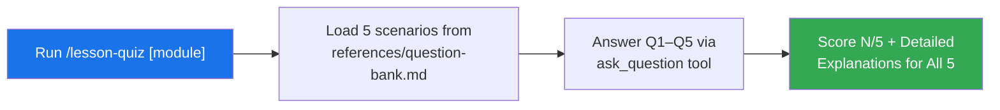

# Module Lesson Quiz (`/lesson-quiz`)

> Interactive 5-question scenario-based quiz for any specific module (`01` through `10`) of the **Google Antigravity & Gemini How-To Guide**.

---

## Highlights

- **50 Scenario-Based Questions**: 5 rich, practical multiple-choice questions for every module (`01`–`10`) stored in `references/question-bank.md`.
- **Native `ask_question` Modal**: Presents one scenario at a time with 4 shuffled options and zero spoilers while you are answering.
- **Full Architectural Explanations**: Explains the reasoning behind all 5 answers at the end of the quiz, with direct links back to the module tutorial and templates.

---

## How It Works



---

## Usage

### In the Google Antigravity IDE App or `agy` CLI

Pass either the module number (`01`–`10`) or the topic name:

```text
/lesson-quiz 01
/lesson-quiz 02
/lesson-quiz 06
/lesson-quiz hooks
/lesson-quiz mcp
/lesson-quiz subagents
/lesson-quiz advanced-features
/lesson-quiz 10
```

You can also run `/lesson-quiz` without arguments to pick a module from an interactive menu, or ask naturally:
- *"Quiz me on Module 06"*
- *"Test my understanding of Antigravity hooks"*
- *"Give me the lesson quiz for MCP"*

---

## Available Module Quizzes

| Command | Module | Key Scenarios Tested |
| :--- | :--- | :--- |
| `/lesson-quiz 01` | **[01 — Slash Commands](../../../01-slash-commands/README.md)** | `/grill-me`, `/goal`, `/btw`, `/learn`, `/boost`, `/teamwork-preview`, custom skill-based `/<name>` commands |
| `/lesson-quiz 02` | **[02 — Memory & Rules](../../../02-memory/README.md)** | `GEMINI.md` vs `AGENTS.md`, `.agents/rules/*.md` (`always_on`, `model_decision`, `glob`, `manual`), `@[label](path)`, 24 KB / 20k-token budget, `.agents/rules.json` |
| `/lesson-quiz 03` | **[03 — Skills](../../../03-skills/README.md)** | `.agents/skills/<name>/SKILL.md`, 3-stage progressive disclosure, `scripts/` & `references/`, `.agents/skills.json` |
| `/lesson-quiz 04` | **[04 — Subagents](../../../04-subagents/README.md)** | `.agents/agents/<name>.md`, `research`/`browser`/`self`, `invoke_subagent` (`Workspace: inherit \| branch \| share`), reactive wakeup via `send_message` |
| `/lesson-quiz 05` | **[05 — MCP](../../../05-mcp/README.md)** | `~/.gemini/config/mcp_config.json`, Stdio vs Streamable HTTP (`url` + `${VAR}` headers), `mcp(server/tool)` permissions, **Fix with Agent** |
| `/lesson-quiz 06` | **[06 — Hooks](../../../06-hooks/README.md)** | `.agents/hooks.json`, `SessionStart`, `PreInvocation`, `PreToolUse`, `PostToolUse`, `PostInvocation`, `Stop`, camelCase JSON (`decision`, `overwrite`, `injectSteps`, `fullyIdle`) |
| `/lesson-quiz 07` | **[07 — Plugins](../../../07-plugins/README.md)** | `plugin.json`, root-level `hooks.json` & `mcp_config.json`, `<plugin>:<skill>` namespacing, `agy plugin install/validate`, `/plugin` |
| `/lesson-quiz 08` | **[08 — Checkpoints, UI & Sidecars](../../../08-checkpoints/README.md)** | `/rewind` (`/undo`), `/fork` (`/branch`), Implementation Plan inline comments, `<agent-embed>` with `tailwindcss.min.js`, `sidecar.json` & `/schedule` (`CRON_TZ`) |
| `/lesson-quiz 09` | **[09 — Advanced Features](../../../09-advanced-features/README.md)** | `/boost` (3-phase DeepCoder/DeepInvestigator), `/teamwork-preview` (Sentinel/Critic/Challenger/Auditor), Gemini 4 Argon & 3.8 Flash, `Deny > Ask > Allow`, Seatbelt/`nsjail`, `agy remote-control` |
| `/lesson-quiz 10` | **[10 — CLI & Python SDK](../../../10-cli/README.md)** | `agy -p`, `--mode auto`, `alt+m`, `Ctrl+J`/`Ctrl+K`, Python SDK `google-antigravity` (`Agent`, `@beta.workflows.define`, `LiteRTAgentConfig`) |
