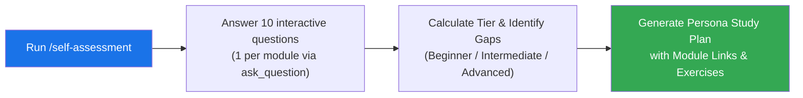

# Self-Assessment & Personalized Learning Roadmap (`/self-assessment`)

> Interactive 10-question assessment that evaluates your Google Antigravity and Gemini proficiency across Modules 01–10 and builds a tailored study plan.

---

## Highlights

- **Native Interactive UI**: Uses Antigravity's `ask_question` modal — one question at a time, 4 choices per question, zero spoilers before you answer.
- **Covers All 10 Core Modules**: Tests real-world knowledge of Slash Commands, Memory & Rules (`GEMINI.md`, `AGENTS.md`), Skills, Subagents, MCP, Hooks, Plugins, Checkpoints & Generative UI, Advanced Orchestration (`/boost`, `/teamwork-preview`), and CLI & Python SDK (`agy`, `google-antigravity`).
- **3 Proficiency Tiers**: Scores your responses into **Beginner (0–3)**, **Intermediate (4–7)**, or **Advanced (8–10)**.
- **Persona-Driven Roadmaps**: Customizes your recommended module sequence whether you are a **Newcomer**, **Everyday Developer**, **Systems Architect**, or **SDK & Platform Engineer**.

---

## How It Works



---

## How to Run

### In the Google Antigravity IDE App

Open the Agent chat panel in this repository workspace and type:

```text
/self-assessment
```

Or ask in natural language:
- *"Test my Antigravity and Gemini level"*
- *"Where should I start in gemini-howto?"*
- *"Run the self-assessment quiz"*

### In the Antigravity CLI (`agy`)

From the root of the `gemini-howto` repository, start an interactive CLI session:

```bash
agy
```

Then invoke the skill at the prompt:

```text
> /self-assessment
```

---

## What Gets Tested

| Module | Topics Covered |
| :--- | :--- |
| **[01 — Slash Commands](../../../01-slash-commands/README.md)** | Built-in commands (`/boost`, `/teamwork-preview`, `/goal`, `/grill-me`, `/learn`, `/btw`) & custom skill-backed `/<name>` commands |
| **[02 — Memory & Rules](../../../02-memory/README.md)** | `GEMINI.md`, `AGENTS.md`, `.agents/rules/*.md` triggers (`always_on`, `model_decision`, `glob`, `manual`), `@[label](path)`, 24 KB / 20,000-token budget, `.agents/rules.json` |
| **[03 — Skills](../../../03-skills/README.md)** | `.agents/skills/<name>/SKILL.md`, 3-stage progressive disclosure, `.agents/skills.json` |
| **[04 — Subagents](../../../04-subagents/README.md)** | `.agents/agents/<name>.md`, built-in `research`/`browser`/`self`, `invoke_subagent` with `Workspace: inherit \| branch \| share`, reactive wakeup via `send_message` |
| **[05 — MCP](../../../05-mcp/README.md)** | `~/.gemini/config/mcp_config.json`, Stdio vs Streamable HTTP (`url` + `${VAR}` headers), `mcp(server/tool)` permissions, **Fix with Agent** |
| **[06 — Hooks](../../../06-hooks/README.md)** | `.agents/hooks.json`, `SessionStart`, `PreToolUse`, `PostToolUse`, `PreInvocation`, `PostInvocation`, `Stop`, camelCase JSON contract (`decision`, `overwrite`, `injectSteps`, `fullyIdle`) |
| **[07 — Plugins](../../../07-plugins/README.md)** | `plugin.json`, root-level `hooks.json` & `mcp_config.json`, `agy plugin install/validate`, `/plugin` |
| **[08 — Checkpoints, UI & Sidecars](../../../08-checkpoints/README.md)** | `/rewind` (`/undo`), `/fork` (`/branch`), Implementation Plan inline comments, Generative UI `<agent-embed>`, `sidecar.json` & `/schedule` (`CRON_TZ`) |
| **[09 — Advanced Features](../../../09-advanced-features/README.md)** | `/boost` (3-phase DeepCoder/DeepInvestigator), `/teamwork-preview` (2-phase with Sentinel/Critic/Challenger/Auditor), Gemini 4 Argon & Gemini 3.8 Flash, `Deny > Ask > Allow`, OS Seatbelt/nsjail sandbox, `agy remote-control` |
| **[10 — CLI & Python SDK](../../../10-cli/README.md)** | `agy -p`, `--mode auto`, `alt+m`, `Ctrl+J`/`Ctrl+K`, Python SDK `google-antigravity` (`Agent`, `@beta.workflows.define`, `LiteRTAgentConfig`) |

---

## Files in This Skill

| File | Purpose |
| :--- | :--- |
| `SKILL.md` | Agent instructions for running the 10-question assessment via `ask_question` |
| `README.md` | User guide for running `/self-assessment` in the Antigravity App or CLI (`agy`) |
| `references/question-bank.md` | 20+ curated multiple-choice questions (2+ per module across Modules 01–10) |
| `references/scoring-and-paths.md` | Tier rubrics and persona-specific learning paths |
