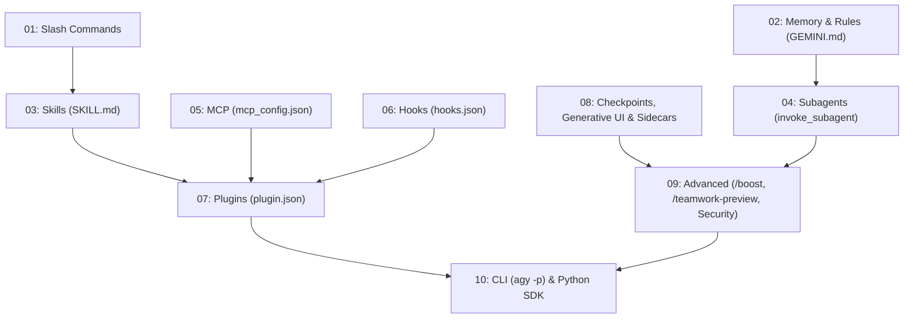

# Self-Assessment Scoring Rubric & Persona Learning Paths

Use this reference after the user completes the 10-question `/self-assessment` quiz to calculate their proficiency tier and assemble a personalized study roadmap.

---

## 1. Scoring Rubric (0–10 Points)

Each question in the 10-question assessment corresponds to one module (`01` through `10`) and is worth **1 point**.

| Score | Proficiency Tier | Profile Description | Recommended Strategy |
| :---: | :--- | :--- | :--- |
| **0 – 3** | 🟢 **Level 1: Beginner** | New to Google Antigravity & Gemini or transitioning from another AI coding tool. | Start with the core mental model (`GEMINI.md`, built-in slash commands, and checkpoints) before adding automation. |
| **4 – 7** | 🔵 **Level 2: Intermediate** | Productive in daily coding sessions; ready to automate repetitive workflows and connect external tools. | Focus on missed modules in the middle tier (`03-skills`, `04-subagents`, `05-mcp`, `06-hooks`, `07-plugins`). |
| **8 – 10** | 🔴 **Level 3: Advanced** | Strong command of Antigravity's customization architecture. | Dive straight into multi-agent orchestration (`/boost`, `/teamwork-preview`), OS sandboxing, headless CI/CD (`agy -p`), and the `google-antigravity` Python SDK. |

---

## 2. Dependency Order of Modules

When ordering missed modules in the user's personalized study plan, respect these conceptual dependencies:

---

## 3. Recommended Module Order by Persona

Tailor the sequence of modules based on the user's role or goal, skipping modules where they already scored `1/1` (or listing them as quick 5-minute skims).

### Persona A: 🌱 Newcomer (Fast Daily Productivity)
*Goal: Get productive in the Antigravity IDE and `agy` CLI within 90 minutes without getting overwhelmed by configuration files.*

1. **[01 — Slash Commands](../../../01-slash-commands/README.md)** *(25 min)* — Master `/grill-me`, `/goal`, `/btw`, `/learn`, and `/compact`.
2. **[02 — Memory & Rules](../../../02-memory/README.md)** *(30 min)* — Set up `GEMINI.md`, `AGENTS.md`, and `.agents/rules/*.md` while staying within the 24 KB / 20k-token budget.
3. **[08 — Checkpoints, Generative UI & Sidecars](../../../08-checkpoints/README.md)** *(25 min)* — Experiment safely with `/rewind` (`/undo`), `/fork` (`/branch`), and inline comments on Implementation Plans.
4. **[03 — Skills](../../../03-skills/README.md)** *(30 min)* — Install or author your first `.agents/skills/<name>/SKILL.md` workflow.

---

### Persona B: 🛠️ Everyday Developer (Workflow Automation & Delegation)
*Goal: Eliminate repetitive prompting, enforce code quality automatically, and delegate parallel research/coding tasks.*

1. **[02 — Memory & Rules](../../../02-memory/README.md)** *(25 min)* — Configure `always_on`, `model_decision`, `glob`, and `manual` rule triggers plus `@[label](path)` imports.
2. **[03 — Skills](../../../03-skills/README.md)** *(35 min)* — Build 3-stage progressive disclosure skills with `scripts/` and `references/` managed by `.agents/skills.json`.
3. **[04 — Subagents](../../../04-subagents/README.md)** *(40 min)* — Spawn parallel subagents (`research`, `browser`, `self`, and custom `.agents/agents/*.md`) using `Workspace: "share"` or `"branch"` and reactive `send_message` wakeup.
4. **[05 — MCP](../../../05-mcp/README.md)** *(30 min)* — Connect GitHub, Postgres, and internal APIs via `mcp_config.json` (Stdio & Streamable HTTP) and `mcp(server/tool)` permissions.
5. **[06 — Hooks](../../../06-hooks/README.md)** *(35 min)* — Add `PreToolUse`, `PostToolUse`, and `Stop` hooks in `.agents/hooks.json` for automated linting, secret scanning, and verification.

---

### Persona C: 🏗️ Systems Architect & Tech Lead (Team Standards & Multi-Agent Orchestration)
*Goal: Standardize engineering workflows across a team repository, enforce security boundaries, and orchestrate complex multi-agent initiatives.*

1. **[06 — Hooks](../../../06-hooks/README.md)** *(35 min)* — Enforce deterministic guardrails (`decision: "block"`, `overwrite`, `injectSteps` on `Stop` when `fullyIdle: true`).
2. **[07 — Plugins](../../../07-plugins/README.md)** *(40 min)* — Package team rules, skills, subagents, `hooks.json`, and `mcp_config.json` into versioned plugins with `plugin.json` and `agy plugin validate`.
3. **[09 — Advanced Features](../../../09-advanced-features/README.md)** *(45 min)* — Orchestrate complex architecture tasks with `/boost` (3-phase DeepCoder/DeepInvestigator) and `/teamwork-preview` (Sentinel, Critic, Challenger, Auditor), and harden `Deny > Ask > Allow` permissions with Seatbelt/`nsjail` sandboxing.
4. **[08 — Checkpoints, Generative UI & Sidecars](../../../08-checkpoints/README.md)** *(30 min)* — Build rich `<agent-embed>` architectural dashboards, interactive `sidecar.json` viewers, and `/schedule` (`CRON_TZ`) standing jobs.

---

### Persona D: ⚙️ SDK & Platform Engineer (CI/CD Pipelines & Programmatic Agents)
*Goal: Embed Antigravity and Gemini into automated CI/CD pipelines, developer platforms, and custom Python services.*

1. **[10 — CLI & Python SDK](../../../10-cli/README.md)** *(45 min)* — Master headless `agy -p` with `--mode auto` and JSON output, plus the `google-antigravity` Python SDK (`Agent`, `@beta.workflows.define`, `LiteRTAgentConfig`).
2. **[06 — Hooks](../../../06-hooks/README.md)** *(30 min)* — Wire telemetry, audit logging, and policy enforcement across all 6 lifecycle events (`SessionStart` through `Stop`).
3. **[05 — MCP](../../../05-mcp/README.md)** *(30 min)* — Integrate internal platform services over Streamable HTTP with `${VAR}` header authentication and `mcp(server/tool)` policies.
4. **[07 — Plugins](../../../07-plugins/README.md)** *(30 min)* — Distribute organization-wide plugins via `agy plugin install` and validate them in CI with `agy plugin validate`.
5. **[09 — Advanced Features](../../../09-advanced-features/README.md)** *(30 min)* — Configure OS-level sandboxing (macOS Seatbelt / Linux `nsjail`), model routing (Gemini 4 Argon vs. Gemini 3.8 Flash), and `agy remote-control`.

---

## 4. Per-Module Actionable Exercise Table

Include the relevant row from this table for every module the user missed (`0/1`):

| Module | Link | Key Focus | Hands-On Verification Exercise |
| :--- | :--- | :--- | :--- |
| **01** | `[01-slash-commands](../../../01-slash-commands/README.md)` | `/grill-me`, `/goal`, `/btw`, `/learn`, skill-backed `/<name>` | Run `/grill-me` on a small feature idea, then use `/learn` to capture a convention |
| **02** | `[02-memory](../../../02-memory/README.md)` | `GEMINI.md`, `AGENTS.md`, `.agents/rules/*.md` triggers, 20k-token budget | Create a `trigger: model_decision` rule in `.agents/rules/` and link a doc with `@[label](path)` |
| **03** | `[03-skills](../../../03-skills/README.md)` | `.agents/skills/<name>/SKILL.md`, 3-stage disclosure, `.agents/skills.json` | Create a custom skill with a `references/` file and verify Stage 1 → Stage 3 loading |
| **04** | `[04-subagents](../../../04-subagents/README.md)` | `.agents/agents/<name>.md`, `Workspace: share \| branch`, `send_message` | Spawn two subagents in `Workspace: "share"` to compare two implementations in parallel |
| **05** | `[05-mcp](../../../05-mcp/README.md)` | `mcp_config.json`, Stdio vs Streamable HTTP, `mcp(server/tool)`, **Fix with Agent** | Configure a Streamable HTTP or Stdio MCP server with `${VAR}` env expansion |
| **06** | `[06-hooks](../../../06-hooks/README.md)` | `.agents/hooks.json`, 6 events, `decision`, `overwrite`, `injectSteps`, `fullyIdle` | Add a `PreToolUse` hook that blocks `rm -rf` and a `Stop` hook that checks `fullyIdle` |
| **07** | `[07-plugins](../../../07-plugins/README.md)` | `plugin.json`, root `hooks.json` & `mcp_config.json`, `agy plugin validate` | Bundle a skill and hook into a plugin and run `agy plugin validate` |
| **08** | `[08-checkpoints](../../../08-checkpoints/README.md)` | `/rewind`, `/fork`, Plan comments, `<agent-embed>`, `sidecar.json`, `/schedule` | Render an `<agent-embed>` widget with `tailwindcss.min.js` and test `/fork` vs `/rewind` |
| **09** | `[09-advanced-features](../../../09-advanced-features/README.md)` | `/boost`, `/teamwork-preview`, Gemini 4 Argon / 3.8 Flash, `Deny > Ask > Allow` | Run `/boost` or `/teamwork-preview` on a multi-file refactor and audit permission rules |
| **10** | `[10-cli](../../../10-cli/README.md)` | `agy -p`, `--mode auto`, `alt+m`, `Ctrl+J`/`Ctrl+K`, `google-antigravity` SDK | Pipe `git diff` into `agy -p --mode auto` and write an `@beta.workflows.define` Python workflow |
