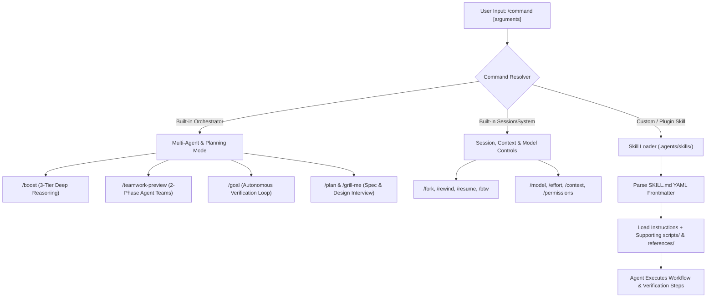
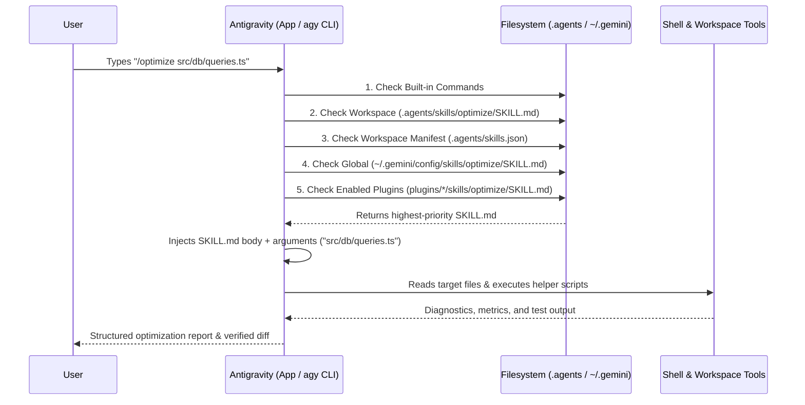
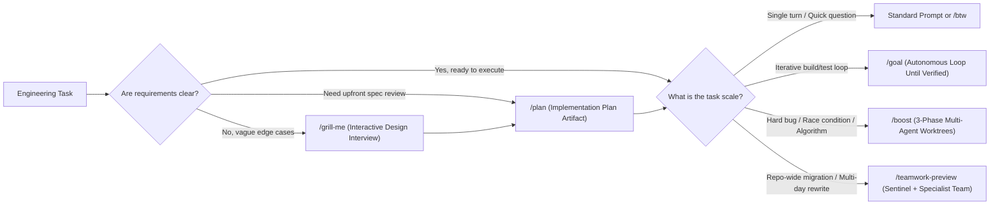
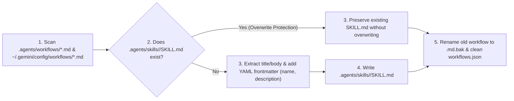

# Module 01: Slash Commands (`/` & Custom Skill Commands)

> **Antigravity App v2.24.0 & CLI (`agy`) v1.4.0** · **Models**: Gemini 4 Argon, Gemini 3.8 Flash, Gemini 3.1 Pro

Slash commands are instantaneous shortcuts that control Google Antigravity's reasoning modes, planning workflows, session branching, and custom automations across both the **Antigravity App** (Desktop & Web) and the **Antigravity CLI** (`agy`).

In modern Antigravity, **every Skill is a Slash Command**. Placing a skill at `.agents/skills/<name>/SKILL.md` (workspace) or `~/.gemini/config/skills/<name>/SKILL.md` (global) automatically registers `/<name>` in the interactive slash command menu **and** enables the agent to auto-discover and activate it semantically when relevant to your task.

---

## Table of Contents

1. [Command Taxonomy & Architecture](#1-command-taxonomy--architecture)
2. [Built-in Slash Commands Reference](#2-built-in-slash-commands-reference)
   - [Multi-Agent & Autonomous Reasoning](#21-multi-agent--autonomous-reasoning)
   - [Learning, Customizations & Tools](#22-learning-customizations--tools)
   - [Session Management, Diffs & Branching](#23-session-management-diffs--branching)
   - [Model, Effort, Permissions & System Config](#24-model-effort-permissions--system-config)
3. [Deep Dive: Flagship Reasoning & Planning Commands](#3-deep-dive-flagship-reasoning--planning-commands)
4. [How Custom Slash Commands Work (Skills = Commands)](#4-how-custom-slash-commands-work-skills--commands)
5. [Step-by-Step: Creating Custom Slash Commands](#5-step-by-step-creating-custom-slash-commands)
6. [Migrating Legacy `.agents/workflows/` to Skills](#6-migrating-legacy-agentsworkflows-to-skills)
7. [Chaining & Composing Commands](#7-chaining--composing-commands)
8. [Ready-to-Use Command Templates in This Module](#8-ready-to-use-command-templates-in-this-module)
9. [Best Practices & Anti-Patterns](#9-best-practices--anti-patterns)

---

## 1. Command Taxonomy & Architecture

Antigravity organizes slash commands into four execution layers: built-in system controls, multi-agent reasoning orchestrators, custom workspace/global skills, and plugin-bundled commands.



### How `/<skill-name>` Resolves and Executes

When you type `/<name>` in the prompt box or terminal, Antigravity resolves the command across your active customization scopes in strict priority order:



---

## 2. Built-in Slash Commands Reference

Type `/` in the **Antigravity App** chat input or the **`agy` CLI** prompt to open the interactive command autocomplete menu. Type any characters after `/` to fuzzy-filter commands.

### 2.1 Multi-Agent & Autonomous Reasoning

| Command | Arguments | Surface | Description |
| :--- | :--- | :--- | :--- |
| `/boost` | `<task>` | App & CLI | **3-phase multi-agent deep reasoning**. Activates `Orchestrator` → `DeepCoder` / `DeepInvestigator` → isolated git worktree workers to explore competing hypotheses, benchmark solutions, and independently verify fixes before merging back. |
| `/teamwork-preview` | `<task>` | App & CLI | **2-phase collaborative multi-agent teams**. Phase 1 runs an interactive scoping interview led by the **Sentinel** to draft a binding specification plan; Phase 2 dispatches parallel specialist agents with adversarial verification gates. |
| `/goal` | `<objective>` | App & CLI | **Autonomous completion loop**. Registers a session-level objective and works continuously across turns—running builds, fixing test failures, and auditing deliverables—until the objective is verified complete without intermediate confirmation pauses. |
| `/plan` | `[task]` | App & CLI | **Structured planning mode**. Explores the codebase, interviews you on ambiguous requirements, and generates a reviewable `Implementation Plan` artifact with a **Proceed** button before modifying any code. |
| `/grill-me` | `[topic]` | App & CLI | **Interactive design interview**. Prompts the agent to systematically question you about architecture, edge cases, failure modes, performance targets, and backward compatibility before writing code. |

### 2.2 Learning, Customizations & Tools

| Command | Arguments | Aliases | Description |
| :--- | :--- | :--- | :--- |
| `/learn` | `[instruction]` | — | **Session memory distillation**. Analyzes session corrections, debugging findings, and user feedback to draft a reviewable `learning_proposal.md` artifact that persists new rules (`GEMINI.md`, `AGENTS.md`, `.agents/rules/*.md`) or reusable skills (`.agents/skills/<name>/SKILL.md`). |
| `/skills` | `[filter]` | — | Browse, inspect, enable, or disable discovered workspace, global, and plugin skills. |
| `/agents` | — | — | Open the subagents manager to inspect active subagents, view live states/transcripts, or manage custom subagent definitions in `.agents/agents/`. |
| `/hooks` | — | — | Inspect registered lifecycle hooks (`hooks.json`) and test pre/post-tool execution triggers. |
| `/mcp` | `[server]` | — | Manage Model Context Protocol (MCP) server connections (`mcp_config.json`), inspect exposed tools, and refresh OAuth tokens. |
| `/plugin` | `[subcommand]` | `/plugins` | Open the interactive **Plugins Manager** (`Installed` and `Discover` tabs) or run inline commands (`/plugin install <name>@antigravity-plugins-official`, `/plugin list`). |
| `/schedule` | `<when> <task>` | — | Create a one-shot countdown timer or a recurring 5-field cron automation (e.g., `/schedule "0 9 * * 1-5" Summarize open PRs`). |
| `/browser` | `<task>` | — | Delegate live web research, DOM inspection, visual screenshot capture, and UI verification to a sandboxed Chrome browser subagent. |

### 2.3 Session Management, Diffs & Branching

| Command | Arguments | Aliases | Description |
| :--- | :--- | :--- | :--- |
| `/btw` | `<query>` | — | **Ephemeral side question**. Opens an out-of-band background popup to answer a quick question without interrupting active agent work or polluting the main conversation context. |
| `/compact` | `[focus]` | — | Summarize and compress the conversation history to free up context window tokens while preserving key architectural decisions and state. |
| `/diff` | — | — | Open the interactive diff viewer to inspect uncommitted workspace changes and per-turn file modifications. |
| `/rewind` | `[step]` | `/undo` | Revert both the conversation history and workspace file state back to an earlier turn checkpoint. |
| `/fork` | `[name]` | `/branch` | Clone the current conversation state at this exact point into an independent session branch so you can explore an alternative implementation safely. |
| `/resume` | `[session-id]` | `/switch`, `/conversation` | Open the interactive session picker to switch to or resume a previous conversation thread. |
| `/clear` | — | `/new` | Clear the active conversation and start a fresh session with a clean context window. |
| `/rename` | `<name>` | — | Assign a human-readable title to the current conversation session. |
| `/copy` | `[n \| btw]` | — | Copy the latest assistant response, the `n`-th response, or the last `/btw` answer (`btw`) to the system clipboard. |
| `/context` | — | — | Visualize context window token usage broken down across `always_on` rules, skill catalogs, MCP schemas, read files, and conversation history. |

### 2.4 Model, Effort, Permissions & System Config

| Command | Arguments | Aliases | Description |
| :--- | :--- | :--- | :--- |
| `/model` | `[model-name]` | — | Switch the active foundation model across **Gemini 4 Argon** (deep reasoning flagship), **Gemini 3.8 Flash** (high-speed interactive agentic coding), and **Gemini 3.1 Pro** (balanced long-context engineering). |
| `/effort` | `[low\|medium\|high\|max]` | — | Set the model's thinking and reasoning depth budget (`low`, `medium`, `high`, or `max`). |
| `/fast` | `[on\|off]` | — | Toggle high-speed execution mode for rapid iterative edits and low-latency responses. |
| `/permissions` | — | — | View and configure `Allow`, `Ask`, and `Deny` execution policies for shell commands, file writes, and MCP tools. |
| `/config` | — | `/settings` | Open the interactive Antigravity configuration editor (`settings.json`). |
| `/statusline` | — | — | Configure the CLI status line display (active model, effort level, token usage, git branch, active `/goal`). |
| `/tasks` | — | — | List and manage running background shell tasks, daemon processes, and active cron schedules. |
| `/remote-control` | `[on\|off]` | — | Enable or disable remote session control between the Antigravity CLI and Antigravity Web/Desktop. |
| `/keybindings` | — | — | View and customize keyboard shortcuts (e.g., `Alt+J` thread switching, `Ctrl+O` trajectory viewer). |
| `/changelog` | — | — | Display release notes for Antigravity App v2.24.0 and `agy` CLI v1.4.0. |
| `/usage` | — | — | Inspect session and billing period token consumption, rate limits, and model breakdown. |
| `/credits` | — | — | View available plan credits and quota balance. |
| `/add-dir` | `<path>` | — | Mount an additional workspace directory into the current session and discover its rules and skills. |
| `/open` | `<path>` | — | Open a workspace file or artifact directly in the IDE editor or system viewer. |
| `/exit` | — | `/quit` | Gracefully terminate the interactive `agy` CLI session. |
| `/logout` | — | — | Sign out of your Google Antigravity account. |
| `/help` | `[command]` | — | Show interactive help and command usage examples. |
| `/feedback` | `[message]` | — | Submit bug reports or product feedback with optional session diagnostics. |

---

## 3. Deep Dive: Flagship Reasoning & Planning Commands

Choosing the right workflow command dramatically improves first-pass success rates on complex engineering tasks:



### `/boost <task>` — 3-Phase Multi-Agent Deep Reasoning
When tackling race conditions, subtle state corruption, or performance-critical algorithms, `/boost` spawns a 3-phase architecture:
1. **Phase 1 (Hypothesis & Decomposition)**: The `Orchestrator` analyzes the problem and formulates multiple competing root-cause hypotheses or algorithmic approaches.
2. **Phase 2 (Isolated Worktree Exploration)**: Multiple `DeepCoder` and `DeepInvestigator` subagents spin up in **isolated git worktrees** to test hypotheses, run reproducers, and benchmark candidate implementations in parallel without dirtying your working tree.
3. **Phase 3 (Adversarial Verification & Synthesis)**: Candidate solutions are stress-tested against edge cases; only the verified winner is applied to your workspace.

```text
/boost Fix the intermittent deadlock in WorkQueue.drain() under high concurrency and prove it passes 1,000 stress iterations.
```

### `/teamwork-preview <task>` — 2-Phase Collaborative Multi-Agent Teams
Designed for repository-scale migrations and multi-component features:
1. **Phase 1 (Scoping Interview & Spec)**: The **Sentinel** agent inspects your repository and conducts a brief scoping interview with you to lock down architectural invariants, API contracts, and acceptance criteria into a binding specification.
2. **Phase 2 (Collaborative Execution & Adversarial Gates)**: Specialist implementation agents execute work packages in parallel while an independent verification agent enforces adversarial quality gates before any milestone is marked complete.

```text
/teamwork-preview Migrate all 24 REST controllers in services/billing to gRPC with full integration test parity.
```

### `/goal <objective>` — Autonomous Verification Loop
Normally, an agent stops after completing a turn or when asking for confirmation. `/goal` registers a completion contract: every time the agent would finish its turn, Antigravity evaluates whether the objective is 100% satisfied and verified by tests/builds. If anything is incomplete or failing, the agent automatically continues iterating.

```text
/goal Upgrade TypeScript to 5.8 across all monorepo packages and fix every type error until `pnpm build && pnpm test` exits 0.
```

---

## 4. How Custom Slash Commands Work (Skills = Commands)

> [!IMPORTANT]
> **Legacy `.agents/workflows/*.md` files are deprecated.** In Antigravity App v2.24.0 and `agy` CLI v1.4.0, custom slash commands and Agent Skills are unified into a single system under `.agents/skills/<name>/SKILL.md`.

Why did Antigravity unify workflows and skills?

| Capability | Legacy Workflows (`.agents/workflows/<name>.md`) | Modern Skills (`.agents/skills/<name>/SKILL.md`) |
| :--- | :--- | :--- |
| **Slash Command (`/name`)** | Yes | **Yes** — automatically registered in `/` menu |
| **Semantic Auto-Discovery** | No (manual invocation only) | **Yes** — agent auto-activates when user prompt matches `description` |
| **Progressive Disclosure** | Loaded only on `/name` | **3-stage loading** (`name`+`description` catalog → `SKILL.md` → supporting files) |
| **Bundled Scripts & Assets** | Single Markdown file only | Full directory bundle (`scripts/`, `references/`, `resources/`, `examples/`) |
| **Cross-Agent Standard** | Proprietary | Follows the open [Agent Skills specification](https://agentskills.io) |

---

## 5. Step-by-Step: Creating Custom Slash Commands

### Step 1: Choose the Scope

- **Workspace Command (Team-shared via Git)**: `.agents/skills/<command-name>/SKILL.md`
- **Global Command (Personal across all projects)**: `~/.gemini/config/skills/<command-name>/SKILL.md`

### Step 2: Create the Skill Directory and `SKILL.md`

Let's create a `/db-check` command that validates database schema drift and migration safety:

```bash
mkdir -p .agents/skills/db-check
```

Create `.agents/skills/db-check/SKILL.md`:

```markdown
---
name: db-check
description: >-
  Validate SQL migrations for backward compatibility, lock contention, and schema drift.
  Use when the user runs /db-check, creates or modifies database migration files, or asks
  to verify schema changes before deployment.
---

# Database Migration Safety Check (`/db-check`)

When invoked via `/db-check [target-migration]` or during migration reviews, execute this workflow:

## Step 1: Identify Target Migrations
1. If the user passed a specific file or directory argument after `/db-check`, inspect that target.
2. Otherwise, run `git status --short` and `git diff --name-only origin/main...HEAD` to locate all modified files under `migrations/` or `prisma/migrations/`.

## Step 2: Audit Against Zero-Downtime Rules
Check every DDL statement against these invariants:
- **No blocking index creation**: PostgreSQL indexes on existing tables MUST use `CREATE INDEX CONCURRENTLY`.
- **Expand-and-contract**: Never drop or rename a column in a single migration while application code still references it.
- **Not-null constraints**: Adding a `NOT NULL` column to an existing table requires either a safe default or a 3-step backfill pattern (`ADD COLUMN NULL` -> backfill -> `VALIDATE CONSTRAINT`).
- **Reversibility**: Verify a corresponding `down` migration or rollback procedure exists.

## Step 3: Verification & Output Report
1. Run `npm run db:validate` (or the project's schema check command) to confirm syntax validity.
2. Output a structured Markdown report grading each migration (`PASS`, `WARN`, `FAIL`) with exact line numbers and drop-in SQL fixes.
```

### Step 3: Invoke Your Command

You can now trigger the skill in two ways:
1. **Explicit Slash Command**: Type `/db-check migrations/20261021_add_users_idx.sql` in the Antigravity App or `agy` CLI.
2. **Natural Language Auto-Activation**: Ask *"Can you check if my new SQL migration is safe to deploy?"* — Antigravity matches the `description` field and loads `.agents/skills/db-check/SKILL.md` automatically.

---

## 6. Migrating Legacy `.agents/workflows/` to Skills

If your repository or `~/.gemini/config/` contains legacy workflow files:
- `<workspace>/.agents/workflows/*.md` (or `.agent/workflows/*.md`, `_agents/workflows/*.md`)
- `~/.gemini/config/workflows/*.md` or `~/.gemini/config/global_workflows/*.md`
- `workflows.json` manifests

You can migrate all of them automatically using Antigravity's built-in **`migrate-workflows`** skill!

### Automatic Migration

Simply run in Antigravity chat:

```text
Migrate my legacy workflows to skills using the migrate-workflows skill.
```

### What `migrate-workflows` Does Under the Hood



### Manual Migration One-Liner (Shell)

If you want to convert a single legacy workflow manually:

```bash
mkdir -p .agents/skills/my-workflow
mv .agents/workflows/my-workflow.md .agents/skills/my-workflow/SKILL.md
# Ensure the top of .agents/skills/my-workflow/SKILL.md has `name` and `description` YAML frontmatter!
```

---

## 7. Chaining & Composing Commands

In Antigravity, you can combine built-in reasoning modes with your custom skill commands to build high-leverage engineering pipelines:

### Pattern 1: Interview → Plan → Autonomous Goal
1. **Align on edge cases**:
   ```text
   /grill-me We need to add idempotency keys to POST /v1/payments using Redis.
   ```
2. **Generate a reviewable specification artifact**:
   ```text
   /plan Implement Redis-backed idempotency middleware for POST /v1/payments based on our design decisions.
   ```
3. **Execute autonomously until all tests pass**:
   ```text
   /goal Execute the approved implementation plan and run /unit-test-expand on the new middleware until coverage exceeds 90%.
   ```

### Pattern 2: Optimization → Commit → PR Pipeline
Reference multiple custom skill commands in sequence within a single prompt or across turns:

```text
Run /optimize on src/services/checkout.ts, apply the high-priority fixes, verify tests pass, and then run /commit and /pr to prepare the pull request description.
```

### Pattern 3: Fixing a Convention Forever with `/learn`
Whenever you have to correct the agent during a task (for example, *"Don't use `axios` in this repo; use our internal `httpClient` wrapper in `src/lib/http.ts`"*), immediately run:

```text
/learn Always use src/lib/http.ts instead of axios or raw fetch for outbound HTTP calls.
```

Antigravity generates a `learning_proposal.md` artifact showing the exact diff to `AGENTS.md` or `.agents/rules/`, ensuring you never have to repeat that correction again.

---

## 8. Ready-to-Use Command Templates in This Module

This directory includes **8 production-ready skill-command templates**. Each `.md` file is formatted as a complete `SKILL.md` with YAML frontmatter, trigger descriptions, step-by-step agent instructions, and verification gates.

| Command | Template File | Description |
| :--- | :--- | :--- |
| **`/optimize`** | [`optimize.md`](./optimize.md) | Deep performance, algorithmic complexity, N+1 query, memory leak, and bundle size optimization workflow. |
| **`/pr`** | [`pr.md`](./pr.md) | Pre-PR quality checks, diff analysis, breaking-change detection, and structured Pull Request description generator. |
| **`/commit`** | [`commit.md`](./commit.md) | Pre-commit secret/artifact audit, logical atomic staging, and Conventional Commits message generation. |
| **`/push-all`** | [`push-all.md`](./push-all.md) | End-to-end quality gate (lint, typecheck, test), secret scan, commit, push, and remote CI status verification. |
| **`/generate-api-docs`** | [`generate-api-docs.md`](./generate-api-docs.md) | Extracts route handlers and schemas from source code to generate OpenAPI 3.1 specs and Markdown endpoint docs. |
| **`/doc-refactor`** | [`doc-refactor.md`](./doc-refactor.md) | Audits documentation for drift, fixes broken links, reorganizes structure, and adds Mermaid architecture diagrams. |
| **`/setup-ci-cd`** | [`setup-ci-cd.md`](./setup-ci-cd.md) | Scaffolds GitHub Actions or Google Cloud Build pipelines with dependency caching, matrix testing, and security scans. |
| **`/unit-test-expand`** | [`unit-test-expand.md`](./unit-test-expand.md) | Analyzes branch coverage gaps and writes deterministic unit tests for edge cases, boundary conditions, and error paths. |

### Installing These Templates into Your Workspace

Run the following loop to install all 8 templates as workspace skill-commands under `.agents/skills/`:

```bash
for cmd in optimize pr commit push-all generate-api-docs doc-refactor setup-ci-cd unit-test-expand; do
  mkdir -p ".agents/skills/${cmd}"
  cp "01-slash-commands/${cmd}.md" ".agents/skills/${cmd}/SKILL.md"
done
```

Or install them globally for all your projects under `~/.gemini/config/skills/`:

```bash
for cmd in optimize pr commit push-all generate-api-docs doc-refactor setup-ci-cd unit-test-expand; do
  mkdir -p "$HOME/.gemini/config/skills/${cmd}"
  cp "01-slash-commands/${cmd}.md" "$HOME/.gemini/config/skills/${cmd}/SKILL.md"
done
```

---

## 9. Best Practices & Anti-Patterns

> [!TIP]
> **Write specific third-person `description` fields.** Because every custom slash command is also a Skill, the agent uses the `description` in YAML frontmatter to decide when to auto-activate it. Include both **what** the command does and **when** to trigger it.

| Do (Best Practices) | Don't (Anti-Patterns) |
| :--- | :--- |
| Place custom commands in `.agents/skills/<name>/SKILL.md` so they work both via `/<name>` and semantic auto-discovery. | Create new files in the deprecated `.agents/workflows/` directory. |
| Include explicit **Verification Steps** at the end of every command so the agent proves its changes work before finishing. | Write vague instructions like *"make the code faster"* without specifying metrics or verification commands. |
| Use `/btw` for quick tangential questions while a long build or multi-step task is running. | Interrupt a deep `/boost` or `/goal` run with unrelated questions in the main thread. |
| Use `/plan` or `/grill-me` before starting multi-file refactors or ambiguous feature work. | Jump straight into code edits when architectural trade-offs haven't been decided. |
| Run `/context` periodically to inspect token usage across rules, skills, and conversation history. | Let a single conversation grow to hundreds of unrelated turns without running `/compact` or `/clear`. |

---

| Previous Module | Home | Next Module |
| :--- | :---: | ---: |
| [🏠 Repository Root](../README.md) | [Table of Contents](../README.md) | [Module 02: Rules & Persistent Memory →](../02-memory/README.md) |
