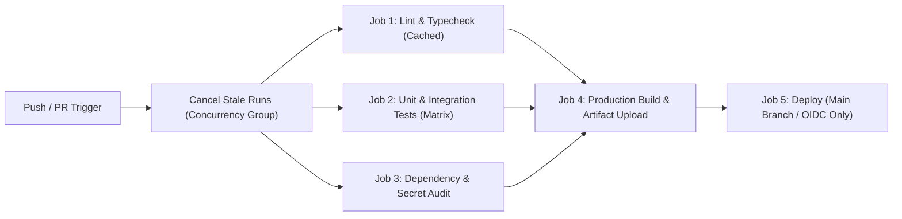

# CI/CD Pipeline Scaffolder (`/setup-ci-cd`)

Use this skill when invoked via `/setup-ci-cd [github-actions|cloud-build]` or when the user asks to set up or modernize automated build, test, security scan, and deployment pipelines.

## Usage Examples

```text
/setup-ci-cd
/setup-ci-cd github-actions --deploy=cloud-run
/setup-ci-cd cloud-build
```

---

## Step-by-Step Agent Instructions

### Step 1: Detect Stack, Package Manager & Monorepo Layout
Inspect the repository root before writing any YAML:
1. **Language & Runtime Version**: Check `.nvmrc`, `.node-version`, `package.json` (`engines`), `.python-version`, `pyproject.toml`, `go.mod`, `rust-toolchain.toml`, or `Dockerfile`.
2. **Package Manager & Lockfile**: Identify exact lockfile (`pnpm-lock.yaml`, `package-lock.json`, `yarn.lock`, `uv.lock`, `poetry.lock`, `Cargo.lock`, `go.sum`) so caching is configured accurately.
3. **Scripts & Commands**: Verify the exact commands for `lint`, `typecheck`, `test`, and `build` so the pipeline never calls non-existent scripts.

### Step 2: Pipeline Architecture & Best Practices



Enforce these production CI/CD invariants in every generated workflow:
1. **Least-Privilege Permissions**: Explicitly declare top-level `permissions: contents: read` in GitHub Actions and elevate permissions only on specific jobs that require `id-token: write` (OIDC) or `pull-requests: write`.
2. **Concurrency Cancellation**: Configure `concurrency` groups (`${{ github.workflow }}-${{ github.ref }}`) with `cancel-in-progress: true` on pull requests to save CI minutes.
3. **Deterministic Dependency Caching**: Use built-in cache keys tied to the lockfile hash (`cache: 'pnpm'` / `cache: 'npm'` / `setup-uv` cache / `actions/cache`) and always install with frozen lockfiles (`pnpm install --frozen-lockfile`, `npm ci`, `uv sync --frozen`).
4. **Job Timeouts**: Set explicit `timeout-minutes: 15` on every job to prevent hung processes from burning runner quota.
5. **Keyless OIDC Authentication**: For cloud deployments (Google Cloud Run, GKE, Firebase, AWS), use Workload Identity Federation (`google-github-actions/auth@v2`) instead of long-lived static service account JSON keys.

### Step 3: Generate Workflow Configuration
- **For GitHub Actions**: Create `.github/workflows/ci.yml` (and `.github/workflows/deploy.yml` if deployment is requested).
- **For Google Cloud Build**: Create `cloudbuild.yaml` using cached Kaniko/Docker layers or parallel `waitFor` build steps.

### Step 4: Verification
1. Validate YAML syntax (e.g., `python3 -c "import yaml, sys; yaml.safe_load(open(sys.argv[1]))" .github/workflows/ci.yml` or `actionlint` if installed).
2. Run each local command referenced in the CI steps (`lint`, `typecheck`, `test`, `build`) to verify they pass on the current codebase.

---

| Previous Module | Module Home | Next Module |
| :--- | :---: | ---: |
| [🏠 Repository Root](../README.md) | [Module 01: Slash Commands](./README.md) | [Module 02: Rules & Persistent Memory →](../02-memory/README.md) |
