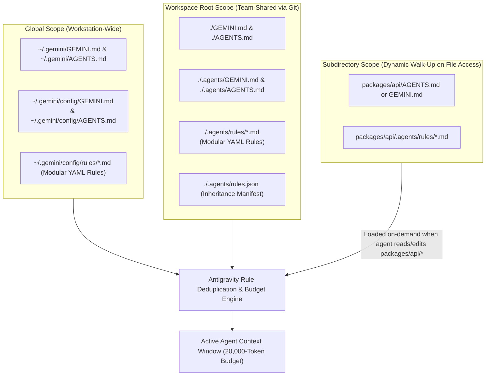
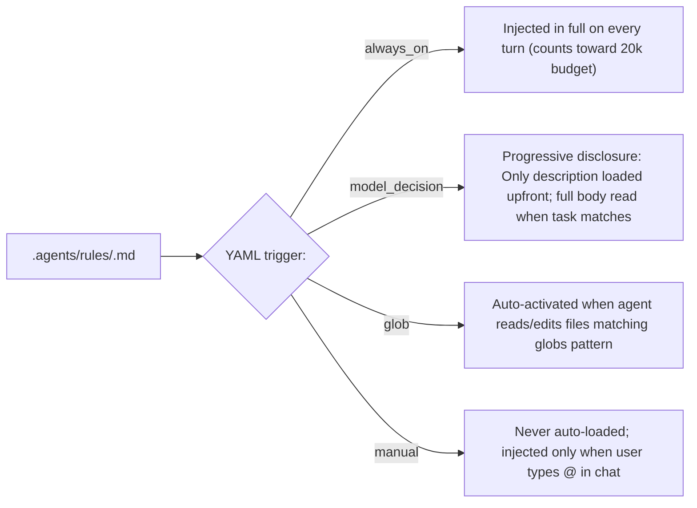
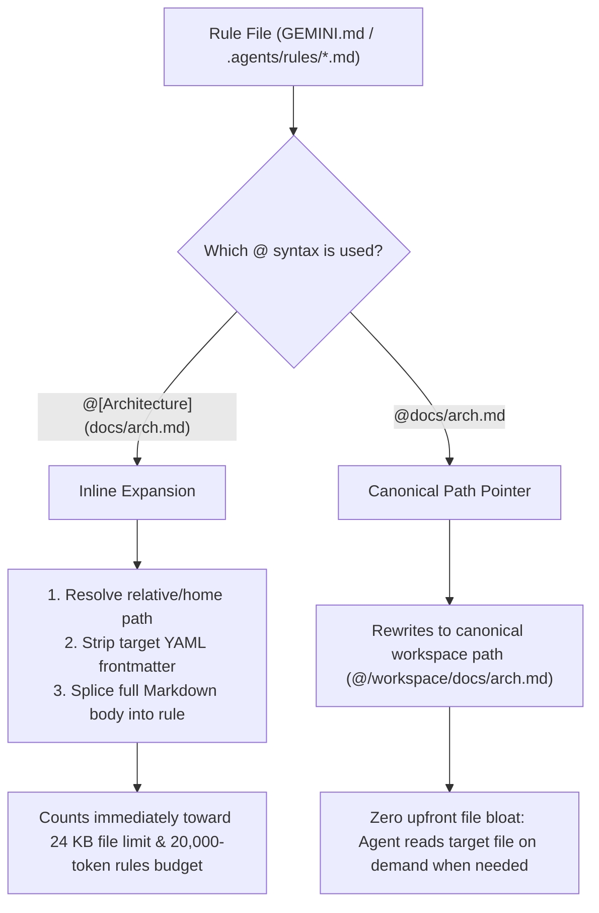
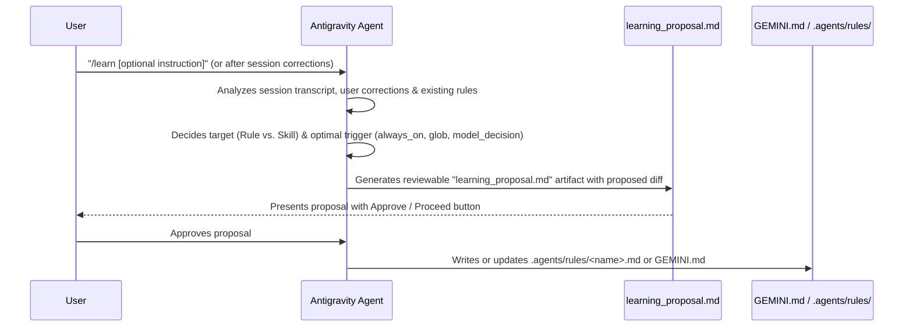

# Module 02: Rules & Persistent Memory (`GEMINI.md`, `AGENTS.md`, `.agents/rules/`)

> **Antigravity App v2.24.0 & CLI (`agy`) v1.4.0** · **Models**: Gemini 4 Argon, Gemini 3.8 Flash, Gemini 3.1 Pro

Rules are persistent instructions, coding standards, and architectural constraints that shape how Google Antigravity behaves across sessions. Instead of repeating project conventions in every chat prompt, Antigravity automatically discovers rules from your filesystem, evaluates their activation triggers, and injects them into the agent's context window.

---

## Table of Contents

1. [Architecture: How Persistent Memory & Rules Work](#1-architecture-how-persistent-memory--rules-work)
2. [Standalone Instruction Files (`GEMINI.md` & `AGENTS.md`)](#2-standalone-instruction-files-geminimd--agentsmd)
3. [Modular Scoped Rules (`.agents/rules/*.md`)](#3-modular-scoped-rules-agentsrulesmd)
   - [The Four Activation Modes (`trigger`)](#31-the-four-activation-modes-trigger)
   - [Frontmatter Schema & Pitfalls](#32-frontmatter-schema--pitfalls)
4. [File Inclusions: `@[label](path)` vs. `@path`](#4-file-inclusions-labelpath-vs-path)
5. [Context Budgets, Size Limits & Graceful Demotion](#5-context-budgets-size-limits--graceful-demotion)
6. [Cross-Project Rule Sharing (`.agents/rules.json`)](#6-cross-project-rule-sharing-agentsrulesjson)
7. [Automated Memory Distillation with `/learn`](#7-automated-memory-distillation-with-learn)
8. [Templates & Examples Included in This Module](#8-templates--examples-included-in-this-module)
9. [Best Practices & Anti-Patterns](#9-best-practices--anti-patterns)

---

## 1. Architecture: How Persistent Memory & Rules Work

Antigravity discovers rules across **Global**, **Workspace**, **Subdirectory**, and **Plugin** scopes. Rules are **cumulative and deduplicated**: Antigravity combines all active rules across scopes into the prompt, and when two rules conflict, **more specific directory rules take priority over broader workspace or global rules**.



### Rules vs. Skills: Which Should You Author?

| Dimension | Rules (`GEMINI.md`, `AGENTS.md`, `.agents/rules/*.md`) | Skills (`.agents/skills/<name>/SKILL.md`) |
| :--- | :--- | :--- |
| **Primary Purpose** | **Constraints & invariants** (*"Always validate inputs with Zod"*, *"Never import `internal/` across packages"*) | **Multi-step workflows & runbooks** (*"How to run zero-downtime DB migrations"*, `/optimize`, `/pr`) |
| **Slash Command (`/name`)** | No (except `manual` rules via `@rule-name` mention) | **Yes** — automatically registers `/<skill-name>` |
| **Bundled Scripts/Assets** | Single Markdown file (supports `@[label](path)` includes) | Full directory bundle (`scripts/`, `references/`, `resources/`, `examples/`) |
| **Context Budget** | Dedicated **20,000-token** aggregate rules budget (`defaultRulesBudget`) | Separate customization catalog budget |

---

## 2. Standalone Instruction Files (`GEMINI.md` & `AGENTS.md`)

Standalone instruction files are plain Markdown files with **no YAML frontmatter required**. They are continuously active (`always_on`) for their directory scope.

### `GEMINI.md` vs. `AGENTS.md`

- **`AGENTS.md`** is the cross-agent open standard supported across multiple AI coding tools.
- **`GEMINI.md`** is the Gemini and Google Antigravity native instruction file.
- **What happens if both exist?** In Antigravity, **both files are loaded and concatenated** (deduplicated by canonical path). You can use `AGENTS.md` for universal repository conventions shared across all coding agents and `GEMINI.md` for Antigravity-specific workflows, or standardize on either one.

### Hierarchical Directory Walk-Up

You can place `GEMINI.md` or `AGENTS.md` (or a `.agents/rules/` folder) in **any subdirectory** of your monorepo:

```text
my-monorepo/
├── GEMINI.md                        # Loaded at session start (repo-wide invariants)
├── .agents/
│   └── rules/
│       ├── database-migrations.md   # Workspace-wide modular rule
│       └── protobuf-conventions.md  # Workspace-wide glob rule
└── packages/
    ├── api/
    │   └── AGENTS.md                # Loaded dynamically when reading/editing packages/api/**
    └── web/
        └── AGENTS.md                # Loaded dynamically when reading/editing packages/web/**
```

Whenever Antigravity reads or edits a file (e.g., `packages/api/src/router.ts`), it walks up the directory tree from `packages/api/src/` to the workspace root, automatically loading `packages/api/AGENTS.md` alongside the root `GEMINI.md`.

### Discovery Locations Summary

| Scope | Supported Paths | Frontmatter | Activation |
| :--- | :--- | :---: | :--- |
| **Global Standalone** | `~/.gemini/GEMINI.md`, `~/.gemini/AGENTS.md`, `~/.gemini/config/GEMINI.md`, `~/.gemini/config/AGENTS.md` | None | Always active across all workspaces |
| **Workspace Standalone** | `./GEMINI.md`, `./AGENTS.md`, `./.agents/GEMINI.md`, `./.agents/AGENTS.md` | None | Always active in workspace |
| **Subdirectory Standalone** | `<subdir>/GEMINI.md`, `<subdir>/AGENTS.md`, `<subdir>/.agents/GEMINI.md`, `<subdir>/.agents/AGENTS.md` | None | Loaded dynamically when accessing `<subdir>/**` |
| **Global Modular Rules** | `~/.gemini/config/rules/*.md` (and `~/.gemini/antigravity-cli/rules/*.md`) | **Required** | Controlled by `trigger` field |
| **Workspace Modular Rules** | `<dir>/.agents/rules/*.md` (and legacy `<dir>/.agent/rules/*.md`) | **Required** | Controlled by `trigger` field |

---

## 3. Modular Scoped Rules (`.agents/rules/*.md`)

Rather than bloating a single root `GEMINI.md` with hundreds of lines of domain-specific rules, split specialized constraints into modular files inside `.agents/rules/*.md` (workspace) or `~/.gemini/config/rules/*.md` (global).

### 3.1 The Four Activation Modes (`trigger`)

Every `.md` file inside `.agents/rules/` **must** begin with YAML frontmatter containing a `trigger` field:



| `trigger` Value | Required Companion Fields | How It Works | Ideal Use Case |
| :--- | :--- | :--- | :--- |
| **`always_on`** | *(Optional `description` recommended)* | Full rule content is injected into the system prompt on every turn. | Core repo-wide security or architectural invariants that must never be violated. |
| **`model_decision`** | **`description`** *(Required)* | **Progressive disclosure**: Antigravity only injects the rule's path and `description` into the prompt index. The agent loads the full Markdown body on demand when your task matches the description. | Detailed domain guides (e.g., SQL migration standards, caching patterns, accessibility checklists). |
| **`glob`** | **`globs`** or **`glob`** *(Required)* | Automatically activates when the agent reads, writes, or edits any file matching the comma-separated glob pattern(s). | File-type or module-specific rules (e.g., `"**/*.proto, **/gen/**"`, `"*.test.ts, *.spec.ts"`). |
| **`manual`** | *(Optional `description`)* | Never loaded automatically. Injected only when you explicitly mention `@rule-name` in your chat prompt. | On-demand rubrics, release checklists, OWASP security audits, or incident postmortem templates. |

### 3.2 Frontmatter Schema & Pitfalls

```yaml
---
trigger: model_decision       # Required: always_on | model_decision | glob | manual
description: "..."            # Required for model_decision; recommended for all rules
globs: "**/*.ts, **/*.tsx"    # Required for glob (singular `glob:` is also accepted)
---
```

> [!CAUTION]
> **Three Common Pitfalls That Silently Discard Rules:**
> 1. **Missing frontmatter or invalid `trigger` casing**: Every file in `.agents/rules/*.md` MUST start with YAML frontmatter using exact `snake_case` trigger names (`always_on`, `model_decision`, `glob`, `manual`). CamelCase values like `alwaysOn` or `modelDecision` are silently ignored!
> 2. **Unquoted `*` in YAML `globs`**: Always wrap glob patterns starting with `*` in double quotes (e.g., `globs: "*.proto, **/*.pb.go"`). Unquoted `*` at the start of a YAML value is parsed as a YAML alias anchor and causes a parse error.
> 3. **Nested subdirectories in `.agents/rules/`**: Antigravity performs a **flat scan** of immediate `.md` children inside `.agents/rules/`. Files placed in subdirectories like `.agents/rules/frontend/react.md` are ignored unless explicitly registered in `.agents/rules.json`.

---

## 4. File Inclusions: `@[label](path)` vs. `@path`

Inside any rule file (`GEMINI.md`, `AGENTS.md`, or `.agents/rules/*.md`), Antigravity supports two distinct `@` syntaxes with very different context-window behavior:



| Syntax | Example | Behavior | Context Cost |
| :--- | :--- | :--- | :--- |
| **`@[label](path)`** | `@[API Standards](../docs/api-standards.md)` | **Inlines the target file's contents directly** into the rule before prompt evaluation. Automatically strips any YAML frontmatter from the included file. Paths resolve relative to the rule file (or `~/` for home). | **Immediate** (counts toward the 24 KB per-file cap and 20k token budget). |
| **`@path`** | `@src/db/schema.ts` or `@docs/architecture.md` | **Does NOT inline file contents.** Resolves and rewrites the reference to a canonical workspace path (`@/workspace/src/db/schema.ts`) so the agent knows exactly where to read it when relevant. | **Near-zero upfront** (only the path string is in the prompt). |

**Practical Example inside `GEMINI.md`:**

```markdown
## Architecture & Shared Standards

Always adhere to our core security invariants:
@[Core Security Invariants](docs/security-invariants.md)

When modifying database schemas or queries, inspect @src/db/schema.ts and @docs/query-tuning.md first.
```

---

## 5. Context Budgets, Size Limits & Graceful Demotion

To prevent rules from starving the context window needed for code analysis and multi-step tool calls, Antigravity enforces two strict guardrails:

1. **Per-File Size Limit (`24 KB` / `24,000` bytes)**:
   - Every individual rule file is capped at **24,000 bytes** *after* expanding any `@[label](path)` inline includes.
   - If a rule exceeds 24,000 bytes, Antigravity truncates it cleanly on a line boundary.
2. **Aggregate Rules Budget (`20,000` tokens — `defaultRulesBudget`)**:
   - All active global and `always_on` rules share a dedicated **20,000-token** budget (configurable via `defaultRulesBudget` in `settings.json`), separate from the budget for skills and MCP tools.
   - **Graceful Demotion (Never Silently Dropped)**: If your combined `always_on` rules exceed 20,000 tokens, Antigravity automatically demotes the largest rule files from full inline text to lightweight path pointers (`- <path>: <description>`), allowing the agent to read them on demand just like `model_decision` rules!

---

## 6. Cross-Project Rule Sharing (`.agents/rules.json`)

When working across multiple repositories or organizing rules into nested subdirectories inside `.agents/rules/`, create a `.agents/rules.json` manifest. This allows you to:
- Inherit rules from a shared team standards repository (`inherits`)
- Scan external rule directories (`entries`)
- Include specific nested rule files (`include_only`) that flat directory scanning would otherwise skip
- Exclude deprecated or irrelevant rules (`exclude`)

```json
{
  "inherits": [
    {
      "path": "../company-engineering-standards/.agents/rules.json"
    }
  ],
  "entries": [
    {
      "path": "../shared-platform-rules",
      "exclude": ["legacy-soap.md", "deprecated/"]
    },
    {
      "path": ".agents/rules",
      "include_only": ["frontend/react-server-components.md", "backend/grpc-errors.md"]
    }
  ]
}
```

---

## 7. Automated Memory Distillation with `/learn`

You don't have to author every rule by hand. Whenever you correct the agent during a coding session, debug a subtle project quirk, or align on a new team convention, run the **`/learn`** slash command:

```text
/learn Always use `Decimal` from `decimal.js` for currency arithmetic in billing services; never use IEEE 754 floating-point numbers.
```

### How `/learn` Works



---

## 8. Templates & Examples Included in This Module

All templates in this folder are ready to copy directly into your workspace or global `~/.gemini/` configuration:

| File | Target Location | Demonstates |
| :--- | :--- | :--- |
| [`project-GEMINI.md`](./project-GEMINI.md) | `./GEMINI.md` (or `./AGENTS.md`) | Production workspace instruction file with `@[label](path)` inline includes and `@path` pointers. |
| [`personal-GEMINI.md`](./personal-GEMINI.md) | `~/.gemini/GEMINI.md` | Workstation-wide personal preferences, communication style, and coding ergonomics. |
| [`directory-api-AGENTS.md`](./directory-api-AGENTS.md) | `packages/api/AGENTS.md` | Subdirectory-scoped rules loaded dynamically via hierarchical walk-up when touching API files. |
| [`rules/database-migrations.md`](./rules/database-migrations.md) | `.agents/rules/database-migrations.md` | Modular rule using `trigger: model_decision` + `description` (progressive disclosure). |
| [`rules/protobuf-conventions.md`](./rules/protobuf-conventions.md) | `.agents/rules/protobuf-conventions.md` | Modular rule using `trigger: glob` + `globs: "**/*.proto, **/gen/**"`. |
| [`rules/security-audit.md`](./rules/security-audit.md) | `.agents/rules/security-audit.md` | Modular rule using `trigger: manual` (invoked on demand via `@security-audit`). |
| [`rules.json`](./rules.json) | `.agents/rules.json` | Multi-repo rule inheritance and nested subdirectory inclusion manifest. |

### Quick Installation

```bash
# 1. Copy workspace GEMINI.md template
cp 02-memory/project-GEMINI.md ./GEMINI.md

# 2. Copy modular rules into .agents/rules/
mkdir -p .agents/rules
cp 02-memory/rules/*.md .agents/rules/

# 3. Copy global personal preferences (optional)
cp 02-memory/personal-GEMINI.md ~/.gemini/GEMINI.md
```

---

## 9. Best Practices & Anti-Patterns

| Do (Best Practices) | Don't (Anti-Patterns) |
| :--- | :--- |
| Keep root `GEMINI.md` / `AGENTS.md` concise (**under 200 lines**) focused on universal commands, architecture, and non-obvious invariants. | Dump 5,000 lines of API docs into `GEMINI.md` — it consumes your 20,000-token `always_on` budget on every turn. |
| Use `.agents/rules/*.md` with `trigger: model_decision` or `trigger: glob` for specialized domain rules. | Use `trigger: always_on` for rules that only apply to `.proto` files or database migrations. |
| Use `@path` pointers (`@docs/architecture.md`) when the agent only needs to read a reference file occasionally. | Use `@[label](path)` inline expansion on massive files (>24 KB), which triggers line-boundary truncation. |
| Wrap glob patterns starting with `*` in double quotes (`globs: "**/*.ts, **/*.tsx"`). | Leave leading asterisks unquoted in YAML frontmatter (`globs: *.ts`), which breaks YAML parsing. |
| Run `/context` to inspect active rule token consumption and `/learn` to capture recurring review feedback. | Manually repeat the same code review correction across multiple sessions without persisting it. |

---

| Previous Module | Home | Next Module |
| :--- | :---: | ---: |
| [← Module 01: Slash Commands](../01-slash-commands/README.md) | [Table of Contents](../README.md) | [Module 03: Agent Skills →](../03-skills/README.md) |
