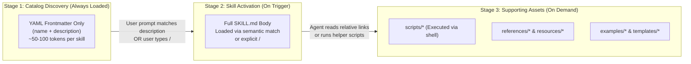
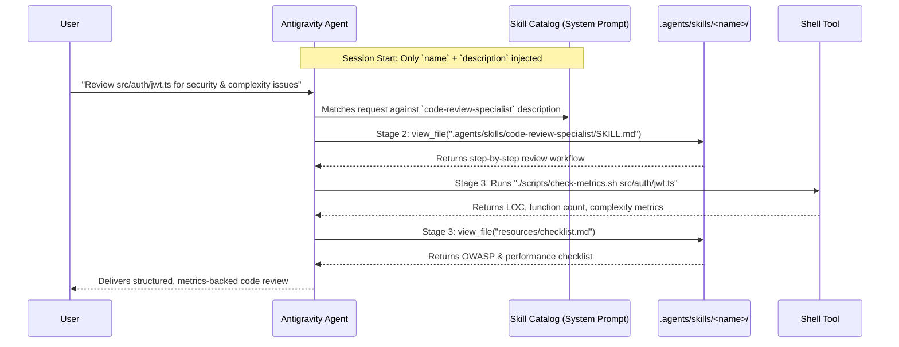
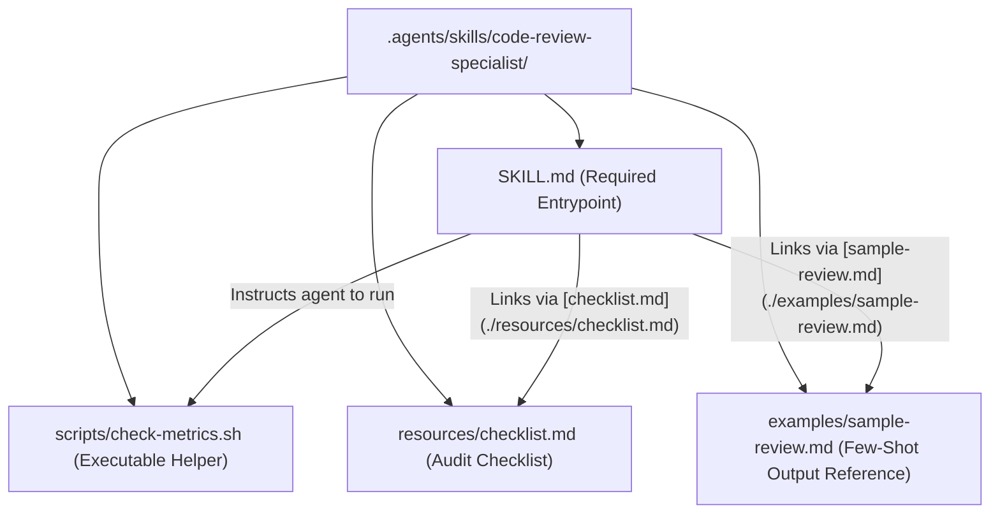
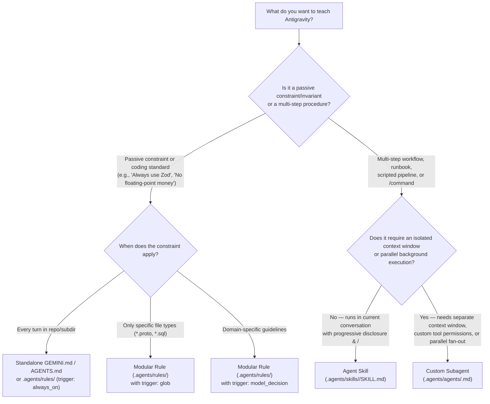

# Module 03: Agent Skills (`.agents/skills/`)

> **Antigravity App v2.24.0 & CLI (`agy`) v1.4.0** · **Open Standard**: [agentskills.io](https://agentskills.io) · **Models**: Gemini 4 Argon, Gemini 3.8 Flash, Gemini 3.1 Pro

**Agent Skills** are modular, filesystem-based packages of procedural knowledge, domain runbooks, executable helper scripts, and reference templates that extend Google Antigravity's capabilities.

Instead of cramming every multi-step workflow into `GEMINI.md`—which consumes context window tokens on every turn—Skills use **3-Stage Progressive Disclosure**. Antigravity loads only a lightweight catalog of skill names and descriptions at session start (~50–100 tokens per skill) and loads the full `SKILL.md` instructions and supporting files **only when triggered**, either automatically via semantic matching or explicitly via `/<skill-name>`.

---

## Table of Contents

1. [How Skills Work: 3-Stage Progressive Disclosure](#1-how-skills-work-3-stage-progressive-disclosure)
2. [Anatomy of an Antigravity Skill Bundle](#2-anatomy-of-an-antigravity-skill-bundle)
3. [Discovery Locations & Loading Precedence](#3-discovery-locations--loading-precedence)
4. [Decision Tree: Rules vs. Skills vs. Subagents](#4-decision-tree-rules-vs-skills-vs-subagents)
5. [Authoring `SKILL.md`: Frontmatter & Trigger Descriptions](#5-authoring-skillmd-frontmatter--trigger-descriptions)
6. [Cross-Project Skill Sharing (`.agents/skills.json`)](#6-cross-project-skill-sharing-agentsskillsjson)
7. [Testing, Inspecting & Debugging Skills (`/skills`, `/context`, `/learn`)](#7-testing-inspecting--debugging-skills-skills-context-learn)
8. [Production Skill Bundles Included in This Module](#8-production-skill-bundles-included-in-this-module)
9. [Best Practices & Anti-Patterns](#9-best-practices--anti-patterns)

---

## 1. How Skills Work: 3-Stage Progressive Disclosure

Antigravity implements the open [Agent Skills specification](https://agentskills.io) using a three-stage loading pipeline that keeps your context window lean even when dozens of skills are installed:



### Runtime Activation Sequence



| Stage | When Loaded | Context Token Cost | What Enters the Prompt |
| :--- | :--- | :--- | :--- |
| **Stage 1: Catalog Discovery** | At session startup | **~50–100 tokens** per skill | Only the `name` and `description` from each `SKILL.md` YAML frontmatter. |
| **Stage 2: Skill Activation** | When semantically matched or invoked via `/<skill-name>` | **~500–3,000 tokens** | The Markdown body of `SKILL.md` containing the workflow steps and links to supporting files. |
| **Stage 3: Execution & Assets** | Only when a specific step requires them | **Zero upfront cost** | Scripts in `scripts/` execute in the shell (only stdout enters context); files in `references/`, `resources/`, `templates/`, and `examples/` are read only when needed. |

---

## 2. Anatomy of an Antigravity Skill Bundle

Every skill lives in its own directory named after the skill (`<skill-name>/`) and **must** contain a top-level `SKILL.md` file. Optional subdirectories organize executable scripts, reference documentation, templates, and few-shot examples:

```text
.agents/skills/<skill-name>/
├── SKILL.md          # REQUIRED: YAML frontmatter (name, description) + core workflow
├── scripts/          # OPTIONAL: Executable helper scripts (.sh, .py, .mjs) run by the agent
├── references/       # OPTIONAL: Deep technical manuals or domain specifications read on demand
├── resources/        # OPTIONAL: Checklists, JSON schemas, or lookup tables
├── templates/        # OPTIONAL: Output Markdown or code Boilerplate templates
└── examples/         # OPTIONAL: Good/bad few-shot examples demonstrating expected output quality
```



---

## 3. Discovery Locations & Loading Precedence

Antigravity automatically discovers skills across your workspace, global workstation config, and installed plugins. If two skills share the same `name`, the higher-priority location overrides the lower-priority one:

| Priority | Scope | Path / Mechanism | Shared With Team? |
| :---: | :--- | :--- | :--- |
| **1 (Highest)** | **Workspace Directory** | `.agents/skills/<name>/SKILL.md` *(also supports `.agent/skills/`, `_agents/skills/`)* walking up from CWD to repo root | **Yes** (committed to Git) |
| **2** | **Workspace Manifest** | Directories and inherited configs declared in `.agents/skills.json` | **Yes** (committed to Git) |
| **3** | **Global Discovery** | `~/.gemini/config/skills/<name>/SKILL.md` | No (personal across all projects) |
| **4** | **Built-in & Plugin Skills** | Bundled Antigravity skills (`agy-customizations`, `migrate-workflows`, `generative_ui`) & enabled plugins (`plugins/<plugin>/skills/<name>/SKILL.md`) | Via Plugin Marketplace |
| **5 (Lowest)** | **Global Manifest** | Directories declared in `~/.gemini/config/skills.json` | No (personal) |

---

## 4. Decision Tree: Rules vs. Skills vs. Subagents

One of the most important architectural decisions when customizing Antigravity is choosing between a **Rule**, a **Skill**, and a **Subagent**:



| Customization | Location | Context Window | Invoked Via | Best For |
| :--- | :--- | :--- | :--- | :--- |
| **Rules** | `GEMINI.md`, `AGENTS.md`, `.agents/rules/*.md` | Shared (20k token budget) | `always_on`, `glob`, `model_decision`, or `@rule` | Guardrails, coding conventions, architectural boundaries. |
| **Skills** | `.agents/skills/<name>/SKILL.md` | Shared (3-stage progressive disclosure) | Semantic auto-match **or** `/<skill-name>` slash command | Repeatable workflows, code generators, audit checklists, helper scripts. |
| **Subagents** | `.agents/agents/<name>.md` (or `define_subagent`) | **Isolated** context window per subagent | `invoke_subagent` tool or `/agents` | Heavy codebase research, parallel worker fan-out, restricted tool sandboxes. |

---

## 5. Authoring `SKILL.md`: Frontmatter & Trigger Descriptions

Every `SKILL.md` file must begin with YAML frontmatter enclosed by `---`:

```yaml
---
name: code-review-specialist
description: >-
  Perform comprehensive security, performance, complexity, and maintainability code reviews
  using quantitative metrics and structured checklists. Use when the user asks to review code,
  audit a pull request, check for security vulnerabilities, or runs /code-review-specialist.
---
```

### Frontmatter Specification

| Field | Type | Required | Description |
| :--- | :--- | :---: | :--- |
| `name` | `string` | **Yes** *(defaults to folder name)* | Unique lowercase, hyphenated identifier (`[a-z0-9-]`). Automatically becomes the `/<name>` slash command. |
| `description` | `string` | **Yes** | **The most critical field in your skill.** Read by the agent at Stage 1 to decide whether to activate the skill. Must clearly state **what** the skill does and **when** to trigger it. |

### How to Write High-Precision `description` Triggers

Because Stage 1 only exposes `name` and `description` to the model, a vague description means your skill will never auto-activate. Follow this formula:

$$\text{Description} = \text{Action & Capabilities (3rd Person)} + \text{Explicit Trigger Scenarios ("Use when...")}$$

| Quality | Example `description` | Why It Succeeds or Fails |
| :--- | :--- | :--- |
| ❌ **Bad (Too Vague)** | `Helps with documentation.` | Doesn't specify API docs vs. READMEs vs. comments; lacks trigger keywords. |
| ❌ **Bad (Too Broad)** | `Use this skill whenever writing Python or TypeScript code.` | Triggers on almost every coding turn, wasting context tokens. |
| ✅ **Good (High Signal)** | `Generate OpenAPI 3.1 specs and Markdown endpoint documentation by extracting route signatures from source files. Use when the user asks to document APIs, generate Swagger/OpenAPI schemas, or runs /doc-generator.` | Clearly states outputs (OpenAPI 3.1, Markdown), mechanism (route extraction), and exact user intents. |

---

## 6. Cross-Project Skill Sharing (`.agents/skills.json`)

If your organization maintains a shared repository of engineering skills (or stores skills in a custom directory like `tools/agents/skills`), create `.agents/skills.json` (workspace) or `~/.gemini/config/skills.json` (global):

```json
{
  "inherits": [
    {
      "path": "../company-agent-customizations/.agents/skills.json",
      "exclude": ["deprecated-deploy-v1"]
    }
  ],
  "entries": [
    {
      "path": "tools/agents/skills",
      "exclude": ["experimental-.*"]
    },
    {
      "path": "~/personal-engineering-skills",
      "include_only": ["code-review-specialist", "refactor"]
    }
  ]
}
```

- **`entries`**: Each directory path is scanned **one level deep** for `<skill-name>/SKILL.md` bundles. Paths starting with `/` are absolute, `~/` resolve to `$HOME`, and relative paths resolve from the workspace root.
- **`inherits`**: Merges entries from another `skills.json` manifest in order, with optional `include_only` and `exclude` filters.

---

## 7. Testing, Inspecting & Debugging Skills (`/skills`, `/context`, `/learn`)

### 1. Verify Discovery with `/skills`
Run `/skills` in the Antigravity App or `agy` CLI (or open **Customizations → Skills** in the IDE side panel) to verify your skill appears in the active catalog and inspect its resolved path and description.

### 2. Test Both Activation Paths
- **Explicit Slash Command Test**: Run `/<skill-name> <test-target>` to immediately load `SKILL.md` and verify the step-by-step instructions and helper scripts execute cleanly.
- **Semantic Auto-Activation Test**: Start a fresh session (`/clear`) and send a natural-language prompt matching your `description` (without typing `/<skill-name>`). Confirm the agent calls `view_file` on your `SKILL.md` before executing the task.

### 3. Monitor Token Footprint with `/context`
Run `/context` to inspect how many tokens your skill catalog and active `SKILL.md` files consume. Keep `SKILL.md` **under 500 lines**—move long reference tables, schemas, and examples into `references/`, `resources/`, or `examples/`.

### 4. Distill Ad-Hoc Workflows into Skills with `/learn` or `workflow-skill-creator`
After completing a complex multi-step task in chat, you can turn the workflow into a reusable skill automatically:

```text
/learn Package our OpenAPI extraction and validation workflow from this session into a reusable skill under .agents/skills/doc-generator/
```

---

## 8. Production Skill Bundles Included in This Module

This directory contains **6 complete, multi-file skill bundles** plus a reference [`skills.json`](./skills.json) manifest:

| Skill Name & Slash Command | Directory Structure | Key Capabilities Demonstrated |
| :--- | :--- | :--- |
| **`/code-review-specialist`** | [`code-review-specialist/`](./code-review-specialist/SKILL.md)<br/>├── `SKILL.md`<br/>├── [`scripts/check-metrics.sh`](./code-review-specialist/scripts/check-metrics.sh)<br/>├── [`resources/checklist.md`](./code-review-specialist/resources/checklist.md)<br/>└── [`examples/sample-review.md`](./code-review-specialist/examples/sample-review.md) | Shell script execution (`check-metrics.sh`), OWASP/performance checklist (`resources/`), and few-shot review output (`examples/`). |
| **`/doc-generator`** | [`doc-generator/`](./doc-generator/SKILL.md)<br/>├── `SKILL.md`<br/>├── [`scripts/extract-signatures.py`](./doc-generator/scripts/extract-signatures.py)<br/>├── [`templates/api-template.md`](./doc-generator/templates/api-template.md)<br/>└── [`examples/sample-docs.md`](./doc-generator/examples/sample-docs.md) | Python AST/regex signature extractor (`extract-signatures.py`), standardized Markdown template (`templates/`), and sample output. |
| **`/refactor`** | [`refactor/`](./refactor/SKILL.md)<br/>└── `SKILL.md` | Martin Fowler's 6-phase behavior-preserving refactoring workflow with test gates and code-smell mapping. |
| **`/gemini-md`** | [`gemini-md/`](./gemini-md/SKILL.md)<br/>├── `SKILL.md`<br/>├── [`references/context-patterns.md`](./gemini-md/references/context-patterns.md)<br/>└── [`references/example-files.md`](./gemini-md/references/example-files.md) | Meta-skill for authoring, auditing, and optimizing `GEMINI.md`, `AGENTS.md`, and `.agents/rules/*.md` files within the 24 KB / 20k-token budgets. |
| **`/blog-draft`** | [`blog-draft/`](./blog-draft/SKILL.md)<br/>├── `SKILL.md`<br/>├── [`examples/good-post.md`](./blog-draft/examples/good-post.md)<br/>└── [`examples/bad-post.md`](./blog-draft/examples/bad-post.md) | Iterative technical blog writing workflow with contrastive few-shot examples (`good-post.md` vs. `bad-post.md`). |
| **`/brand-voice`** | [`brand-voice/`](./brand-voice/SKILL.md)<br/>└── `SKILL.md` | Developer-first communication style, tone calibration, and terminology enforcement skill. |

### Installing These Skills into Your Workspace

```bash
mkdir -p .agents/skills
cp -R 03-skills/code-review-specialist \
      03-skills/doc-generator \
      03-skills/refactor \
      03-skills/gemini-md \
      03-skills/blog-draft \
      03-skills/brand-voice \
      .agents/skills/

# Ensure helper scripts are executable
chmod +x .agents/skills/code-review-specialist/scripts/check-metrics.sh \
         .agents/skills/doc-generator/scripts/extract-signatures.py
```

---

## 9. Best Practices & Anti-Patterns

| Do (Best Practices) | Don't (Anti-Patterns) |
| :--- | :--- |
| Keep `SKILL.md` concise (**under 500 lines**) and link to `references/`, `resources/`, `templates/`, and `examples/` using relative Markdown links. | Inline thousands of lines of reference schemas directly into `SKILL.md`. |
| Encapsulate complex deterministic checks (metrics, AST parsing, linters) into `scripts/` so the agent runs them via shell instead of guessing. | Ask the LLM to manually count lines of code or calculate cyclomatic complexity by reading raw text. |
| Include both **good** and **bad** examples in `examples/` when output style or structure matters. | Describe formatting rules only in abstract prose without concrete examples. |
| Always include a final **Verification Step** in `SKILL.md` so the agent validates its output before finishing. | Omit verification gates in skills that modify code or configuration files. |

---

| Previous Module | Home | Next Module |
| :--- | :---: | ---: |
| [← Module 02: Rules & Persistent Memory](../02-memory/README.md) | [Table of Contents](../README.md) | [Module 04: Subagents & Multi-Agent Workflows →](../04-subagents/README.md) |
