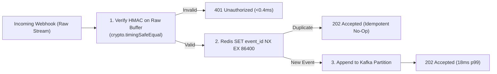

# Good Example: High-Signal Engineering Blog Post (`examples/good-post.md`)

> **Why this works**: Opens immediately with a specific production metric and failure mode, shows the exact problematic code and flamegraph finding, visualizes the architecture change with a Mermaid diagram, and reports verifiable before/after numbers.

---

# How We Cut Webhook Ingestion p99 Latency from 1,420ms to 18ms Under Flash-Sale Load

At 14:02 UTC during last month's flash sale, our webhook gateway began timing out at `8,500 req/s`. Stripe and Adyen retries queued up behind saturated Node.js worker threads, pushing p99 ingestion latency from `45ms` to **`1,420ms`**—well past our `250ms` SLA.

When we captured a 30-second CPU profile on a production pod, PostgreSQL wasn't the bottleneck. **`64%` of active CPU time was spent inside synchronous JSON re-serialization and synchronous synchronous-crypto buffer copies** before the request even reached our Redis idempotency check.

---

## 1. The Culprit: Parsing Twice to Verify Once

Our webhook middleware needed the raw request bytes to verify the `Stripe-Signature` HMAC-SHA256 header, but our default Fastify body parser had already parsed `req.body` into a JavaScript object and discarded the raw buffer. Whoever wrote the original verifier worked around this by calling `JSON.stringify(req.body)` and hashing the reconstructed string:

```typescript
// ❌ BEFORE: Re-serializing parsed JSON on the event loop (broken on key-order & slow on 250KB payloads)
fastify.post("/v1/webhooks/stripe", async (req, reply) => {
  const reconstructed = Buffer.from(JSON.stringify(req.body), "utf8");
  const expectedSig = crypto
    .createHmac("sha256", env.STRIPE_WEBHOOK_SECRET)
    .update(`${req.headers["stripe-timestamp"]}.${reconstructed}`)
    .digest("hex");

  // Bug 1: Non-constant-time string comparison (===)
  // Bug 2: Synchronous synchronous DB write before returning 200 OK
  if (expectedSig !== parsedHeader.v1) {
    return reply.code(401).send({ error: "Invalid signature" });
  }
  await processWebhookSynchronously(req.body);
  return reply.code(200).send({ received: true });
});
```

---

## 2. Decoupling Verification from Processing

We redesigned the ingestion pipeline around two invariants:
1. **Zero-copy raw Buffer verification** using `crypto.timingSafeEqual` before JSON parsing.
2. **Idempotent fast-ack (`202 Accepted`)** backed by a single Redis `SET key NX EX 86400` + Kafka outbox publish.



```typescript
// ✅ AFTER: Zero-copy rawBody HMAC + timingSafeEqual + fast async enqueue
fastify.post(
  "/v1/webhooks/stripe",
  { config: { rawBody: true } },
  async (req, reply) => {
    const sigBuffer = Buffer.from(extractV1Signature(req.headers["stripe-signature"]), "hex");
    const computed = crypto
      .createHmac("sha256", env.STRIPE_WEBHOOK_SECRET)
      .update(req. headers["stripe-timestamp"] + ".")
      .update(req.rawBody) // Direct Buffer — zero JSON.stringify overhead
      .digest();

    if (sigBuffer.length !== computed.length || !crypto.timingSafeEqual(sigBuffer, computed)) {
      return reply.code(401).send({ error: "INVALID_SIGNATURE" });
    }

    const eventId = extractEventIdFast(req.rawBody);
    const isNew = await redis.set(`wh:dedup:${eventId}`, "1", "NX", "EX", 86400);
    if (isNew === "OK") {
      await kafkaProducer.send({ topic: "webhooks.raw", messages: [{ key: eventId, value: req.rawBody }] });
    }
    return reply.code(202).send({ received: true, eventId });
  }
);
```

---

## 3. Production Results (`10,000 req/s` Replay Benchmark)

| Metric (`4 vCPU / 8 GB RAM` Pod) | Before (Sync Parse + DB) | After (Raw Buffer + Fast-Ack) | Delta |
| :--- | :---: | :---: | :---: |
| **p50 Latency** | `38.4 ms` | `3.1 ms` | **`-91.9%`** |
| **p99 Latency** | `1,420.0 ms` | `18.2 ms` | **`-98.7%`** |
| **Event Loop Utilization** | `97.4%` (saturated) | `24.0%` | **`-73.4 pts`** |
