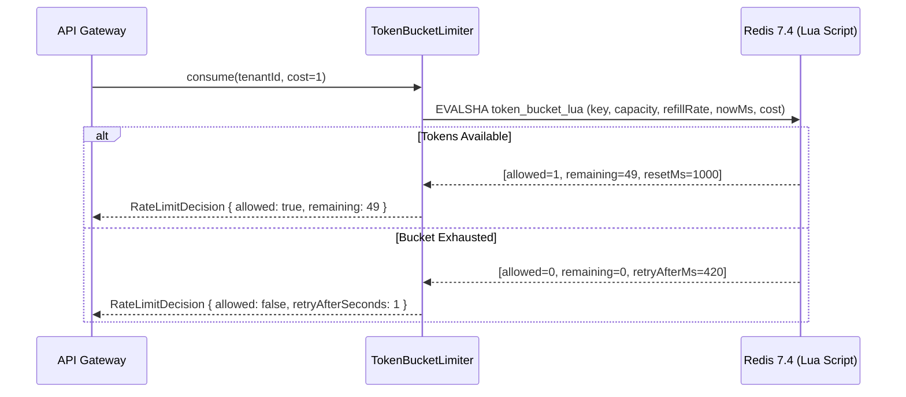

# Sample Generated Documentation (`examples/sample-docs.md`)

> This file shows the expected quality and structure produced by the `doc-generator` skill.

---

# `TokenBucketLimiter` & `POST /v1/keys/verify` API Reference

> **Source**: `src/ratelimit/token-bucket.ts` · **Authentication**: Internal Service Header (`X-Internal-Token`)

## 1. Overview & Request Flow

The `TokenBucketLimiter` module enforces distributed, atomic per-tenant API rate limits backed by Redis Lua evaluation. It guarantees single-round-trip latency (`<1.5ms` p99) and fails open with structured metrics if the Redis cluster is unreachable.



---

## 2. Exported Functions & Endpoints

### `consume(key: string, cost?: number): Promise<RateLimitDecision>`

Atomically deducts `cost` tokens from the bucket identified by `key`, refilling tokens proportionally based on elapsed wall-clock time since the last request.

#### Parameters

| Name | Kind | Type | Required | Default | Constraints & Description |
| :--- | :--- | :--- | :---: | :---: | :--- |
| `key` | `argument` | `string` | **Yes** | — | Non-empty namespace key (e.g., `"org_01J9:orders:write"`). Max 128 bytes. |
| `cost` | `argument` | `number` | No | `1` | Positive integer number of tokens to consume (`1 <= cost <= capacity`). |

#### Return Value (`RateLimitDecision`)

```json
{
  "allowed": true,
  "limit": 100,
  "remaining": 99,
  "resetAtEpochSeconds": 1792569660,
  "retryAfterSeconds": 0
}
```

#### Error Conditions

| Exception / Code | Trigger Condition & Remediation |
| :--- | :--- |
| `InvalidRateLimitCostError` | Thrown synchronously when `cost <= 0`, `!Number.isInteger(cost)`, or `cost > bucketCapacity`. |
| `RedisEvalFallbackWarning` | Logged (does not throw) when Redis times out (`>150ms`); returns `{ allowed: true, degraded: true }`. |

#### Runnable Usage Example

```typescript
import { TokenBucketLimiter } from "@acme/ratelimit";

const limiter = new TokenBucketLimiter({
  redis: redisClient,
  capacity: 100,
  refillPerSecond: 10,
});

const decision = await limiter.consume(`org_${organizationId}:exports`, 5);
if (!decision.allowed) {
  reply
    .code(429)
    .header("Retry-After", String(decision.retryAfterSeconds))
    .send({ error: "RATE_LIMIT_EXCEEDED", retryAfter: decision.retryAfterSeconds });
  return;
}
```
