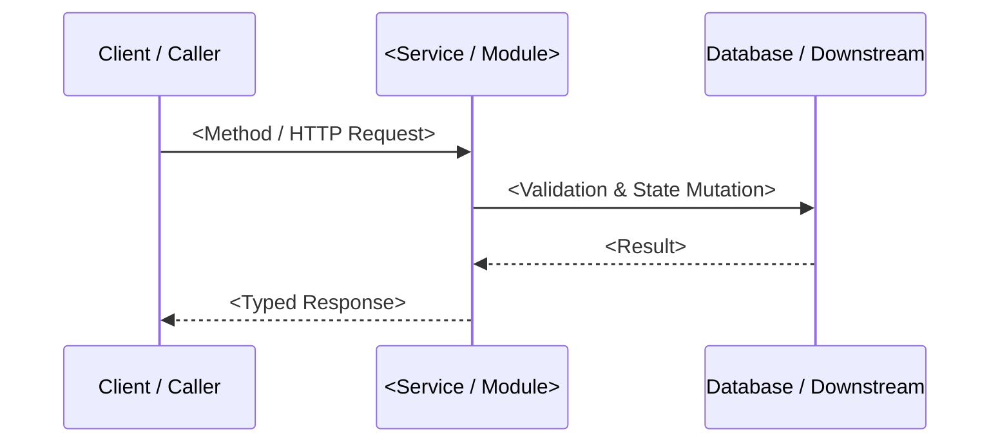

# API Reference Template (`templates/api-template.md`)

Use this structure when generating API or SDK reference documentation in the `doc-generator` skill:

````markdown
# `<Module or Service Name>` API Reference

> **Source**: [`<relative-path-to-file>`](<relative-path-to-file>) · **Authentication**: `<Bearer JWT | API Key | Internal>`

## 1. Overview & Request Flow

<!-- 2-3 sentence summary of what this module/service does and its primary invariants -->



---

## 2. Endpoints / Exported Functions

### `<HTTP Method / Function Signature>`

<Concise description of behavior, idempotency guarantees, and side effects.>

#### Parameters / Request Schema

| Name | Location / Kind | Type | Required | Default | Constraints & Description |
| :--- | :--- | :--- | :---: | :---: | :--- |
| `<paramName>` | `body` / `arg` | `<type>` | Yes / No | `<default>` | <Validation rules and meaning> |

#### Response / Return Value (`<Status Code or Return Type>`)

```json
{
  "id": "example_id",
  "status": "active"
}
```

#### Error Conditions

| Error Code / Exception | HTTP Status | Trigger Condition & Remediation |
| :--- | :---: | :--- |
| `<ERROR_CODE>` | `400` / `409` / `429` | <Why it happens and how the caller should handle it> |

#### Runnable Usage Examples

**TypeScript / SDK**
```typescript
// Copy-pasteable example with error handling
```

**cURL (if HTTP endpoint)**
```bash
curl -X POST "https://api.example.com/v1/resource" \
  -H "Authorization: Bearer $API_TOKEN" \
  -H "Content-Type: application/json" \
  -d '{}'
```
````
