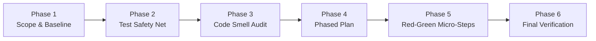

# Systematic Code Refactoring (`refactor`)

> *"Refactoring is a disciplined technique for restructuring an existing body of code, altering its internal structure without changing its external behavior."* — Martin Fowler

Use this skill to plan and execute safe, incremental refactorings verified by automated test gates at every micro-step.

---

## 6-Phase Refactoring Lifecycle

### Phase 1: Scope & Dependency Discovery
1. Read the target file(s) and trace all callers/importers across the workspace using grep/find tools.
2. Identify public exports and external contracts (HTTP routes, CLI flags, DB schemas, serialized types) that **must remain 100% backward-compatible**.

### Phase 2: Verify the Test Safety Net
1. Locate and run the existing unit/integration tests covering the target module.
2. **Decision Gate**:
   - **If tests exist and pass**: Record baseline pass count and execution time, then proceed to Phase 3.
   - **If tests are missing for the code being refactored**: Write characterization tests covering the current behavior **before** restructuring the implementation.
   - **If existing tests are already failing**: Stop and ask the user whether to fix the broken tests first before refactoring.

### Phase 3: Code Smell Identification & Mapping
Catalog the specific structural smells in the target code and map each to its canonical refactoring mechanics:

| Detected Code Smell | Signs & Heuristics | Canonical Refactoring Technique |
| :--- | :--- | :--- |
| **Long Function / Deep Nesting** | Function > 50 lines or > 3 levels of `if/for/try` nesting | *Extract Function*, *Replace Nested Conditional with Guard Clauses* |
| **Duplicated Logic** | Parallel blocks across functions or subclasses | *Extract Function*, *Pull Up Method*, *Parameterize Function* |
| **Large Module / God Class** | Unrelated state prefixes or mixed I/O + domain calculation | *Extract Class / Module*, *Separate Query from Modifier* |
| **Long Parameter List / Data Clumps** | 4+ parameters passed together through call chains | *Introduce Parameter Object*, *Preserve Whole Object* |
| **Primitive Obsession** | Raw strings/numbers for money, emails, tenant IDs, statuses | *Replace Primitive with Value Object / Branded Type* |
| **Complex `switch` / Type-Code Chains** | Repeated `switch (item.kind)` across multiple functions | *Replace Conditional with Polymorphism / Strategy Map* |
| **Feature Envy** | Function manipulates another module's internal data more than its own | *Move Function* to the data owner |

### Phase 4: Propose a Phased Refactoring Plan
For non-trivial refactorings, present a brief plan grouped by risk before applying edits:
- **Wave A (Low Risk / High Clarity)**: Guard clauses, dead-code removal, variable/type renaming, extracting pure helper functions.
- **Wave B (Medium Risk / Structural)**: Introducing parameter objects, splitting pure domain logic from I/O adapters.
- **Wave C (Architectural)**: Splitting modules, re-wiring dependency injection, or replacing conditionals with polymorphism.

### Phase 5: Incremental Implementation (`Edit → Test → Green`)
Execute changes in small, verifiable increments:
1. Apply **one logical refactoring** at a time.
2. Run the scoped test suite and typechecker immediately after each step.
3. **Never mix feature changes or behavior modifications into a refactoring step.** If a test fails, immediately fix or revert the micro-step before proceeding.

### Phase 6: Final Verification & Summary
1. Run the full test, lint, and typecheck suite across all affected packages.
2. Report a concise before/after summary (lines of code, function count, extracted modules, and test pass status).
