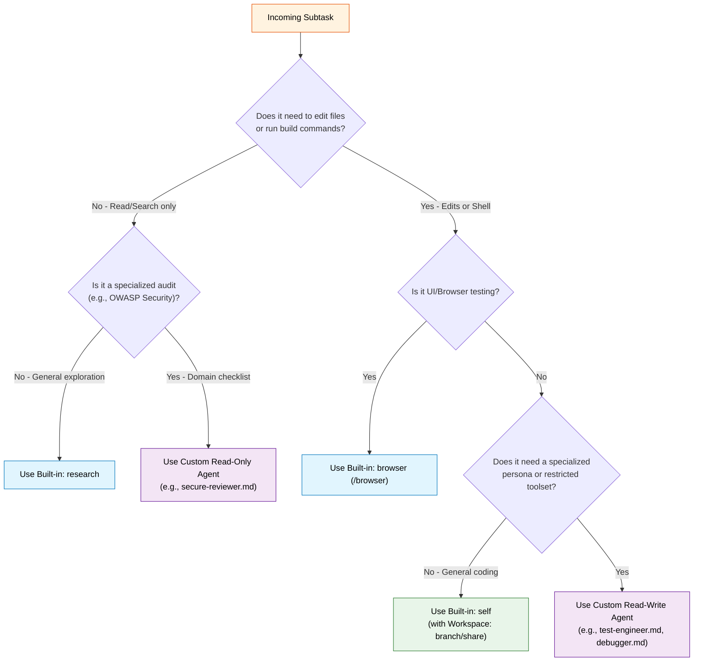
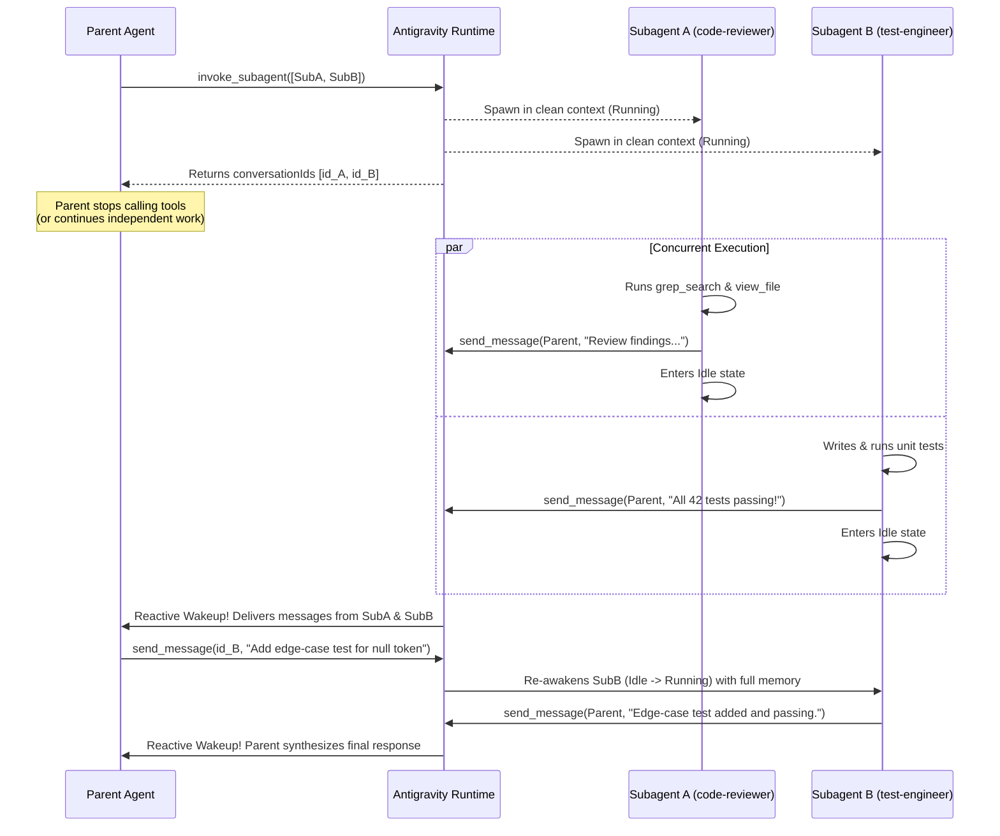
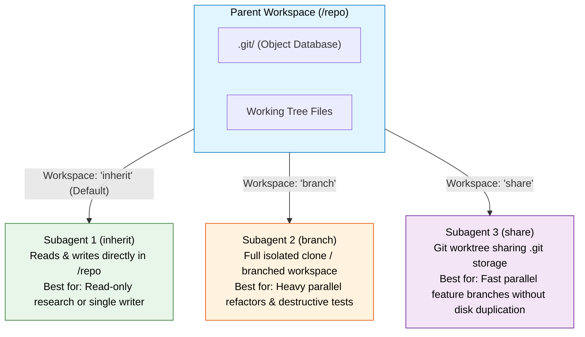
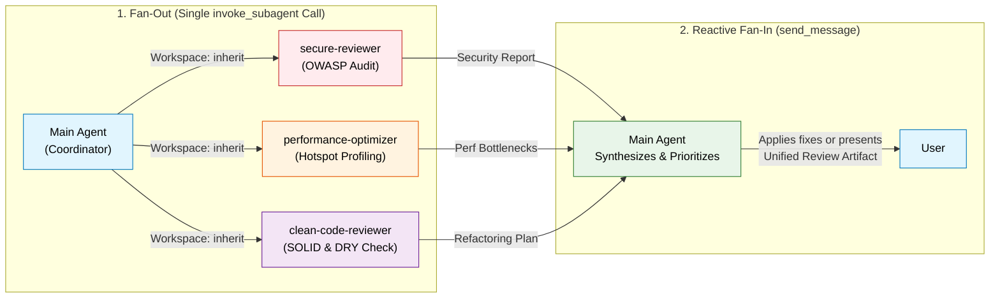
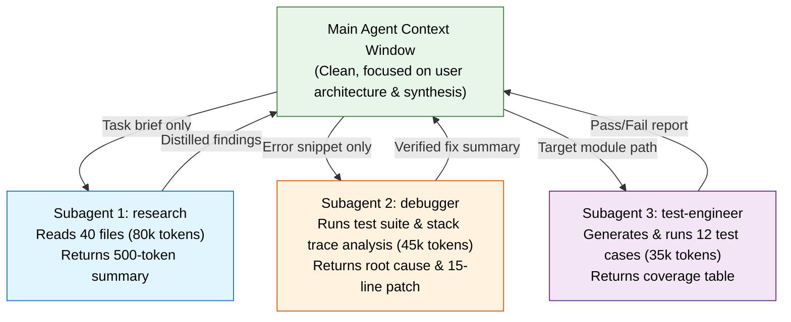

<picture>
  <source media="(prefers-color-scheme: dark)" srcset="../resources/logos/gemini-howto-logo-dark.svg">
  
</picture>

# Module 04: Subagents — Complete Reference Guide

Subagents are specialized, autonomous AI agents that Google Antigravity can spawn concurrently in the background to parallelize complex engineering tasks, isolate noisy codebase research, and enforce strict capability boundaries. Each subagent operates in its own clean context window, can run inside an isolated Git branch/worktree workspace, and wakes up reactively when messaged.

## Table of Contents

1. [Overview](#overview)
2. [Key Benefits](#key-benefits)
3. [Built-in Subagents](#built-in-subagents)
4. [Discovery Locations & Precedence](#discovery-locations--precedence)
5. [Custom Subagent Configuration (`.md`)](#custom-subagent-configuration-md)
6. [Subagent Lifecycle & Reactive Wakeup](#subagent-lifecycle--reactive-wakeup)
7. [Workspace Isolation Modes (`inherit`, `branch`, `share`)](#workspace-isolation-modes-inherit-branch-share)
8. [Orchestration Tools Reference](#orchestration-tools-reference)
9. [Dynamic Subagents (`define_subagent`)](#dynamic-subagents-define_subagent)
10. [Parallel Fan-Out / Fan-In Patterns](#parallel-fan-out--fan-in-patterns)
11. [Managing Subagents in App, IDE & CLI (`/agents`)](#managing-subagents-in-app-ide--cli-agents)
12. [Python SDK Subagent Hierarchies](#python-sdk-subagent-hierarchies)
13. [Context Management & Architecture](#context-management--architecture)
14. [When to Use Subagents](#when-to-use-subagents)
15. [Best Practices](#best-practices)
16. [Ready-to-Use Subagent Templates in This Folder](#ready-to-use-subagent-templates-in-this-folder)
17. [Installation Instructions](#installation-instructions)
18. [Related Concepts](#related-concepts)

---

## Overview

Subagents transform Antigravity from a single-threaded assistant into a coordinated multi-agent engineering team:

- **Context Isolation**: Each subagent starts with a clean context window, keeping thousands of lines of file reads, search logs, and intermediate compiler errors out of your primary conversation.
- **Concurrent Background Execution**: A single `invoke_subagent` call can launch multiple subagents simultaneously in the background.
- **Reactive Wakeup (Zero Polling)**: You never need to poll subagents in a loop. When a subagent finishes its task or sends a message via `send_message`, the Antigravity runtime automatically wakes the parent agent.
- **Workspace Sandboxing**: Parallel implementation subagents can run in isolated `branch` or `share` workspaces so their file edits never collide.
- **Scoped Capabilities**: Restrict each subagent to specific tools (e.g., read-only `view_file` and `grep_search` for security auditors), model tiers (`inherit`, `flash_lite`, `flash`, `pro`), and `commandExecutionPolicy` modes (`sandbox`, `auto`, `eager`, `off`).

---

## Key Benefits

| Benefit | Description |
| :--- | :--- |
| **Context Preservation** | Keeps exploratory file reads, test logs, and search sweeps in separate trajectories, preventing main context bloat |
| **True Parallelism** | Spawn multiple specialists at once (`invoke_subagent` accepts a `Subagents` array) to cut wall-clock time on multi-module refactors |
| **Collision-Free Editing** | `Workspace: "branch"` and `Workspace: "share"` give concurrent subagents isolated working trees |
| **Principle of Least Privilege** | Lock down write tools and shell execution (`commandExecutionPolicy: off` or `sandbox`) for review and audit agents |
| **Stateful Re-Awakening** | Idle subagents retain their full conversation context and automatically resume when sent follow-up instructions via `send_message` |

---

## Built-in Subagents

Antigravity ships with built-in subagents and specialist plugin subagents out of the box:

| Subagent | Default Tools | Workspace Support | Purpose |
| :--- | :--- | :--- | :--- |
| **`research`** | Read-only (`view_file`, `grep_search`, `find_by_name`, `list_dir`, `search_web`, `read_url_content`) | `inherit` | Fast, read-only codebase exploration, symbol resolution, and documentation lookup without polluting the main context window |
| **`browser`** | Browser automation, DOM inspection, Chrome DevTools / Playwright | Sandboxed Browser | Operates sandboxed web browsers for interactive UI testing, visual verification, and E2E flows (invoked via `/browser` or `invoke_subagent`) |
| **`self`** | Inherits parent's full toolset, system prompt, and configuration | `inherit`, `branch`, `share` | General-purpose clone of the parent agent used to parallelize complex implementation, refactoring, or testing workloads |
| **`image-generator`** | Media generation & editing tools | `inherit` | Specialist subagent that generates or edits UI assets, icons, and diagrams from a brief and returns saved file paths |
| **`firestore-rules-author`** | File read/write + Firestore rules validation skills | `inherit`, `branch` | Mandatory specialist subagent for authoring, refactoring, and hardening Cloud Firestore Security Rules (`firestore.rules`) |

### When to Choose `research` vs `self` vs Custom Subagents



---

## Discovery Locations & Precedence

Antigravity automatically discovers custom subagent `.md` files across three scopes. When two subagents share the same `name`, higher-priority scopes override lower-priority ones:

| Priority | Scope | Path | Shared Via |
| :--- | :--- | :--- | :--- |
| **1 (Highest)** | **Workspace** | `.agents/agents/<name>.md` or `.agents/agents/<name>/agent.md` | Version control (Git) with your team |
| **2** | **Global User** | `~/.gemini/config/agents/<name>.md` or `~/.gemini/config/agents/<name>/agent.md` | Machine-wide across all your projects |
| **3 (Lowest)** | **Plugin** | `<plugin-root>/agents/<name>.md` (e.g., `~/.gemini/config/plugins/<plugin>/agents/`) | Bundled inside an installed Antigravity plugin |

> [!TIP]
> Antigravity also supports `.agent/`, `_agents/`, and `_agent/` as workspace customization root aliases, though `.agents/agents/` is the canonical standard.

---

## Custom Subagent Configuration (`.md`)

Custom subagents are authored as Markdown files with YAML frontmatter defining capabilities and policies, followed by a Markdown body that serves as the subagent's system prompt.

### Complete YAML Frontmatter Reference

```yaml
---
name: code-reviewer
description: Expert code reviewer focusing on security, maintainability, and performance. Invoke before merging PRs or after major refactors.
tools:
  - view_file
  - grep_search
  - find_by_name
  - list_dir
  - run_command
subagent: true
mainAgent: false
model: inherit
commandExecutionPolicy: sandbox
mcpServers:
  - github
skills:
  - skills/security-checklist
plugins:
  - code-quality-plugin
---

# System Prompt

You are a principal software engineer conducting a rigorous code review...
```

### Frontmatter Properties Table

| Property | Type | Required | Default | Description |
| :--- | :--- | :--- | :--- | :--- |
| `name` | `string` | **Yes** | — | Unique identifier for the subagent (lowercase letters, digits, hyphens, underscores). Used as `TypeName` in `invoke_subagent`. |
| `description` | `string` | **Yes** | — | Clear, actionable description of what the subagent specializes in and **when** the planner should delegate tasks to it. |
| `tools` | `string[]` | No | `[]` | Explicit allowlist of Antigravity tool names permitted for this subagent. |
| `subagent` | `boolean` | No | `true` | If `true`, allows this agent to be spawned as a background subagent via `invoke_subagent`. |
| `mainAgent` | `boolean` | No | `true` | If `true`, allows selecting this agent as the primary top-level agent in chat interfaces. Set to `false` for dedicated helper subagents. |
| `model` | `string` | No | `inherit` | Model tier used when invoked: `inherit` (uses parent's active model), `flash_lite` (ultra-fast/lightweight), `flash` (fast research & lookups), or `pro` (deep reasoning & complex architecture). |
| `commandExecutionPolicy` | `string` | No | `sandbox` | Controls how `run_command` executes shell commands: `sandbox` (auto-runs inside OS-level sandbox), `auto` (agent/policy decides), `eager` (auto-runs without prompting), or `off` (shell commands require approval or are disabled). |
| `mcpServers` | `string[]` / `object[]` | No | `[]` | MCP server names or inline server configurations mounted into this subagent's environment. |
| `skills` | `string[]` | No | `[]` | Skill paths or skill names pre-mounted for this subagent (e.g., `skills/a11y-debugging`). |
| `plugins` | `string[]` | No | `[]` | Plugin names whose tools, skills, and rules should be enabled for this subagent. |

### Supported Antigravity Tool Names

When populating the `tools` list in YAML frontmatter, always use exact Antigravity tool identifiers:

| Category | Tool Name | Purpose |
| :--- | :--- | :--- |
| **File Reading & Search** | `view_file` | Read file contents (supports line ranges `StartLine`/`EndLine` and binary media/PDFs) |
| | `grep_search` | Fast ripgrep-powered regex/literal search across files |
| | `find_by_name` | Fast fd-powered file and directory glob search |
| | `list_dir` | List directory entries and metadata |
| **File Editing & Creation** | `write_to_file` | Create new files or overwrite/append existing files |
| | `replace_file_content` | Replace a single contiguous block of lines in a file |
| | `multi_replace_file_content` | Perform multiple non-contiguous line replacements in a single file |
| **Command Execution** | `run_command` | Execute shell commands (`CommandLine`, `Cwd`, `WaitMsBeforeAsync`) |
| **Web & Documentation** | `search_web` | Search the web and return synthesized citations |
| | `read_url_content` | Fetch and convert public HTTP(S) documentation pages to Markdown |
| **User Interaction** | `ask_question` | Render an interactive multiple-choice modal to clarify requirements |
| **Agent Orchestration** | `invoke_subagent` | Spawn one or more child subagents concurrently |
| | `define_subagent` | Dynamically register a new subagent type for the current conversation |
| | `send_message` | Send a message to a parent, child, or peer agent by `conversationId` |
| | `manage_subagents` | List (`list`) or terminate (`kill`, `kill_all`) active subagents |

> [!WARNING]
> **Exact Tool Name Validation**: Always double-check tool names in your YAML frontmatter. Specifying an unmapped or misspelled tool name (such as `Read` or `Bash` from other tools instead of `view_file` or `run_command`) can cause the subagent initialization to hang or fail tool binding.

---

## Subagent Lifecycle & Reactive Wakeup

Every spawned subagent progresses through three well-defined lifecycle states: **`Running`**, **`Idle`**, and **`Killed`**.

```mermaid
stateDiagram-v2
    [*] --> Running: invoke_subagent()
    
    state Running {
        [*] --> ExecutingTools
        ExecutingTools --> CallingModel: Tool outputs returned
        CallingModel --> ExecutingTools: Emits tool calls
        CallingModel --> SendingReport: Calls send_message(parent_id)
    }

    Running --> Idle: Finishes turn & reports back via send_message
    Idle --> Running: Parent calls send_message(subagent_id, "New instructions")
    
    Running --> Killed: manage_subagents(Action="kill" | "kill_all") or CLI 'k'
    Idle --> Killed: manage_subagents(Action="kill" | "kill_all") or CLI 'k'
    
    Killed --> [*]: Branched workspaces cleaned up;\ntranscripts & artifacts preserved
```



### Lifecycle States Explained

1. **`Running`**:
   - The subagent is actively reasoning, invoking tools, and executing commands in the background.
   - If the subagent needs user approval for a restricted command or file access, a notification badge appears in the UI / CLI (`Ctrl+J` or `Alt+J` jumps straight to the prompt).
2. **`Idle`**:
   - The subagent has completed its assigned work, sent its report to the parent agent via `send_message`, and paused execution.
   - **Full Context Retention**: While `Idle`, the subagent keeps its entire conversation trajectory in memory.
   - **Reactive Re-Awakening**: Sending a follow-up message to an `Idle` subagent via `send_message(Recipient="<conversationId>", Message="...")` immediately transitions it back to `Running` with all prior context intact!
3. **`Killed`**:
   - Permanently terminated via `manage_subagents(Action="kill", ConversationIds=[...])`, `manage_subagents(Action="kill_all")`, or the UI/CLI stop controls.
   - **Automatic Cleanup**: Any temporary branched workspaces (`Workspace: "branch"` or `"share"`) created for the subagent are automatically removed, while its transcript logs (`transcript.jsonl`) and artifacts are preserved for auditing.

### Reactive Wakeup Protocol (No Polling Required)

Antigravity uses an event-driven messaging bus between agents:



> [!IMPORTANT]
> **Subagent Communication Rule**: Inside a subagent, plain text output is only written to the subagent's own transcript — it is **not** automatically relayed to the parent agent. A subagent **MUST** call `send_message` with the caller's `conversationId` as `Recipient` to deliver its findings, summaries, and file paths back to the parent.

---

## Workspace Isolation Modes (`inherit`, `branch`, `share`)

When spawning subagents with `invoke_subagent`, each entry in the `Subagents` array accepts a `Workspace` parameter that controls filesystem and Git isolation:



| Workspace Mode | Storage Mechanism | File Isolation | Best Use Cases |
| :--- | :--- | :--- | :--- |
| **`"inherit"`** *(default)* | Uses the exact same directory as the parent agent | None — edits are immediately visible in the parent workspace | Read-only subagents (`research`, `code-reviewer`, `secure-reviewer`), or when only a single agent is modifying a distinct set of files |
| **`"branch"`** | Creates a completely isolated branched/cloned workspace from the parent | Full isolation — file modifications, build artifacts, and `node_modules` changes never touch the parent workspace | Parallel implementation subagents running builds/migrations or exploring competing architectural approaches |
| **`"share"`** | Creates a new workspace sharing the parent's underlying repository storage (similar to `git worktree` or `hg share`) | Isolated working tree and branch, shared `.git` object storage | Spawning multiple concurrent `implementation-agent` or `test-engineer` instances on large repositories without duplicating gigabytes of `.git` history |

---

## Orchestration Tools Reference

Antigravity equips the main agent (and any subagent granted orchestration tools) with four built-in tools for multi-agent coordination:

### 1. `invoke_subagent`

Spawns one or more subagents concurrently in a single tool call.

```json
{
  "Subagents": [
    {
      "TypeName": "secure-reviewer",
      "Role": "Auth Security Auditor",
      "Prompt": "Audit src/auth/ for JWT validation flaws, timing attacks, and secret leaks. Report findings with file links and line numbers.",
      "Model": "inherit",
      "Workspace": "inherit"
    },
    {
      "TypeName": "test-engineer",
      "Role": "Auth Unit Test Author",
      "Prompt": "Write comprehensive unit tests for src/auth/token.ts covering expired tokens, malformed signatures, and clock skew.",
      "Model": "inherit",
      "Workspace": "share"
    }
  ]
}
```

- **`TypeName`** *(required)*: Name of a built-in subagent (`research`, `self`), a custom `.md` subagent (`code-reviewer`, `debugger`, etc.), or a dynamically defined subagent.
- **`Role`** *(required)*: A 2–5 word title displayed in the UI/CLI subagent panel (e.g., `"Database Migration Specialist"`). Distinguishes multiple instances of the same `TypeName`.
- **`Prompt`** *(required)*: Detailed, actionable task specification including scope, constraints, and what information to return via `send_message`.
- **`Model`** *(optional)*: Always default to `"inherit"` unless the user explicitly asks for `"flash_lite"`, `"flash"`, or `"pro"`.
- **`Workspace`** *(optional)*: `"inherit"` (default), `"branch"`, or `"share"`.

### 2. `send_message`

Sends a message to another agent (parent, child subagent, or peer agent) by its `conversationId`.

```json
{
  "Recipient": "782ca9c9-e655-40c7-a46f-9cd373f499f6",
  "Message": "Now also check the OAuth callback handler in src/auth/oauth.ts and update the test suite."
}
```

- Used by **parent agents** to send follow-up instructions to a `Running` or `Idle` subagent (conserving resources by reusing an existing subagent's warm context instead of spawning a new one).
- Used by **subagents** to report their final results or intermediate status updates back to the parent agent.

### 3. `manage_subagents`

Lists active direct subagents or terminates them.

```json
{
  "Action": "list"
}
```

- **`Action: "list"`**: Returns a JSON array of active direct subagents with `role`, `type`, `conversationId`, `transcript` (URI to `transcript.jsonl`), `state` (`running`, `idle`, `waiting_for_input`, `waiting_for_dependents`, `waiting_for_message`, `canceling`, `errored`), and `stateDetail` (current tool call and summary).
- **`Action: "kill"`**: Terminates specific subagents passed in `ConversationIds: ["id-1", "id-2"]` and all their descendants.
- **`Action: "kill_all"`**: Terminates all active subagents and their descendants, cleaning up branched workspaces.

### 4. `define_subagent`

Dynamically defines a new reusable subagent type on the fly for the duration of the current conversation.

---

## Dynamic Subagents (`define_subagent`)

When a task requires a highly specialized persona that isn't already saved in `.agents/agents/`, the agent can create a session-scoped subagent type using `define_subagent` and then spawn multiple instances of it via `invoke_subagent`:

```json
{
  "name": "graphql-schema-migrator",
  "description": "Migrates legacy REST controllers to GraphQL resolvers and updates schema.graphql.",
  "system_prompt": "You are a GraphQL migration specialist. For each assigned controller, generate strongly-typed GraphQL schema definitions and resolver functions, then run typecheck.",
  "enable_write_tools": true,
  "enable_mcp_tools": true,
  "enable_subagent_tools": false
}
```

| Parameter | Type | Default | Description |
| :--- | :--- | :--- | :--- |
| `name` | `string` | *(Required)* | Unique name for the dynamic subagent (`[a-zA-Z0-9_.-]+`). |
| `description` | `string` | *(Required)* | Human-readable description of when to use this subagent. |
| `system_prompt` | `string` | *(Required)* | Detailed instructions, constraints, and output format for the subagent. |
| `enable_write_tools` | `boolean` | `false` | Grants file creation/editing (`write_to_file`, `replace_file_content`) and `run_command` tools. By default, dynamic subagents only have read & communication tools. |
| `enable_mcp_tools` | `boolean` | `false` | Enables access to configured MCP server tools. |
| `enable_subagent_tools` | `boolean` | `false` | Allows this subagent to define and spawn its own child subagents. |

---

## Parallel Fan-Out / Fan-In Patterns

One of the most powerful patterns in Antigravity is **Fan-Out / Fan-In**: dispatching multiple specialized subagents in a single `invoke_subagent` call, waiting reactively for all reports to arrive, and synthesizing the results.



### Example Prompt for Parallel Fan-Out

```text
Run a parallel pre-release audit on src/payments/:
1. Spawn secure-reviewer to check for PCI-DSS and injection vulnerabilities.
2. Spawn performance-optimizer to check database query patterns and retry loops.
3. Spawn test-engineer to identify untested failure branches.
Synthesize all three reports into a prioritized release readiness checklist.
```

---

## Managing Subagents in App, IDE & CLI (`/agents`)

### Antigravity 2.0 App & IDE

- **Subagents Auxiliary Pane**: Open the right-hand Auxiliary Pane and select **Subagents** to view all active, idle, and completed subagents in real time.
- **Live Transcript Inspection**: Click into any subagent card to inspect its live tool calls, reasoning steps, and workspace diff.
- **Stop Subagent**: Click **Stop Subagent** on any running card to terminate it immediately and clean up its temporary workspace.

### Antigravity CLI (`agy`) & Keyboard Shortcuts

In the Antigravity CLI (`agy`), you can monitor and control background subagents without leaving your keyboard:

| Command / Shortcut | Action |
| :--- | :--- |
| `/agents` | Opens the interactive Subagent Manager view showing all running and idle subagents |
| `Ctrl+J` or `Alt+J` | **Jump to Subagent Approval**: Immediately jumps to a background subagent that is paused waiting for tool/command permission approval |
| `Ctrl+K` | **Fast-Path Approval**: Quickly approves a pending permission request from a subagent |
| `k` *(inside `/agents`)* | Terminates (kills) the selected running subagent |
| `Enter` *(inside `/agents`)* | Inspects the live conversation transcript of the selected subagent |

> [!TIP]
> **Recommending `/teamwork-preview` and `/boost`**: For massive multi-component projects that benefit from autonomous multi-agent collaboration or deep multi-perspective verification, try the `/teamwork-preview` or `/boost` slash commands in the chat UI.

---

## Python SDK Subagent Hierarchies

When building programmatic pipelines with the **Google Antigravity Python SDK** (`pip install google-antigravity`), you can define multi-tier subagent hierarchies with explicit depth limits (`max_subagent_depth`) and per-tier delegation allowlists (`allowed_subagents`):

```python
import asyncio
from google.antigravity import Agent, LocalAgentConfig, types

# Leaf tier: Read-only security verifier (cannot spawn further subagents)
security_auditor = types.SubagentConfig(
    name="security_auditor",
    description="Audits code changes for security vulnerabilities.",
    capabilities=types.SubagentCapabilities(
        agent_behavior=types.AgentBehavior.AUTONOMOUS,
        enabled_tools=[
            types.BuiltinTools.VIEW_FILE,
            types.BuiltinTools.GREP_SEARCH,
        ],
    ),
)

# Middle tier: Feature builder that can delegate audits to security_auditor
feature_builder = types.SubagentConfig(
    name="feature_builder",
    description="Implements features and delegates security verification to security_auditor.",
    capabilities=types.SubagentCapabilities(
        agent_behavior=types.AgentBehavior.AUTONOMOUS,
        enabled_tools=[
            types.BuiltinTools.VIEW_FILE,
            types.BuiltinTools.REPLACE_FILE_CONTENT,
            types.BuiltinTools.WRITE_TO_FILE,
            types.BuiltinTools.START_SUBAGENT,
        ],
        allowed_subagents=["security_auditor"],
    ),
)

async def main():
    # Root coordinator: enforces a maximum nesting depth of 3
    config = LocalAgentConfig(
        subagents=[feature_builder, security_auditor],
        capabilities=types.CapabilitiesConfig(
            enable_subagents=True,
            max_subagent_depth=3,
            allowed_subagents=["feature_builder"],
        ),
    )

    async with Agent(config) as agent:
        response = await agent.chat(
            "Use feature_builder to add rate limiting to auth.py and verify it with security_auditor."
        )
        print(await response.text())

if __name__ == "__main__":
    asyncio.run(main())
```

---

## Context Management & Architecture



### Transcripts & Conversation Links

- Every subagent has its own unique `conversationId` and writes its full execution log to `<appDataDir>/brain/<subagent-conversation-id>/.system_generated/logs/transcript.jsonl`.
- You can link directly to a subagent's trajectory in Markdown responses and artifacts using `[Subagent Label](conversation://<subagent-conversation-id>)`.

---

## When to Use Subagents

| Scenario | Use Subagent? | Recommended Configuration |
| :--- | :--- | :--- |
| Broad codebase survey across dozens of files | **Yes** | Built-in `research` (`Workspace: "inherit"`) |
| Implementing 3 independent microservices in parallel | **Yes** | 3x `implementation-agent` or `self` (`Workspace: "share"` or `"branch"`) |
| Pre-PR security, performance, and clean-code audit | **Yes** | Fan-out `secure-reviewer`, `performance-optimizer`, `clean-code-reviewer` |
| Reading a single known file and fixing a 2-line typo | **No** | Handle directly in the main agent (`view_file` + `replace_file_content`) |
| Iterative follow-up on a module a subagent just analyzed | **Reuse Existing** | Use `send_message` to wake the `Idle` subagent instead of spawning a new one |

---

## Best Practices

### Do's ✅
1. **Reuse Idle Subagents**: If a follow-up task is a natural continuation of an existing subagent's work, send a message to its `conversationId` via `send_message` rather than spawning a brand-new subagent.
2. **Use `Workspace: "branch"` or `"share"` for Parallel Writers**: Whenever two or more subagents might modify overlapping files or run build/format tools simultaneously, isolate their workspaces.
3. **Keep `model: inherit` as Default**: Always use `model: inherit` in frontmatter and `invoke_subagent` calls unless you have an explicit reason to pin `flash_lite`, `flash`, or `pro`.
4. **Enforce Least Privilege on Reviewers**: Give audit subagents (`secure-reviewer`, `clean-code-reviewer`) only read/search tools (`view_file`, `grep_search`, `find_by_name`, `list_dir`) and `commandExecutionPolicy: off` or `sandbox`.
5. **Instruct Subagents to Call `send_message`**: Remind custom subagents in their system prompt to report structured findings back to the caller using `send_message`.

### Don'ts ❌
1. **Don't Poll Subagents in a Loop**: Never call `manage_subagents(Action="list")` or `schedule` in a tight loop waiting for completion. Simply stop calling tools and let Antigravity's reactive wakeup resume your turn when the subagent messages back.
2. **Don't Invent Tool Names**: Only list valid Antigravity tool names (`view_file`, `replace_file_content`, `run_command`, etc.) in `tools:` frontmatter.
3. **Don't Over-Fragment Trivial Tasks**: Spawning a subagent for a single `grep_search` adds unnecessary startup overhead.

---

## Ready-to-Use Subagent Templates in This Folder

This directory includes **9 production-ready custom subagent definitions** configured with Antigravity YAML frontmatter and specialized system prompts:

| File | Agent Name | Tools Granted | Command Policy | Specialization |
| :--- | :--- | :--- | :--- | :--- |
| [`code-reviewer.md`](./code-reviewer.md) | `code-reviewer` | `view_file`, `grep_search`, `find_by_name`, `list_dir`, `run_command`, `send_message` | `sandbox` | Comprehensive PR review across security, performance, maintainability, and test coverage |
| [`secure-reviewer.md`](./secure-reviewer.md) | `secure-reviewer` | `view_file`, `grep_search`, `find_by_name`, `list_dir`, `send_message` | `off` | Strictly read-only OWASP security auditor, secret scanner, and injection analyzer |
| [`debugger.md`](./debugger.md) | `debugger` | `view_file`, `replace_file_content`, `multi_replace_file_content`, `grep_search`, `find_by_name`, `list_dir`, `run_command`, `send_message` | `sandbox` | Root-cause analysis, minimal reproduction isolation, surgical fixes, and regression verification |
| [`test-engineer.md`](./test-engineer.md) | `test-engineer` | `view_file`, `write_to_file`, `replace_file_content`, `multi_replace_file_content`, `grep_search`, `find_by_name`, `list_dir`, `run_command`, `send_message` | `sandbox` | Unit, integration, and edge-case test generation with coverage verification |
| [`performance-optimizer.md`](./performance-optimizer.md) | `performance-optimizer` | `view_file`, `replace_file_content`, `multi_replace_file_content`, `grep_search`, `find_by_name`, `list_dir`, `run_command`, `send_message` | `sandbox` | Algorithmic complexity, N+1 query remediation, memory profiling, and before/after benchmarking |
| [`documentation-writer.md`](./documentation-writer.md) | `documentation-writer` | `view_file`, `write_to_file`, `replace_file_content`, `multi_replace_file_content`, `grep_search`, `find_by_name`, `list_dir`, `send_message` | `off` | Technical documentation, API references, Mermaid architecture diagrams, and runbooks |
| [`clean-code-reviewer.md`](./clean-code-reviewer.md) | `clean-code-reviewer` | `view_file`, `grep_search`, `find_by_name`, `list_dir`, `run_command`, `send_message` | `sandbox` | SOLID principles, DRY/KISS/YAGNI enforcement, naming clarity, and code smell detection |
| [`implementation-agent.md`](./implementation-agent.md) | `implementation-agent` | `view_file`, `write_to_file`, `replace_file_content`, `multi_replace_file_content`, `grep_search`, `find_by_name`, `list_dir`, `run_command`, `send_message` | `sandbox` | Full-stack end-to-end feature implementation designed for `Workspace: "branch"` or `"share"` |
| [`data-scientist.md`](./data-scientist.md) | `data-scientist` | `view_file`, `write_to_file`, `replace_file_content`, `grep_search`, `find_by_name`, `list_dir`, `run_command`, `send_message` | `sandbox` | SQL & BigQuery optimization, exploratory data profiling, statistical analysis, and reporting |

---

## Installation Instructions

### Option 1: Install to Workspace (`.agents/agents/` — Shared with Team)

Copy the subagent templates into your repository's `.agents/agents/` directory so every team member can invoke them:

```bash
# From your project root
mkdir -p .agents/agents

# Copy all 9 subagent templates (excluding README.md)
for f in code-reviewer secure-reviewer debugger test-engineer performance-optimizer documentation-writer clean-code-reviewer implementation-agent data-scientist; do
  cp /path/to/gemini-howto/04-subagents/${f}.md .agents/agents/
done
```

### Option 2: Install Globally (`~/.gemini/config/agents/` — All Projects)

Install your favorite subagents globally on your machine:

```bash
mkdir -p ~/.gemini/config/agents

cp /path/to/gemini-howto/04-subagents/code-reviewer.md ~/.gemini/config/agents/
cp /path/to/gemini-howto/04-subagents/secure-reviewer.md ~/.gemini/config/agents/
cp /path/to/gemini-howto/04-subagents/debugger.md ~/.gemini/config/agents/
```

### Option 3: Verify Installation

Launch Antigravity or `agy` CLI and run:

```text
/agents
```

Or prompt the agent directly:

```text
Spawn the code-reviewer and secure-reviewer subagents concurrently to audit our latest changes.
```

---

## Related Concepts

- **[Module 01: Slash Commands](../01-slash-commands/README.md)** — Trigger built-in workflows like `/browser`, `/boost`, and `/teamwork-preview`
- **[Module 02: Rules & Memory](../02-memory-and-rules/README.md)** — `GEMINI.md` and `.agents/rules/` inherited by subagents
- **[Module 03: Skills](../03-skills/README.md)** — Progressive-disclosure `SKILL.md` capabilities that can be mounted via `skills:` in subagent frontmatter
- **[Module 05: MCP](../05-mcp/README.md)** — Connect external tools and scope them to subagents via `mcpServers:`
- **[Module 06: Hooks](../06-hooks/README.md)** — Intercept `invoke_subagent` calls or enforce completion gates with `hooks.json`

---

<p align="center">
  <a href="../03-skills/README.md">← Previous: Module 03 - Skills</a> | <a href="../README.md">Home</a> | <a href="../05-mcp/README.md">Next: Module 05 - MCP →</a>
</p>
