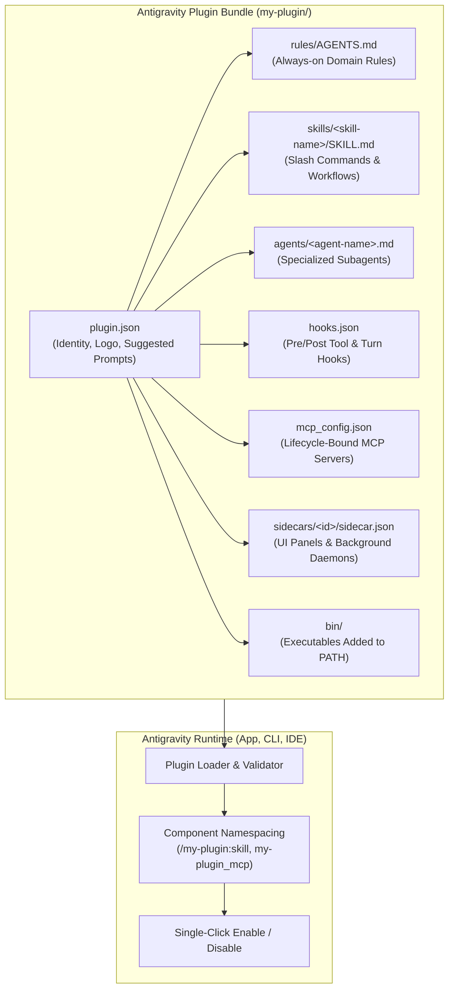
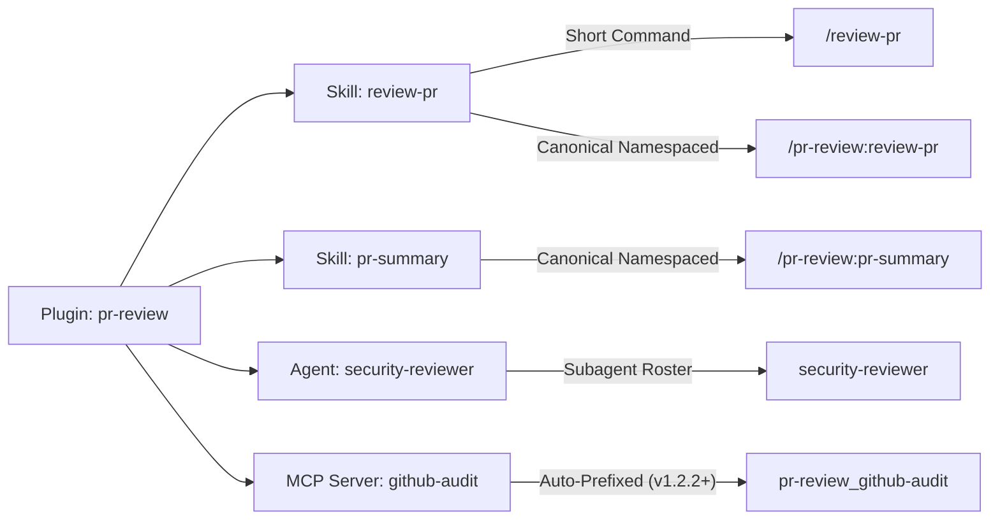
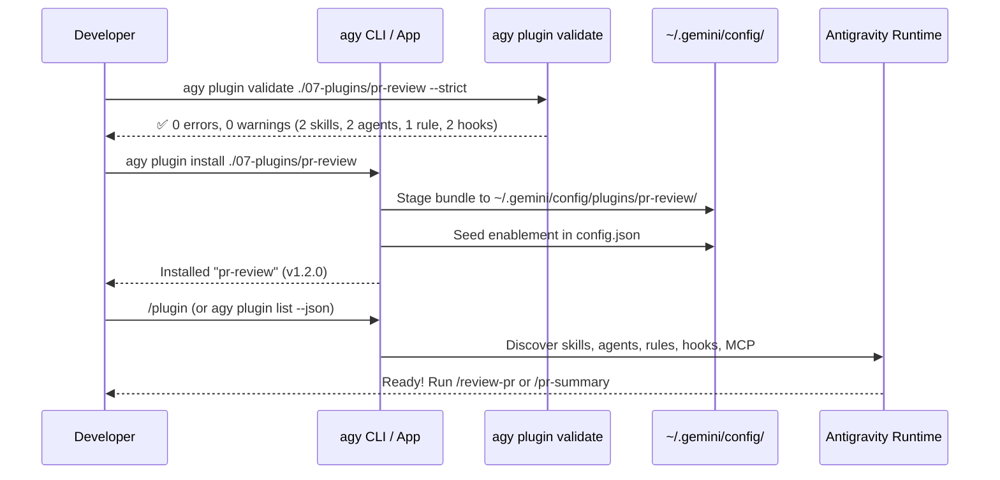

<picture>
  <source media="(prefers-color-scheme: dark)" srcset="../resources/logos/gemini-howto-logo-dark.svg">
  
</picture>

# Module 07: Native Antigravity Plugins (`plugin.json`)

Antigravity **Plugins** are namespaced, self-contained bundles that package **Skills (`skills/`)**, **Subagents (`agents/`)**, **Rules (`rules/AGENTS.md`)**, **Lifecycle Hooks (`hooks.json`)**, **MCP Servers (`mcp_config.json`)**, **Sidecars (`sidecars/`)**, and **CLI Binaries (`bin/`)** into a single installable, toggleable unit.

When a plugin is enabled, every customization inside it becomes active across the **Google Antigravity App**, **Antigravity CLI (`agy`)**, and **Antigravity IDE extensions**. Disabling the plugin cleanly deactivates the entire bundle at once—including stopping any bundled MCP servers or background sidecars.

---

## Table of Contents

1. [Plugin Architecture & Anatomy](#1-plugin-architecture--anatomy)
2. [Directory Layout & Root Manifest Rules](#2-directory-layout--root-manifest-rules)
3. [The `plugin.json` Specification](#3-the-pluginjson-specification)
4. [Discovery Paths & Component Namespacing](#4-discovery-paths--component-namespacing)
5. [Managing Plugins (`/plugin` TUI & `agy plugin` CLI)](#5-managing-plugins-plugin-tui--agy-plugin-cli)
6. [Validating Plugins with `agy plugin validate`](#6-validating-plugins-with-agy-plugin-validate)
7. [Programmatic Management & Language Server RPCs](#7-programmatic-management--language-server-rpcs)
8. [Included Production Plugin Bundles](#8-included-production-plugin-bundles)
   - [Bundle 1: `pr-review` (PR Review & Security Suite)](#bundle-1-pr-review-pr-review--security-suite)
   - [Bundle 2: `devops-automation` (Deployment & Incident Response)](#bundle-2-devops-automation-deployment--incident-response)
   - [Bundle 3: `documentation` (API Docs & Architecture Sync)](#bundle-3-documentation-api-docs--architecture-sync)
9. [Authoring & Publishing Best Practices](#9-authoring--publishing-best-practices)

---

## 1. Plugin Architecture & Anatomy



### When to Package Customizations as a Plugin

| Approach | Scope & Lifecycle | Best For |
| :--- | :--- | :--- |
| **Loose Customizations** (`.agents/skills/`, `.agents/rules/`) | Individual files toggled or edited one by one in a single repo | Project-specific conventions, quick personal scripts, or single-skill prototypes |
| **Antigravity Plugin (`plugin.json`)** | Atomic unit—installed, versioned, validated, and enabled/disabled together | Multi-component workflows (Skill + Subagent + MCP + Hook), team-wide engineering suites, and Marketplace distribution |

Plugins naturally cohere around one of three shapes:
1. **A Data Provider or External Service** (e.g., Firebase, GitHub, ChEMBL, Kubernetes): Bundles the service's MCP server (`mcp_config.json`), the skills that drive it (`skills/`), and rules about its idioms (`rules/AGENTS.md`).
2. **An Artifact or File Type** (e.g., Biomolecular 3D Structures, OpenAPI Specs, Terraform Plans): Bundles specialized viewers (`sidecars/`), validators (`hooks.json`), and domain subagents (`agents/`).
3. **A Role or Recurring Engineering Workflow** (e.g., PR Review, DevOps Incident Response, Documentation Sync): Coordinates multiple skills, subagents, and safety hooks for a repeatable job.

---

## 2. Directory Layout & Root Manifest Rules

> [!IMPORTANT]
> **`hooks.json` and `mcp_config.json` MUST live at the plugin root!**
> Unlike standalone workspace hooks (`.agents/hooks.json`), a plugin's `hooks.json` and `mcp_config.json` are placed directly in the **root directory of the plugin** alongside `plugin.json`—never inside a `hooks/` or `mcp/` subdirectory.

```text
my-plugin/
├── plugin.json                        # Required manifest (JSON / JSONC)
├── README.md                          # User-facing documentation (not loaded into prompt context)
├── mcp_config.json                    # Optional: MCP servers started while plugin is enabled
├── hooks.json                         # Optional: PreToolUse, PostToolUse, PreInvocation, Stop hooks
├── agents.json                        # Optional: Root-level subagent manifest / declarations
├── assets/
│   └── logo.svg                       # Optional: Square icon (128x128+, .svg/.png/.webp)
├── rules/
│   └── AGENTS.md                      # Optional: Plain Markdown rules active while plugin is enabled
├── skills/
│   ├── review-pr/
│   │   └── SKILL.md                   # Invocable as /review-pr or /my-plugin:review-pr
│   └── pr-summary/
│       └── SKILL.md
├── agents/
│   ├── security-reviewer.md           # Markdown subagent with YAML frontmatter
│   └── performance-reviewer.md
├── sidecars/
│   └── metrics-viewer/
│       └── sidecar.json               # Optional: Interactive UI panel or background daemon
└── bin/
    └── my-helper                      # Optional: Executables (chmod +x) added to agent PATH
```

> [!TIP]
> **Alternative Manifest Subdirectories (`v1.3.2+`)**: While placing `plugin.json` at the plugin root is standard and recommended, `agy plugin validate` and the loader also recognize manifests placed at `.antigravity-plugin/plugin.json` or `.gemini-plugin/plugin.json` (and case-insensitive `Plugin.json` since `v1.4.0`). Even when using a manifest subdirectory, all component folders (`skills/`, `agents/`, `rules/`, `hooks.json`, `mcp_config.json`) **must remain at the plugin root**.

---

## 3. The `plugin.json` Specification

`plugin.json` is parsed as **JSONC** (comments and trailing commas are permitted). Keep your manifest clean and strictly limited to supported fields:

```json
{
  "name": "pr-review",
  "displayName": "PR Review Suite",
  "description": "Automated code review, security auditing, and PR summary generation.",
  "version": "1.2.0",
  "logo": "assets/logo.svg",
  "suggestedPrompts": [
    {
      "title": "Review Staged Changes",
      "prompt": "Run /review-pr on my current git diff and check for security issues."
    },
    {
      "title": "Draft PR Summary",
      "prompt": "Use /pr-summary to generate a pull request description from the branch commits."
    }
  ]
}
```

### Field Reference

| Field | Type | Required | Description |
| :--- | :--- | :---: | :--- |
| `name` | `string` | **Yes** | Global unique identifier in lowercase `kebab-case` (e.g., `"pr-review"`). Defaults to the directory name if omitted. If two installed plugins share the same `name`, the first discovered wins and the second is dropped. |
| `displayName` | `string` | No | Human-readable title displayed in UI cards, Marketplace listings, and slash command menus (e.g., `"PR Review Suite"`). |
| `description` | `string` | **Yes** | 1–2 sentences explaining what the plugin does and who it is for. Used by Marketplace search and `/plugin` filtering. |
| `version` | `string` | No | Semantic version string (e.g., `"1.2.0"`). |
| `logo` | `string` | No | Relative path inside the plugin directory (e.g., `"assets/logo.svg"`) ending in `.svg`, `.png`, `.jpg`, `.jpeg`, or `.webp`. External URLs and absolute paths are rejected silently. |
| `suggestedPrompts` | `array` | No | Up to 3 starter prompts displayed on the plugin's detail page in the App and CLI. Supports either plain strings (`"Prompt text"`) or `{ "title": "...", "prompt": "..." }` objects. Selecting one in the App opens a new conversation pre-filled with the prompt. |
| `disabled` | `boolean` | No | If `true`, the plugin installs in the disabled state by default until the user explicitly enables it. Seeded once into `config.json` on first discovery. |
| `skills` | `string[]` | No | Optional explicit list of skill paths to merge with the default `skills/` directory scan. |

> [!WARNING]
> **Avoid Unsupported Top-Level Keys**: Fields from other ecosystems (such as `author`, `homepage`, or `license`) are flagged as unknown fields by `agy plugin validate` and ignored by the runtime loader. Put author and license metadata in your plugin's `README.md` instead.

### Environment Variables Available to Plugins

When a plugin's hooks, MCP servers, or scripts execute, Antigravity injects:
- **`PLUGIN_DATA`**: Path to a persistent, per-plugin data directory that survives across sessions and plugin upgrades—ideal for SQLite caches, state files, or downloaded assets.
- **`bin/` on `PATH`**: Any executable (`chmod +x`) inside the plugin's `bin/` directory is automatically appended to the agent's shell `PATH` while the plugin is enabled.

---

## 4. Discovery Paths & Component Namespacing

### Where Antigravity Discovers Plugins

Antigravity scans the following locations on startup and when workspaces change:

| Scope | Path | Notes |
| :--- | :--- | :--- |
| **Workspace Directory** | `.agents/plugins/<plugin-name>/` | Checked into Git so every contributor on the repository gets the plugin automatically. |
| **Workspace Manifest** | `.agents/plugins.json` | Maps external/shared plugin directories into the workspace (supports `{"path": "...", "include_only": [...]}`). |
| **Global Config (Shared)** | `~/.gemini/config/plugins/<dir>/` | Shared across the Antigravity Desktop App, CLI (`agy`), and IDE extensions. |
| **CLI Staged Directory** | `~/.gemini/antigravity-cli/plugins/<dir>/` | Staged plugins tracked alongside `~/.gemini/antigravity-cli/import_manifest.json`. |
| **Built-in Plugins** | `<appInstall>/builtin/plugins/<name>/` | First-party plugins shipped with Antigravity (can be disabled, cannot be uninstalled). |

### How Component Namespacing Works



1. **Skills & Slash Commands (`/plugin:skill` and `/skill`)**:
   - Every skill in `skills/<skill-name>/SKILL.md` is registered under its short name (`/review-pr`) **and** its canonical plugin-namespaced name (`/pr-review:review-pr`).
   - If two plugins define a skill with the same short name, the plugin prefix (`/pr-review:review-pr`) disambiguates them cleanly without shadowing (`v1.2.7+`).
   - Do **not** hardcode the plugin prefix inside `SKILL.md`'s frontmatter `name:` field—Antigravity namespaces it automatically.
   - To hide a helper skill from the `/` autocomplete menu while keeping it invocable by the model, add `disable-slash-command: true` to its `SKILL.md` frontmatter (`v1.1.12+`).
2. **MCP Servers (`mcp_config.json`)**:
   - Bundled MCP servers are automatically namespaced internally (`<plugin>_<server>`, `v1.2.2+`) so they never collide with user-configured servers in `~/.gemini/config/mcp_config.json` or other plugins.
   - Relative working directories in a plugin's `mcp_config.json` resolve directly against the **plugin's root directory** (`v1.1.28+`).
   - Header variables (such as `"Authorization": "Bearer ${API_TOKEN}"`) are expanded from the plugin's configured settings before connecting (`v1.4.0+`).
   - If a bundled MCP server requires user configuration variables before it can connect, the plugin automatically starts in the **disabled** state until the user fills in the settings form in `/plugin` (`v1.2.11+`).
3. **Subagents (`agents/*.md` and `agents.json`)**:
   - Markdown subagents in `agents/` can access the plugin's own MCP servers when `inheritMcp: true` (or `enable_mcp_tools: true`) is set (`v1.3.2+`).
   - Any relative paths to `skills:`, `rules:`, `agents:`, or `hooks:` inside a custom agent's frontmatter resolve relative to that agent's own file directory (`v1.3.1+`).

---

## 5. Managing Plugins (`/plugin` TUI & `agy plugin` CLI)



### Interactive TUI Manager (`/plugin` or `/plugins`)

Inside the Antigravity CLI or App, type `/plugin` (or `/plugins`) to open the interactive **Plugins Manager**:
- **`Tab`**: Switch between the **Installed** tab and the **Discover** (Marketplace) tab.
- **Discover Tab**:
  - Type to fuzzy-search the official marketplace (`antigravity-plugins-official`).
  - Select **`+ Install from local directory...`** to install a plugin folder from disk.
  - Press `Enter` on any plugin to inspect its components (skills, subagents, MCP servers, rules, hooks, version).
  - Press `Ctrl+S` to install or uninstall the highlighted plugin.
- **Installed Tab**:
  - Type to filter installed plugins (press `Enter` to finish searching, then `Space` to toggle enable/disable).
  - Press `Space` to enable (`●`) or disable (`○`) a plugin live without restarting.
- **Inline Slash Subcommands** (no modal needed):
  ```text
  /plugin list
  /plugin install firebase@antigravity-plugins-official
  /plugin install ./07-plugins/pr-review
  /plugin enable pr-review
  /plugin disable pr-review
  /plugin uninstall pr-review
  ```

### Terminal Subcommands (`agy plugin`)

Manage plugins directly from scripts, dotfiles, or CI pipelines using `agy plugin`:

```bash
# 1. Install from the official Antigravity Marketplace
agy plugin install firebase@antigravity-plugins-official
# (Bare name defaults to @antigravity-plugins-official)
agy plugin install firebase

# 2. Install directly from a GitHub repository
agy plugin install https://github.com/my-org/antigravity-pr-review

# 3. Install from a local directory (try the examples in this module!)
agy plugin install ./07-plugins/pr-review
agy plugin install ./07-plugins/devops-automation
agy plugin install ./07-plugins/documentation

# 4. List all installed plugins (human-readable or machine-readable JSON)
agy plugin list
agy plugin list --json

# 5. Enable, disable, or uninstall a plugin
agy plugin enable pr-review
agy plugin disable pr-review
agy plugin uninstall pr-review
```

---

## 6. Validating Plugins with `agy plugin validate`

Introduced and enhanced in **Antigravity CLI v1.4.0**, `agy plugin validate` checks your plugin using the **exact same parser and loader rules** as the runtime engine:

```bash
# Validate a plugin directory or plugin.json file
agy plugin validate ./07-plugins/pr-review

# Fail on warnings as well as errors (recommended for CI)
agy plugin validate ./07-plugins/pr-review --strict

# Emit machine-readable JSON report for CI/CD pipelines
agy plugin validate ./07-plugins/pr-review --strict --json
```

### What `agy plugin validate` Checks
1. **Manifest Schema & Typos**: Verifies `plugin.json` syntax, checks required/optional field types, and flags unknown top-level fields with *"did you mean?"* suggestions.
2. **Misplaced Components**: Warns if `skills/`, `agents/`, `rules/`, `hooks.json`, or `mcp_config.json` were accidentally placed inside `.antigravity-plugin/` or a `hooks/` subdirectory instead of the plugin root.
3. **Skill & Agent Frontmatter**: Parses every `skills/*/SKILL.md`, `agents/*.md`, and root `agents.json` file—catching unquoted colons in YAML `description:` fields (`v1.3.6+`), missing required fields, or `skills.json` exclusions.
4. **Hook & MCP Validity**: Validates event names and matchers in `hooks.json` and server definitions in `mcp_config.json`.

---

## 7. Programmatic Management & Language Server RPCs

When an Antigravity agent manages plugins on your behalf (using the built-in `plugin` skill), it communicates with the local Antigravity Language Server (`ANTIGRAVITY_LS_ADDRESS`) and links to plugins in chat using the `customization://` URI scheme:

- **UI Deep Links**: `[pr-review](customization://<dir>)` opens the plugin's dedicated management page in the Antigravity App.
- **Directory Keying (`<dir>` vs `name`)**: Marketplace-installed plugins are stored in directories named after a signed 64-bit hash (e.g., `-1870732469773246571`), whereas locally installed plugins use their folder name (`pr-review`). Lifecycle RPCs (`GetAllPlugins`, `JetboxWriteState`, `DeletePlugin`) always key on the install directory segment (`<dir>`), never `plugin.json`'s `name`.

---

## 8. Included Production Plugin Bundles

This directory contains **three complete, ready-to-install Antigravity plugin bundles** that you can inspect, validate, and install right now:

### Bundle 1: `pr-review` (PR Review & Security Suite)

Located in [`./pr-review/`](file:///Users/moc/Projects/gemini-howto/07-plugins/pr-review/):
- **[`plugin.json`](file:///Users/moc/Projects/gemini-howto/07-plugins/pr-review/plugin.json)**: Manifest with display name, version, and starter prompts.
- **[`rules/AGENTS.md`](file:///Users/moc/Projects/gemini-howto/07-plugins/pr-review/rules/AGENTS.md)**: Enforces constructive, evidence-backed code review standards with clickable `file://` line links and severity ratings.
- **[`hooks.json`](file:///Users/moc/Projects/gemini-howto/07-plugins/pr-review/hooks.json)**: `PreToolUse` guard blocking `git push --force` during reviews and `PostToolUse` audit logging.
- **[`skills/review-pr/SKILL.md`](file:///Users/moc/Projects/gemini-howto/07-plugins/pr-review/skills/review-pr/SKILL.md)**: Multi-step `/review-pr` workflow that inspects diffs, delegates to security & performance subagents, and outputs a structured review report.
- **[`skills/pr-summary/SKILL.md`](file:///Users/moc/Projects/gemini-howto/07-plugins/pr-review/skills/pr-summary/SKILL.md)**: `/pr-summary` skill that analyzes commit history and generates a changelog-ready PR description with test plans.
- **[`agents/security-reviewer.md`](file:///Users/moc/Projects/gemini-howto/07-plugins/pr-review/agents/security-reviewer.md)**: Read-only OWASP & secrets auditing specialist subagent.
- **[`agents/performance-reviewer.md`](file:///Users/moc/Projects/gemini-howto/07-plugins/pr-review/agents/performance-reviewer.md)**: Algorithmic complexity, memory allocation, and N+1 query reviewer subagent.

### Bundle 2: `devops-automation` (Deployment & Incident Response)

Located in [`./devops-automation/`](file:///Users/moc/Projects/gemini-howto/07-plugins/devops-automation/):
- **[`plugin.json`](file:///Users/moc/Projects/gemini-howto/07-plugins/devops-automation/plugin.json)**: DevOps & SRE automation manifest.
- **[`rules/AGENTS.md`](file:///Users/moc/Projects/gemini-howto/07-plugins/devops-automation/rules/AGENTS.md)**: Zero-downtime deployment rules, mandatory canary checks, and production blast-radius guardrails.
- **[`hooks.json`](file:///Users/moc/Projects/gemini-howto/07-plugins/devops-automation/hooks.json)**: `PreToolUse` safety gate that intercepts destructive `kubectl delete` / `terraform destroy` commands and requires pre-deployment verification.
- **[`mcp_config.json`](file:///Users/moc/Projects/gemini-howto/07-plugins/devops-automation/mcp_config.json)**: Bundles a Kubernetes & Prometheus observability MCP server configuration bound to the plugin lifecycle.
- **[`skills/deploy/SKILL.md`](file:///Users/moc/Projects/gemini-howto/07-plugins/devops-automation/skills/deploy/SKILL.md)**: `/deploy` skill with pre-flight checklist, canary rollout, and post-deploy smoke verification.
- **[`skills/rollback/SKILL.md`](file:///Users/moc/Projects/gemini-howto/07-plugins/devops-automation/skills/rollback/SKILL.md)**: `/rollback` emergency reversion workflow with incident timeline capture.
- **[`agents/incident-responder.md`](file:///Users/moc/Projects/gemini-howto/07-plugins/devops-automation/agents/incident-responder.md)**: On-call triage subagent (`model: pro`) for log correlation and root-cause isolation.

### Bundle 3: `documentation` (API Docs & Architecture Sync)

Located in [`./documentation/`](file:///Users/moc/Projects/gemini-howto/07-plugins/documentation/):
- **[`plugin.json`](file:///Users/moc/Projects/gemini-howto/07-plugins/documentation/plugin.json)**: Technical documentation and diagram synchronization suite.
- **[`rules/AGENTS.md`](file:///Users/moc/Projects/gemini-howto/07-plugins/documentation/rules/AGENTS.md)**: Enforces GitHub Flavored Markdown, valid Mermaid diagram types, KaTeX escaping (`\$`), and clickable `file://` symbol links.
- **[`hooks.json`](file:///Users/moc/Projects/gemini-howto/07-plugins/documentation/hooks.json)**: `PostToolUse` hook on `write_to_file` / `replace_file_content` to verify Markdown link integrity and Mermaid syntax on `.md` files.
- **[`skills/docs-update/SKILL.md`](file:///Users/moc/Projects/gemini-howto/07-plugins/documentation/skills/docs-update/SKILL.md)**: `/docs-update` workflow that diffs recent code changes and synchronizes READMEs, OpenAPI specs, and architecture diagrams.
- **[`agents/api-documenter.md`](file:///Users/moc/Projects/gemini-howto/07-plugins/documentation/agents/api-documenter.md)**: Specialist subagent that extracts function signatures, types, and HTTP routes into reference tables.

---

## 9. Authoring & Publishing Best Practices

1. **One Coherent Purpose Per Plugin**: Because enabling or disabling a plugin toggles all of its rules, hooks, and MCP servers together, keep each plugin focused on a single domain or workflow.
2. **Quote Descriptions with Colons in YAML Frontmatter**: In `SKILL.md` and `agents/*.md`, always wrap `description: "..."` in double quotes so colons inside the description never break YAML parsing.
3. **Prefix Bundled MCP Server Names**: Even though Antigravity auto-namespaces plugin MCP servers (`v1.2.2+`), naming your server `"devops-k8s-telemetry"` instead of `"server"` makes `/mcp` and permission prompts (`mcp(devops-k8s-telemetry/*)`) immediately self-explanatory.
4. **Always Validate Before Publishing**: Run `agy plugin validate ./my-plugin --strict` locally and in GitHub Actions to catch schema or path mistakes before users install your bundle.

---

| [← Module 06: Hooks](../06-hooks/README.md) | [🏠 Home](../README.md) | [Module 08: Checkpoints, Artifacts & Sidecars →](../08-checkpoints/README.md) |
| :--- | :---: | ---: |
