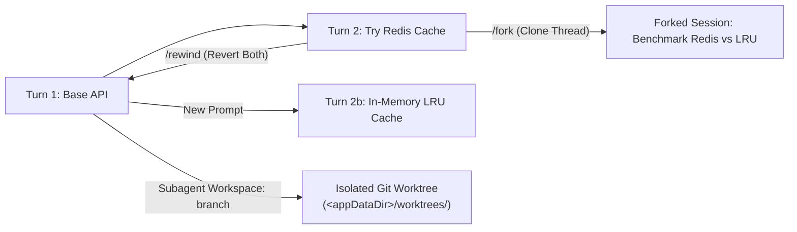
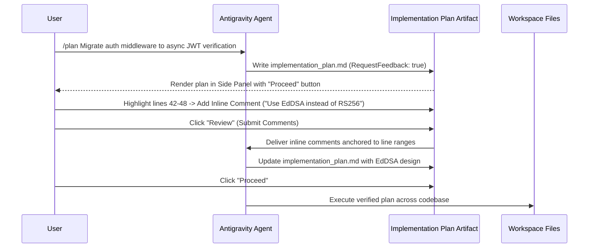
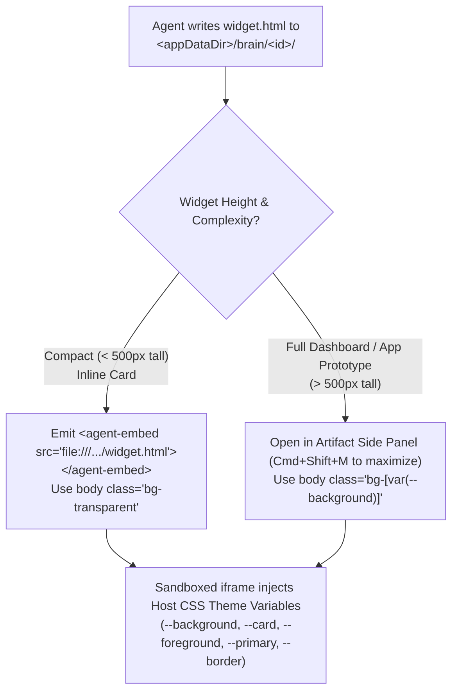
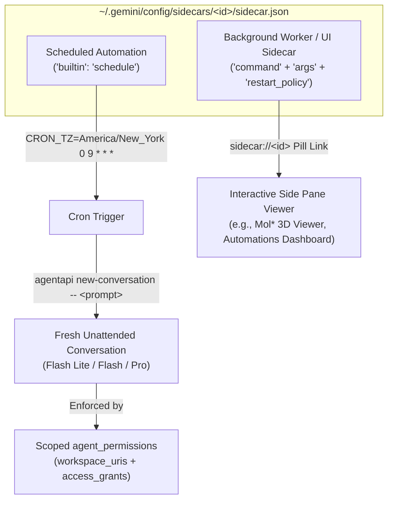

<picture>
  <source media="(prefers-color-scheme: dark)" srcset="../resources/logos/gemini-howto-logo-dark.svg">
  
</picture>

# Module 08: Checkpoints, Artifacts, Generative UI & Sidecars

Antigravity goes far beyond basic conversation checkpoints by combining **four integrated state and visualization systems**:

1. **Checkpoints, Rewind, Session Forking & Git Worktrees**: Instant time-travel across conversation turns and disk state (`/rewind`, `/fork`, `/diff`), with isolated Git worktrees for parallel exploration.
2. **Artifacts & Implementation Plans**: Rich, persistent Markdown documents stored in `<appDataDir>/brain/<conversation-id>/` with inline line-by-line review comments, **Proceed / Review** gates, and PDF export.
3. **Generative UI (`<agent-embed>`)**: Self-contained, theme-aware HTML/Tailwind/JS interactive widgets rendered directly inline in chat or as full-pane visual dashboards.
4. **Sidecars & Scheduled Automations (`sidecar.json`)**: Long-running background services, interactive UI panels (`sidecar://`), and cron-triggered autonomous agent runs (`"builtin": "schedule"`).

---

## Table of Contents

1. [Pillar 1: Checkpoints, Rewind, Forking & Git Worktrees](#1-pillar-1-checkpoints-rewind-forking--git-worktrees)
2. [Pillar 2: Artifacts & Implementation Plans (`/plan`)](#2-pillar-2-artifacts--implementation-plans-plan)
3. [Pillar 3: Generative UI (`<agent-embed>` & Theme-Aware Widgets)](#3-pillar-3-generative-ui-agent-embed--theme-aware-widgets)
4. [Pillar 4: Sidecars & Scheduled Automations (`sidecar.json` & `/schedule`)](#4-pillar-4-sidecars--scheduled-automations-sidecarjson--schedule)
5. [Included Templates, Widgets & Configuration Examples](#5-included-templates-widgets--configuration-examples)

---

## 1. Pillar 1: Checkpoints, Rewind, Forking & Git Worktrees

Every time you send a prompt in the Antigravity App, CLI (`agy`), or IDE extension, Antigravity automatically snapshots both the **conversation trajectory** and **workspace file state**.



### Rewinding State (`/rewind` / `/undo` & App Confirm Undo)

| Surface | How to Trigger | Capabilities |
| :--- | :--- | :--- |
| **Antigravity CLI (`agy`)** | `/rewind` (alias `/undo`) | Opens the interactive step timeline with relative timestamps (`v1.2.9+`), focused on the most recent turn. Select any prior message to roll back. Messages compacted earlier to save context are dimmed and labeled `cleared to save space, can't rewind here` (`v1.3.1+`). |
| **Antigravity App** | Click **Undo / Revert** on any earlier user turn | Opens the **Confirm Undo** dialog (`v2.19.1+`) with an explicit checkbox to **revert only the conversation** (keeping your code edits on disk intact) or **revert both conversation and files** back to that checkpoint. |
| **VS Code / Visual Studio** | Conversation Rollback | Rolling back a turn immediately reverts open inline and side-by-side diff reviews in the editor and clears stored review decisions for the rolled-back turn (`v1.8.0+`). |

### Cloning Sessions with `/fork` (`/branch`)

When you want to explore a second architectural direction **without discarding** your current progress:
- Run `/fork` (alias `/branch`) in the CLI or select **Fork Conversation** in the App.
- Antigravity clones the conversation history up to the current step into a brand-new, independent session ID (stripping internal `.system_generated/subagents` and `.system_generated/worktrees` residue so the fork starts clean).
- If you accidentally open the same conversation in two CLI terminals simultaneously, Antigravity displays a non-blocking advisory banner pointing you to `/fork` so the two terminals don't interleave steps (`v1.1.10+`).

### Interactive Diff Viewer (`/diff`)

Run `/diff` in the CLI (or open the **Changes / Overview** side panel in the App) to inspect uncommitted changes, per-turn diffs, and the latest **100 Git/Jujutsu commits** (`v1.4.0+`):
- **`Tab` / `Shift+Tab`**: Cycle between **Uncommitted Changes**, **Turns**, and **Commit Tree** views.
- **`j` / `k` or `↑` / `↓`**: Move line-by-line through the diff (`v1.3.0+`).
- **`←` / `→`**: Jump to the previous or next modified file at its first hunk.
- **`n` / `N`**: Jump to the next or previous change hunk across files (`v1.3.1+`).
- **`Ctrl+O`**: Expand or collapse folded unchanged context lines above a hunk (`v1.3.5+`).
- **`f`**: Toggle between showing only changed hunks and the entire file (`v1.3.5+`).

### Git Worktree Isolation (`Local` vs `Worktree`)

For zero-conflict parallel development, Antigravity supports native Git worktrees at two levels:
1. **Project Thread Composer (`Local` vs `Worktree`)**: When starting a new conversation in the Antigravity App, toggle the target from **Local** (works directly in your checkout) to **Worktree** (automatically creates an isolated Git worktree branch for that conversation). You can also sort sidebar conversations by worktree.
2. **Subagent Workspaces (`Workspace: "branch" | "share"`)**: When invoking a subagent via `invoke_subagent`, setting `Workspace: "branch"` or `"share"` gives the subagent its own isolated worktree under `<appDataDir>/worktrees/` (`v1.2.10+`) across single- or multi-repository workspaces (`v1.3.3+`).

---

## 2. Pillar 2: Artifacts & Implementation Plans (`/plan`)

Artifacts are structured documents stored in `<appDataDir>/brain/<conversation-id>/` (typically `~/.gemini/antigravity/brain/<conversation-id>/`). The agent creates and updates artifacts using `write_to_file` with `ArtifactMetadata`:

```json
{
  "TargetFile": "/Users/alice/.gemini/antigravity/brain/4287e724-.../implementation_plan.md",
  "Overwrite": true,
  "Description": "Create implementation plan for WebSocket notification service",
  "ArtifactMetadata": {
    "Summary": "Architecture, schema changes, and verification plan for real-time notifications.",
    "UserFacing": true,
    "RequestFeedback": true
  }
}
```

### Implementation Plan Workflow & Inline Commenting



### Artifact Review Policies (`Plan Review Policy`)

Configure when the agent pauses for approval on Implementation Plans and artifacts via **Settings > Agent > Plan Review Policy** in the App, or `/config` (`artifactReviewPolicy` in `~/.gemini/antigravity-cli/settings.json`) in the CLI:

| App Setting | CLI `artifactReviewPolicy` | Behavior |
| :--- | :--- | :--- |
| **Request Review** | `asks-for-review` *(default)* | Always pauses and presents the **Proceed** / **Review** buttons when an executable artifact (`RequestFeedback: true`) is created. |
| **Agent Decides** | `agent-decides` | The agent requests review only on complex or architectural changes and proceeds automatically on trivial tasks. |
| **Always Proceed** | `always-proceed` | Never pauses for plan review; the agent writes the plan and immediately begins execution. |

> [!NOTE]
> **`--dangerously-skip-permissions` vs Plan Review (`v1.3.2+`)**: Passing `--dangerously-skip-permissions` in the CLI skips *tool* permission prompts, but intentionally **still pauses** on your implementation plan in `/plan` mode so you can review the design before code is written. Set `artifactReviewPolicy: "always-proceed"` if you want completely unattended `/plan` execution.

### Rich Artifact Formatting & Viewer Shortcuts

Antigravity Markdown artifacts support:
- **GitHub Flavored Alerts**: `> [!NOTE]`, `> [!TIP]`, `> [!IMPORTANT]`, `> [!WARNING]`, `> [!CAUTION]` (rendered natively in both App and CLI `v1.1.12+`).
- **Mermaid Diagrams & KaTeX Math**: Rendered as crisp interactive SVGs in the App, and rendered inline via **Kitty graphics** (with automatic Unicode ASCII fallback) in the CLI artifact viewer (`v1.2.7+`).
- **Carousels**: Use ````carousel with `<!-- slide -->` separators to build interactive step-by-step walkthroughs and before/after comparisons.
- **Export as PDF (`v2.19.1+`)**: In the Antigravity App side panel, open the overflow menu (`...`) on any rendered Markdown artifact to export it as a formatted PDF complete with tables, syntax-highlighted code blocks, and Mermaid diagrams.
- **CLI Artifact Viewer Keys**:
  - `t`: Open the **Heading Outline** jump menu (`v1.1.12+`).
  - `m`: Cycle diagram/math rendering between **Image**, **ASCII**, and **Raw Source** (`v1.2.7+`).
  - `/` then `n` / `N`: Search keywords inside the artifact (`v1.1.1+`).
  - `Ctrl+G`: Open the artifact in your external `$EDITOR` (`v1.0.15+`).

---

## 3. Pillar 3: Generative UI (`<agent-embed>` & Theme-Aware Widgets)

When static Markdown or Mermaid diagrams aren't enough—such as interactive calculators, latency simulators, parameter explorers, or custom charts—Antigravity's **Generative UI** lets the agent build self-contained `.html` artifacts and embed them directly in the chat stream or side panel.



### Golden Rules of Antigravity Generative UI

1. **Allowlisted Tailwind CSS Script**:
   Content Security Policy (CSP) blocks arbitrary external CDNs inside artifact iframes, except for the official allowlisted gstatic Tailwind script:
   ```html
   <script src="https://www.gstatic.com/antigravity/web/dev/tailwindcss.min.js"></script>
   ```
2. **Live Semantic Theme Variables (Light & Dark Mode Automatically)**:
   The host iframe automatically injects Antigravity's design-system CSS variables. **Never** hardcode `bg-slate-900` or `text-white`, and **never** define `:root` fallback overrides in a `<style>` block:
   - Surfaces: `bg-[var(--background)]`, `bg-[var(--card)]`, `bg-[var(--content)]`, `bg-[var(--sidebar)]`
   - Borders: `border-[var(--border)]`
   - Typography: `text-[var(--foreground)]`, `text-[var(--muted-foreground)]`, `text-[var(--placeholder)]`
   - Accents: `bg-[var(--primary)]`, `text-[var(--primary-foreground)]`, `bg-[var(--secondary)]`, `text-[var(--secondary-foreground)]`, `bg-[var(--accent)]`
3. **Inline (`<agent-embed>`) Sizing & Viewport Rules**:
   - Embed compact widgets (`< 500px` tall) inline in chat using:
     ```html
     <agent-embed src="file:///Users/alice/.gemini/antigravity/brain/<conv-id>/widget.html"></agent-embed>
     ```
   - **Never** use `h-screen`, `min-h-screen`, `100vh`, or `height: 100%` on a top-level inline container (the iframe height is derived from your content, so viewport-relative heights collapse to a sliver).
   - Keep minimum font size at `12px` (`text-xs`) or larger—never use sub-12px micro-text (`text-[10px]`).

---

## 4. Pillar 4: Sidecars & Scheduled Automations (`sidecar.json` & `/schedule`)

Antigravity **Sidecars** are background processes, UI extension panels, or cron-scheduled automations defined by a `sidecar.json` manifest in `~/.gemini/config/sidecars/<sidecar-id>/sidecar.json` (or bundled inside a plugin under `sidecars/<sidecar-id>/sidecar.json`).



### Type 1: Scheduled Automations (`/schedule` & `/automation`)

Renamed from *Scheduled Tasks* to **Automations** in Antigravity App `v2.21.1+`, Scheduled Automations run unattended on a cron schedule and launch a fresh agent conversation (`agentapi new-conversation`) on each trigger.

- **How to Create**:
  - Type `/schedule <when> <task>` or `/automation` in chat to have the agent interactively configure the schedule, write `~/.gemini/config/sidecars/<id>/sidecar.json`, and offer a **live test run** to verify exact permissions.
  - Or click **Create with Prompt** / **Run Now** in the **Automations** view (`[Open Automations Dashboard](sidecar://dashboard)`).
- **Model Selection (`v2.24.0+`)**: You can choose **Flash Lite**, **Flash** (default), or **Pro** for any automation when creating or editing it.
- **Strict Permission Scoping (`agent_permissions`)**:
  Because scheduled automations run unattended, any non-approved tool call is **auto-denied**. You grant least-privilege access in `sidecar.json` using `snake_case` keys:
  - `workspace_uris`: `["file:///Users/alice/Projects/my-repo"]`
  - `access_grants`: Specific `action(target)` rules such as `"command(gh pr list)"`, `"read_file(/Users/alice/notes)"`, `"read_url(github.com)"`, or `"mcp(linear/list_issues)"`. Never use wildcard `command(*)` or `read_file(*)`.

### Type 2: Background Worker & Interactive UI Sidecars (`sidecar://`)

Plugins and power users can also register long-running daemon workers or custom UI extension panels (`v2.22.0+`):
- Whenever an agent loads data into a UI sidecar (such as the Biomolecular Structure Viewer or Automations Dashboard), it surfaces a one-click **`sidecar://` pill link** in chat:
  - `[Open Automations Dashboard](sidecar://dashboard)`
  - `[Open 3D Structure Viewer](sidecar://biomolecular-structure-viewer)`

### In-Session Timers (`schedule` Tool)

In addition to persistent `sidecar.json` automations, the agent can set in-session one-shot timers or recurring monitors during an active conversation using the built-in `schedule` tool:
- **One-Shot Timer (`DurationSeconds`)**: Supports `TimerCondition: "never"` (unconditional reminder), `"any"` (wakes early if any subagent/task sends a message), or `"<task-or-subagent-id>"` (liveness timeout that auto-cancels as soon as that specific task finishes).
- **Recurring Monitor (`CronExpression`)**: Supports `MaxIterations` and `IsDaemon: false` (keeps the current task active while polling a deployment) or `IsDaemon: true` (standing background job).

---

## 5. Included Templates, Widgets & Configuration Examples

Explore the ready-to-use files in this directory:

- **[`checkpoint-and-worktree-examples.md`](file:///Users/moc/Projects/gemini-howto/08-checkpoints/checkpoint-and-worktree-examples.md)**: Step-by-step playbooks for `/rewind` (conversation-only vs full undo), `/fork`, `/diff` keyboard navigation, and multi-agent Git Worktrees.
- **[`implementation-plan-template.md`](file:///Users/moc/Projects/gemini-howto/08-checkpoints/implementation-plan-template.md)**: Production Implementation Plan artifact template featuring architecture diagrams, carousel slides, inline review markers, and verification gates.
- **[`generative-ui-widget.html`](file:///Users/moc/Projects/gemini-howto/08-checkpoints/generative-ui-widget.html)**: Complete, runnable **Model Latency & Token Cost Simulator** built with `tailwindcss.min.js` and Antigravity's live `var(--card)` / `var(--primary)` CSS variables.
- **[`sidecar-schedule-example.json`](file:///Users/moc/Projects/gemini-howto/08-checkpoints/sidecar-schedule-example.json)**: Production `sidecar.json` for a weekday 9:00 AM PR & CI Health Digest automation using `CRON_TZ` and least-privilege `access_grants`.
- **[`sidecar-worker-example.json`](file:///Users/moc/Projects/gemini-howto/08-checkpoints/sidecar-worker-example.json)**: Production `sidecar.json` for a persistent local telemetry collector and UI sidecar daemon.

---

| [← Module 07: Plugins](../07-plugins/README.md) | [🏠 Home](../README.md) | [Module 09: Advanced Features →](../09-advanced-features/README.md) |
| :--- | :---: | ---: |
