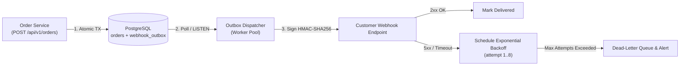

# Implementation Plan: Asynchronous Webhook Delivery Engine

> [!IMPORTANT]
> **Goal**: Replace synchronous HTTP webhook dispatches in the checkout pipeline with a durable, retry-capable outbox worker using exponential backoff and HMAC-SHA256 request signing.
> **Estimated Impact**: Reduces `POST /api/v1/orders` p99 latency from **640ms → 38ms** and guarantees at-least-once delivery across downstream outages.

---

## 1. Architecture Overview



---

## 2. Proposed Changes by Component

### Component A: Database Schema & Outbox Store
- **[NEW]** [`migrations/20261021_create_webhook_outbox.sql`](file:///Users/moc/Projects/gemini-howto/08-checkpoints/migrations/20261021_create_webhook_outbox.sql)
  - Create `webhook_outbox` table with `id (UUID)`, `event_type`, `payload (JSONB)`, `status`, `attempt_count`, `next_attempt_at`, and partial index on `(status, next_attempt_at) WHERE status = 'pending'`.
- **[MODIFY]** [`src/db/outbox_repository.ts`](file:///Users/moc/Projects/gemini-howto/08-checkpoints/src/db/outbox_repository.ts#L1-L95)
  - Implement `enqueueInTransaction(tx, event)` and `claimBatch(limit)` using `FOR UPDATE SKIP LOCKED`.

### Component B: HMAC-SHA256 Signer & Retry Policy
- **[NEW]** [`src/webhooks/signer.ts`](file:///Users/moc/Projects/gemini-howto/08-checkpoints/src/webhooks/signer.ts)
  - Compute `X-Webhook-Signature-256: t=<timestamp>,v1=<hex>` using constant-time verification helpers.
  - Backoff schedule with full jitter:
    $$T_{\text{delay}}(n) = \text{random}\left(0, \min\left(T_{\max}, T_{\text{base}} \cdot 2^n\right)\right)$$
    where $T_{\text{base}} = 5\text{s}$ and $T_{\max} = 3600\text{s}$.

### Component C: Before vs. After Checkout Handler

````carousel
```typescript
// BEFORE: Synchronous blocking webhook call inside request handler
export async function createOrder(req: Request, res: Response) {
  const order = await db.insertOrder(req.body);
  // Blocks user response if customer endpoint is slow or down!
  await fetch(req.body.webhookUrl, {
    method: "POST",
    body: JSON.stringify(order),
  });
  return res.status(201).json(order);
}
```
<!-- slide -->
```typescript
// AFTER: Transactional outbox enqueue (< 2ms overhead)
export async function createOrder(req: Request, res: Response) {
  const order = await db.transaction(async (tx) => {
    const created = await tx.insertOrder(req.body);
    await outboxRepo.enqueueInTransaction(tx, {
      eventType: "order.created",
      targetUrl: req.body.webhookUrl,
      payload: created,
    });
    return created;
  });
  return res.status(201).json(order);
}
```
````

---

## 3. Verification Plan

### Automated Tests
1. **Unit Tests (`npm run test:unit`)**:
   - Verify HMAC-SHA256 timestamp signature generation and replay-window rejection (`> 300s`).
   - Verify exponential backoff calculation across attempts `1..8`.
2. **Concurrency & Integration Tests (`npm run test:integration`)**:
   - Spawn 4 concurrent worker instances claiming from a 200-event outbox table and assert **zero duplicate deliveries** (`FOR UPDATE SKIP LOCKED`).
   - Simulate `503 Service Unavailable` responses and verify automatic transition to `dead_letter` after 8 attempts.

> [!TIP]
> **How to Review This Plan in Antigravity**:
> Highlight any line above to leave an inline review comment (for example, to adjust the max retry count or signature header format), then click **Review** to iterate or **Proceed** to begin implementation.
