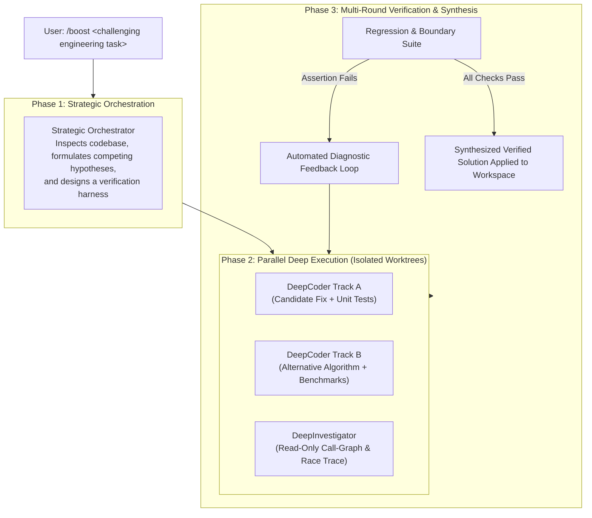
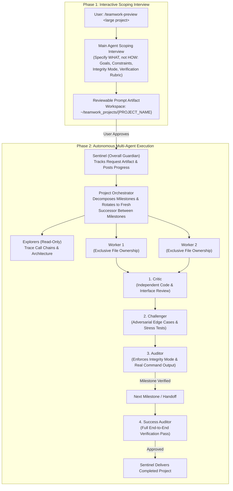
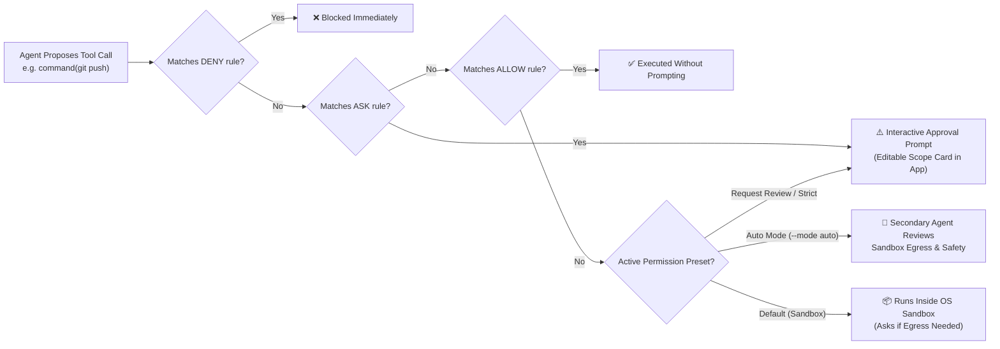

<picture>
  <source media="(prefers-color-scheme: dark)" srcset="../resources/logos/gemini-howto-logo-dark.svg">
  
</picture>

# Module 09: Advanced Features (`/boost`, `/teamwork-preview`, Permissions, OS Sandbox & Remote Control)

This module covers Google Antigravity's flagship multi-agent reasoning systems, security architecture, model fleet controls, and cross-device remote execution:

1. **Boost Mode (`/boost`)**: 3-phase multi-agent deep reasoning for subtle concurrency bugs, algorithmic optimization, and intricate multi-file refactors.
2. **Teamwork Mode (`/teamwork-preview`)**: 2-phase autonomous multi-agent engineering teams with a 4-tier adversarial verification gate (**Critic**, **Challenger**, **Auditor**, **Success Auditor**).
3. **Autonomous Goal Mode (`/goal`), Design Interviews (`/grill-me`), & Background Side Questions (`/btw`)**.
4. **Frontier Model Fleet & Effort Tuning (`/model` & `/effort`)**: **Gemini 4 Argon**, **Gemini 3.8 Flash**, **Gemini 3.1 Pro**, **Nano Banana 2**, and Vertex AI / ADC partner models.
5. **Unified Fine-Grained Permissions (`action(target)`) & Auto Mode (`--mode auto`)**: Strict **Deny > Ask > Allow** evaluation, `regex:` token matching, and secondary-agent sandbox egress review.
6. **OS-Level Terminal Sandbox**: Zero-overhead kernel containment via macOS Seatbelt (`sandbox-exec`), Linux `nsjail`, and Windows `AppContainer`.
7. **Remote Control (`agy remote-control` & `/remote-control`)**: Drive local desktop and CLI sessions from any browser or mobile device at `https://antigravity.google.com`.

---

## Table of Contents

1. [Choosing the Right Execution Mode](#1-choosing-the-right-execution-mode)
2. [Boost Mode (`/boost`): 3-Phase Deep Reasoning](#2-boost-mode-boost-3-phase-deep-reasoning)
3. [Teamwork Mode (`/teamwork-preview`): Autonomous Agent Teams](#3-teamwork-mode-teamwork-preview-autonomous-agent-teams)
4. [`/goal`, `/grill-me`, `/btw` & Slash Command Stacking](#4-goal-grill-me-btw--slash-command-stacking)
5. [Frontier Model Fleet & Reasoning Effort (Oct 2026)](#5-frontier-model-fleet--reasoning-effort-oct-2026)
6. [Unified Fine-Grained Permissions (`action(target)`) & Auto Mode](#6-unified-fine-grained-permissions-actiontarget--auto-mode)
7. [OS-Level Terminal Sandbox Architecture](#7-os-level-terminal-sandbox-architecture)
8. [Remote Control (`agy remote-control` & `/remote-control`)](#8-remote-control-agy-remote-control--remote-control)
9. [Included Playbooks & Configuration Profiles](#9-included-playbooks--configuration-profiles)

---

## 1. Choosing the Right Execution Mode

| Dimension | Default Agent | 🚀 Boost (`/boost`) | 👥 Teamwork (`/teamwork-preview`) | 🎯 Goal (`/goal`) |
| :--- | :--- | :--- | :--- | :--- |
| **Primary Focus** | Interactive pair programming | **Deep reasoning & tough bugs** | **Large multi-day projects & proofs** | **Unattended completion** |
| **Time Horizon** | Seconds to minutes | **Minutes to hours** | **Hours to days** | **Minutes to overnight** |
| **Scoping Phase** | Immediate single prompt | **Immediate 3-phase pipeline** | **Phase 1 interactive scoping interview** | Immediate autonomous loop |
| **Architecture** | Single-agent + subagents | **Strategic Orchestrator + parallel DeepCoder / DeepInvestigator** | **Sentinel + Orchestrator + Explorers + Workers + 4-Tier Auditors** | Persistent self-verifying loop |
| **Workspace Isolation** | Active workspace | **Ephemeral isolated Git worktrees** | **Dedicated `~/teamwork_projects/{NAME}` + exclusive file ownership** | Active workspace |
| **Verification** | Tool/test execution | **Multi-round independent test & regression harness** | **Adversarial Critic, Challenger, Auditor & Success Auditor** | Continuous check against objective |

---

## 2. Boost Mode (`/boost`): 3-Phase Deep Reasoning

When standard single-turn assistance falls short on intermittent deadlocks, lock-free algorithms, or tightly coupled multi-file refactors, invoke `/boost <task>` in the Antigravity App or CLI:



### Usage Examples

```text
# Debug a multithreaded race condition
/boost Reproduce and fix the intermittent deadlock in the connection pool during high connection turnover.

# Optimize a hot-path algorithm with benchmarks
/boost Optimize the matrix transposition routine to use SIMD vectorization and benchmark throughput before and after.

# Trace a root cause without modifying files
/boost Trace why HTTP request timeouts spike when batch payload size exceeds 2MB, without modifying code.
```

---

## 3. Teamwork Mode (`/teamwork-preview`): Autonomous Agent Teams

For repository-scale migrations, cycle-accurate simulators, or formal mathematical proofs, `/teamwork-preview <task>` orchestrates a hierarchical engineering team across **two structured phases**.



### The 4 Adversarial Verification Gates

Unlike single-agent coding where the author grades its own homework, Teamwork requires every milestone to survive four independent gates:
1. **Critic**: Performs independent code review checking logical completeness, interface conformance, and style.
2. **Challenger**: Writes adversarial stress tests, boundary probes, and failure-path inputs designed to break the Worker's implementation.
3. **Auditor**: Verifies test evidence against real command execution logs and enforces the chosen **Integrity Mode** (confirming no tests were mocked, skipped, or hardcoded).
4. **Success Auditor**: Spawned by **Sentinel** at the end of the project to run a full end-to-end verification pass before delivery.

### Integrity Modes

During the Phase 1 interview, Teamwork maps your shortcut constraints to one of three internal integrity modes:

| Integrity Mode | Purpose | Verification Strictness |
| :--- | :--- | :--- |
| **`development`** *(default)* | Rapid production engineering | Flags fabricated outputs and facade implementations; permits third-party libraries and code reuse. |
| **`demo`** | Reproducible presentations | Prohibits copying core logic from open source, delegating core work to external tools, or reading test source to reverse-engineer answers. |
| **`benchmark`** | Ground-truth evaluation | Maximum strictness: 100% from-scratch implementation using the language standard library only; zero shortcuts or mocked passes. |

---

## 4. `/goal`, `/grill-me`, `/btw` & Slash Command Stacking

- **`/goal <objective>` (Autonomous Goal Mode)**: Instructs the agent to work thoroughly through multi-step implementation, debugging, and verification without stopping prematurely until the objective is demonstrably complete.
- **`/grill-me` (Interactive Design Interview)**: Reverses the prompt flow—before writing a single line of code, the agent interviews you using structured questions (`ask_question`) to surface hidden edge cases, schema trade-offs, and failure modes.
- **Slash Command Stacking (`v1.1.4+`)**: You can chain multiple leading slash commands in a single prompt, and Antigravity activates them in sequence:
  ```text
  /plan /grill-me Design a multi-region rate limiter backed by Redis Cluster
  ```
- **`/btw <query>` (Ephemeral Background Side Questions)**: Ask a quick question in the background (`v2.1.4+` / CLI `v1.1.3+`) that has full read access to your current conversation context without interrupting an in-flight agent turn or polluting the main transcript. Copy its answer anytime with `/copy btw` (`v1.2.3+`).

---

## 5. Frontier Model Fleet & Reasoning Effort (Oct 2026)

Switch models anytime via the model picker in the App or `/model` (and `--model`) in the CLI, and tune reasoning depth with `/effort [low|medium|high|max]` (or `--effort`):

| Model | Identifier / CLI Slug | Tier Availability | Best For |
| :--- | :--- | :--- | :--- |
| **Gemini 4 Argon** | `gemini-4-argon` | AI Pro (paid), AI Ultra, Enterprise | Flagship frontier reasoning, `/boost`, complex system architecture, and subtle bug hunting. Supports `/effort low\|medium\|high\|max`. |
| **Gemini 3.8 Flash** | `gemini-3.8-flash` | Free, AI Plus, AI Pro, AI Ultra, Enterprise | Ultra-fast default agentic coding, subagent workers, and scheduled automations. |
| **Gemini 3.1 Pro** | `gemini-3.1-pro` | Enterprise (`Gemini Enterprise` / Vertex AI) | Enterprise regional compliance and balanced multi-step engineering. |
| **Gemini 3.7 / 3.6 Flash** | `gemini-3.7-flash` | Enterprise | High-throughput enterprise workloads. |
| **Nano Banana 2** | *(Auto-invoked via `image-generator`)* | All plans | UI mockups, web assets, and system architecture visuals generated via the built-in `image-generator` subagent (`v1.2.16+`). |
| **Claude Opus 5.5 / Sonnet 5.5 (thinking)** | Partner models | AI Pro (paid), AI Ultra, Enterprise, & Vertex AI ADC (`AGY_ADC_AUTH`, `v1.3.6+`) | Alternative thinking models (automatically filtered in `/model` based on GCP project entitlement). |

---

## 6. Unified Fine-Grained Permissions (`action(target)`) & Auto Mode

Antigravity evaluates every sensitive tool call against a unified permission engine formatted as `action(target)`.



### Strict Precedence: `Deny > Ask > Allow`

Conflicting rules across global settings, project settings, and CLI flags always resolve in strict priority order: **Deny > Ask > Allow**.

### Supported Permission Actions

| Action | Target Syntax | Matching Behavior & Implicit Rules |
| :--- | :--- | :--- |
| `read_file` | `read_file(/path)`, `read_file(src/)`, `read_file(*)` | Grants recursive read access to the file or directory. Populates the OS sandbox's read-only mount list. |
| `write_file` | `write_file(/path)`, `write_file(src/)`, `write_file(*)` | Grants recursive write access and **implicitly grants `read_file`** on the exact same path. Denying `read_file` implicitly blocks `write_file`. |
| `read_url` | `read_url(domain)`, `read_url(*)` | Matches the domain and all subdomains (e.g., `google.com` covers `docs.google.com`). Governs `read_url_content`, browser navigation, **and** outbound network hosts inside the terminal sandbox! |
| `execute_url` | `execute_url(domain)`, `execute_url(*)` | Governs interactive browser actuation (clicking, typing, submitting forms) on the target domain. |
| `command` | `command(prefix)`, `command(regex:pattern)`, `command(*)` | Matches by word/token prefix literally, or by anchored token regex (`^(?:pattern)$`) when prefixed with `regex:`. |
| `mcp` | `mcp(server/tool)`, `mcp(server/*)`, `mcp(*)` | Matches an individual MCP tool, all tools on a specific server, or all MCP servers. |

> [!CAUTION]
> **When Commands Require an Exact Character-for-Character Match**:
> If a shell command contains command/process substitution (`$(...)`, backticks, `<(...)`), arithmetic expansion (`$((...))`), brace expansion (`{a,b}`), or subcommand-executing flags (`git -c core.pager=...`, `tar --to-command`), Antigravity **disables prefix matching** for the entire command line. It will only auto-run if a rule matches the **entire raw command line** (or full-line `regex:`), otherwise falling back to **Ask**. Standard pipelines (`|`) and chains (`&&`, `||`, `;`) still prefix-match each segment normally!

### Permission Presets & Auto Mode (`--mode auto`)

| Preset / CLI Mode | OS Sandbox | Terminal Commands | File Access | Highlights |
| :--- | :--- | :--- | :--- | :--- |
| **Default** (`proceed-in-sandbox`) | **Enabled** | Auto-run inside sandbox; Ask outside | Workspace + system temp dirs | Safe everyday default. |
| **Auto Mode** (`--mode auto`, `v1.3.5+`) | **Enabled** | Safe edits & sandboxed commands auto-run; **secondary agent** reviews sandbox escapes | Workspace + temp dirs | Automatically approves workspace formatters/linters (`v1.3.6+`), blocks sensitive data uploads, and prompts before irreversible actions. |
| **Request Review** (`request-review`) | Disabled | Always Ask (with inline diff preview `f`) | Workspace only | Line-level diff review before writes. |
| **Strict** (`strict`) | Enabled/Optional | Always Ask | Prompts on all non-read tools | Maximum human-in-the-loop control. |
| **Turbo** (`always-proceed`) | Disabled | Unrestricted | Full filesystem | Use only inside disposable containers/VMs. |

---

## 7. OS-Level Terminal Sandbox Architecture

Instead of heavy Docker containers or slow VMs, Antigravity's Terminal Sandbox uses **native OS kernel primitives** with zero startup latency:

| Operating System | Kernel Mechanism | Key Protections |
| :--- | :--- | :--- |
| **macOS** | Apple Seatbelt (`sandbox-exec`) | Blocks writes outside workspace/temp/scratch; blocks reads to `~/Library/Application Support` by default (`v1.3.3+`); mounts `.git/` as **read-only** (`v1.1.10+`) so sandboxed commands can inspect history without corrupting refs. |
| **Linux** | Kernel Namespaces (`nsjail`) | Process, mount, and network namespace containment with zero-copy bind mounts from `read_file` / `write_file` grants. |
| **Windows** | `AppContainer` (`v1.2.17+`) | Runs without Administrator privileges (`v1.2.17+`) with out-of-the-box support for Python, Git, and `npm`, and automatic fallback to Windows PowerShell if Store PowerShell 7 is restricted (`v1.3.3+`). |

---

## 8. Remote Control (`agy remote-control` & `/remote-control`)

Antigravity Remote Control lets you monitor and drive your local desktop and CLI sessions from any browser (laptop, tablet, or phone) at **[`https://antigravity.google.com`](https://antigravity.google.com)**.

```mermaid
sequenceDiagram
    participant Phone as Mobile / Browser<br/>(antigravity.google.com)
    participant Relay as Google Antigravity Relay<br/>(Authenticated Google Account)
    participant Host as Local Workstation<br/>(agy --remote-control or Daemon)

    Host->>Relay: Establish outbound TLS tunnel (Hostname: devbox-swift-falcon)
    Phone->>Relay: Connect to instance "devbox-swift-falcon"
    Phone->>Host: Submit prompt / Approve tool call (y/n) / Sync Settings
    Host-->>Phone: Stream live thoughts, diffs, artifacts &amp; terminal output
```

### Two CLI Remote Control Modes

| Feature | Interactive Session Mode | Headless Background Daemon |
| :--- | :--- | :--- |
| **How to Start** | `agy --remote-control` at launch, or `/remote-control on` mid-session | `agy remote-control start --name "dev-workstation"` |
| **How to Stop / Inspect** | `/remote-control off` or exit the CLI (`/exit`) | `agy remote-control status` / `agy remote-control stop` |
| **Lifecycle** | Tied strictly to that single terminal window | Registers as an OS service (`LaunchAgent` on macOS, `systemd` user service or background PID on Linux, `Scheduled Task` on Windows) that survives logouts and reboots |
| **Config Key** | Ephemeral per-session hostname | Persisted in `~/.gemini/config/config.json` as `cliRemoteControlHostname` (distinct from the App's `remoteControlHostname`) |
| **Settings Sync (`v1.3.4+`)** | Browser Settings modal reads and saves directly to `~/.gemini/antigravity-cli/settings.json` | Full bidirectional settings & permission rule sync |

> [!NOTE]
> Remote Control requires a standard Google Account or Google Workspace sign-in and is not supported when authenticating via Application Default Credentials (`AGY_ADC_AUTH`, `v1.3.3+`).

---

## 9. Included Playbooks & Configuration Profiles

Explore the reference configurations and playbooks in this directory:

- **[`settings-examples.json`](file:///Users/moc/Projects/gemini-howto/09-advanced-features/settings-examples.json)**: Annotated `~/.gemini/antigravity-cli/settings.json` and custom `keybindings.json` profiles (Vim mode, adaptive alt-screen, queued messages, terminal sandbox).
- **[`permissions-examples.json`](file:///Users/moc/Projects/gemini-howto/09-advanced-features/permissions-examples.json)**: Production `action(target)` permission profiles for **Strict Enterprise**, **Full-Stack Web Development**, and **Autonomous CI/CD**.
- **[`boost-and-teamwork-examples.md`](file:///Users/moc/Projects/gemini-howto/09-advanced-features/boost-and-teamwork-examples.md)**: Real-world prompts and execution playbooks for `/boost`, `/teamwork-preview`, `/goal`, and `/grill-me`.
- **[`planning-mode-examples.md`](file:///Users/moc/Projects/gemini-howto/09-advanced-features/planning-mode-examples.md)**: Playbook for combining `/plan`, `/grill-me`, and Implementation Plan inline commenting.

---

| [← Module 08: Checkpoints, Artifacts & Sidecars](../08-checkpoints/README.md) | [🏠 Home](../README.md) | [Module 10: CLI & Python SDK →](../10-cli/README.md) |
| :--- | :---: | ---: |
