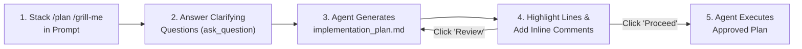

# Playbook: Planning Mode (`/plan`), Command Stacking & Inline Artifact Reviews

How to combine `/plan`, `/grill-me`, and Antigravity's interactive Implementation Plan viewer to align on architecture before a single source file is modified.

---

## 1. Workflow Overview



---

## 2. Step-by-Step Example: Designing an Idempotent Payment Service

### Step 1: Chaining `/plan` and `/grill-me` (`v1.1.4+`)
Instead of letting the agent guess your constraints, stack `/plan` and `/grill-me` at the start of your prompt:

```text
/plan /grill-me Add idempotency key support to POST /v1/charges so network retries from mobile clients never double-charge a customer.
```

### Step 2: Answering the Interactive Interview
The agent inspects your checkout handler and uses the `ask_question` modal to clarify:
1. **Storage Backend**: Redis with 24h TTL vs. PostgreSQL `idempotency_keys` table with ACID transactional locking?
2. **Concurrent In-Flight Behavior**: Return `409 Conflict` (`Retry-After: 2`) while the first request is still processing, or hold the connection open and await the first request's result?
3. **Payload Mismatch Policy**: Return `422 Unprocessable Entity` if a client reuses the same `Idempotency-Key` with a different request body hash?

### Step 3: Reviewing the Implementation Plan Artifact
Once you submit your answers, the agent writes `implementation_plan.md` to `<appDataDir>/brain/<conversation-id>/` with `RequestFeedback: true`.

In the Antigravity App or VS Code Artifact Viewer:
1. Select lines `34–41` where the agent proposed a 12-hour key expiration.
2. Click **Add Comment** and type:
   > *"Increase the idempotency key retention window to 48 hours to match Stripe's retry window, and index `created_at` for our nightly cleanup cron."*
3. Click **Review** in the artifact header to send your anchored comment back to the agent without starting code execution yet.

### Step 4: Approving & Exporting
1. The agent updates `implementation_plan.md` to reflect the 48-hour window and cleanup index.
2. *(Optional)* Open the artifact's `...` overflow menu and select **Export as PDF** (`v2.19.1+`) to attach the architecture plan to your team's RFC ticket.
3. Click **Proceed** (or press `Ctrl+G` in the CLI artifact viewer to edit any line directly in `$EDITOR`). The agent immediately transitions from planning to implementation.
