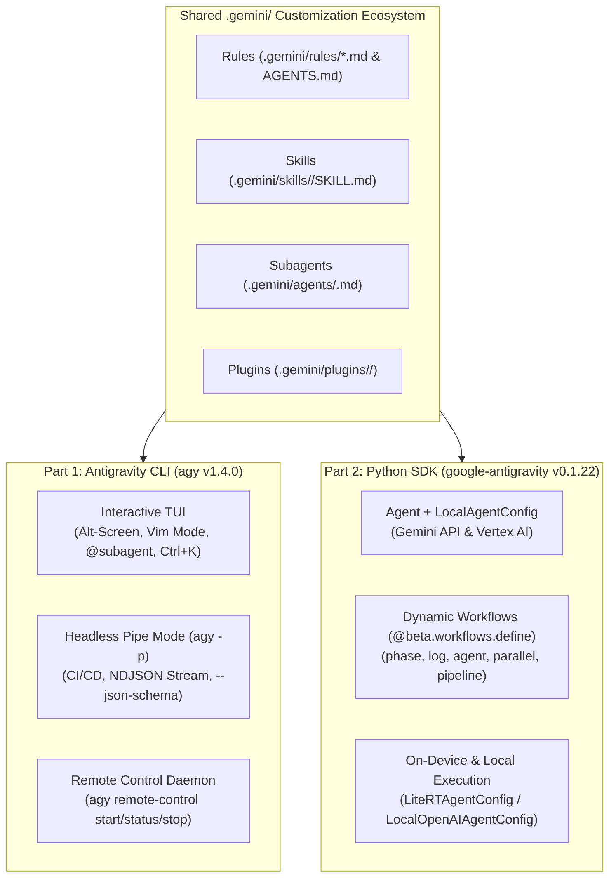
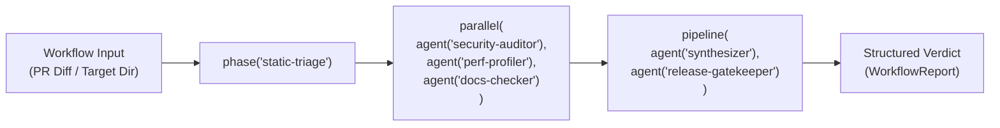

<picture>
  <source media="(prefers-color-scheme: dark)" srcset="../resources/logo-02-dark.svg">
  
</picture>

# Module 10: CLI & Python SDK Reference (`agy` & `google-antigravity`)

[← Back to Main Index](../README.md) | [Previous: Module 09 — Advanced Features](../09-advanced-features/README.md)

> **Reading Time**: ~35 minutes  
> **Difficulty**: Intermediate to Advanced  
> **Prerequisites**: [Module 01: Slash Commands](../01-slash-commands/README.md), [Module 03: Skills](../03-skills/README.md), [Module 04: Subagents](../04-subagents/README.md), [Module 05: MCP](../05-mcp/README.md), [Module 06: Hooks](../06-hooks/README.md), [Module 07: Plugins](../07-plugins/README.md)

The Antigravity ecosystem provides two complementary command-line and programmatic interfaces:
1. **The Antigravity CLI (`agy` v1.4.0)**: A full-featured interactive terminal UI (TUI) and headless Unix automation engine (`agy -p`) that shares the exact same `.gemini/` customization stack, model catalog, and workspace context as the Antigravity IDE.
2. **The Google Antigravity Python SDK (`google-antigravity` v0.1.22)**: An async-first Python library for building, orchestrating, testing, and deploying autonomous single-agent and multi-agent workflows against Gemini API, Vertex AI, on-device LiteRT-LM (`Gemma 4 26B`), or local OpenAI-compatible servers.



---

## Table of Contents

- [Part 1: The Antigravity CLI (`agy` v1.4.0)](#part-1-the-antigravity-cli-agy-v140)
  - [1.1 Installation & Authentication](#11-installation--authentication)
  - [1.2 Complete CLI Flags & Subcommands Reference](#12-complete-cli-flags--subcommands-reference)
  - [1.3 Headless Mode (`-p` / `--print`), JSON Schemas & Streaming NDJSON](#13-headless-mode--p----print-json-schemas--streaming-ndjson)
  - [1.4 Terminal UI (TUI) Power Features](#14-terminal-ui-tui-power-features)
  - [1.5 Shell Piping & CI/CD Recipes](#15-shell-piping--cicd-recipes)
- [Part 2: The Google Antigravity Python SDK (`google-antigravity` v0.1.22)](#part-2-the-google-antigravity-python-sdk-google-antigravity-v0122)
  - [2.1 Installation & Core Architecture](#21-installation--core-architecture)
  - [2.2 Basic Agent Queries, Streaming Thoughts & Tool Calls](#22-basic-agent-queries-streaming-thoughts--tool-calls)
  - [2.3 Custom Python Tools, MCP Servers & Inline Skills](#23-custom-python-tools-mcp-servers--inline-skills)
  - [2.4 Subagent Delegation & Declarative Security Policies](#24-subagent-delegation--declarative-security-policies)
  - [2.5 Dynamic Multi-Agent Workflows (`@beta.workflows.define`)](#25-dynamic-multi-agent-workflows-betaworkflowsdefine)
  - [2.6 On-Device Execution with LiteRT-LM (`Gemma 4 26B`) & Local OpenAI Servers](#26-on-device-execution-with-litert-lm-gemma-4-26b--local-openai-servers)
- [Runnable SDK Examples in This Module](#runnable-sdk-examples-in-this-module)
- [Verification & Hands-On Exercises](#verification--hands-on-exercises)

---

## Part 1: The Antigravity CLI (`agy` v1.4.0)

### 1.1 Installation & Authentication

Install `agy` using the official bootstrap scripts:

```bash
# macOS & Linux (installs to ~/.local/bin/agy)
curl -fsSL https://antigravity.google/cli/install.sh | bash

# Windows PowerShell
irm https://antigravity.google/cli/install.ps1 | iex
```

> [!TIP]
> **Android Termux Support (`v1.2.15+`)**: The Linux installer automatically detects Termux on Android (`aarch64`), downloads the native Android build, and configures storage permissions.

Verify your installation and authenticate:

```bash
# Check installed version
agy --version

# Interactive OAuth login (or switch accounts)
agy auth

# Upgrade to the latest CLI release in-place
agy update
```

#### Authentication & Privacy Environment Variables

| Environment Variable | Purpose |
| :--- | :--- |
| `GEMINI_API_KEY` | Authenticate directly against the Gemini API in headless or CI/CD environments. |
| `AGY_ADC_AUTH=1` | Use Google Cloud Application Default Credentials (`gcloud auth application-default login`) for Vertex AI endpoints. |
| `AGY_CLI_HIDE_ACCOUNT_INFO=1` | Redact your email address and organization name in the TUI header and `/status` output (ideal for screen-sharing or recording demos). |
| `AGY_CLI_OSC7501=on\|off` | Enable or disable OSC 7501 terminal tab/window status reporting (`v1.4.0+`, enabled by default on compatible terminals). |
| `AGY_CLI_OSC7501_MESSAGES=brief` | Emit concise terminal title/tab notifications when OSC 7501 is active (`v1.4.0+`). |

---

### 1.2 Complete CLI Flags & Subcommands Reference

#### Primary Invocation Modes

| Command | Description |
| :--- | :--- |
| `agy` | Launch the interactive Terminal UI (TUI) in the current directory. |
| `agy "Explain the auth flow"` | Launch the interactive TUI and immediately submit an initial prompt. |
| `agy -p "Summarize changes"` | Run non-interactively in headless print mode, write output to `stdout`, and exit. |
| `cat error.log \| agy -p "Root cause?"` | Pipe `stdin` directly into a headless query. |

#### Core Command-Line Flags

| Flag | Values / Syntax | Description |
| :--- | :--- | :--- |
| `-p`, `--print` | `"<prompt>"` | Run non-interactively (headless mode). Supports both prompts and read-only inspection slash commands (`/usage`, `/permissions`, `/hooks`, `/changelog`, `/config`, `/model`, `/effort`, `/skills`). |
| `--print-timeout` | `<seconds>` | Optional timeout for `--print` mode (`v1.2.6+` defaults to unlimited duration so long-running headless tasks never time out prematurely). |
| `--model` | `<slug>` | Select the active model (e.g., `gemini-4-argon`, `gemini-3.8-flash`, `gemini-3.1-pro`). Since `v1.3.4+`, omitting `--effort` automatically selects the model's recommended default thinking effort. |
| `--effort` | `low \| medium \| high \| max` | Override thinking effort level for reasoning depth vs. latency. |
| `--mode` | `auto \| default \| accept-edits \| plan \| request-review \| strict` | Set permission and execution mode (`plan` enforces read-only architectural planning; `accept-edits` auto-approves file edits while prompting for shell commands). |
| `--sandbox` | *(boolean flag)* | Enforce OS-level process sandboxing (Seatbelt `sandbox-exec` on macOS, bubblewrap/seccomp on Linux) for all `run_command` executions. |
| `-c`, `--continue` | *(boolean flag)* | Immediately resume the most recent conversation in the current workspace. |
| `--resume` | `[conversation-id]` | Resume a specific session by ID, or open the interactive session picker if no ID is supplied. |
| `--remote-control` | *(boolean flag)* | Attach to or start a remote control session so the IDE or mobile web client can drive the CLI session. |
| `--add-dir` | `<path>` | Grant the agent workspace read/write access to an additional directory outside the current working directory. |
| `--agent` | `<agent-name>` | Run the session using a specific custom subagent persona from `.gemini/agents/<name>.md` or an enabled plugin. |
| `--output-format` | `text \| json \| stream-json` | Control output serialization in `-p` mode (`stream-json` emits real-time NDJSON events). |
| `--json-schema` | `<json-string-or-file>` | Constrain the final assistant response in `-p` mode to validate against a strict JSON Schema. |
| `--disable-slash-commands` | *(boolean flag)* | Disable slash command parsing so leading `/` strings in prompts (e.g., Unix paths `/etc/hosts`) are treated as literal text. |
| `--dangerously-skip-permissions` | *(boolean flag)* | Bypass all interactive tool permission prompts. **Only use inside isolated containers or ephemeral CI runners.** |

#### First-Class Subcommands

```bash
# 1. Plugin lifecycle management (see Module 07)
agy plugin list [--json]
agy plugin validate ./07-plugins/pr-review --strict --json
agy plugin install ./07-plugins/pr-review
agy plugin enable pr-review
agy plugin disable pr-review
agy plugin uninstall pr-review

# 2. Remote Control daemon management
agy remote-control start --name "prod-bastion-01"
agy remote-control status
agy remote-control stop

# 3. Inspect available models & subagents programmatically
agy models --output-format json
agy agents --output-format json
```

---

### 1.3 Headless Mode (`-p` / `--print`), JSON Schemas & Streaming NDJSON

Headless mode (`agy -p`) turns Antigravity into a composable Unix command-line utility with deterministic exit codes and structured output formats.

#### Deterministic Exit Codes & Error Payloads (`v1.2.6+`)

- **Exit Code `0`**: Prompt completed normally.
- **Exit Code `3`**: API, authentication, or agent execution failure. When `agy -p` exits with code `3`, it writes a structured single-line diagnostic prefix to `stderr`:
  ```text
  AGY_ERROR: {"type":"rate_limit_exceeded","message":"Quota exceeded for gemini-4-argon","retryable":true}
  ```

#### Inspecting Configuration in Headless Mode (`v1.3.2+`)

You can run read-only slash commands directly via `agy -p` to audit an environment in CI scripts:

```bash
agy -p "/usage"
agy -p "/permissions"
agy -p "/hooks"
agy -p "/skills"
```

#### Enforcing Structured Output with `--json-schema`

Combine `-p`, `--output-format json`, and `--json-schema` to guarantee machine-parseable output for downstream `jq` pipelines:

```bash
git diff HEAD~1 | agy -p "Identify any breaking API changes in this diff" \
  --model gemini-3.8-flash \
  --output-format json \
  --json-schema '{
    "type": "object",
    "properties": {
      "breaking_changes": {
        "type": "array",
        "items": {
          "type": "object",
          "properties": {
            "symbol": {"type": "string"},
            "file": {"type": "string"},
            "reason": {"type": "string"}
          },
          "required": ["symbol", "file", "reason"]
        }
      },
      "safe_to_merge": {"type": "boolean"}
    },
    "required": ["breaking_changes", "safe_to_merge"]
  }'
```

#### Real-Time NDJSON Telemetry (`--output-format stream-json`)

When `--output-format stream-json` is passed, `agy -p` emits newline-delimited JSON (NDJSON) events in real time:
1. `{"type": "init", "session_id": "...", "model": "gemini-4-argon", ...}`
2. `{"type": "step_update", "step_index": 1, "tool_info": {...}, "subagent_info": {...}}`
3. `{"type": "result", "status": "success", "output": "...", "usage": {"input_tokens": 4120, "output_tokens": 680, "cache_read_tokens": 3584}}`

---

### 1.4 Terminal UI (TUI) Power Features

The interactive `agy` TUI is designed for keyboard-driven developer velocity:

#### 1. Visual Rendering Modes (`altScreenMode`)
Configured in `~/.gemini/antigravity-cli/settings.json` (see [Module 09](../09-advanced-features/README.md)):
- `"default"`: Adaptive rendering that enters alternate-screen mode only when needed.
- `"always"`: Full-screen alternate buffer (`v1.3.3+`) featuring smooth mouse-wheel scrolling, a virtual scrollbar, `copyOnSelect` clipboard integration, and a pinned user prompt header at the top of the viewport.
- `"never"`: Pure inline `stdout` rendering—ideal when running inside `tmux`, `screen`, or low-bandwidth SSH sessions where native terminal scrollback is preferred.

#### 2. Full Modal Vim Editor (`editorMode: "vim"`)
Enable `"editorMode": "vim"` (and `"vimInsertFirst": true`) in `~/.gemini/antigravity-cli/settings.json` for modal prompt editing:
- **Modes**: `NORMAL`, `INSERT`, `VISUAL`, and `VISUAL LINE` (`V`), including inside interactive plan/diff comment editors.
- **Count Multipliers**: Supports numeric prefixes such as `3dw`, `5j`, `2di(`, `ci"`, and `y$`.
- **Submission Shortcuts**: Press `Ctrl+S` or `Ctrl+Enter` to submit immediately from any mode.

#### 3. Message Queueing Toggle (`Alt+M` in `v1.4.0+`)
While the agent is actively streaming a turn, typing a follow-up message uses your configured `Queued Messages` preference (`Queue` vs. `Send Immediately`). Press **`Alt+M`** (`Option+M` on macOS) to send the current message using the **opposite** behavior on the fly without changing your global setting.

#### 4. Interactive Subagent Orchestration (`@<subagent>`, `Ctrl+J`, `Ctrl+K`)
When parallel subagents are running in the TUI:
- **`@<subagent-id>`**: Type `@` in the prompt box to autocomplete any active subagent and send a direct steering message to it (`v1.2.9+`).
- **`/agents`**: Open the interactive subagent manager panel to inspect live transcripts, statuses, and token usage.
- **`Ctrl+J` / `Alt+J`**: Jump directly to the next background subagent currently waiting for tool approval or user input.
- **`Ctrl+K` (`v1.3.6+`)**: Fast-path approval and question answering directly from the main prompt bar without switching out of your active conversation view.

#### 5. Custom Keybindings & Statusline
- **Custom Keybindings**: Override any TUI shortcut in `~/.gemini/antigravity-cli/keybindings.json`.
- **Live Statusline (`/statusline`)**: Configure a custom shell command or script that renders live git branch, Kubernetes context, or token cost metrics in the bottom TUI bar.

---

### 1.5 Shell Piping & CI/CD Recipes

#### Recipe 1: Automated Git Commit Message Generator
```bash
git diff --staged | agy -p \
  "Write a Conventional Commits message for these staged changes. Output ONLY the commit message." \
  --model gemini-3.8-flash --effort low | git commit -F -
```

#### Recipe 2: GitHub Actions Pull Request Security Gate
```yaml
name: Antigravity PR Security Gate
on: [pull_request]

jobs:
  security-audit:
    runs-on: ubuntu-latest
    steps:
      - uses: actions/checkout@v4
        with:
          fetch-depth: 0
      - name: Install Antigravity CLI
        run: curl -fsSL https://antigravity.google/cli/install.sh | bash
      - name: Run Headless Security Review
        env:
          GEMINI_API_KEY: ${{ secrets.GEMINI_API_KEY }}
        run: |
          git diff origin/${{ github.base_ref }}...HEAD | ~/.local/bin/agy -p \
            "Audit this diff for OWASP Top 10 vulnerabilities and leaked secrets." \
            --agent security-reviewer \
            --mode strict \
            --sandbox \
            --output-format json \
            --json-schema '{"type":"object","properties":{"passed":{"type":"boolean"},"findings":{"type":"array","items":{"type":"string"}}},"required":["passed","findings"]}' \
            > audit-report.json
          jq -e '.passed == true' audit-report.json
```

---

## Part 2: The Google Antigravity Python SDK (`google-antigravity` v0.1.22)

The **Google Antigravity Python SDK** (`google-antigravity`) brings the exact same agent runtime, built-in workspace tools, MCP client, skill loader, and declarative security engine into Python `3.11+` applications.

### 2.1 Installation & Core Architecture

```bash
# Using uv (recommended)
uv add google-antigravity

# Using pip
pip install google-antigravity

# Optional: include on-device LiteRT-LM runtime for local Gemma 4 models
pip install "google-antigravity[litert]" litert-lm
```

#### Core SDK Classes

| Class / Symbol | Import Path | Purpose |
| :--- | :--- | :--- |
| `Agent` | `google.antigravity` | Async context manager and primary execution client (`agent.chat()`, `agent.query()`, `agent.stream()`, `agent.beta.run_workflow()`). |
| `LocalAgentConfig` | `google.antigravity` | Configures workspace root, model endpoint, built-in tools, skills, subagents, MCP servers, and policy hooks. |
| `GeminiAPIEndpoint` | `google.antigravity` | Connects to Google AI Studio / Gemini API (`api_key`, `model`, `model_options`). |
| `VertexEndpoint` | `google.antigravity` | Connects to Google Cloud Vertex AI (`project`, `location`, `model`, `model_options`). |
| `LiteRTAgentConfig` | `google.antigravity` | Zero-cloud on-device configuration for `.litertlm` models (e.g., `Gemma 4 26B`). |
| `LocalOpenAIAgentConfig` | `google.antigravity` | Connects to local OpenAI-compatible inference servers (Ollama, vLLM, LM Studio, llama.cpp). |
| `types.GeminiModelOptions` | `google.antigravity.types` | Configures `thinking_level` (`"low"`, `"medium"`, `"high"`, `"max"`), `max_output_tokens`, and `service_tier` (`types.ServiceTier.PRIORITY`). |
| `InlineSkill` | `google.antigravity` | Defines an in-memory `SKILL.md` capability without requiring files on disk. |

---

### 2.2 Basic Agent Queries, Streaming Thoughts & Tool Calls

See the complete runnable implementation in [`sdk-examples/hello_agent.py`](file:///Users/moc/Projects/gemini-howto/10-cli/sdk-examples/hello_agent.py).

The SDK supports both the async context-manager streaming pattern (`async with Agent(config) as agent:`) and high-level `agent.query()` / `agent.stream()` helpers:

```python
import asyncio
import os
from google.antigravity import Agent, GeminiAPIEndpoint, LocalAgentConfig, types

async def main() -> None:
    config = LocalAgentConfig(
        workspace_root=os.getcwd(),
        endpoint=GeminiAPIEndpoint(
            api_key=os.environ["GEMINI_API_KEY"],
            model="gemini-4-argon",
            model_options=types.GeminiModelOptions(
                thinking_level="high",
                max_output_tokens=16384,
                service_tier=types.ServiceTier.PRIORITY,
            ),
        ),
        builtin_tools=[
            types.BuiltinTools.VIEW_FILE,
            types.BuiltinTools.GREP_SEARCH,
            types.BuiltinTools.FIND_BY_NAME,
        ],
    )

    async with Agent(config) as agent:
        # 1. Single-turn structured query
        result = await agent.query("Summarize the modules in this repository.")
        print(result.text)

        # 2. Real-time streaming of internal thoughts, tool calls, and text chunks
        async for chunk in agent.stream("Verify all plugin.json manifests in 07-plugins/"):
            if chunk.thoughts:
                print(f"[Thinking] {chunk.thoughts}", end="", flush=True)
            for tool_call in chunk.tool_calls:
                print(f"\n[Tool Call] {tool_call.name}({tool_call.args})")
            if chunk.text:
                print(chunk.text, end="", flush=True)

if __name__ == "__main__":
    asyncio.run(main())
```

---

### 2.3 Custom Python Tools, MCP Servers & Inline Skills

See the complete runnable implementation in [`sdk-examples/custom_tools_and_mcp.py`](file:///Users/moc/Projects/gemini-howto/10-cli/sdk-examples/custom_tools_and_mcp.py).

1. **Custom Python Functions (`tools=[...]`)**: Any type-annotated Python function (sync or `async`) with a descriptive docstring is automatically converted into a tool schema. Add a `ctx: types.ToolContext` parameter to read/write session state (`ctx.get_state()` / `ctx.set_state()`).
2. **Remote & Local MCP Servers (`mcp_servers=[...]`)**: Attach `types.McpStreamableHttpServer` or `types.McpStdioServer` instances. Set `force_all_tools_eager=True` when you want all MCP schemas loaded upfront, and cap large payloads with `mcp_max_output_bytes=65536`.
3. **In-Memory Skills (`inline_skills=[...]`)**: Inject domain playbooks dynamically via `InlineSkill(name=..., description=..., content=...)` alongside on-disk `skills_paths=[".gemini/skills"]`.

---

### 2.4 Subagent Delegation & Declarative Security Policies

You can register specialized subagents in `LocalAgentConfig` using `types.SubagentConfig` and govern every tool call using the 9-level declarative policy engine (`google.antigravity.hooks.policy`):

```python
from google.antigravity import types
from google.antigravity.hooks.policy import (
    allow,
    ask_user,
    confirm_run_command,
    deny,
    workspace_only,
)

security_policies = [
    # Enforce strict workspace boundary for all file mutations
    workspace_only(),
    # Block destructive shell commands unconditionally
    deny(
        types.BuiltinTools.RUN_COMMAND,
        when=lambda args: "rm -rf" in args.get("CommandLine", ""),
        reason="Destructive rm -rf commands are prohibited by policy.",
    ),
    # Require interactive confirmation for git push
    ask_user(
        types.BuiltinTools.RUN_COMMAND,
        when=lambda args: "git push" in args.get("CommandLine", ""),
    ),
    # Auto-allow read-only tools
    allow(types.BuiltinTools.VIEW_FILE),
    allow(types.BuiltinTools.GREP_SEARCH),
    confirm_run_command(),
]
```

Combine policies with OS-level process sandboxing via `run_command_config=types.RunCommandConfig(enable_sandbox=True)` to isolate subprocesses at the kernel level.

---

### 2.5 Dynamic Multi-Agent Workflows (`@beta.workflows.define`)

See the complete runnable implementation in [`sdk-examples/dynamic_workflow.py`](file:///Users/moc/Projects/gemini-howto/10-cli/sdk-examples/dynamic_workflow.py).

Introduced in **`google-antigravity` v0.1.22**, the `@beta.workflows.define` decorator lets you orchestrate deterministic and dynamic multi-agent pipelines in pure Python using five composable primitives:



| Workflow Primitive | Purpose |
| :--- | :--- |
| `phase(name)` | Groups steps into a named lifecycle stage with hierarchical telemetry and progress tracking. |
| `log(message)` | Emits structured workflow progress events to the caller stream and transcript logs. |
| `agent(name, prompt, ...)` | Spawns an isolated agent turn (with optional model, toolset, or skill overrides) and returns its result. |
| `parallel(*tasks)` | Executes multiple `agent()` or sub-pipeline branches concurrently and gathers their outputs. |
| `pipeline(*steps)` | Chains sequential steps where each stage receives the structured output of the previous stage. |

Execute any `@beta.workflows.define` function with `await client.beta.run_workflow(workflow_fn, payload)`.

---

### 2.6 On-Device Execution with LiteRT-LM (`Gemma 4 26B`) & Local OpenAI Servers

See the complete runnable implementation in [`sdk-examples/local_litert_agent.py`](file:///Users/moc/Projects/gemini-howto/10-cli/sdk-examples/local_litert_agent.py).

When building air-gapped tools, privacy-sensitive local assistants, or zero-cost offline workflows, `google-antigravity` (`v0.1.22`) supports two first-class local inference configurations:

#### 1. Native On-Device LiteRT-LM (`LiteRTAgentConfig`)
First, import and quantize `Gemma 4 26B` using the `litert-lm` CLI:

```bash
# Download and convert Gemma 4 26B for local hardware acceleration (Metal / CUDA / NPU)
litert-lm import google/gemma-4-26b-it \
  --quantization int4 \
  --output ~/.litert-lm/models/gemma4-26b/model.litertlm
```

Then instantiate `LiteRTAgentConfig`:

```python
import os
from google.antigravity import Agent, LiteRTAgentConfig

config = LiteRTAgentConfig(
    model_path=os.path.expanduser("~/.litert-lm/models/gemma4-26b/model.litertlm"),
    workspace_root=os.getcwd(),
)
```

> [!NOTE]
> **Automatic Lightweight Preset (`40,960` Token Compaction)**: `LiteRTAgentConfig` automatically applies the SDK's `.lightweight()` preset—trimming system prompt overhead, enabling compact tool schemas, and setting the automatic context compaction threshold to **`40,960` tokens** so local hardware KV-cache memory stays fast and bounded.

#### 2. Local OpenAI-Compatible Servers (`LocalOpenAIAgentConfig`)
For Ollama, vLLM, LM Studio, or `llama.cpp` servers exposing an OpenAI-compatible `/v1` endpoint, chain `.lightweight()` to apply the same compact prompt and `40,960`-token compaction optimizations:

```python
from google.antigravity import LocalOpenAIAgentConfig

ollama_config = LocalOpenAIAgentConfig(
    model="gemma4:26b",
    base_url="http://localhost:11434/v1",
    workspace_root=os.getcwd(),
).lightweight()
```

---

## Runnable SDK Examples in This Module

All four Python scripts in [`sdk-examples/`](file:///Users/moc/Projects/gemini-howto/10-cli/sdk-examples) include a `--dry-run` flag so you can inspect their configuration, schemas, and execution flow even without an active API key or local `.litertlm` model file:

| File | Description |
| :--- | :--- |
| [`sdk-examples/hello_agent.py`](file:///Users/moc/Projects/gemini-howto/10-cli/sdk-examples/hello_agent.py) | Demonstrates `Agent`, `LocalAgentConfig`, `GeminiAPIEndpoint`, `VertexEndpoint`, `types.GeminiModelOptions`, `agent.query()`, and real-time `agent.stream()` over `chunk.thoughts`, `chunk.tool_calls`, and `chunk.text`. |
| [`sdk-examples/custom_tools_and_mcp.py`](file:///Users/moc/Projects/gemini-howto/10-cli/sdk-examples/custom_tools_and_mcp.py) | Demonstrates stateful custom Python tools (`ToolContext`), `types.McpStreamableHttpServer` (`force_all_tools_eager=True`), `InlineSkill`, `types.SubagentConfig`, and declarative `google.antigravity.hooks.policy` rules. |
| [`sdk-examples/dynamic_workflow.py`](file:///Users/moc/Projects/gemini-howto/10-cli/sdk-examples/dynamic_workflow.py) | Demonstrates `@beta.workflows.define` (`v0.1.22`) orchestrating `phase`, `log`, `agent`, `parallel`, and `pipeline` via `await agent.beta.run_workflow(...)`. |
| [`sdk-examples/local_litert_agent.py`](file:///Users/moc/Projects/gemini-howto/10-cli/sdk-examples/local_litert_agent.py) | Demonstrates offline on-device execution with `LiteRTAgentConfig` (`~/.litert-lm/models/gemma4-26b/model.litertlm`) and `LocalOpenAIAgentConfig(...).lightweight()`. |

---

## Verification & Hands-On Exercises

Run these commands from the repository root to verify your CLI knowledge and test the SDK examples:

```bash
# 1. Verify all 4 Python SDK examples compile and pass --dry-run validation
python3 10-cli/sdk-examples/hello_agent.py --dry-run
python3 10-cli/sdk-examples/custom_tools_and_mcp.py --dry-run
python3 10-cli/sdk-examples/dynamic_workflow.py --dry-run
python3 10-cli/sdk-examples/local_litert_agent.py --dry-run

# 2. If agy CLI is installed, inspect your active skills and permissions in headless mode
agy -p "/skills"
agy -p "/permissions"
```

---

[← Back to Main Index](../README.md) | [Previous: Module 09 — Advanced Features](../09-advanced-features/README.md)
