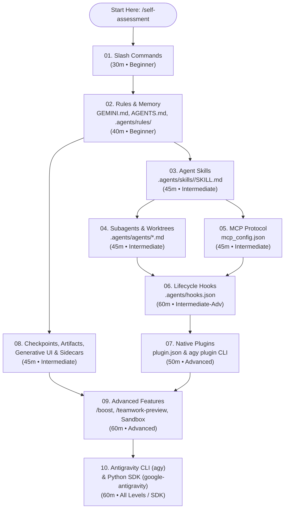

# Learning Roadmap: Mastering Google Antigravity & Gemini

**English** | [Tiếng Việt](vi/LEARNING-ROADMAP.md)

This roadmap provides a structured progression through all 10 modules of **gemini-howto**, taking you from your first slash command to orchestrating autonomous multi-agent engineering teams and building custom Python SDK workflows.

> [!TIP]
> **Want a personalized starting point?** Open this repository in the Antigravity App or CLI (`agy`) and run `/self-assessment` to take an interactive 10-question diagnostic!

---

## Visual Curriculum Dependency Graph

---

## Four Role-Based Learning Tracks

### Track 1: The Productive Everyday Developer (~2 Hours)
*Goal: Eliminate repetitive prompting, persist project conventions automatically, and master safe code exploration with checkpoints and Implementation Plans.*

1. **[Module 01: Slash Commands](01-slash-commands/README.md)** (30 min)
   - Master `/plan`, `/grill-me`, `/btw`, `/diff`, `/compact`, `/context`, and `/learn`.
   - Install your first custom skill-backed commands (`/commit`, `/pr`, `/optimize`).
   - Verify with `/lesson-quiz 01`.
2. **[Module 02: Rules & Memory](02-memory/README.md)** (40 min)
   - Write a root `GEMINI.md` / `AGENTS.md` under the 20,000-token budget.
   - Split domain-specific guidelines into `.agents/rules/*.md` using `trigger: model_decision` and `trigger: glob`.
   - Use `/learn` to turn a manual code review correction into a permanent rule.
   - Verify with `/lesson-quiz 02`.
3. **[Module 08: Checkpoints, Artifacts & Sidecars](08-checkpoints/README.md)** (45 min)
   - Practice `/rewind` (conversation-only vs full file revert) and `/fork` for parallel experiments.
   - Review an **Implementation Plan** artifact using inline line comments.
   - Render your first theme-aware **Generative UI** `<agent-embed>` widget.
   - Verify with `/lesson-quiz 08`.

---

### Track 2: The Workflow & Quality Automator (~3.5 Hours)
*Goal: Encode complex team workflows, delegate parallel work to isolated subagents, connect external databases/APIs via MCP, and enforce deterministic safety gates with hooks.*

1. **[Module 03: Agent Skills](03-skills/README.md)** (45 min)
   - Understand 3-stage progressive disclosure (`name`/`description` catalog → `SKILL.md` body → `scripts/` & `references/`).
   - Build multi-file skills (`code-review-specialist`, `doc-generator`) and share skills across repos with `.agents/skills.json`.
   - Verify with `/lesson-quiz 03`.
2. **[Module 04: Subagents](04-subagents/README.md)** (45 min)
   - Use built-in `research`, `browser`, and `self` subagents.
   - Author custom `.agents/agents/*.md` with scoped `tools` and `commandExecutionPolicy: sandbox`.
   - Run parallel subagents with `Workspace: "branch"` and `Workspace: "share"` to avoid file edit collisions.
   - Verify with `/lesson-quiz 04`.
3. **[Module 05: MCP (Model Context Protocol)](05-mcp/README.md)** (45 min)
   - Configure `~/.gemini/config/mcp_config.json` with Stdio and Streamable HTTP servers (`${VAR}` header interpolation).
   - Lock down tool execution using `mcp(server/tool)` permissions in `Allow`, `Ask`, and `Deny`.
   - Verify with `/lesson-quiz 05`.
4. **[Module 06: Lifecycle Hooks](06-hooks/README.md)** (60 min)
   - Wire up `.agents/hooks.json` across `SessionStart`, `PreToolUse`, `PostToolUse`, `PreInvocation`, `PostInvocation`, and `Stop`.
   - Deploy `security-scan.sh` (`PreToolUse` secret blocker), `format-code.sh` (`PostToolUse` formatter), and `goal-gate.sh` (`Stop` test verifier).
   - Verify with `/lesson-quiz 06`.

---

### Track 3: The Autonomous Systems & Security Architect (~3 Hours)
*Goal: Package org-wide capabilities into validated plugins, unleash multi-agent `/boost` and `/teamwork-preview` engines, and harden OS-level sandboxing.*

1. **[Module 07: Native Plugins](07-plugins/README.md)** (50 min)
   - Bundle skills, subagents, rules, root `hooks.json`, root `mcp_config.json`, and `sidecars/` into a `plugin.json` package.
   - Validate with `agy plugin validate --strict` and manage via `/plugin`.
   - Verify with `/lesson-quiz 07`.
2. **[Module 09: Advanced Features](09-advanced-features/README.md)** (60 min)
   - Use `/boost` (3-phase DeepCoder/DeepInvestigator worktree exploration) for algorithmic and debugging challenges.
   - Use `/teamwork-preview` (2-phase autonomous engineering teams with `Sentinel`, `Critic`, `Challenger`, and `Auditor`) for greenfield builds and large refactors.
   - Configure `Deny > Ask > Allow` permissions, OS Seatbelt / `nsjail` / `AppContainer` sandboxing, and `agy remote-control`.
   - Verify with `/lesson-quiz 09`.
3. **[Module 08 (Section 4): Sidecars & Scheduled Automations](08-checkpoints/README.md)** (30 min)
   - Configure `sidecar.json` background daemons and `CRON_TZ` scheduled automations with scoped `access_grants`.

---

### Track 4: The CLI Power User & Python SDK Engineer (~2 Hours)
*Goal: Automate CI/CD pipelines with headless `agy -p` and build custom multi-agent Python applications with `google-antigravity`.*

1. **[Module 10 (Part 1): Antigravity CLI (`agy` v1.4.0)](10-cli/README.md)** (45 min)
   - Master TUI ergonomics (`alt+m` queue mode, `Ctrl+J`/`Ctrl+K` subagent approvals, Vim mode, OSC 7501 status).
   - Build non-interactive Unix pipelines (`git diff | agy -p "..." --mode auto --output-format json`).
2. **[Module 10 (Part 2): Python SDK (`google-antigravity` v0.1.22)](10-cli/README.md)** (45 min)
   - Build programmatic agents with `Agent`, `GeminiModelOptions`, `InlineSkill`, and `SubagentConfig`.
   - Orchestrate deterministic + agentic pipelines with `@beta.workflows.define` (`phase`, `parallel`, `pipeline`).
   - Run offline local models (Gemma 4 26B via `LiteRTAgentConfig` or Ollama via `LocalOpenAIAgentConfig`).
   - Verify with `/lesson-quiz 10`.

---

## Mastery Checklist

Track your progress as you complete each module:

- [ ] **01 — Slash Commands**: Created a custom `.agents/skills/<name>/SKILL.md` and invoked it via `/<name>`.
- [ ] **02 — Rules & Memory**: Configured `GEMINI.md` and at least one `.agents/rules/*.md` with `trigger: model_decision` or `trigger: glob`.
- [ ] **03 — Agent Skills**: Built a multi-file skill with a helper script in `scripts/` and verified its token footprint in `/context`.
- [ ] **04 — Subagents**: Launched parallel subagents with `Workspace: "branch"` and inspected them via `/agents`.
- [ ] **05 — MCP**: Connected an MCP server in `~/.gemini/config/mcp_config.json` and scoped its `mcp(server/tool)` permissions.
- [ ] **06 — Hooks**: Configured `.agents/hooks.json` with a `PreToolUse` safety check and a `Stop` verification gate.
- [ ] **07 — Plugins**: Validated a plugin bundle with `agy plugin validate --strict`.
- [ ] **08 — Checkpoints, Artifacts & Sidecars**: Reviewed an Implementation Plan inline, embedded a Generative UI `<agent-embed>` widget, and scheduled an automation with `/schedule`.
- [ ] **09 — Advanced Features**: Ran `/boost` or `/teamwork-preview` on a complex task and audited your `Deny > Ask > Allow` sandbox permissions.
- [ ] **10 — CLI & Python SDK**: Executed a headless `agy -p` command and ran a `@beta.workflows.define` script with `google-antigravity`.
