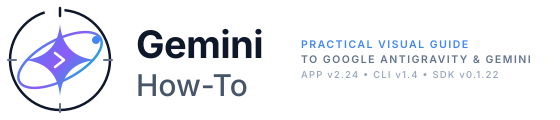
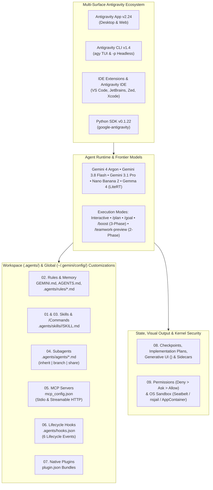

<div align="center">

<picture>
  <source media="(prefers-color-scheme: dark)" srcset="resources/logos/gemini-howto-logo-dark.svg">
  <source media="(prefers-color-scheme: light)" srcset="resources/logos/gemini-howto-logo.svg">
  
</picture>

# Google Antigravity & Gemini: Practical How-To Guide

**A visual, example-driven curriculum from everyday prompts to multi-agent `/boost` & `/teamwork-preview` orchestration, Generative UI artifacts, OS-sandboxed hooks, native plugins, and the Python SDK.**

[](https://antigravity.google/docs/changelog)
[](https://antigravity.google/docs/cli/reference)
[](10-cli/README.md)
[](09-advanced-features/README.md)
[](LICENSE)

**English** | [Tiếng Việt](vi/README.md)

[Quick Start](#-5-minute-quick-start) • [Learning Roadmap](LEARNING-ROADMAP.md) • [Quick Reference](QUICK_REFERENCE.md) • [Template Catalog](CATALOG.md) • [Concepts Guide](gemini_concepts_guide.md) • [Topic Index](INDEX.md)

</div>

---

## Why This Repository Exists

Most developers use only a fraction of **Google Antigravity** and **Gemini**—typing free-form chat prompts while missing the customization primitives and autonomous orchestration engines that turn Antigravity into a programmable engineering platform:

- **Progressive-Disclosure Rules & Memory** (`GEMINI.md`, `AGENTS.md`, `.agents/rules/*.md` with `always_on`, `model_decision`, `glob`, and `manual` triggers inside a 20,000-token budget)
- **Dual-Mode Agent Skills** (`.agents/skills/<name>/SKILL.md` that work simultaneously as `/<name>` slash commands and semantically auto-discovered capabilities)
- **Worktree-Isolated Subagents** (`research`, `browser`, `self`, and custom `.agents/agents/*.md` running in parallel across `inherit`, `branch`, or `share` workspaces)
- **Deterministic Lifecycle Hooks** (`.agents/hooks.json` intercepting `SessionStart`, `PreToolUse`, `PostToolUse`, `PreInvocation`, `PostInvocation`, and `Stop`)
- **Rich Artifacts, Generative UI & Sidecars** (Implementation Plans with inline review comments, theme-aware `<agent-embed>` HTML widgets, and `sidecar.json` cron automations)
- **Frontier Multi-Agent Modes** (`/boost` 3-phase deep reasoning, `/teamwork-preview` autonomous engineering teams with adversarial `Critic`/`Challenger`/`Auditor` gates, and `/goal`)

Every module in this repository includes **Mermaid architecture diagrams**, **production-ready copy-paste templates**, **Do's and Don'ts**, and **interactive quizzes**.

---

## Interactive Self-Assessment & Quizzes (Built Into This Repo!)

When you open this repository in the **Antigravity App** or **Antigravity CLI (`agy`)**, two interactive skills in `.agents/skills/` are automatically available:

```text
/self-assessment        # Take a 10-question diagnostic to get a personalized learning path
/lesson-quiz 01         # Test your mastery of any module (01 through 10) with a 5-question quiz
```

> [!TIP]
> Both skills use Antigravity's native interactive `ask_question` UI modal—giving you clickable multiple-choice options and instant architectural explanations.

---

## Ecosystem Architecture Overview



---

## The 10-Module Curriculum

| Module | Topic | Difficulty | Time | What You Will Build & Master |
| :--- | :--- | :---: | :---: | :--- |
| **[01. Slash Commands](01-slash-commands/README.md)** | Built-in & Custom `/commands` | Beginner | 30m | Master 35+ built-in commands (`/boost`, `/teamwork-preview`, `/goal`, `/plan`, `/grill-me`, `/learn`, `/btw`) and build 8 custom skill-backed slash commands (`/optimize`, `/pr`, `/commit`, etc.). |
| **[02. Rules & Memory](02-memory/README.md)** | `GEMINI.md`, `AGENTS.md`, `.agents/rules/` | Beginner | 40m | Configure hierarchical `GEMINI.md`/`AGENTS.md`, modular rules with 4 triggers (`always_on`, `model_decision`, `glob`, `manual`), `@[label](path)` includes, the 20k token budget, `.agents/rules.json`, and `/learn`. |
| **[03. Agent Skills](03-skills/README.md)** | `.agents/skills/<name>/SKILL.md` | Intermediate | 45m | Build multi-file Open Agent Skills (`agentskills.io`) with 3-stage progressive disclosure, bundled `scripts/`, `references/`, and 6 production skill packages. |
| **[04. Subagents](04-subagents/README.md)** | `.agents/agents/*.md` & Worktrees | Intermediate | 45m | Orchestrate `research`, `browser`, `self`, and 9 custom specialist subagents across isolated `inherit`, `branch`, and `share` workspaces with reactive wakeup messaging. |
| **[05. MCP Protocol](05-mcp/README.md)** | `mcp_config.json` (Stdio & HTTP) | Intermediate | 45m | Connect GitHub, PostgreSQL, Sentry, and filesystem MCP servers via Stdio and Streamable HTTP (`${VAR}` header expansion), scope `mcp(server/tool)` permissions, and use **Fix with Agent**. |
| **[06. Lifecycle Hooks](06-hooks/README.md)** | `.agents/hooks.json` (6 Events) | Intermediate–Adv | 60m | Intercept `SessionStart`, `PreToolUse`, `PostToolUse`, `PreInvocation`, `PostInvocation`, and `Stop` using the camelCase JSON contract to block secrets, auto-format code, and enforce test gates. |
| **[07. Native Plugins](07-plugins/README.md)** | `plugin.json` & `agy plugin` CLI | Advanced | 50m | Package skills, subagents, rules, `hooks.json`, `mcp_config.json`, and sidecars into distributable plugins (`pr-review`, `devops-automation`, `documentation`) and validate with `agy plugin validate`. |
| **[08. Checkpoints, Artifacts & Sidecars](08-checkpoints/README.md)** | `/rewind`, `/fork`, Generative UI, `sidecar.json` | Intermediate | 45m | Rewind code/chat state, review Implementation Plans with inline comments, build theme-aware `<agent-embed>` HTML widgets, and run `sidecar.json` daemons & `CRON_TZ` scheduled automations. |
| **[09. Advanced Features](09-advanced-features/README.md)** | `/boost`, `/teamwork-preview`, Permissions, Sandbox | Advanced | 60m | Deploy 3-phase `/boost` and 2-phase `/teamwork-preview` agent teams, tune Gemini 4 Argon effort, author `Deny > Ask > Allow` permissions with `regex:`, enforce OS kernel sandboxing, and use `agy remote-control`. |
| **[10. CLI & Python SDK](10-cli/README.md)** | `agy` v1.4 & `google-antigravity` v0.1.22 | All Levels | 60m | Master `agy` TUI shortcuts (`alt+m`, `Ctrl+J`/`Ctrl+K`), `-p` headless CI/CD pipelines, and programmatic agents in Python (`Agent`, `@beta.workflows.define`, `LiteRTAgentConfig` for local Gemma 4). |

---

## Coming from Claude Code? Quick Translation Matrix

If you previously used Claude Code (`claude-howto`), here is how every concept maps—and upgrades—in **Google Antigravity & Gemini**:

| Capability | Claude Code | Google Antigravity & Gemini | Key Antigravity Upgrade |
| :--- | :--- | :--- | :--- |
| **CLI Binary** | `claude` | `agy` (`~/.local/bin/agy`) | Alt-Screen/Inline TUI, `alt+m` live queue toggle, `Ctrl+J` subagent jump, OSC 7501 tab status |
| **Workspace Memory** | `CLAUDE.md`, `.claude/rules/` | `GEMINI.md`, `AGENTS.md`, `.agents/rules/*.md` | 4 explicit triggers (`always_on`, `model_decision`, `glob`, `manual`), `@[label](path)` inlining, `.agents/rules.json` inheritance, `/learn` |
| **Custom Slash Commands** | `.claude/commands/*.md` | `.agents/skills/<name>/SKILL.md` | Unified model: every Skill is automatically BOTH a `/<name>` slash command AND semantically auto-discovered |
| **Subagent Isolation** | `.claude/agents/*.md` | `.agents/agents/*.md` + `invoke_subagent` | Per-invocation `Workspace: "inherit" \| "branch" \| "share"`, dynamic `define_subagent`, reactive wakeup (no polling) |
| **Hooks Config** | `settings.json` (`hooks` key) | `.agents/hooks.json` & `~/.gemini/config/hooks.json` | Dedicated `hooks.json` with 6 events (`SessionStart`, `PreToolUse`, `PostToolUse`, `PreInvocation`, `PostInvocation`, `Stop`), tool input `overwrite`, and `injectSteps` |
| **Plugins** | `.claude-plugin/plugin.json` | `<plugin-root>/plugin.json` | Bundles `skills/`, `agents/`, `rules/`, root `hooks.json`, root `mcp_config.json`, and `sidecars/` + `agy plugin validate --strict` |
| **Visual Output & Plans** | Terminal Markdown | **Artifacts & Generative UI** | Implementation Plans with inline line-by-line review comments, PDF export, and live `<agent-embed>` HTML/Tailwind widgets |
| **Background & Cron** | `/loop` or OS crontab | **Sidecars (`sidecar.json`) & `/schedule`** | Managed background daemons (`restart_policy`), `sidecar://` UI panels, and timezone-aware `CRON_TZ` automations with scoped `access_grants` |
| **Deep Multi-Agent Modes** | Manual subagents | `/boost`, `/teamwork-preview`, `/goal` | First-class 3-phase hypothesis/worktree exploration (`/boost`) and 2-phase autonomous teams with adversarial `Critic`/`Challenger`/`Auditor` gates (`/teamwork-preview`) |
| **Programmatic SDK** | Agent SDK | `google-antigravity` Python SDK | Supports Gemini 4 Argon, declarative `@beta.workflows.define` (`parallel`, `pipeline`), and offline on-device Gemma 4 via `LiteRTAgentConfig` |

---

## 5-Minute Quick Start

### 1. Install Antigravity CLI (`agy`) & Python SDK

```bash
# macOS / Linux — Install Antigravity CLI (v1.4.0+)
curl -fsSL https://antigravity.google/cli/install.sh | bash

# Windows (PowerShell)
irm https://antigravity.google/cli/install.ps1 | iex

# Optional: Install the Google Antigravity Python SDK (v0.1.22+)
pip install google-antigravity
```

### 2. Clone This Repository & Take the Diagnostic

```bash
git clone https://github.com/minhxuvi/gemini-howto.git
cd gemini-howto

# Launch Antigravity CLI in this workspace
agy
```

Inside the Antigravity prompt (App or CLI), run:

```text
/self-assessment
```

### 3. Copy Your First Production Templates Into Your Own Project

```bash
# 1. Copy the workspace GEMINI.md & modular rules into your project
cp 02-memory/project-GEMINI.md /path/to/your-project/GEMINI.md
mkdir -p /path/to/your-project/.agents/rules
cp 02-memory/rules/*.md /path/to/your-project/.agents/rules/

# 2. Add a custom /optimize slash-command skill
mkdir -p /path/to/your-project/.agents/skills/optimize
cp 01-slash-commands/optimize.md /path/to/your-project/.agents/skills/optimize/SKILL.md

# 3. Add a read-only Security Reviewer subagent
mkdir -p /path/to/your-project/.agents/agents
cp 04-subagents/secure-reviewer.md /path/to/your-project/.agents/agents/

# 4. Enable secret-scanning & auto-formatting lifecycle hooks
cp 06-hooks/hooks.json /path/to/your-project/.agents/hooks.json
mkdir -p /path/to/your-project/.agents/hooks
cp 06-hooks/*.sh 06-hooks/*.py /path/to/your-project/.agents/hooks/
chmod +x /path/to/your-project/.agents/hooks/*.sh /path/to/your-project/.agents/hooks/*.py
```

---

## Choose Your Learning Track

Not sure where to begin? Pick the track that matches your role, or see the full **[Learning Roadmap](LEARNING-ROADMAP.md)**:

1. **Track A — Everyday Productive Developer (~2 hours)**:
   - [Module 01: Slash Commands](01-slash-commands/README.md) → [Module 02: Rules & Memory](02-memory/README.md) → [Module 08: Checkpoints, Artifacts & Sidecars](08-checkpoints/README.md)
2. **Track B — Workflow & Team Automator (~3.5 hours)**:
   - [Module 03: Agent Skills](03-skills/README.md) → [Module 04: Subagents](04-subagents/README.md) → [Module 05: MCP](05-mcp/README.md) → [Module 06: Lifecycle Hooks](06-hooks/README.md)
3. **Track C — Staff / Platform Architect (~4 hours)**:
   - [Module 07: Native Plugins](07-plugins/README.md) → [Module 09: Advanced Features (`/boost`, `/teamwork-preview`, Sandbox)](09-advanced-features/README.md) → [Module 10: CLI & Python SDK](10-cli/README.md)

---

## Reference Guides in This Repository

- **[`LEARNING-ROADMAP.md`](LEARNING-ROADMAP.md)** — Visual dependency graphs, time estimates, and milestone checklists.
- **[`QUICK_REFERENCE.md`](QUICK_REFERENCE.md)** — Single-page cheat sheet for every slash command, frontmatter field, hook JSON schema, permission rule, and CLI flag.
- **[`CATALOG.md`](CATALOG.md)** — Browse and copy all 50+ ready-to-use templates across Modules 01–10.
- **[`gemini_concepts_guide.md`](gemini_concepts_guide.md)** — Deep architectural mental models: how Antigravity assembles the context window, when to choose a Rule vs Skill vs Subagent vs Hook vs Plugin, and how `/boost` and `/teamwork-preview` coordinate multi-agent verification.
- **[`INDEX.md`](INDEX.md)** — Alphabetical and problem-oriented index ("How do I block `git push --force`?", "How do I run Gemma 4 offline?").

---

## License

Distributed under the [MIT License](LICENSE).
