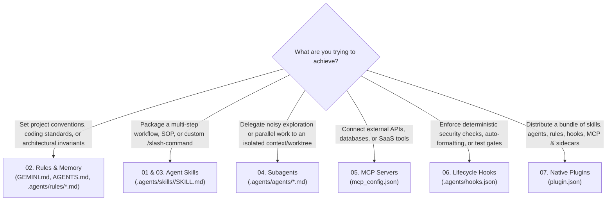
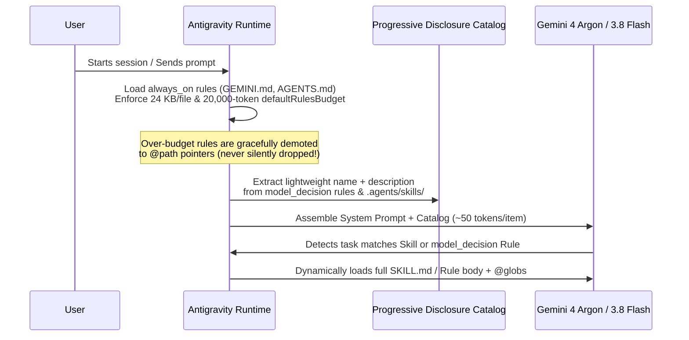
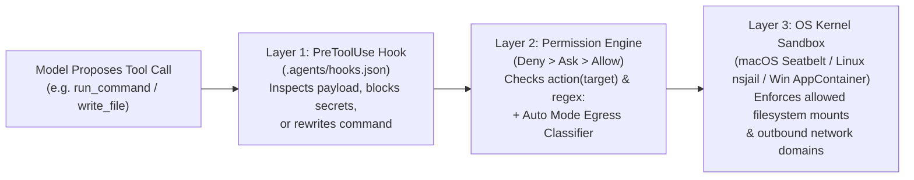

# Google Antigravity & Gemini: Core Concepts & Architectural Guide

**English** | [Tiếng Việt](vi/gemini_concepts_guide.md)

This guide explains the architectural mental models behind **Google Antigravity** and **Gemini**—how all customization layers fit together, how the context window is managed under the hood, and how to choose the right primitive for any engineering problem.

---

## 1. The Six Customization Primitives: When to Use What

Antigravity provides six composable primitives. Choosing the right one keeps your context window lean, your security boundaries deterministic, and your workflows reusable:

### Architectural Comparison Matrix

| Primitive | Location | Trigger Mechanism | Context Token Cost | Execution Environment | Best For |
| :--- | :--- | :--- | :--- | :--- | :--- |
| **Rules & Memory** | `GEMINI.md`, `AGENTS.md`, `.agents/rules/*.md` | `always_on`, `model_decision`, `glob`, or `manual` (`@`) | **Upfront** (`always_on` capped at 20k budget) or **On-Demand** (`model_decision`/`glob`) | Injected into system prompt | Coding standards, tech stack constraints, PR checklists |
| **Agent Skills** | `.agents/skills/<name>/SKILL.md` | **Dual**: `/<name>` slash command OR automatic semantic match | **~50–100 tokens** in catalog; full `SKILL.md` loaded only when activated | Main agent (plus optional `scripts/` execution) | Repeatable playbooks (`/commit`, `/optimize`, API doc generation) |
| **Subagents** | `.agents/agents/<name>.md` | `invoke_subagent` tool or `/browser` | **Zero** in main agent until summary is returned | **Isolated context window** + optional `branch`/`share` Git worktree | Deep codebase research, parallel feature implementation, security audits |
| **MCP Servers** | `~/.gemini/config/mcp_config.json` | Model calls `mcp_<server>_<tool>` | Tool schemas loaded per active server | Local Stdio child process or remote Streamable HTTP | Querying PostgreSQL, GitHub PRs, Sentry, Jira, documentation |
| **Lifecycle Hooks** | `.agents/hooks.json` | Deterministic runtime events (`PreToolUse`, `PostToolUse`, `Stop`, etc.) | **Zero** (unless injecting steps via `injectSteps`) | External shell/Python process via JSON stdin/stdout | Blocking hardcoded secrets, running `prettier`/`ruff`, enforcing passing tests |
| **Sidecars & Automations** | `~/.gemini/config/sidecars/<id>/sidecar.json` | Background daemon startup or `CRON_TZ` schedule (`/schedule`) | **Zero** in interactive chat; runs in separate background process/session | Persistent daemon or scheduled headless conversation | Interactive 3D/data viewers (`sidecar://`), daily CI triage reports |

---

## 2. How Antigravity Manages the Context Window

A common mistake in agentic coding is stuffing thousands of lines of documentation into a single root instruction file, starving the model of working memory for code and tool outputs. Antigravity solves this with **Progressive Disclosure** and a strict **Token Budget**:

### Three Rules for Context Hygiene
1. **Keep Root `GEMINI.md` / `AGENTS.md` Under 2,000 Tokens**: Put only universal build commands, repo layout, and core invariants in the root file.
2. **Use `trigger: model_decision` and `trigger: glob` for Domain Rules**: Database migration rules (`trigger: model_decision`) and Protobuf conventions (`trigger: glob`, `globs: "**/*.proto"`) cost almost zero tokens until the agent actually touches those domains.
3. **Offload Noisy Exploration to Subagents**: Searching 50 files via grep and reading 10,000 lines of logs inside the main agent permanently bloats the conversation history. Delegating that lookup to the `research` subagent isolates all intermediate file reads in the subagent's disposable context and returns a clean 300-token synthesis.

---

## 3. Multi-Agent Execution Engines: Interactive vs `/goal` vs `/boost` vs `/teamwork-preview`

Antigravity offers four distinct execution engines depending on task complexity:

| Mode | Command | Architecture | When to Choose It |
| :--- | :--- | :--- | :--- |
| **Standard Interactive / Plan** | Default or `/plan` | Single primary agent (can spawn `research`/`self` subagents) + **Implementation Plan** artifact review | Everyday bug fixes, single-feature PRs, interactive pair programming |
| **Autonomous Goal Loop** | `/goal <objective>` | Single primary agent with persistent self-verification loop until objective criteria are met | Long-running migrations, test-coverage expansion, overnight lint/typecheck cleanup |
| **Boost Mode (3-Phase)** | `/boost <task>` | **Phase 1**: Strategic Orchestrator decomposes problem & test harness **Phase 2**: Parallel `DeepCoder` & `DeepInvestigator` subagents in isolated Git worktrees **Phase 3**: Multi-round verification & synthesis | Hard algorithmic bugs, race conditions, performance bottlenecks, competing architectural designs |
| **Teamwork Mode (2-Phase)** | `/teamwork-preview <task>` | **Phase 1**: Interactive Scoping Interview **Phase 2**: Autonomous team (`Sentinel`, `Orchestrator`, `Explorers`, `Workers`) + 4-tier adversarial gates (`Critic`, `Challenger`, `Auditor`, `Success Auditor`) | Large multi-component features, greenfield services, cross-cutting refactors requiring strict adversarial QA |

---

## 4. Defense-in-Depth Security Architecture

Antigravity layers three independent security mechanisms so agents can move fast without risking your workstation or production infrastructure:

1. **Layer 1 — Deterministic `PreToolUse` Hooks (`.agents/hooks.json`)**: Runs custom project logic (e.g., scanning `write_to_file` payloads for AWS keys or rewriting unsafe CLI flags via `overwrite`).
2. **Layer 2 — Fine-Grained Permission Engine (`Deny > Ask > Allow`)**: Evaluates `read_file`, `write_file`, `command`, `unsandboxed`, `read_url`, `execute_url`, and `mcp` targets. Shell command substitutions (`$(...)`) automatically require exact-match rules.
3. **Layer 3 — Zero-Overhead OS Kernel Sandbox**: Even after a `command(...)` is allowed, the OS kernel restricts the child process so it can only write to paths granted by `write_file(...)` and only connect to domains granted by `read_url(...)`.

---

## 5. Rich Visual Output: Artifacts, Generative UI & Sidecars

Unlike terminal-only tools, Antigravity treats rich visual communication as a first-class primitive:

- **Implementation Plans (`<appDataDir>/brain/<conversation-id>/`)**: Before touching code on a complex task, the agent creates a structured plan artifact. You can highlight specific lines to leave **inline review comments** and click **Proceed** (or export to PDF).
- **Generative UI (`<agent-embed>`)**: The agent can generate self-contained HTML/Tailwind widgets (cost calculators, flamegraphs, schema explorers, state machine simulators) using Antigravity's semantic theme variables (`var(--card)`, `var(--foreground)`, `var(--primary)`) and embed them directly inline in chat (`<500px`) or in the side panel.
- **Interactive Sidecars (`sidecar://`)**: Specialized plugins (such as the 3D Biomolecular Structure Viewer or live service dashboards) run as managed sidecar processes and surface one-click `[Open Viewer](sidecar://...)` pills in chat.
