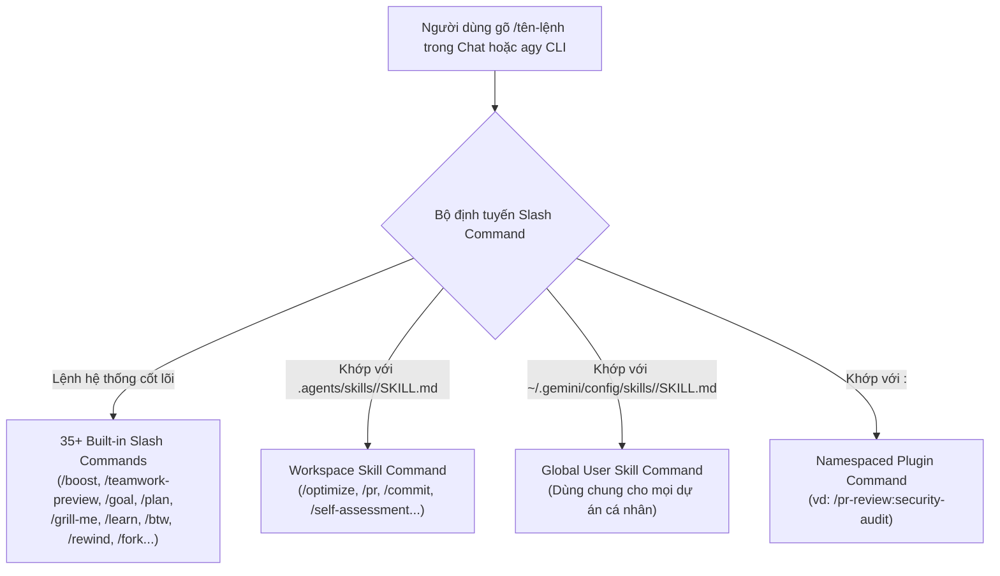
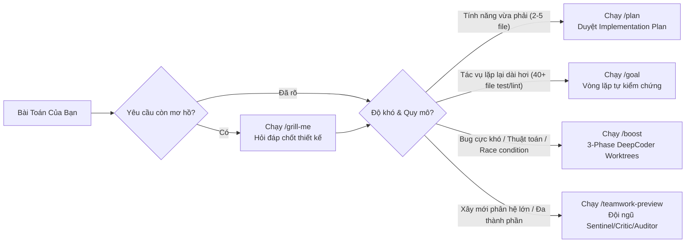

# Module 01: Slash Commands (Lệnh Tắt Tích Hợp & Lệnh Tùy Chỉnh Dựa Trên Skill)

[English](../../01-slash-commands/README.md) | **Tiếng Việt**

> **Thời lượng**: 30 phút • **Độ khó**: Cơ bản • **Trắc nghiệm**: Chạy `/lesson-quiz 01` trong Antigravity

Các lệnh Slash (`/commands`) là bảng điều khiển trung tâm của **Google Antigravity** (App, IDE và `agy` CLI). Chúng cho phép bạn chuyển đổi chế độ suy luận đa tác nhân (`/boost`, `/teamwork-preview`, `/goal`), thực hiện phỏng vấn kiến trúc (`/grill-me`), quản lý cửa sổ ngữ cảnh (`/compact`, `/context`, `/btw`) và tự động hóa các quy trình kỹ thuật của nhóm thông qua các lệnh tùy chỉnh dựa trên Skill (`.agents/skills/<name>/SKILL.md`).

---

## 1. Tổng Quan Kiến Trúc Slash Commands Trong Antigravity

Khác với các công cụ thế hệ cũ tách rời "lệnh tĩnh" và "kỹ năng", Google Antigravity hợp nhất chúng thành một kiến trúc duy nhất:



> [!IMPORTANT]
> **Mô hình hợp nhất Skill & Command**: Mọi kỹ năng được định nghĩa tại `.agents/skills/<name>/SKILL.md` đều hoạt động ở **chế độ kép (Dual-Mode)**:
> 1. **Gọi tường minh**: Người dùng gõ trực tiếp `/<name>` trong menu `/`.
> 2. **Tự động kích hoạt theo ngữ nghĩa**: Mô hình Gemini tự động nạp `SKILL.md` khi yêu cầu của người dùng khớp với trường `description`.
>
> *(Lưu ý: Các file `.agents/workflows/*.md` kiểu cũ đã ngừng khuyến nghị; hãy dùng `/migrate-workflows` để nâng cấp sang `.agents/skills/<name>/SKILL.md`).*

---

## 2. Bảng Tham Chiếu Toàn Bộ Built-in Slash Commands

### 2.1. Chế Độ Điều Phối Tự Hành & Lập Kế Hoạch Kiến Trúc

| Lệnh | Cú Pháp | Khi Nào Sử Dụng & Cơ Chế Hoạt Động |
| :--- | :--- | :--- |
| **`/boost`** | `/boost <nhiệm vụ>` | **Suy luận sâu 3 giai đoạn**: (1) `Orchestrator` phân rã bài toán và thiết kế khung kiểm thử; (2) Các subagent `DeepCoder` và `DeepInvestigator` chạy song song trên các Git worktree cô lập; (3) Kiểm chứng đa vòng và tổng hợp giải pháp tối ưu. Lý tưởng cho bug khó, race condition và thuật toán phức tạp. |
| **`/teamwork-preview`** | `/teamwork-preview <nhiệm vụ>` | **Đội ngũ kỹ sư tự hành 2 giai đoạn**: (1) Phỏng vấn xác định phạm vi (`Scoping Interview`); (2) Triển khai đa tác nhân với các cổng phản biện độc lập (`Sentinel`, `Critic`, `Challenger`, `Auditor`). |
| **`/goal`** | `/goal <mục tiêu>` | **Vòng lặp mục tiêu bền bỉ**: Giữ agent hoạt động liên tục qua nhiều lượt sửa lỗi, chạy test và kiểm tra cho đến khi hoàn thành trọn vẹn mục tiêu (rất phù hợp cho tác vụ dài hơi). |
| **`/plan`** | `/plan [mô tả]` | Chuyển sang chế độ Lập kế hoạch và tạo artifact **Implementation Plan** để bạn duyệt và bình luận từng dòng trước khi sửa code. |
| **`/grill-me`** | `/grill-me` | **Phỏng vấn phản biện thiết kế**: Agent đóng vai kiến trúc sư trưởng hỏi xoáy vào các yêu cầu còn mơ hồ, trường hợp biên (edge cases) và đánh đổi kỹ thuật trước khi bắt đầu lập trình. |
| **`/browser`** | `/browser <yêu cầu>` | Ủy quyền thao tác duyệt web, kiểm thử giao diện hoặc thu thập thông tin cho subagent trình duyệt an toàn. |
| **`/schedule`** | `/schedule <lịch> <việc>` | Thiết lập bộ hẹn giờ một lần hoặc tác vụ định kỳ cron (hỗ trợ múi giờ `CRON_TZ`). |

### 2.2. Quản Lý Ngữ Cảnh, Phiên Làm Việc & Thử Nghiệm An Toàn

| Lệnh | Bí Danh | Công Dụng Thực Tế |
| :--- | :--- | :--- |
| **`/btw`** | — | **Câu hỏi phụ nhanh ("By the way")**: Mở lớp phủ tạm thời để hỏi một câu ngắn (ví dụ cú pháp regex hay lệnh SQL) mà **không** ghi vào lịch sử hội thoại chính. |
| **`/rewind`** | `/undo` | Quay lui hội thoại và/hoặc trạng thái file trong workspace về một checkpoint trước đó. |
| **`/fork`** | `/branch` | Nhân bản cuộc hội thoại tại thời điểm hiện tại thành một nhánh độc lập để thử hướng đi khác. |
| **`/compact`** | — | Tóm tắt lịch sử hội thoại dài để giải phóng token trong cửa sổ ngữ cảnh. |
| **`/context`** | — | Hiển thị biểu đồ chi tiết lượng token đang tiêu thụ bởi `GEMINI.md`, `.agents/rules/`, skills, MCP tools và lịch sử chat. |
| **`/diff`** | — | Xem nhanh các thay đổi Git chưa commit và các file vừa được sửa trong phiên. |
| **`/resume`** | `/switch`, `/conversation` | Tiếp tục hoặc chuyển sang một phiên hội thoại trước đó. |
| **`/clear`** | `/new` | Làm sạch phiên hiện tại và bắt đầu cuộc hội thoại mới. |
| **`/copy`** | `/copy [n\|btw]` | Sao chép phản hồi gần nhất, phản hồi thứ `n`, hoặc câu trả lời `/btw` vào clipboard. |

### 2.3. Quản Lý Tùy Biến, Mô Hình & Bảo Mật

| Lệnh | Bí Danh | Công Dụng Thực Tế |
| :--- | :--- | :--- |
| **`/learn`** | — | **Đúc kết kiến thức tự động**: Phân tích các lỗi vừa sửa hoặc quy ước bạn vừa nhắc nhở trong phiên để đề xuất lưu thành Rule (`.agents/rules/*.md`) hoặc Skill (`.agents/skills/<name>/SKILL.md`) qua artifact `learning_proposal.md`. |
| **`/skills`** | — | Liệt kê tất cả các skill đang có ở cấp workspace, global và plugin. |
| **`/agents`** | — | Mở bảng quản lý Subagents trực tiếp (xem trạng thái, phê duyệt quyền, dừng subagent). |
| **`/mcp`** | — | Kiểm tra kết nối MCP servers, xem danh sách tool, khởi động lại hoặc bấm **Fix with Agent**. |
| **`/hooks`** | — | Kiểm tra các lifecycle hook đang đăng ký trong `.agents/hooks.json` và global. |
| **`/plugin`** | `/plugins` | Mở trình quản lý Native Plugins (cài đặt, bật/tắt, gỡ bỏ). |
| **`/model`** | — | Chuyển đổi giữa `gemini-4-argon`, `gemini-3.8-flash`, `gemini-3.1-pro`... |
| **`/effort`** | `/effort [low\|medium\|high\|max]` | Điều chỉnh độ sâu suy luận (thinking effort) của mô hình. |
| **`/permissions`** | — | Xem và cấu hình quy tắc phân quyền `Deny > Ask > Allow`. |
| **`/remote-control`** | — | Bật/tắt cầu nối điều khiển phiên cục bộ từ xa qua trình duyệt. |

---

## 3. So Sánh Tình Huống: Khi Nào Dùng `/grill-me`, `/plan`, `/goal`, `/boost` hay `/teamwork-preview`?



---

## 4. Cách Tự Tạo Lệnh Slash Tùy Chỉnh (Skill-Backed Command)

Để tạo một lệnh `/optimize` cho cả nhóm, bạn chỉ cần tạo một thư mục con trong `.agents/skills/optimize/` chứa file `SKILL.md`:

```markdown
---
name: optimize
description: Analyze code for performance bottlenecks, algorithmic complexity, memory leaks, and N+1 database queries. Trigger when the user runs /optimize or asks to optimize performance.
---

# Quy Trình Tối Ưu Hóa Hiệu Năng (/optimize)

Khi người dùng gọi `/optimize` (hoặc yêu cầu tối ưu hóa một file/module):

1. **Đo lường & Xác định điểm nghẽn**:
   - Phân tích độ phức tạp thời gian $O(\cdot)$ và không gian bộ nhớ của hàm mục tiêu.
   - Kiểm tra các truy vấn cơ sở dữ liệu trong vòng lặp (N+1 queries), việc cấp phát bộ nhớ dư thừa hoặc thao tác I/O đồng bộ chặn luồng.
2. **Đề xuất phương án tối ưu**:
   - Trình bày bảng so sánh **Trước vs. Sau** kèm ước tính mức cải thiện độ trễ/bộ nhớ.
3. **Kiểm chứng an toàn**:
   - Áp dụng thay đổi và chạy bộ unit test hiện có để đảm bảo không làm hỏng hành vi đúng đắn.
```

Ngay sau khi lưu file `.agents/skills/optimize/SKILL.md`, lệnh `/optimize` sẽ xuất hiện trong menu `/` của Antigravity App và `agy` CLI!

---

## 5. Bộ 8 Template Lệnh Slash Thực Chiến Có Sẵn Trong Module Này

Bạn có thể xem và sao chép trực tiếp 8 mẫu lệnh chuẩn công nghiệp từ thư mục [`../../01-slash-commands/`](../../01-slash-commands/):

| Lệnh | File Template Nguồn | Công Dụng & Kịch Bản Áp Dụng |
| :--- | :--- | :--- |
| **`/optimize`** | [`../../01-slash-commands/optimize.md`](../../01-slash-commands/optimize.md) | Phân tích độ phức tạp thuật toán, truy vấn N+1 và tối ưu hóa tốc độ thực thi |
| **`/pr`** | [`../../01-slash-commands/pr.md`](../../01-slash-commands/pr.md) | Tự động kiểm tra `git diff`, tóm tắt thay đổi và tạo mô tả Pull Request kèm kế hoạch kiểm thử |
| **`/commit`** | [`../../01-slash-commands/commit.md`](../../01-slash-commands/commit.md) | Phân tích các file đã stage và tạo commit message chuẩn Conventional Commits |
| **`/push-all`** | [`../../01-slash-commands/push-all.md`](../../01-slash-commands/push-all.md) | Chạy kiểm tra bảo mật & test nhanh trước khi stage, commit và push lên nhánh từ xa |
| **`/generate-api-docs`** | [`../../01-slash-commands/generate-api-docs.md`](../../01-slash-commands/generate-api-docs.md) | Quét các endpoint HTTP/gRPC và sinh tài liệu OpenAPI 3.1 + ví dụ `curl` |
| **`/doc-refactor`** | [`../../01-slash-commands/doc-refactor.md`](../../01-slash-commands/doc-refactor.md) | Tái cấu trúc tài liệu Markdown, bổ sung sơ đồ Mermaid và kiểm tra liên kết |
| **`/setup-ci-cd`** | [`../../01-slash-commands/setup-ci-cd.md`](../../01-slash-commands/setup-ci-cd.md) | Khởi tạo quy trình CI/CD (GitHub Actions / Cloud Build) phù hợp với ngôn ngữ dự án |
| **`/unit-test-expand`** | [`../../01-slash-commands/unit-test-expand.md`](../../01-slash-commands/unit-test-expand.md) | Tìm các nhánh điều kiện chưa được kiểm thử và bổ sung bộ unit test toàn diện |

### Lệnh Sao Chép Nhanh Vào Dự Án Của Bạn

```bash
# Cài đặt cả 8 lệnh mẫu vào thư mục .agents/skills/ của dự án
for cmd in optimize pr commit push-all generate-api-docs doc-refactor setup-ci-cd unit-test-expand; do
  mkdir -p .agents/skills/$cmd
  cp ../../01-slash-commands/$cmd.md .agents/skills/$cmd/SKILL.md
done
```

---

## 6. Nguyên Tắc Nên & Không Nên (Do's & Don'ts)

| ✅ Nên Làm (Do's) | ❌ Không Nên Làm (Don'ts) |
| :--- | :--- |
| Dùng `/grill-me` trước khi code các tính năng có yêu cầu chưa rõ ràng | Bắt tay vào code ngay khi còn nhiều giả định ngầm chưa thống nhất |
| Dùng `/btw` cho các câu hỏi tra cứu phụ nhanh | Hỏi các câu lạc đề ngay trong luồng chính làm loãng ngữ cảnh đang làm việc |
| Dùng `/learn` ngay sau khi bạn vừa chỉ cho agent một quy ước đặc thù của dự án | Lặp lại cùng một lời nhắc nhở thủ công ở mọi phiên làm việc mới |
| Đặt các lệnh tùy chỉnh tại `.agents/skills/<name>/SKILL.md` với `description` giàu ngữ nghĩa | Tạo file trong thư mục cũ `.agents/workflows/` hoặc `.claude/commands/` |

---

## Bước Tiếp Theo

- **Kiểm tra mức độ hiểu bài**: Chạy `/lesson-quiz 01` trong Antigravity App hoặc `agy` CLI.
- **Bài học tiếp theo**: **[Module 02: Rules & Memory (`GEMINI.md`, `AGENTS.md`, `.agents/rules/`)](../02-memory/README.md)** →
