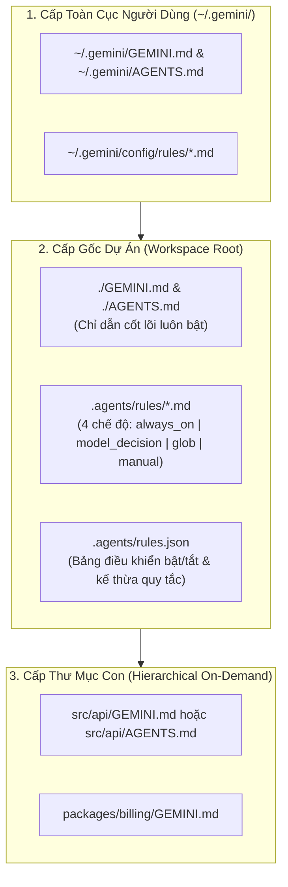
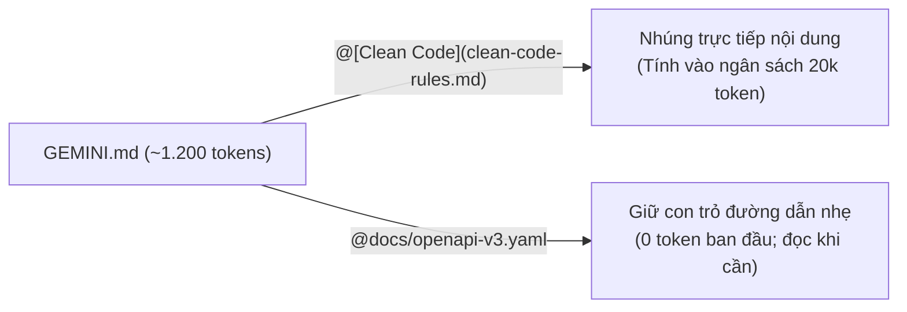

# Module 02: Rules & Memory (`GEMINI.md`, `AGENTS.md` & `.agents/rules/`)

[English](../../02-memory/README.md) | **Tiếng Việt**

> **Thời lượng**: 40 phút • **Độ khó**: Cơ bản • **Trắc nghiệm**: Chạy `/lesson-quiz 02` trong Antigravity

Một tác nhân AI chỉ thực sự thông minh khi nó hiểu rõ kiến trúc, quy ước đặt tên, lệnh kiểm thử và các ranh giới bất biến của dự án bạn. Trong **Google Antigravity**, hệ thống **Memory & Rules** giúp lưu giữ tri thức dự án xuyên suốt các phiên làm việc thông qua `GEMINI.md`, chuẩn mở `AGENTS.md` và các quy tắc mô-đun trong `.agents/rules/*.md` — tất cả được quản lý thông minh trong **ngân sách 20.000 token (`defaultRulesBudget`)**.

---

## 1. Kiến Trúc Phân Cấp Bộ Nhớ & Quy Tắc Trong Antigravity

Antigravity kết hợp bộ nhớ phân cấp theo thư mục với hệ thống quy tắc mô-đun có điều kiện kích hoạt:



### Sự Khác Biệt Giữa `GEMINI.md`, `AGENTS.md` và `.agents/rules/*.md`

| Loại File | Vị Trí | Yêu Cầu YAML Frontmatter? | Khi Nào Được Nạp Vào Ngữ Cảnh? | Mục Đích Chính |
| :--- | :--- | :---: | :--- | :--- |
| **`GEMINI.md`** | `./GEMINI.md`, thư mục con, hoặc `~/.gemini/GEMINI.md` | **Không** (Markdown thuần) | Luôn nạp ở gốc dự án; nạp động khi agent truy cập vào thư mục con tương ứng | Chỉ dẫn cốt lõi dành cho Google Antigravity & Gemini |
| **`AGENTS.md`** | `./AGENTS.md`, thư mục con, hoặc `~/.gemini/AGENTS.md` | **Không** (Markdown thuần) | Nạp song hành cùng `GEMINI.md` theo phân cấp thư mục | Tương thích chuẩn mở đa tác nhân (dùng chung với các công cụ AI khác) |
| **`.agents/rules/*.md`** | `.agents/rules/<name>.md` hoặc `~/.gemini/config/rules/` | **Bắt buộc** (`trigger`) | Tùy thuộc vào trường `trigger` (`always_on`, `model_decision`, `glob`, `manual`) | Tách nhỏ các quy chuẩn theo chủ đề hoặc loại file để tiết kiệm token |

---

## 2. Bốn Chế Độ Kích Hoạt (`trigger`) Trong `.agents/rules/*.md`

Mỗi file quy tắc trong `.agents/rules/*.md` bắt buộc khai báo YAML frontmatter ở đầu file với một trong 4 chế độ `trigger`:

| Giá Trị `trigger` | Các Trường Frontmatter Cần Thiết | Cơ Chế Kích Hoạt | Ví Dụ Thực Tế |
| :--- | :--- | :--- | :--- |
| **`always_on`** | `trigger: always_on` | Luôn nạp vào system prompt ở mọi lượt hội thoại (tính vào ngân sách 20.000 token) | Quy tắc bảo mật cốt lõi, quy ước commit chung |
| **`model_decision`** | `trigger: model_decision` + `description: "..."` | Bộ định tuyến ngữ nghĩa của Antigravity đọc `description` và chỉ nạp nội dung rule khi yêu cầu của người dùng liên quan | Quy trình viết migration SQL, quy tắc thiết kế sự kiện Kafka |
| **`glob`** | `trigger: glob` + `globs: "..."` | Tự động nạp khi agent đọc, sửa hoặc làm việc với các file khớp mẫu đường dẫn `globs` | Quy tắc React component (`src/ui/**/*.tsx`), quy tắc Protobuf (`**/*.proto`) |
| **`manual`** | `trigger: manual` | Không tự động nạp; chỉ nạp khi người dùng gọi đích danh qua `@rule-name` trong prompt | Danh sách kiểm tra phát hành phiên bản lớn (`@release-checklist`) |

### Ví Dụ 1: Quy Tắc Kích Hoạt Theo Ngữ Nghĩa (`trigger: model_decision`)
File: `.agents/rules/database-migrations.md`

```markdown
---
trigger: model_decision
description: Áp dụng khi thiết kế, viết hoặc review các bản migration cơ sở dữ liệu PostgreSQL, thay đổi schema SQL hoặc đánh chỉ mục bảng.
---

# Quy Tắc Migration PostgreSQL Không Gián Đoạn Dịch Vụ (Zero-Downtime)

1. **Luôn tạo chỉ mục không khóa bảng**: Bắt buộc sử dụng `CREATE INDEX CONCURRENTLY` thay vì `CREATE INDEX` thông thường trên các bảng đã có dữ liệu.
2. **Tách bước thêm cột `NOT NULL`**: Không thêm trực tiếp cột `NOT NULL` không có giá trị mặc định trên bảng lớn; hãy thêm cột cho phép `NULL` trước, backfill dữ liệu theo lô, sau đó mới đặt ràng buộc `CONSTRAINT ... NOT VALID` và `VALIDATE CONSTRAINT`.
3. **Cấm xóa cột ngay lập tức**: Trước khi chạy `DROP COLUMN`, phải đảm bảo mã nguồn ứng dụng đã ngừng đọc/ghi cột đó ít nhất 1 phiên bản triển khai.
```

### Ví Dụ 2: Quy Tắc Kích Hoạt Theo Đường Dẫn File (`trigger: glob`)
File: `.agents/rules/api-routes.md`

```markdown
---
trigger: glob
globs: "src/api/**/*.ts, src/controllers/**/*.ts"
---

# Tiêu ChuẩnTầng API & Controller

- Mọi dữ liệu đầu vào (`req.body`, `req.query`, `req.params`) phải được xác thực bằng schema `zod` trước khi truyền xuống tầng dịch vụ.
- Luôn trả về cấu trúc lỗi chuẩn RFC 9457 (`ProblemDetails`) và tuyệt đối không trả thẳng stack trace nội bộ ra phản hồi HTTP.
```

---

## 3. Liên Kết Mô-Đun `@[label](path)` & Ngân Sách 24 KB / 20.000 Token

Để ngăn chặn tình trạng quá tải ngữ cảnh (context bloat), Antigravity áp dụng hai ngưỡng bảo vệ thông minh:

1. **Giới hạn mỗi file (`24 KB` / `24.000` byte)**: Mỗi file quy tắc riêng lẻ không được vượt quá 24 KB.
2. **Ngân sách tổng hợp (`20.000` token — `defaultRulesBudget`)**: Tổng dung lượng của tất cả các file `GEMINI.md`, `AGENTS.md` và các rule `trigger: always_on` được giới hạn ở mức 20.000 token.
   - **Cơ chế hạ cấp an toàn (Graceful Demotion)**: Nếu tổng các rule `always_on` vượt quá 20.000 token, Antigravity **không bao giờ cắt bỏ âm thầm** mà chuyển các file vượt ngưỡng thành **con trỏ đường dẫn (`@path`)** để agent vẫn biết sự tồn tại của file và chủ động đọc bằng `view_file` khi cần!

### Hai Cú Pháp Tham Chiếu File Trong `GEMINI.md` và Rules

| Cú Pháp | Hành Vi Khi Nạp | Khi Nào Nên Dùng |
| :--- | :--- | :--- |
| **`@[Nhãn Tài Liệu](docs/architecture.md)`** | **Nhúng trực tiếp (Inline)**: Nội dung của `docs/architecture.md` (đã tự động lược bỏ YAML frontmatter nếu có) được chèn thẳng vào vị trí liên kết. | Khi bạn muốn dùng chung một file quy tắc chuẩn giữa `AGENTS.md` và `GEMINI.md` hoặc chia nhỏ quy tắc luôn bật. |
| **`@docs/api-schema.md`** | **Con trỏ đường dẫn (Path Pointer)**: Chỉ giữ lại đường dẫn tham chiếu gọn nhẹ; agent sẽ gọi `view_file` để đọc khi thực sự cần. | Khi tham chiếu các tài liệu dài (API specs, runbooks, bảng mã lỗi) mà không muốn tốn token ở mọi lượt. |



---

## 4. Quản Lý Quy Tắc Với `.agents/rules.json` và Lệnh `/learn`

### 4.1. Bật/Tắt Quy Tắc Tập Trung Qua `.agents/rules.json`
Trong các monorepo lớn hoặc dự án nhiều nhóm, bạn có thể kiểm soát trạng thái bật/tắt của từng quy tắc mà không cần xóa file Markdown khỏi Git bằng `.agents/rules.json`:

```json
{
  "version": 1,
  "inheritGlobalRules": true,
  "rules": {
    "database-migrations.md": {
      "enabled": true
    },
    "legacy-soap-xml.md": {
      "enabled": false
    }
  }
}
```

### 4.2. Tự Động Hóa Việc Học Quy Tắc Mới Với `/learn`
Khi bạn vừa sửa một lỗi sai của agent hoặc giải thích một quy ước ngầm trong cuộc trò chuyện, hãy gõ:

```text
/learn Luôn sử dụng thư viện decimal.Decimal thay vì float cho mọi phép tính tiền tệ trong module billing.
```

Antigravity sẽ phân tích phiên hội thoại, tạo một artifact đề xuất (`learning_proposal.md`) và hỏi ý kiến bạn để tự động cập nhật `GEMINI.md` hoặc tạo một file mới trong `.agents/rules/`!

---

## 5. Các Template Mẫu Có Sẵn Trong Module Này

Khám phá và sao chép các mẫu bộ nhớ trong [`../../02-memory/`](../../02-memory/):

| File Mẫu | Mô Tả | Lệnh Sao Chép Nhanh |
| :--- | :--- | :--- |
| [`../../02-memory/project-GEMINI.md`](../../02-memory/project-GEMINI.md) | Mẫu `GEMINI.md` chuẩn cho dự án phần mềm nhóm | `cp ../../02-memory/project-GEMINI.md ./GEMINI.md` |
| [`../../02-memory/personal-GEMINI.md`](../../02-memory/personal-GEMINI.md) | Mẫu `GEMINI.md` cá nhân lưu phong cách làm việc riêng | `cp ../../02-memory/personal-GEMINI.md ~/.gemini/GEMINI.md` |
| [`../../02-memory/directory-api-AGENTS.md`](../../02-memory/directory-api-AGENTS.md) | Mẫu `AGENTS.md` cấp thư mục con cho tầng API | `cp ../../02-memory/directory-api-AGENTS.md ./src/api/AGENTS.md` |

---

## 6. Nguyên Tắc Nên & Không Nên (Do's & Don'ts)

| ✅ Nên Làm (Do's) | ❌ Không Nên Làm (Don'ts) |
| :--- | :--- |
| Giữ `GEMINI.md` gốc ngắn gọn (< 2.000 token) chỉ chứa lệnh build/test và bất biến kiến trúc | Dán nguyên văn hàng chục trang tài liệu API vào `GEMINI.md` làm cạn ngân sách 20.000 token |
| Sử dụng `trigger: model_decision` và `trigger: glob` trong `.agents/rules/*.md` cho quy tắc chuyên biệt | Đặt tất cả 20 file trong `.agents/rules/` thành `trigger: always_on` |
| Duy trì cả `GEMINI.md` và `AGENTS.md` (dùng `@[GEMINI.md](GEMINI.md)` trong `AGENTS.md`) để tương thích đa công cụ | Sao chép thủ công cùng một nội dung ở nhiều nơi gây lệch phiên bản khi cập nhật |

---

## Bước Tiếp Theo

- **Kiểm tra mức độ hiểu bài**: Chạy `/lesson-quiz 02` trong Antigravity App hoặc `agy` CLI.
- **Quay lại**: ← [Module 01: Slash Commands](../01-slash-commands/README.md)
- **Bài học tiếp theo**: **[Module 03: Agent Skills (`.agents/skills/<name>/SKILL.md`)](../03-skills/README.md)** →
