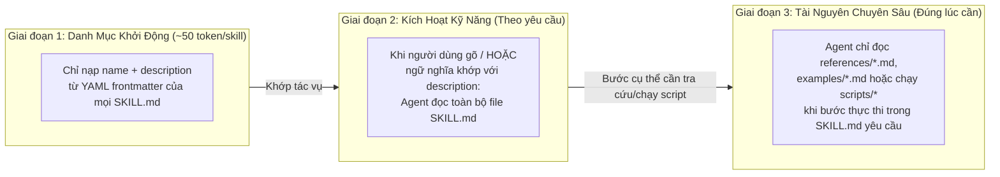

# Module 03: Agent Skills (`.agents/skills/<name>/SKILL.md` & Tiết Lộ Tăng Dần 3 Giai Đoạn)

[English](../../03-skills/README.md) | **Tiếng Việt**

> **Thời lượng**: 45 phút • **Độ khó**: Trung cấp • **Trắc nghiệm**: Chạy `/lesson-quiz 03` trong Antigravity

Nếu **Rules (`02-memory`)** định nghĩa các *ràng buộc và quy chuẩn*, thì **Agent Skills (`03-skills`)** đóng gói các *quy trình chuyên môn có thể thực thi (SOPs)* — kết hợp hướng dẫn từng bước trong `SKILL.md` với các kịch bản tự động (`scripts/`), tài liệu tham chiếu sâu (`references/`) và biểu mẫu (`resources/`, `examples/`).

---

## 1. Kiến Trúc Tiết Lộ Tăng Dần 3 Giai Đoạn (3-Stage Progressive Disclosure)

Làm thế nào bạn có thể cài đặt hàng chục kỹ năng chuyên sâu (từ kiểm toán bảo mật, tối ưu hóa SQL, phân tích sinh học phân tử đến viết tài liệu API) mà không làm tràn cửa sổ ngữ cảnh? Câu trả lời nằm ở cơ chế **Tiết lộ tăng dần 3 giai đoạn** của Antigravity:



### Lợi Ích Vượt Trội Của Kiến Trúc 3 Giai Đoạn
- **Chi phí nhàn rỗi gần bằng 0**: 30 kỹ năng được cài đặt chỉ tiêu tốn khoảng ~1.500 token trong danh mục khởi động (Giai đoạn 1).
- **Chế độ kích hoạt kép (Dual-Mode)**: Mọi skill đều có thể được gọi chủ động qua lệnh `/<name>` hoặc tự động kích hoạt khi bạn trò chuyện tự nhiên.
- **Tách biệt điều phối và dữ liệu nặng**: File `SKILL.md` chỉ giữ luồng điều phối ngắn gọn (dưới 200 dòng), trong khi các bộ quy tắc dài hàng ngàn dòng nằm gọn trong `references/` và chỉ được nạp ở Giai đoạn 3 khi cần.

---

## 2. Cấu Trúc Chuẩn Của Một Thư Mục Skill

Mỗi kỹ năng là một thư mục con nằm trong `.agents/skills/<name>/` (cấp dự án) hoặc `~/.gemini/config/skills/<name>/` (cấp người dùng toàn cục):

```text
.agents/skills/code-review-specialist/
├── SKILL.md                      # (Bắt buộc) YAML frontmatter + quy trình điều phối chính
├── scripts/                      # (Tùy chọn) Các script thực thi tất định (Python, Bash, Node)
│   ├── analyze-metrics.py
│   └── compare-complexity.py
├── references/                   # (Tùy chọn) Tài liệu tra cứu chuyên sâu chỉ đọc khi cần
│   └── owasp-top10-checklist.md
├── resources/                    # (Tùy chọn) Biểu mẫu (templates), schema JSON, cấu hình mẫu
│   └── review-report-template.md
└── examples/                     # (Tùy chọn) Ví dụ đầu vào / đầu ra mẫu (Few-shot examples)
    └── sample-pr-review.md
```

### Cấu Trúc File `SKILL.md` Chuẩn

```markdown
---
name: code-review-specialist
description: Perform a comprehensive security, performance, and maintainability code review on staged changes, diffs, or pull requests. Use when the user asks to review code, audit a PR, check code quality, or runs /code-review-specialist. Do not use for simple syntax formatting.
---

# Chuyên Gia Review Code (Code Review Specialist)

Thực hiện đánh giá chất lượng mã nguồn theo quy trình 4 bước sau:

## Bước 1: Thu Thập Số Liệu Độ Phức Tạp
Chạy script phân tích tự động trên các file vừa thay đổi:
```bash
python3 scripts/analyze-metrics.py
```

## Bước 2: Đối Chiếu Danh Mục Bảo Mật & Hiệu Năng
- Nếu bản diff có thay đổi liên quan đến xác thực, SQL hoặc đầu vào người dùng, hãy đọc `references/owasp-top10-checklist.md` bằng công cụ `view_file`.

## Bước 3: Lập Báo Cáo Theo Biểu Mẫu Chuẩn
Đọc biểu mẫu `resources/review-report-template.md` và trình bày các phát hiện theo thứ tự ưu tiên:
1. 🔴 **Critical (Nghiêm trọng)**: Lỗ hổng bảo mật, mất dữ liệu, race condition.
2. 🟠 **Major (Quan trọng)**: Điểm nghẽn hiệu năng $O(N^2)$, thiếu xử lý lỗi.
3. 🔵 **Minor (Gợi ý)**: Cải thiện tên biến, tách hàm nhỏ, bổ sung test.
```

---

## 3. Nghệ Thuật Viết Trường `description` Chất Lượng Cao

Vì ở **Giai đoạn 1**, mô hình chỉ nhìn thấy duy nhất `name` và `description`, nên chất lượng của trường `description` quyết định 100% việc skill có được tự động kích hoạt đúng lúc hay không:

| Thành Phần Trong `description` | Ví Dụ Kém Hiệu Quả ❌ | Ví Dụ Chuẩn Xác ✅ |
| :--- | :--- | :--- |
| **1. Skill làm gì?** | `"Hỗ trợ cơ sở dữ liệu"` | `"Kiểm tra độ an toàn của các bản migration PostgreSQL/Alembic và phát hiện nguy cơ khóa bảng (table locks)."` |
| **2. Khi nào cần kích hoạt?** | *(Không ghi rõ)* | `"Sử dụng khi người dùng tạo file migration mới, sửa schema SQL, hoặc hỏi về zero-downtime deployment."` |
| **3. Khi nào KHÔNG kích hoạt?** | *(Không ghi rõ)* | `"Không sử dụng cho các câu truy vấn SELECT phân tích dữ liệu thông thường."` |

---

## 4. Quản Lý Danh Sách Skills Với `.agents/skills.json`

Trong môi trường làm việc nhóm, bạn có thể quản lý việc bật/tắt các skill trong dự án hoặc khai báo nguồn kế thừa thông qua file `.agents/skills.json`:

```json
{
  "version": 1,
  "inheritGlobalSkills": true,
  "skills": {
    "code-review-specialist": {
      "enabled": true
    },
    "refactor": {
      "enabled": true
    },
    "self-assessment": {
      "enabled": true
    },
    "lesson-quiz": {
      "enabled": true
    }
  }
}
```

Bạn cũng có thể gõ lệnh `/skills` bất cứ lúc nào trong Antigravity để kiểm tra danh sách toàn bộ các skill đã được nạp từ Workspace (`.agents/skills/`), Global (`~/.gemini/config/skills/`) và các Plugin đang bật.

---

## 5. Khám Phá Các Bộ Skills Mẫu Có Sẵn Trong Repository

Repository `gemini-howto` cung cấp cả các kỹ năng tương tác đang hoạt động trực tiếp trong `.agents/skills/` lẫn các gói kỹ năng mẫu trong [`../../03-skills/`](../../03-skills/):

| Tên Skill | Đường Dẫn | Đặc Điểm Nổi Bật |
| :--- | :--- | :--- |
| **`self-assessment`** | [`../../.agents/skills/self-assessment/`](../../.agents/skills/self-assessment/) | Đánh giá năng lực 10 câu hỏi tương tác bằng công cụ `ask_question` và sinh lộ trình học cá nhân hóa |
| **`lesson-quiz`** | [`../../.agents/skills/lesson-quiz/`](../../.agents/skills/lesson-quiz/) | Ngân hàng 50 câu hỏi tình huống (5 câu/module) kiểm tra kiến thức sâu từng bài học |
| **`code-review-specialist`** | `../../03-skills/code-review-specialist/` | Kết hợp script đo độ phức tạp Python (`scripts/`) với checklist review chuẩn (`templates/`) |
| **`refactor`** | `../../03-skills/refactor/` | Phát hiện code smells tự động và áp dụng danh mục tái cấu trúc của Martin Fowler (`references/`) |
| **`doc-generator`** | `../../03-skills/doc-generator/` | Trích xuất chữ ký hàm/class bằng script Python và sinh tài liệu kỹ thuật đồng bộ |
| **`brand-voice`** | `../../03-skills/brand-voice/` | Đảm bảo văn phong nhất quán cho tài liệu sản phẩm, thông báo phát hành và bài viết |
| **`blog-draft`** | `../../03-skills/blog-draft/` | Quy trình lập dàn ý và viết bài blog kỹ thuật từ ý tưởng thô |
| **`gemini-md`** | `../../03-skills/gemini-md/` | Kiểm toán và tối ưu hóa file `GEMINI.md` cùng `.agents/rules/` để luôn nằm gọn trong ngân sách 20k token |

---

## 6. Nguyên Tắc Nên & Không Nên (Do's & Don'ts)

| ✅ Nên Làm (Do's) | ❌ Không Nên Làm (Don'ts) |
| :--- | :--- |
| Giữ `SKILL.md` ngắn gọn, tập trung vào các bước thực thi và đẩy tài liệu dài sang `references/` | Nhồi nhét hàng ngàn dòng tài liệu tham khảo trực tiếp vào trong `SKILL.md` |
| Giao các phép tính tất định (đếm dòng, kiểm tra cú pháp, phân tích AST) cho các script trong `scripts/` | Bắt mô hình LLM tự nhẩm tính độ phức tạp cyclomatic bằng mắt thường |
| Viết trường `description` nêu rõ cả ngữ cảnh kích hoạt ("Use when...") và ngữ cảnh loại trừ ("Do not use when...") | Đặt `description` chung chung một vài từ khiến bộ định tuyến ngữ nghĩa không biết khi nào nên gọi |

---

## Bước Tiếp Theo

- **Kiểm tra mức độ hiểu bài**: Chạy `/lesson-quiz 03` trong Antigravity App hoặc `agy` CLI.
- **Quay lại**: ← [Module 02: Rules & Memory](../02-memory/README.md)
- **Bài học tiếp theo**: **[Module 04: Subagents (`.agents/agents/*.md` & Cô Lập Worktree)](../04-subagents/README.md)** →
