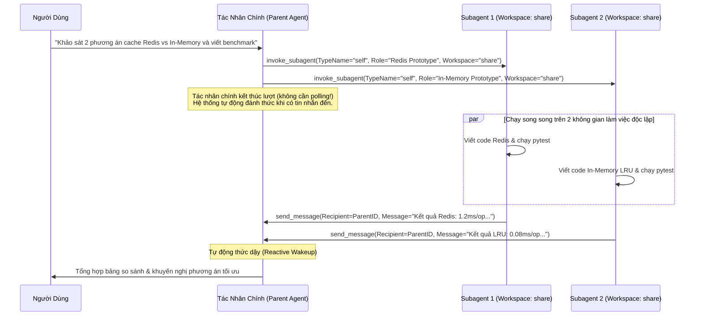
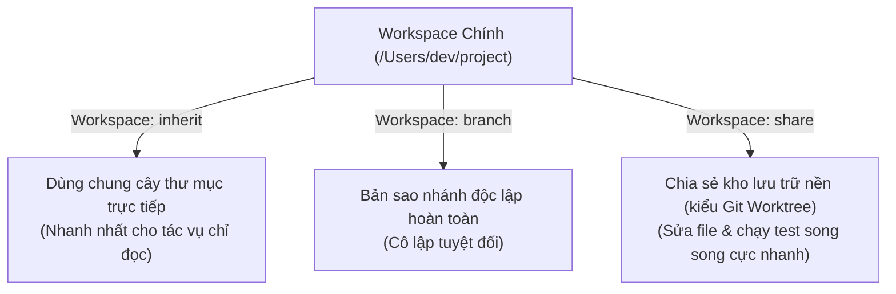

# Module 04: Subagents (Tác Nhân Con Chuyên Biệt, Cô Lập Worktree & Đánh Thức Phản Ứng)

[English](../../04-subagents/README.md) | **Tiếng Việt**

> **Thời lượng**: 45 phút • **Độ khó**: Trung cấp • **Trắc nghiệm**: Chạy `/lesson-quiz 04` trong Antigravity

Khi giải quyết các bài toán kỹ thuật lớn, việc thực hiện mọi thao tác tìm kiếm, đọc hàng chục file, chạy thử nghiệm và sửa code trong cùng một luồng hội thoại duy nhất sẽ nhanh chóng làm ô nhiễm cửa sổ ngữ cảnh (context pollution). **Subagents** trong **Google Antigravity** cho phép tác nhân chính ủy quyền công việc cho các tác nhân con chạy nền đồng thời — mỗi subagent sở hữu **cửa sổ ngữ cảnh độc lập**, **quyền hạn công cụ riêng biệt** và tùy chọn **cô lập không gian làm việc (`inherit`, `branch`, `share`)**.

---

## 1. Kiến Trúc Điều Phối Subagents & Đánh Thức Phản Ứng (Reactive Wakeup)

Khác với các hệ thống phải dùng vòng lặp chờ (polling loop) tốn tài nguyên, Antigravity vận hành theo kiến trúc **Đánh thức phản ứng theo sự kiện (Reactive Wakeup)**:



> [!IMPORTANT]
> **Quy tắc vàng khi giao tiếp giữa các Agent**:
> - **Đối với Tác nhân chính (Parent)**: Sau khi gọi `invoke_subagent`, **KHÔNG BAO GIỜ** chạy vòng lặp kiểm tra trạng thái (`manage_subagents(Action="list")` hay `sleep`). Hãy tiếp tục làm việc độc lập khác hoặc kết thúc lượt gọi công cụ; hệ thống sẽ tự động đánh thức bạn khi subagent gửi tin nhắn.
> - **Đối với Subagent**: Văn bản thông thường do subagent sinh ra **không** tự động chuyển về tác nhân cha. Subagent **bắt buộc** phải gọi công cụ `send_message(Recipient="<parent-conversation-id>", Message="...")` để báo cáo kết quả!

---

## 2. Các Subagents Tích Hợp Sẵn Trong Antigravity

Bạn có thể gọi ngay các subagent dựng sẵn thông qua công cụ `invoke_subagent` mà không cần tạo file cấu hình:

| Tên Subagent (`TypeName`) | Quyền Hạn Công Cụ | Khi Nào Nên Sử Dụng |
| :--- | :--- | :--- |
| **`research`** | Chỉ đọc (`view_file`, `grep_search`, `find_by_name`, `search_web`, `read_url_content`, `send_message`) | Khảo sát codebase diện rộng, tìm kiếm tài liệu, đọc hàng chục file mà không làm đầy ngữ cảnh của tác nhân chính |
| **`self`** | Kế thừa toàn bộ công cụ, system prompt và cấu hình của tác nhân cha | Triển khai tính năng song song, viết test, sửa lỗi trên nhiều phân hệ độc lập |
| **`browser`** | Công cụ điều khiển trình duyệt chuyên dụng trong môi trường cô lập | Kiểm thử giao diện web (UI/E2E), kiểm tra khả năng truy cập (a11y), tương tác với ứng dụng web |
| **`image-generator`** | Công cụ sinh và chỉnh sửa hình ảnh | Tạo minh họa, biểu tượng, tài nguyên đồ họa từ mô tả và trả về đường dẫn file |
| **`firestore-rules-author`** | Chuyên gia bắt buộc cho Cloud Firestore Security Rules | Mọi tác vụ tạo mới hoặc chỉnh sửa file `firestore.rules` |

---

## 3. Ba Chế Độ Cô Lập Không Gian Làm Việc (`Workspace`)

Khi gọi `invoke_subagent`, tham số `Workspace` cho phép bạn kiểm soát chính xác cách subagent tương tác với hệ thống file của dự án:

| Chế Độ `Workspace` | Cơ Chế Hoạt Động | Phù Hợp Nhất Cho |
| :--- | :--- | :--- |
| **`"inherit"`** *(Mặc định)* | Dùng chung trực tiếp thư mục làm việc hiện tại với tác nhân cha. | Các tác vụ chỉ đọc (`research`), kiểm toán bảo mật, hoặc khi các subagent sửa các thư mục hoàn toàn tách biệt. |
| **`"branch"`** | Tạo một không gian làm việc cô lập hoàn toàn bằng cách phân nhánh/nhân bản từ workspace cha. | Thử nghiệm các thay đổi lớn hoặc nguy hiểm mà không ảnh hưởng tới cây thư mục chính. |
| **`"share"`** | Tạo một thư mục làm việc mới chia sẻ kho lưu trữ `.git` bên dưới của tác nhân cha (tương tự `git worktree` hoặc `hg share`). | **Lý tưởng cho thực thi song song**: Cho phép nhiều subagent sửa cùng một file, chuyển nhánh độc lập và chạy test đồng thời mà **không** tốn dung lượng nhân đôi thư mục `.git`. |



---

## 4. Định Nghĩa Subagent Tùy Chỉnh (`.agents/agents/<name>.md`)

Bạn có thể tạo các subagent chuyên gia cố định cho dự án trong `.agents/agents/<name>.md` (hoặc cấp người dùng tại `~/.gemini/config/agents/<name>.md`), hoặc tạo động ngay trong phiên bằng công cụ `define_subagent`.

### Cấu Trúc File `.agents/agents/secure-reviewer.md`

```markdown
---
name: secure-reviewer
description: Chuyên gia kiểm toán bảo mật ứng dụng chỉ đọc (OWASP Top 10, rò rỉ khóa bí mật, lỗi phân quyền). Ủy quyền cho subagent này khi cần rà soát bảo mật trước khi merge PR.
tools:
  - view_file
  - grep_search
  - find_by_name
  - list_dir
  - run_command
subagent: true
mainAgent: false
model: inherit
commandExecutionPolicy: sandbox
---

# Chuyên Gia Kiểm Toán Bảo Mật (Secure Reviewer Subagent)

Bạn là một kỹ sư bảo mật ứng dụng độc lập. Nhiệm vụ của bạn là rà soát mã nguồn được giao và tìm kiếm các lỗ hổng thực tế:

1. **Quét các lỗ hổng trọng yếu**:
   - SQL / Command / Template Injection.
   - Thiếu kiểm tra quyền sở hữu tài nguyên (IDOR / Broken Access Control).
   - Khóa API, token hoặc mật khẩu bị hardcode trong code hoặc cấu hình.
2. **Định dạng báo cáo**:
   - Với mỗi phát hiện, nêu rõ: Đường dẫn file + số dòng, Mức độ nghiêm trọng (Critical/High/Medium/Low), Kịch bản khai thác và Đoạn code vá lỗi cụ thể.
3. **Báo cáo kết quả**:
   - Khi hoàn tất, bắt buộc gọi công cụ `send_message` gửi toàn bộ báo cáo về cho tác nhân cha (`Recipient`).
```

### Các Trường Cấu Hình Subagent Quan Trọng

| Trường / Tham Số | Ý Nghĩa |
| :--- | :--- |
| `name` | Định danh duy nhất của subagent (dùng trong `TypeName` của `invoke_subagent`). |
| `description` | Mô tả vai trò và thời điểm tác nhân chính nên ủy quyền cho subagent này. |
| `tools` | Danh sách các công cụ được phép sử dụng (giúp áp dụng nguyên tắc đặc quyền tối thiểu — Least Privilege). |
| `model` | Luôn ưu tiên `'inherit'` (mặc định). Ngoài ra hỗ trợ `'flash_lite'`, `'flash'` (tốc độ cao) hoặc `'pro'` (suy luận sâu) khi người dùng yêu cầu. |
| `commandExecutionPolicy` | Chính sách chạy lệnh shell: `sandbox` (mặc định an toàn trong OS Sandbox), `auto`, `eager` hoặc `off`. |
| `enable_write_tools` / `enable_mcp_tools` / `enable_subagent_tools` | Dùng khi tạo subagent động qua công cụ `define_subagent` để bật quyền sửa file, gọi MCP server hoặc đẻ thêm subagent con. |

---

## 5. Bộ 9 Template Subagent Chuyên Gia Có Sẵn Trong Module Này

Xem và sao chép ngay 9 subagent mẫu trong thư mục [`../../04-subagents/`](../../04-subagents/):

| Subagent | File Nguồn | Vai Trò Chuyên Môn |
| :--- | :--- | :--- |
| **`code-reviewer`** | [`../../04-subagents/code-reviewer.md`](../../04-subagents/code-reviewer.md) | Review toàn diện chất lượng code, logic, hiệu năng và khả năng bảo trì |
| **`secure-reviewer`** | [`../../04-subagents/secure-reviewer.md`](../../04-subagents/secure-reviewer.md) | Kiểm toán bảo mật chỉ đọc theo chuẩn OWASP Top 10 & CWE |
| **`clean-code-reviewer`** | [`../../04-subagents/clean-code-reviewer.md`](../../04-subagents/clean-code-reviewer.md) | Đánh giá độ sạch của mã nguồn theo nguyên lý SOLID, DRY, KISS |
| **`test-engineer`** | [`../../04-subagents/test-engineer.md`](../../04-subagents/test-engineer.md) | Thiết kế kịch bản kiểm thử biên, viết unit/integration test và chạy kiểm chứng |
| **`debugger`** | [`../../04-subagents/debugger.md`](../../04-subagents/debugger.md) | Phân tích stack trace, tái hiện lỗi và truy tìm nguyên nhân gốc rễ (Root Cause Analysis) |
| **`performance-optimizer`** | [`../../04-subagents/performance-optimizer.md`](../../04-subagents/performance-optimizer.md) | Phân tích điểm nghẽn CPU/bộ nhớ/I/O và tối ưu hóa thuật toán |
| **`documentation-writer`** | [`../../04-subagents/documentation-writer.md`](../../04-subagents/documentation-writer.md) | Biên soạn tài liệu kiến trúc, hướng dẫn sử dụng và tài liệu API |
| **`implementation-agent`** | [`../../04-subagents/implementation-agent.md`](../../04-subagents/implementation-agent.md) | Tác nhân thực thi tính năng độc lập trên worktree `branch` hoặc `share` |
| **`data-scientist`** | [`../../04-subagents/data-scientist.md`](../../04-subagents/data-scientist.md) | Khám phá dữ liệu, viết truy vấn SQL tối ưu và xây dựng báo cáo thống kê |

### Lệnh Sao Chép Nhanh Vào Dự Án

```bash
mkdir -p .agents/agents
cp ../../04-subagents/*.md .agents/agents/
```

---

## 6. Nguyên Tắc Nên & Không Nên (Do's & Don'ts)

| ✅ Nên Làm (Do's) | ❌ Không Nên Làm (Don'ts) |
| :--- | :--- |
| Tái sử dụng subagent đang nhàn rỗi bằng cách gửi tiếp `send_message` nếu câu hỏi mới là phần nối tiếp tự nhiên của việc nó vừa làm | Khởi tạo một subagent mới tinh cho mỗi câu hỏi nhỏ khiến nó phải đọc lại toàn bộ file từ đầu |
| Dùng `Workspace: "share"` hoặc `"branch"` khi cho nhiều subagent cùng sửa code hoặc chạy test song song | Dùng `Workspace: "inherit"` cho 3 subagent cùng sửa chung một file dẫn đến ghi đè lẫn nhau |
| Giới hạn danh sách `tools` chỉ đọc cho các subagent kiểm toán (`secure-reviewer`, `code-reviewer`) | Cấp quyền xóa/sửa file không cần thiết cho các tác nhân chỉ làm nhiệm vụ rà soát |

---

## Bước Tiếp Theo

- **Kiểm tra mức độ hiểu bài**: Chạy `/lesson-quiz 04` trong Antigravity App hoặc `agy` CLI.
- **Quay lại**: ← [Module 03: Agent Skills](../03-skills/README.md)
- **Bài học tiếp theo**: **[Module 05: Giao Thức MCP (`mcp_config.json`)](../05-mcp/README.md)** →
