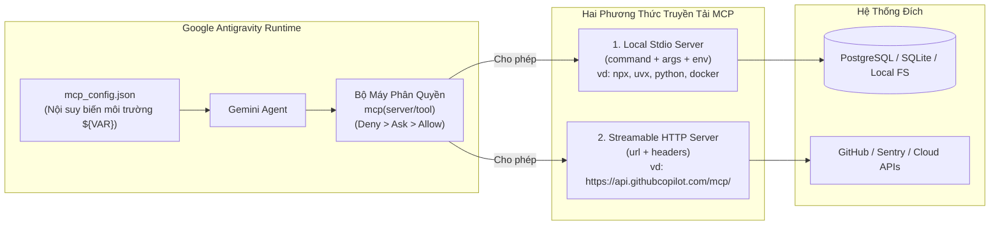
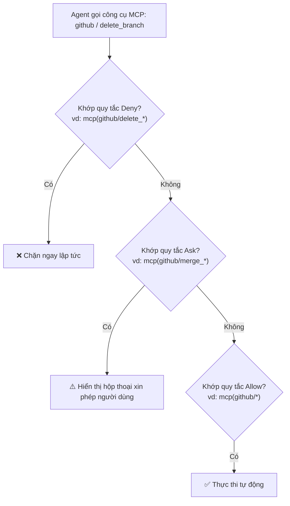

# Module 05: Giao Thức MCP — Model Context Protocol (`mcp_config.json`)

[English](../../05-mcp/README.md) | **Tiếng Việt**

> **Thời lượng**: 45 phút • **Độ khó**: Trung cấp • **Trắc nghiệm**: Chạy `/lesson-quiz 05` trong Antigravity

**Model Context Protocol (MCP)** là chuẩn kết nối mở cho phép **Google Antigravity** và **Gemini** giao tiếp trực tiếp với các hệ thống bên ngoài — từ GitHub, PostgreSQL, BigQuery, Sentry, Jira, Linear cho đến các dịch vụ nội bộ của doanh nghiệp bạn — thông qua một định dạng cấu hình chuẩn duy nhất tại `~/.gemini/config/mcp_config.json` (hoặc đóng gói trong Plugin tại `<plugin-root>/mcp_config.json`).

---

## 1. Kiến Trúc Kết Nối MCP Trong Google Antigravity

Antigravity hỗ trợ hai phương thức truyền tải (transport) chính cho MCP servers: **Local Stdio** (tiến trình con cục bộ) và **Remote Streamable HTTP** (máy chủ HTTP/SSE từ xa có xác thực header):



---

## 2. Cấu Hình `mcp_config.json`: Stdio vs. Streamable HTTP

File cấu hình MCP chính của người dùng nằm tại `~/.gemini/config/mcp_config.json` (ngoài ra mỗi Native Plugin có thể đóng gói kèm một file `mcp_config.json` ngay tại thư mục gốc của plugin).

### Ví Dụ Cấu Hình Kết Hợp Cả Stdio và Streamable HTTP

```json
{
  "mcpServers": {
    "github": {
      "url": "https://api.githubcopilot.com/mcp/",
      "headers": {
        "Authorization": "Bearer ${GITHUB_PERSONAL_ACCESS_TOKEN}"
      }
    },
    "postgres": {
      "command": "npx",
      "args": [
        "-y",
        "@modelcontextprotocol/server-postgres",
        "${DATABASE_URL}"
      ],
      "env": {
        "PGCONNECT_TIMEOUT": "10"
      }
    },
    "filesystem": {
      "command": "npx",
      "args": [
        "-y",
        "@modelcontextprotocol/server-filesystem",
        "/Users/dev/Projects/shared-schemas"
      ]
    }
  }
}
```

### So Sánh Hai Loại Máy Chủ MCP

| Tiêu Chí | Local Stdio (`command` + `args`) | Remote Streamable HTTP (`url` + `headers`) |
| :--- | :--- | :--- |
| **Cách khởi chạy** | Antigravity tự khởi chạy tiến trình con cục bộ (`npx`, `uvx`, binary) và giao tiếp qua `stdin`/`stdout` | Kết nối trực tiếp qua HTTPS tới endpoint MCP từ xa |
| **Cấu hình xác thực** | Truyền qua mảng `"args"` hoặc đối tượng `"env"` với cú pháp `${VAR}` | Truyền qua đối tượng `"headers"` (ví dụ `"Authorization": "Bearer ${TOKEN}"`) |
| **Ưu điểm** | Không cần mở cổng mạng, truy cập được tài nguyên cục bộ hoặc qua VPN/SSH tunnel | Không cần cài đặt runtime cục bộ (`Node.js`/`Python`), quản lý tập trung cho cả công ty |

> [!CAUTION]
> **Bảo mật thông tin xác thực (Credentials Hygiene)**:
> Tuyệt đối **không bao giờ** ghi trực tiếp khóa API thật (như `ghp_...` hoặc mật khẩu DB) vào trong `mcp_config.json`. Hãy luôn sử dụng cú pháp nội suy biến môi trường **`${TÊN_BIẾN}`** để file cấu hình có thể chia sẻ hoặc lưu trữ an toàn.

---

## 3. Phân Quyền Chi Tiết Cho Công Cụ MCP (`mcp(server/tool)`)

Không phải công cụ MCP nào cũng có mức độ rủi ro giống nhau: công cụ `list_pull_requests` hoàn toàn vô hại, nhưng `merge_pull_request` hoặc `delete_branch` lại có tác động không thể đảo ngược. Antigravity cho phép bạn kiểm soát quyền ở cả cấp máy chủ lẫn cấp từng công cụ riêng lẻ:



### Mẫu Cấu Hình Phân Quyền MCP Khuyến Nghị

| Mức Quyền | Cú Pháp Quy Tắc | Ý Nghĩa Bảo Vệ |
| :--- | :--- | :--- |
| **`Allow`** | `mcp(github/get_*)`, `mcp(github/list_*)`, `mcp(github/search_*)` | Cho phép agent tự động tra cứu thông tin PR, issue và code mà không làm phiền bạn |
| **`Ask`** | `mcp(github/create_*)`, `mcp(github/merge_pull_request)` | Yêu cầu bạn xác nhận trước khi tạo hoặc gộp Pull Request |
| **`Deny`** | `mcp(github/delete_*)`, `mcp(postgres/drop_*)` | Cấm tuyệt đối các thao tác xóa nhánh hoặc xóa bảng cơ sở dữ liệu |

---

## 4. Chẩn Đoán & Tự Động Sửa Lỗi Với **Fix with Agent**

Khi cấu hình một MCP server mới, đôi khi server không thể khởi động do thiếu thư viện (`npx`/`uvx`), sai tên biến môi trường hoặc lỗi cú pháp JSON.

Thay vì phải tự đọc log hệ thống thủ công:
1. Gõ lệnh **`/mcp`** trong Antigravity App hoặc mở bảng điều khiển MCP.
2. Nếu một server hiển thị trạng thái **Error / Disconnected**, hãy nhấp vào nút **Fix with Agent** ngay cạnh server đó.
3. Antigravity sẽ tự động chuyển toàn bộ luồng lỗi `stderr`, trạng thái bắt tay (handshake) và cấu hình `mcp_config.json` cho agent để nó chẩn đoán nguyên nhân và đề xuất bản sửa lỗi chính xác chỉ trong vài giây!

---

## 5. Cho Phép Subagent Sử Dụng Công Cụ MCP

Mặc định, các subagent tùy chỉnh trong `.agents/agents/*.md` hoặc tạo qua `define_subagent` chỉ được trang bị nhóm công cụ đọc file cục bộ. Để một subagent (ví dụ `data-scientist` hoặc `devops-agent`) có thể gọi các công cụ từ MCP server:
- Bật `enable_mcp_tools: true` khi định nghĩa subagent (hoặc liệt kê tên công cụ MCP trong danh sách `tools` của file `.agents/agents/<name>.md`).

---

## 6. Bộ 4 Template Cấu Hình MCP Trong Module Này

Bạn có thể tìm thấy các file cấu hình mẫu trong thư mục [`../../05-mcp/`](../../05-mcp/):

| File Mẫu | Dịch Vụ Kết Nối | Đặc Điểm |
| :--- | :--- | :--- |
| `../../05-mcp/github-mcp.json` | **GitHub Copilot MCP** | Kết nối Streamable HTTP chuẩn với header `Authorization: Bearer ${GITHUB_PERSONAL_ACCESS_TOKEN}` |
| `../../05-mcp/database-mcp.json` | **PostgreSQL MCP** | Kết nối cơ sở dữ liệu qua Stdio với biến môi trường `${DATABASE_URL}` |
| `../../05-mcp/filesystem-mcp.json` | **Filesystem MCP** | Cấp quyền truy cập có kiểm soát tới các thư mục tài liệu/schema bên ngoài workspace |
| `../../05-mcp/multi-mcp.json` | **Multi-Server Suite** | Cấu hình tổng hợp kết nối đồng thời GitHub, PostgreSQL và công cụ giám sát |

---

## 7. Nguyên Tắc Nên & Không Nên (Do's & Don'ts)

| ✅ Nên Làm (Do's) | ❌ Không Nên Làm (Don'ts) |
| :--- | :--- |
| Sử dụng `${VAR}` cho mọi token, API key và chuỗi kết nối cơ sở dữ liệu trong `mcp_config.json` | Commit thẳng token thật lên Git hoặc dán khóa bí mật vào `GEMINI.md` |
| Áp dụng quy tắc `Deny` và `Ask` cho các công cụ MCP có khả năng ghi/xóa dữ liệu (`mcp(server/tool)`) | Cấp quyền `Allow: mcp(*)` cho các tài khoản cơ sở dữ liệu production có quyền ghi |
| Chỉ bật các MCP server thực sự cần thiết để tiết kiệm token mô tả công cụ (tool schemas) | Bật cùng lúc 25 MCP server không dùng tới làm tốn hàng ngàn token ngữ cảnh ở mỗi lượt |
| Dùng nút **Fix with Agent** trong `/mcp` khi gặp lỗi khởi tạo server | Đoán mò lỗi cấu hình khi tiến trình Stdio bị dừng đột ngột |

---

## Bước Tiếp Theo

- **Kiểm tra mức độ hiểu bài**: Chạy `/lesson-quiz 05` trong Antigravity App hoặc `agy` CLI.
- **Quay lại**: ← [Module 04: Subagents](../04-subagents/README.md)
- **Bài học tiếp theo**: **[Module 06: Lifecycle Hooks (`.agents/hooks.json`)](../06-hooks/README.md)** →
