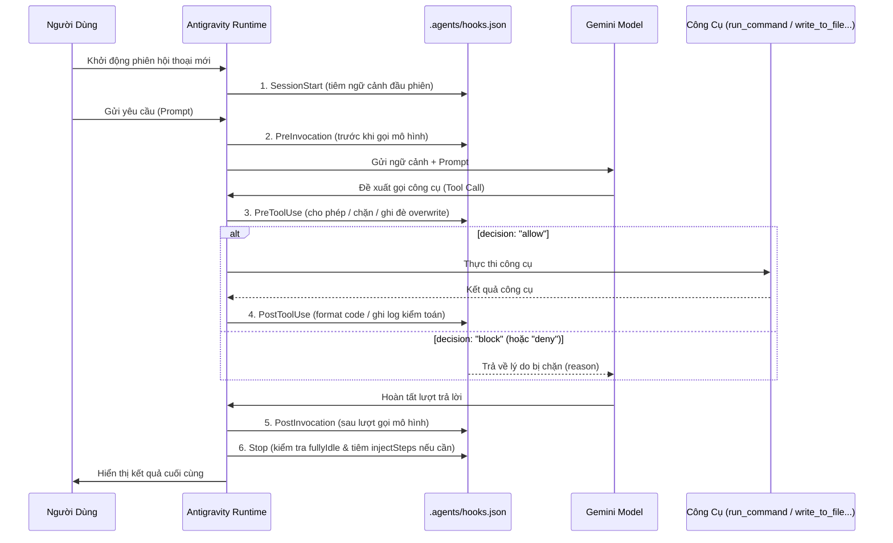

# Module 06: Lifecycle Hooks (`.agents/hooks.json` & Hợp Đồng JSON Tất Định)

[English](../../06-hooks/README.md) | **Tiếng Việt**

> **Thời lượng**: 60 phút • **Độ khó**: Trung cấp – Nâng cao • **Trắc nghiệm**: Chạy `/lesson-quiz 06` trong Antigravity

Trong khi `GEMINI.md` và `.agents/rules/*.md` hướng dẫn mô hình bằng ngôn ngữ tự nhiên (mang tính xác suất), **Lifecycle Hooks** trong **Google Antigravity** cung cấp các chốt chặn kiểm soát **tất định 100% (deterministic)**. Được cấu hình tại `.agents/hooks.json` (cấp dự án), `~/.gemini/config/hooks.json` (cấp người dùng) hoặc `<plugin-root>/hooks.json` (trong Plugin), hooks cho phép bạn thực thi các script kiểm tra bảo mật, tự động viết lại tham số công cụ (`overwrite`), tự động format code ngay sau khi sửa và ép buộc chạy kiểm thử trước khi kết thúc phiên (`Stop`).

---

## 1. Sáu Sự Kiện Vòng Đời (6 Lifecycle Events) Trong Antigravity

Antigravity cung cấp 6 điểm đón chặn chiến lược xuyên suốt vòng đời của một phiên làm việc:



### Bảng Phân Loại 6 Sự Kiện Vòng Đời

| Sự Kiện | Thời Điểm Kích Hoạt | Có Dùng `matcher`? | Khả Năng Can Thiệp Chính |
| :--- | :--- | :---: | :--- |
| **`SessionStart`** | Khi khởi tạo phiên hội thoại mới | Không (Mảng phẳng) | Tiêm thông tin môi trường, nhánh Git hoặc cảnh báo hệ thống vào đầu phiên qua `injectSteps` |
| **`PreInvocation`** | Ngay trước mỗi lượt gửi prompt tới mô hình | Không (Mảng phẳng) | Kiểm tra prompt, bổ sung thông điệp tạm thời (`ephemeralMessage`) trước khi mô hình suy luận |
| **`PreToolUse`** | Ngay trước khi một công cụ (`run_command`, `write_to_file`...) được chạy | **Có** (`matcher` theo tên tool) | **Chặn lệnh nguy hiểm** (`decision: "block"`), **viết lại tham số đầu vào** (`overwrite`) hoặc ghi đè quyền (`permissionOverrides`) |
| **`PostToolUse`** | Ngay sau khi một công cụ thực thi xong | **Có** (`matcher` theo tên tool) | Tự động chạy `ruff` / `prettier` trên file vừa sửa, ghi nhật ký kiểm toán (`audit.log`) |
| **`PostInvocation`** | Ngay sau khi mô hình hoàn thành một lượt suy luận | Không (Mảng phẳng) | Theo dõi lượng token, hoặc ép tiếp tục (`terminationBehavior: "force_continue"`) |
| **`Stop`** | Khi agent chuẩn bị kết thúc lượt và trả quyền điều khiển về cho người dùng | Không (Mảng phẳng) | Kiểm tra `fullyIdle: true`, chạy bộ kiểm thử cuối cùng và tiêm thêm bước sửa lỗi (`injectSteps`) nếu test chưa đạt |

---

## 2. Cấu Trúc File `.agents/hooks.json`

Lưu ý sự khác biệt quan trọng trong cấu trúc JSON:
- **`PreToolUse` và `PostToolUse`** sử dụng mảng các đối tượng có trường **`matcher`** (khớp biểu thức chính quy với tên công cụ như `"run_command"` hoặc `"write_to_file|replace_file_content"`).
- **4 sự kiện còn lại (`SessionStart`, `PreInvocation`, `PostInvocation`, `Stop`)** sử dụng mảng phẳng các đối tượng handler.

```json
{
  "SessionStart": [
    {
      "type": "command",
      "command": "bash .agents/hooks/session-context.sh"
    }
  ],
  "PreToolUse": [
    {
      "matcher": "run_command",
      "hooks": [
        {
          "type": "command",
          "command": "python3 .agents/hooks/guard-commands.py"
        }
      ]
    },
    {
      "matcher": "write_to_file|replace_file_content",
      "hooks": [
        {
          "type": "command",
          "command": "bash .agents/hooks/security-scan.sh"
        }
      ]
    }
  ],
  "PostToolUse": [
    {
      "matcher": "write_to_file|replace_file_content",
      "hooks": [
        {
          "type": "command",
          "command": "bash .agents/hooks/format-code.sh"
        }
      ]
    }
  ],
  "Stop": [
    {
      "type": "command",
      "command": "python3 .agents/hooks/verify-on-stop.py"
    }
  ]
}
```

---

## 3. Hợp Đồng JSON `stdin` / `stdout` (Chuẩn `camelCase`)

Mỗi khi sự kiện kích hoạt, Antigravity truyền một đối tượng JSON qua `stdin` của script và đọc kết quả JSON từ `stdout`. **Tất cả các khóa JSON đều tuân theo quy ước `camelCase`**.

### 3.1. Dữ Liệu Đầu Vào Qua `stdin`

```json
{
  "event": "PreToolUse",
  "conversationId": "29b8663b-cbbd-420f-9ab4-16d6edcf8f62",
  "workspacePaths": ["/Users/dev/Projects/my-service"],
  "transcriptPath": "/Users/dev/.gemini/antigravity/brain/29b8.../transcript.jsonl",
  "artifactDirectoryPath": "/Users/dev/.gemini/antigravity/brain/29b8...",
  "modelName": "gemini-4-argon",
  "toolName": "run_command",
  "toolInput": {
    "CommandLine": "pytest",
    "Cwd": "/Users/dev/Projects/my-service"
  }
}
```

*(Khi sự kiện là `Stop`, payload đầu vào sẽ có thêm hai trường cực kỳ hữu ích: `"fullyIdle": true | false` và `"terminationReason"`).*

### 3.2. Dữ Liệu Đầu Ra Qua `stdout`

#### Kịch bản A: Chặn một lệnh nguy hiểm trong `PreToolUse`
```json
{
  "decision": "block",
  "reason": "Lệnh chứa thao tác xóa toàn cục hoặc đẩy nhánh cưỡng bức (git push --force) bị cấm bởi chính sách dự án."
}
```

#### Kịch bản B: Tự động viết lại tham số công cụ (`overwrite`) trong `PreToolUse`
Ví dụ: Tự động gắn thêm cờ `-q --tb=short` mỗi khi agent chạy `pytest` để tiết kiệm token đầu ra:

```python
#!/usr/bin/env python3
import json
import sys

payload = json.load(sys.stdin)
tool_input = payload.get("toolInput", {})
cmd = tool_input.get("CommandLine", "")

if "rm -rf /" in cmd or "git push --force" in cmd:
    print(json.dumps({
        "decision": "block",
        "reason": f"Chặn lệnh không an toàn: {cmd}"
    }))
elif cmd.strip() == "pytest":
    updated = dict(tool_input)
    updated["CommandLine"] = "pytest -q --tb=short"
    print(json.dumps({
        "decision": "allow",
        "overwrite": updated
    }))
else:
    print(json.dumps({"decision": "allow"}))
```

#### Kịch bản C: Cổng kiểm chứng tự động ở sự kiện `Stop` (Kiểm tra `fullyIdle` & `injectSteps`)

> [!WARNING]
> **Tránh vòng lặp vô tận trong `Stop` hook**:
> 1. Luôn kiểm tra `payload.get("fullyIdle") is True` trước khi tiêm bước mới — nếu agent chỉ tạm dừng để đợi một subagent hoặc tác vụ nền hoàn tất (`fullyIdle == False`), bạn **không** được chen ngang.
> 2. Luôn kiểm tra điều kiện dừng (ví dụ test đã pass hoặc đã kiểm tra rồi) để không trả về `injectSteps` mãi mãi!

```python
#!/usr/bin/env python3
import json
import subprocess
import sys

payload = json.load(sys.stdin)

# Chỉ chạy cổng kiểm tra khi mọi subagent và tác vụ nền đã hoàn tất
if not payload.get("fullyIdle", False):
    print(json.dumps({}))
    sys.exit(0)

# Chạy kiểm tra nhanh xem unit test có vượt qua không
res = subprocess.run(["pytest", "-q"], capture_output=True, text=True)
if res.returncode != 0:
    print(json.dumps({
        "injectSteps": [
            f"Bộ kiểm thử pytest chưa vượt qua:\n{res.stdout}\nHãy sửa hết các lỗi test trước khi kết thúc."
        ]
    }))
else:
    print(json.dumps({}))
```

---

## 4. Bộ Script Hooks Mẫu Có Sẵn Trong Module Này

Khám phá các script mẫu trong thư mục [`../../06-hooks/`](../../06-hooks/):

| File / Script | Sự Kiện | Tác Dụng Thực Tế |
| :--- | :--- | :--- |
| `../../06-hooks/hooks.json` | Tất cả | File cấu hình `.agents/hooks.json` mẫu kết nối sẵn các script |
| `../../06-hooks/security-scan.sh` | `PreToolUse` | Quét khóa AWS, GitHub PAT, private key trước khi cho phép ghi file hoặc chạy lệnh |
| `../../06-hooks/format-code.sh` | `PostToolUse` | Tự động chạy công cụ format (`ruff`, `prettier`, `gofmt`) ngay khi file được lưu |
| `../../06-hooks/pre-commit.sh` | `PreToolUse` | Đón chặn lệnh `git commit` để đảm bảo linter không có lỗi |
| `../../06-hooks/dependency-check.sh` | `PreToolUse` | Kiểm tra tên gói và phiên bản trước khi cài đặt thư viện mới |
| `../../06-hooks/log-bash.sh` | `PostToolUse` | Lưu lịch sử các lệnh shell đã chạy kèm timestamp và `conversationId` |
| `../../06-hooks/validate-prompt.sh` | `PreInvocation` | Kiểm tra và bổ sung thông tin ngữ cảnh trước lượt suy luận |
| `../../06-hooks/context-tracker.py` | `PostInvocation` | Thống kê lượng token và số bước thực thi trong phiên |
| `../../06-hooks/notify-team.sh` | `Stop` | Kiểm tra `fullyIdle` và gửi thông báo hoàn tất tác vụ dài |

---

## 5. Nguyên Tắc Nên & Không Nên (Do's & Don'ts)

| ✅ Nên Làm (Do's) | ❌ Không Nên Làm (Don'ts) |
| :--- | :--- |
| Giữ thời gian thực thi của các hook `PreToolUse` và `PostToolUse` thật nhanh (< 500ms) | Chạy một bộ kiểm thử tích hợp mất 10 phút ở mỗi lần `PostToolUse` lưu file |
| Sử dụng đúng các khóa JSON dạng `camelCase` (`decision`, `overwrite`, `injectSteps`, `fullyIdle`) | Sử dụng các khóa `snake_case` của công cụ khác khiến runtime bỏ qua phản hồi |
| Luôn kiểm tra `fullyIdle: true` và điều kiện thoát trong sự kiện `Stop` | Trả về `injectSteps` vô điều kiện ở sự kiện `Stop` gây vòng lặp vô hạn |

---

## Bước Tiếp Theo

- **Kiểm tra mức độ hiểu bài**: Chạy `/lesson-quiz 06` trong Antigravity App hoặc `agy` CLI.
- **Quay lại**: ← [Module 05: Giao Thức MCP](../05-mcp/README.md)
- **Bài học tiếp theo**: **[Module 07: Native Plugins (`plugin.json` & `agy plugin` CLI)](../07-plugins/README.md)** →
