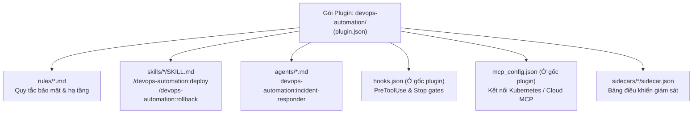

# Module 07: Native Plugins (`plugin.json` & Quản Lý Gói Mở Rộng Với `agy plugin`)

[English](../../07-plugins/README.md) | **Tiếng Việt**

> **Thời lượng**: 50 phút • **Độ khó**: Nâng cao • **Trắc nghiệm**: Chạy `/lesson-quiz 07` trong Antigravity

Khi bạn đã xây dựng được các bộ **Skills (`03-skills`)**, **Subagents (`04-subagents`)**, **Rules (`02-memory`)**, **MCP Servers (`05-mcp`)**, **Lifecycle Hooks (`06-hooks`)** và **Sidecars (`08-checkpoints`)**, làm thế nào để chia sẻ toàn bộ hệ sinh thái đó cho 50 lập trình viên trong công ty hoặc phân phối qua nhiều repository mà không phải sao chép từng file lẻ tẻ? **Native Plugins** trong **Google Antigravity** giải quyết bài toán này bằng cách đóng gói mọi thành phần vào một đơn vị duy nhất được định danh không gian tên (namespaced), có thể cài đặt, kiểm định, bật hoặc tắt chỉ bằng một lệnh.

---

## 1. Kiến Trúc & Cấu Trúc Thư Mục Chuẩn Của Một Native Plugin

Một gói Plugin chuẩn trong Google Antigravity có cấu trúc thư mục rõ ràng, trong đó `plugin.json`, `hooks.json` và `mcp_config.json` **bắt buộc đặt ngay tại thư mục gốc của plugin**:

```text
devops-automation/
├── plugin.json                   # (Bắt buộc) Manifest khai báo tên, phiên bản, mô tả, tác giả
├── hooks.json                    # (Tùy chọn) Lifecycle hooks đặt ngay tại gốc plugin
├── mcp_config.json               # (Tùy chọn) Cấu hình MCP servers đặt ngay tại gốc plugin
├── README.md                     # Tài liệu hướng dẫn sử dụng plugin
├── rules/                        # (Tùy chọn) Các quy tắc .md (always_on, model_decision, glob, manual)
│   └── terraform-safety.md
├── skills/                       # (Tùy chọn) Các thư mục kỹ năng <skill-name>/SKILL.md
│   ├── deploy/
│   │   ├── SKILL.md
│   │   └── scripts/
│   │       └── preflight-check.sh
│   └── rollback/
│       └── SKILL.md
├── agents/                       # (Tùy chọn) Các subagent chuyên biệt <agent-name>.md
│   └── incident-responder.md
└── sidecars/                     # (Tùy chọn) Các tiến trình/bảng điều khiển sidecar
    └── cluster-monitor/
        └── sidecar.json
```



> [!IMPORTANT]
> **Quy tắc vị trí file gốc**: Trong Antigravity Native Plugins, hai file `hooks.json` và `mcp_config.json` phải nằm **trực tiếp ở thư mục gốc của plugin** (ngang hàng với `plugin.json`), tuyệt đối không đặt ẩn bên trong thư mục con `hooks/hooks.json` hay `.claude-plugin/`.

---

## 2. Cấu Trúc File Manifest `plugin.json`

File `plugin.json` định nghĩa siêu dữ liệu và phiên bản của gói plugin:

```json
{
  "name": "devops-automation",
  "version": "1.2.0",
  "description": "Bộ công cụ tự động hóa triển khai, phản ứng sự cố, kiểm tra hạ tầng Terraform và giám sát Kubernetes cho đội ngũ SRE/DevOps.",
  "author": {
    "name": "Platform Engineering Team",
    "email": "platform@example.com"
  },
  "license": "MIT",
  "keywords": ["devops", "sre", "kubernetes", "deployment", "incident-response"]
}
```

---

## 3. Cơ Chế Không Gian Tên (Namespacing) & Chống Xung Đột Tên

Khi một plugin được kích hoạt, Antigravity tự động gắn tiền tố `<tên-plugin>:` cho các thành phần bên trong plugin đó:

| Thành Phần Trong Plugin `pr-review` | Tên Đầy Đủ Sau Khi Nạp | Lợi Ích |
| :--- | :--- | :--- |
| `skills/audit/SKILL.md` | **`pr-review:audit`** (Gọi qua `/pr-review:audit`) | Không bao giờ ghi đè hay xung đột với skill `.agents/skills/audit/SKILL.md` riêng của dự án |
| `agents/security-scanner.md` | **`pr-review:security-scanner`** | Tác nhân chính có thể gọi chính xác subagent của plugin qua `invoke_subagent` |
| `rules/pr-standards.md` | **`pr-review:pr-standards`** | Hiển thị rõ nguồn gốc quy tắc trong `/context` và có thể bật/tắt nguyên khối |

Khi bạn tắt (disable) plugin `pr-review` qua lệnh `/plugin`, toàn bộ skills, subagents, rules, hooks, MCP servers và sidecars thuộc không gian tên `pr-review:*` sẽ được gỡ khỏi phiên làm việc ngay lập tức một cách nguyên tử (atomic).

---

## 4. Quản Lý & Kiểm Định Plugin Bằng `/plugin` và `agy plugin` CLI

### 4.1. Trong Giao Diện Chat Tương Tác (`/plugin`)
Gõ lệnh `/plugin` (hoặc `/plugins`) để mở bảng điều khiển trực quan cho phép:
- Xem danh sách các plugin đang cài đặt ở cấp Workspace (`.agents/plugins/`) và Global (`~/.gemini/config/plugins/`).
- Bật (**Enable**) hoặc Tắt (**Disable**) từng plugin chỉ với một cú nhấp.
- Cài đặt plugin mới hoặc gỡ bỏ plugin không còn sử dụng.

### 4.2. Qua Dòng Lệnh `agy plugin` CLI (Dành Cho Phát Triển & CI/CD)

```bash
# 1. Kiểm định nghiêm ngặt cấu trúc plugin (manifest, frontmatter, hooks.json, mcp_config.json)
agy plugin validate ./07-plugins/devops-automation --strict

# 2. Cài đặt plugin từ thư mục cục bộ hoặc kho lưu trữ
agy plugin install ./07-plugins/pr-review

# 3. Liệt kê các plugin đã cài đặt và trạng thái hiện tại
agy plugin list

# 4. Bật hoặc tắt một plugin
agy plugin enable pr-review
agy plugin disable pr-review
```

---

## 5. Khi Nào Nên Tạo Plugin Thay Vì Đặt File Rời Trong `.agents/`?

| Tình Huống | Đặt Trong `.agents/` Của Dự Án | Đóng Gói Thành Native Plugin (`plugin.json`) |
| :--- | :---: | :---: |
| Quy ước riêng của một repository duy nhất (lệnh build, cấu trúc thư mục) | ✅ Khuyến nghị (`GEMINI.md`, `.agents/rules/`) | ❌ Không cần thiết |
| Một lệnh tắt đơn lẻ chỉ dùng trong 1 dự án | ✅ Khuyến nghị (`.agents/skills/<name>/SKILL.md`) | ❌ Không cần thiết |
| Bộ công cụ chuẩn (Skills + Subagents + Hooks + MCP) dùng chung cho 10+ repositories của công ty | ❌ Khó đồng bộ khi cập nhật | ✅ **Khuyến nghị mạnh mẽ** |
| Bộ công cụ chuyên ngành (ví dụ: Khoa học sự sống, Firebase, Chrome DevTools) cần bật/tắt nguyên khối | ❌ Lộn xộn | ✅ **Khuyến nghị mạnh mẽ** |

---

## 6. Bộ 3 Gói Plugin Hoàn Chỉnh Có Sẵn Trong Module Này

Bạn có thể khám phá, kiểm định và cài đặt ngay 3 gói plugin mẫu trong thư mục [`../../07-plugins/`](../../07-plugins/):

| Gói Plugin | Đường Dẫn | Các Thành Phần Bên Trong |
| :--- | :--- | :--- |
| **`pr-review`** | [`../../07-plugins/pr-review/`](../../07-plugins/pr-review/) | [`plugin.json`](../../07-plugins/pr-review/plugin.json), [`hooks.json`](../../07-plugins/pr-review/hooks.json), `skills/`, `agents/`, `rules/` cho quy trình đánh giá Pull Request tự động |
| **`devops-automation`** | [`../../07-plugins/devops-automation/`](../../07-plugins/devops-automation/) | [`plugin.json`](../../07-plugins/devops-automation/plugin.json), [`hooks.json`](../../07-plugins/devops-automation/hooks.json), [`mcp_config.json`](../../07-plugins/devops-automation/mcp_config.json), `skills/`, `agents/`, `rules/` cho triển khai CI/CD và xử lý sự cố |
| **`documentation`** | [`../../07-plugins/documentation/`](../../07-plugins/documentation/) | [`plugin.json`](../../07-plugins/documentation/plugin.json), `skills/`, `agents/`, `rules/` để tự động sinh và đồng bộ tài liệu kỹ thuật |

---

## 7. Nguyên Tắc Nên & Không Nên (Do's & Don'ts)

| ✅ Nên Làm (Do's) | ❌ Không Nên Làm (Don'ts) |
| :--- | :--- |
| Đặt `plugin.json`, `hooks.json` và `mcp_config.json` ngay tại thư mục gốc của gói plugin | Đặt `hooks.json` trong thư mục con `hooks/` khiến Antigravity không tự động nạp |
| Sử dụng đường dẫn tương đối bên trong plugin để gói hoạt động trên mọi máy tính của đồng nghiệp | Hardcode đường dẫn tuyệt đối `/Users/ten-ban/...` bên trong `hooks.json` hoặc `SKILL.md` |
| Chạy `agy plugin validate <path> --strict` trong pipeline CI trước khi phát hành phiên bản plugin mới | Phân phối plugin có lỗi cú pháp YAML frontmatter hoặc thiếu trường bắt buộc |

---

## Bước Tiếp Theo

- **Kiểm tra mức độ hiểu bài**: Chạy `/lesson-quiz 07` trong Antigravity App hoặc `agy` CLI.
- **Quay lại**: ← [Module 06: Lifecycle Hooks](../06-hooks/README.md)
- **Bài học tiếp theo**: **[Module 08: Checkpoints, Artifacts, Generative UI & Sidecars](../08-checkpoints/README.md)** →
