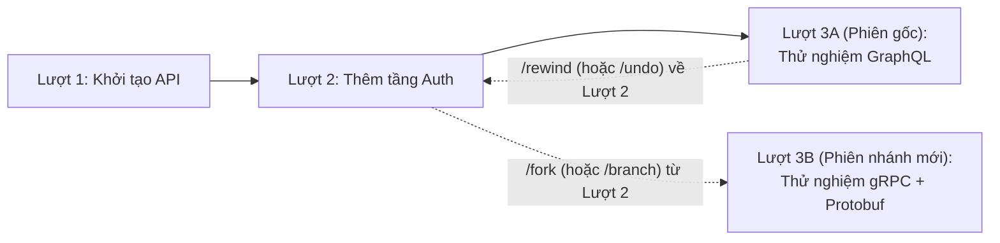
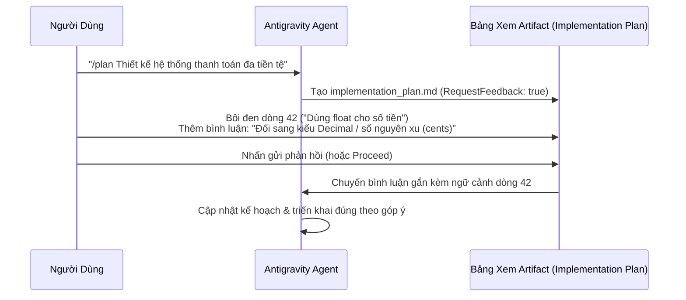

# Module 08: Checkpoints (`/rewind`, `/fork`), Implementation Plans, Generative UI (`<agent-embed>`) & Sidecars

[English](../../08-checkpoints/README.md) | **Tiếng Việt**

> **Thời lượng**: 45 phút • **Độ khó**: Trung cấp • **Trắc nghiệm**: Chạy `/lesson-quiz 08` trong Antigravity

Module này khám phá 4 tính năng giúp **Google Antigravity** vượt xa một trình chat dòng lệnh thông thường:
1. **Checkpoints & Phân nhánh phiên (`/rewind` & `/fork`)**: Thử nghiệm táo bạo với khả năng quay lui hoặc rẽ nhánh bất kỳ lúc nào.
2. **Implementation Plans có bình luận theo dòng**: Duyệt kế hoạch kỹ thuật chi tiết và để lại nhận xét trực tiếp trên từng dòng trước khi agent sửa code.
3. **Generative UI (`<agent-embed>`)**: Hiển thị biểu đồ, bảng tương tác, công cụ mô phỏng trực tiếp ngay trong khung chat với `tailwindcss.min.js` và biến CSS theo giao diện sáng/tối.
4. **Interactive Sidecars (`sidecar.json`) & Lịch hẹn `/schedule` (`CRON_TZ`)**: Mở các bảng điều khiển 3D/dữ liệu chuyên biệt qua liên kết `sidecar://` và tự động hóa các tác vụ nền theo lịch.

---

## 1. Checkpoints: Quay Lui (`/rewind`) vs. Rẽ Nhánh Song Song (`/fork`)

Mỗi khi bạn gửi một yêu cầu trong Antigravity, hệ thống tự động tạo một **Checkpoint** ghi nhận cả trạng thái hội thoại lẫn trạng thái các file trong workspace.



### So Sánh `/rewind` (`/undo`) và `/fork` (`/branch`)

| Lệnh | Bí Danh | Cơ Chế Hoạt Động | Khi Nào Sử Dụng |
| :--- | :--- | :--- | :--- |
| **`/rewind`** | `/undo` | Quay lui phiên hiện tại về một lượt trước đó (hỗ trợ chọn: **Khôi phục cả code và hội thoại**, **Chỉ khôi phục hội thoại**, hoặc **Chỉ khôi phục code**). | Khi hướng tiếp cận vừa thử đi vào ngõ cụt và bạn muốn xóa bỏ các thay đổi đó để làm lại. |
| **`/fork`** | `/branch` | Nhân bản cuộc hội thoại tại một lượt bất kỳ thành một **phiên độc lập mới** trong khi vẫn giữ nguyên phiên hiện tại. | Khi phương án A đang chạy tốt nhưng bạn muốn thử thêm phương án B để so sánh mà không làm mất phương án A. |

---

## 2. Artifacts & Bình Luận Trực Tiếp Trên Implementation Plan

Trong Antigravity, các tài liệu có cấu trúc dài (kế hoạch triển khai, báo cáo phân tích, danh sách công việc) được lưu trữ dưới dạng **Artifacts** tại `<appDataDir>/brain/<conversation-id>/` với siêu dữ liệu `ArtifactMetadata` (`Summary`, `UserFacing: true`, `RequestFeedback: true`).

### Quy Trình Duyệt Kế Hoạch Tương Tác (Inline Review Workflow)



- **Bình luận chính xác từng dòng**: Thay vì phải viết lại một đoạn mô tả dài trong khung chat để giải thích bạn không đồng ý ở mục nào, bạn chỉ cần bôi đen dòng đó ngay trên **Implementation Plan** và gắn bình luận giống như trên Google Docs hoặc GitHub PR!
- **Nút Proceed**: Khi kế hoạch đã hoàn hảo, nhấn **Proceed** để agent bắt đầu thực thi.

---

## 3. Generative UI: Nhúng Widget Tương Tác Với `<agent-embed>`

Khi văn bản thuần hoặc bảng Markdown tĩnh không đủ để truyền tải dữ liệu phức tạp (ví dụ: bộ mô phỏng thuật toán, bảng lọc dữ liệu trực tiếp, sơ đồ kiến trúc có thể nhấp chọn, công cụ ước tính chi phí), agent có thể sử dụng kỹ năng **`generative_ui`** để tạo widget HTML/JS tương tác ngay trong luồng chat thông qua thẻ `<agent-embed>`.

### Các Nguyên Tắc Kỹ Thuật Bắt Buộc Cho `<agent-embed>`
1. **Tự chứa hoàn toàn (Self-Contained)**: Toàn bộ HTML, CSS và JavaScript nằm gọn trong khối `<agent-embed>...</agent-embed>`.
2. **Sử dụng Tailwind cục bộ**: Nạp `/tailwind/tailwindcss.min.js` được cung cấp sẵn bởi runtime nội bộ (không phụ thuộc vào mạng ngoài).
3. **Thích ứng giao diện Sáng / Tối tự động**: Sử dụng các biến CSS ngữ nghĩa của Antigravity (`var(--background)`, `var(--foreground)`, `var(--card)`, `var(--border)`, `var(--primary)`, `var(--muted-foreground)`) thay vì gán cứng màu đen/trắng.

### Ví Dụ Một Khối `<agent-embed>` Chuẩn

```html
<agent-embed height="320">
<!DOCTYPE html>
<html>
<head>
  <script src="/tailwind/tailwindcss.min.js"></script>
  <style>
    body {
      background: var(--card);
      color: var(--foreground);
      font-family: system-ui, sans-serif;
    }
  </style>
</head>
<body class="p-4">
  <h3 class="text-lg font-semibold mb-2">Bộ Ước Tính Ngân Sách Token (20,000 Budget)</h3>
  <input id="tokens" type="range" min="0" max="20000" value="4500" class="w-full"
         oninput="document.getElementById('val').textContent = this.value + ' / 20,000 tokens'" />
  <p id="val" class="mt-2 text-sm">4500 / 20,000 tokens</p>
</body>
</html>
</agent-embed>
```

---

## 4. Interactive Sidecars (`sidecar.json`) & Liên Kết `sidecar://`

Bên cạnh các widget nhúng trong chat, Antigravity còn hỗ trợ **Sidecars** — các bảng điều khiển tương tác chuyên sâu chạy song hành bên cạnh khung chat (ví dụ: **Biomolecular Structure Viewer** dựa trên Mol* để xoay, phóng to và đánh dấu cấu trúc protein 3D `.pdb`/`.cif`, hoặc bảng điều khiển giám sát dịch vụ).

> [!IMPORTANT]
> **Quy tắc bắt buộc khi làm việc với Sidecar**:
>1. Đối với mọi tác vụ trực quan hóa khoa học hoặc dữ liệu có hỗ trợ sidecar, **luôn ưu tiên sử dụng trình xem Sidecar tương tác** thay vì chỉ xuất ảnh tĩnh.
> 2. Mỗi khi agent nạp hoặc cập nhật dữ liệu trong một sidecar (ví dụ gọi MCP tool của trình xem), agent **BẮT BUỘC** phải đính kèm liên kết dạng viên thuốc **`sidecar://`** chính xác của trình xem đó trong câu trả lời chat để người dùng có thể mở bảng điều khiển chỉ với 1 cú nhấp chuột!

---

## 5. Đặt Lịch & Tự Động Hóa Chạy Nền Với `/schedule` (`CRON_TZ`)

Antigravity tích hợp sẵn công cụ `schedule` và lệnh `/schedule` hỗ trợ 2 chế độ:

| Chế Độ | Tham Số Chính | Khi Nào Sử Dụng |
| :--- | :--- | :--- |
| **1. Hẹn giờ một lần (One-Shot Timer)** | `DurationSeconds` + `TimerCondition` (`"never"`, `"any"`, hoặc `<sender-id>`) | Nhắc nhở người dùng sau $N$ giây (`"never"`), hoặc đặt bộ hẹn giờ an toàn khi chờ các subagent/tác vụ nền hoàn tất (`"any"` hoặc `"task-123"` — tự động hủy sớm ngay khi có tin nhắn phản hồi). |
| **2. Lịch định kỳ Cron (Recurring Cron)** | `CronExpression` (5 trường chuẩn, hỗ trợ tiền tố múi giờ `CRON_TZ`) + `MaxIterations` + `IsDaemon` | Kiểm tra trạng thái triển khai mỗi 5 phút (`IsDaemon: false` — gắn với tác vụ hiện tại) hoặc tạo báo cáo tổng hợp hàng ngày chạy độc lập lâu dài (`IsDaemon: true`). |

> [!CAUTION]
> **Không bao giờ** dùng lệnh `sleep` chạy nền trong `run_command` để làm bộ hẹn giờ! Hãy luôn sử dụng công cụ `schedule` gốc của Antigravity.

---

## 6. Nguyên Tắc Nên & Không Nên (Do's & Don'ts)

| ✅ Nên Làm (Do's) | ❌ Không Nên Làm (Don'ts) |
| :--- | :--- |
| Dùng `/fork` khi muốn thử một hướng kiến trúc mới mà vẫn giữ lại nhánh làm việc hiện tại | Dùng `/clear` xóa trắng toàn bộ phiên khi chỉ muốn quay lại 2 bước trước |
| Để lại bình luận trực tiếp trên từng dòng của `implementation_plan.md` để chỉnh sửa kế hoạch chính xác | Bấm **Proceed** ngay cả khi kế hoạch có điểm chưa đúng ý rồi mới dừng agent giữa chừng |
| Luôn hiển thị liên kết `sidecar://` trong phản hồi chat mỗi khi cập nhật dữ liệu trên Sidecar | Cập nhật trạng thái Sidecar qua MCP nhưng quên đưa liên kết mở bảng điều khiển cho người dùng |
| Dùng công cụ `schedule` với `TimerCondition="any"` hoặc `"<sender-id>"` khi muốn giới hạn thời gian chờ tác vụ nền | Chạy `sleep 300` trong bash làm treo luồng hoặc tốn tài nguyên vô ích |

---

## Bước Tiếp Theo

- **Kiểm tra mức độ hiểu bài**: Chạy `/lesson-quiz 08` trong Antigravity App hoặc `agy` CLI.
- **Quay lại**: ← [Module 07: Native Plugins](../07-plugins/README.md)
- **Bài học tiếp theo**: **[Module 09: Tính Năng Nâng Cao (`/boost`, `/teamwork-preview`, Permissions & OS Sandbox)](../09-advanced-features/README.md)** →
