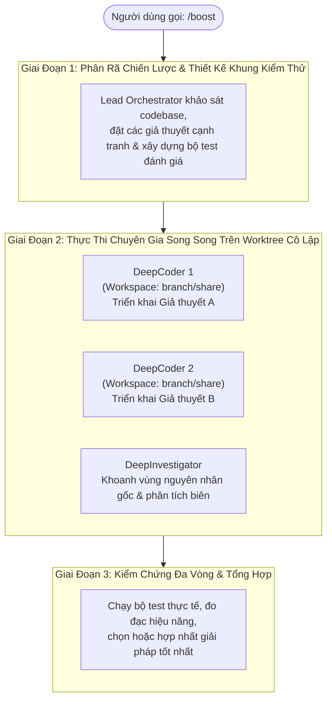
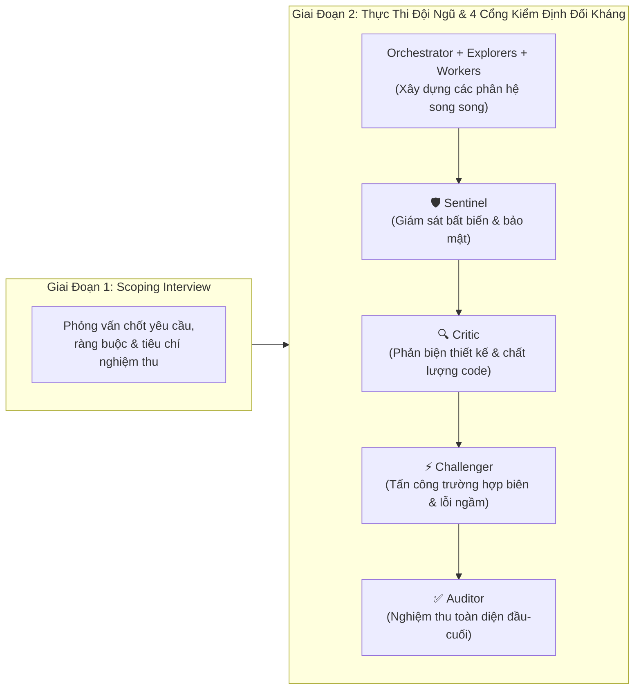

# Module 09: Tính Năng Nâng Cao (`/boost`, `/teamwork-preview`, Mô Hình Gemini, Phân Quyền & OS Sandbox)

[English](../../09-advanced-features/README.md) | **Tiếng Việt**

> **Thời lượng**: 60 phút • **Độ khó**: Nâng cao • **Trắc nghiệm**: Chạy `/lesson-quiz 09` trong Antigravity

Khi đối mặt với những bài toán kỹ thuật hóc búa nhất — như sửa lỗi race condition phân tán, thiết kế kiến trúc đa dịch vụ từ đầu, hay vận hành tác nhân tự hành trong môi trường yêu cầu bảo mật nghiêm ngặt — **Google Antigravity** cung cấp hai bộ máy điều phối đa tác nhân tiên phong (**`/boost`** và **`/teamwork-preview`**) cùng kiến trúc bảo mật đa tầng (**`Deny > Ask > Allow`** kết hợp **OS Kernel Sandbox**).

---

## 1. Chế Độ `/boost`: Suy Luận Sâu 3 Giai Đoạn (3-Phase Deep Reasoning)

Lệnh `/boost` được thiết kế chuyên biệt cho các bài toán đòi hỏi tư duy chiến lược sâu, thử nghiệm đa giả thuyết và kiểm chứng nghiêm ngặt:



### Khi Nào Nên Dùng `/boost`?
- Sửa các lỗi không tất định (flaky tests, deadlock, race condition, rò rỉ bộ nhớ).
- Tối ưu hóa thuật toán phức tạp cần so sánh độ trễ thực tế giữa nhiều cách tiếp cận.
- Tái cấu trúc phần lõi có độ rủi ro cao cần kiểm chứng kỹ lưỡng trước khi áp dụng.

---

## 2. Chế Độ `/teamwork-preview`: Đội Ngũ Kỹ Sư Tự Hành 2 Giai Đoạn Với Cổng Phản Biện

Nếu `/boost` tập trung vào độ sâu thuật toán và đa giả thuyết, thì `/teamwork-preview` mô phỏng một **đội ngũ kỹ sư phần mềm hoàn chỉnh** gồm cả người triển khai lẫn các chuyên gia phản biện độc lập:



### Vai Trò Của 4 Tác Nhân Kiểm Định Trong `/teamwork-preview`
1. **`Sentinel`**: Đảm bảo mọi thay đổi tuân thủ nghiêm ngặt các bất biến bảo mật và kiến trúc của dự án.
2. **`Critic`**: Đánh giá chất lượng mã nguồn, phát hiện thiết kế rườm rà, vi phạm Clean Code hoặc nợ kỹ thuật.
3. **`Challenger`**: Chủ động tìm cách "bẻ gãy" bản triển khai bằng các đầu vào bất thường, tải cao hoặc lỗi mạng.
4. **`Auditor`**: Đối chiếu sản phẩm cuối cùng với toàn bộ yêu cầu ở Giai đoạn 1 và kết quả chạy bộ kiểm thử trước khi bàn giao cho người dùng.

---

## 3. Lựa Chọn Mô Hình Tiên Phong & Mức Độ Suy Luận (`/model` & `/effort`)

Antigravity cho phép bạn phối hợp linh hoạt các thế hệ mô hình Gemini tùy theo tính chất công việc:

| Mô Hình | Điểm Mạnh Cốt Lõi | Ứng Dụng Khuyến Nghị |
| :--- | :--- | :--- |
| **Gemini 4 Argon** (`gemini-4-argon`) | Suy luận đa bước cực sâu, thiết kế kiến trúc hệ thống lớn, điều phối `/boost` và `/teamwork-preview` | Tác nhân chính (Main Agent), `Orchestrator`, `DeepCoder`, `Critic`, giải quyết bug phức tạp |
| **Gemini 3.8 Flash** (`gemini-3.8-flash`) | Tốc độ phản hồi cực nhanh, độ trễ thấp, hiệu quả chi phí cao | Subagent `research` quét nhanh hàng chục file, tác vụ lặp lại, chế độ `/fast` |
| **Gemini 3.1 Pro** (`gemini-3.1-pro`) | Cân bằng giữa cửa sổ ngữ cảnh lớn và khả năng tổng hợp tài liệu | Phân tích tài liệu dài, tổng hợp báo cáo đa nguồn |
| **Gemma 4 (LiteRT)** | Chạy cục bộ ngay trên thiết bị (On-Device / Offline) | Các tác vụ nhạy cảm về độ trễ hoặc ngoại tuyến qua `LiteRTAgentConfig` trong Python SDK |

Bạn có thể điều chỉnh độ sâu suy luận bất cứ lúc nào bằng lệnh `/effort low | medium | high | max`.

---

## 4. Hệ Thống Phân Quyền Chi Tiết (`Deny > Ask > Allow`)

Mọi lời gọi công cụ trong Antigravity đều đi qua bộ máy phân quyền với thứ tự ưu tiên tuyệt đối: **`Deny` (Cấm) > `Ask` (Hỏi) > `Allow` (Cho phép)**.

> [!IMPORTANT]
> **Quy tắc phủ quyết của `Deny`**: Nếu một thao tác khớp với bất kỳ quy tắc nào trong danh sách `Deny`, nó sẽ bị **chặn ngay lập tức** bất kể có quy tắc `Allow` rộng hơn hay không.

### Cú Pháp Quy Tắc Phân Quyền & Biểu Thức Chính Quy (`regex:`)

```json
{
  "permissions": {
    "deny": [
      "read_file(.env*)",
      "read_file(**/*secret*)",
      "write_file(.git/**)",
      "command(regex:^git push .*--force)",
      "command(regex:^rm -rf /)",
      "mcp(postgres/drop_*)"
    ],
    "ask": [
      "command(git push*)",
      "command(npm publish*)",
      "unsandboxed(docker *)",
      "mcp(github/merge_pull_request)"
    ],
    "allow": [
      "read_file(**)",
      "write_file(src/**)",
      "write_file(tests/**)",
      "command(pytest*)",
      "command(npm test*)",
      "command(regex:^git (status|diff|log|branch))",
      "read_url(docs.python.org)",
      "mcp(github/get_*)",
      "mcp(github/list_*)"
    ]
  }
}
```

---

## 5. Cô Lập Cấp Nhân Hệ Điều Hành (OS Kernel Sandbox)

Ngay cả khi một lệnh shell được phép chạy qua `command(...)`, Antigravity vẫn thực thi lệnh đó bên trong một **OS Kernel Sandbox** không gây hao hụt hiệu năng:

| Hệ Điều Hành | Công Nghệ Sandbox Cấp Nhân | Cơ Chế Bảo Vệ Thực Tế |
| :--- | :--- | :--- |
| **macOS** | **Apple Seatbelt (`sandbox-exec`)** | Tạo profile phần cứng/kernel giới hạn tiến trình con chỉ được ghi vào thư mục dự án (hoặc đường dẫn `write_file`) và chặn đọc các thư mục nhạy cảm (`~/.ssh`, `~/.aws`) |
| **Linux** | **`nsjail` (Namespaces + Seccomp-BPF)** | Cô lập mount namespace, PID namespace, network namespace và bộ lọc lời gọi hệ thống seccomp |
| **Windows** | **AppContainer** | Cô lập ACL cấp tiến trình và ranh giới mạng trên Windows |

Nếu một công cụ hợp lệ bắt buộc phải chạy ngoài sandbox (ví dụ daemon `docker build`), bạn phải cấp quyền tường minh qua đối tượng **`unsandboxed(docker *)`** (thường đặt trong `Ask`).

---

## 6. Điều Khiển Phiên Từ Xa Với `agy remote-control`

Khi bạn đang chạy một tác vụ `/boost` hoặc `/goal` kéo dài trên máy trạm ở văn phòng và muốn theo dõi tiến độ hoặc phê duyệt quyền từ điện thoại hay laptop cá nhân:

```bash
# Khởi chạy cầu nối điều khiển từ xa được mã hóa đầu-cuối
agy remote-control start --name "office-workstation"
```

Hoặc bật trực tiếp trong phiên đang chạy bằng lệnh `/remote-control on`.

---

## 7. Nguyên Tắc Nên & Không Nên (Do's & Don'ts)

| ✅ Nên Làm (Do's) | ❌ Không Nên Làm (Don'ts) |
| :--- | :--- |
| Dùng `/boost` cho các bài toán thuật toán/bug phức tạp và `/teamwork-preview` cho các dự án nhiều thành phần cần kiểm định chéo | Dùng `/boost` cho những thay đổi nhỏ chỉ mất 1 dòng code (như sửa lỗi chính tả) |
| Luôn đặt `.env*`, khóa bí mật và `git push --force` vào danh sách `Deny` | Xóa sạch danh sách `Deny` khi chạy ở chế độ `--mode auto` |
| Giữ nguyên chế độ thực thi lệnh trong OS Sandbox (`command(...)`) làm mặc định | Cấp quyền `unsandboxed(*)` cho toàn bộ lệnh shell mà không có lý do bắt buộc |

---

## Bước Tiếp Theo

- **Kiểm tra mức độ hiểu bài**: Chạy `/lesson-quiz 09` trong Antigravity App hoặc `agy` CLI.
- **Quay lại**: ← [Module 08: Checkpoints, Artifacts, Generative UI & Sidecars](../08-checkpoints/README.md)
- **Bài học tiếp theo**: **[Module 10: Antigravity CLI (`agy`) & Python SDK (`google-antigravity`)](../10-cli/README.md)** →
