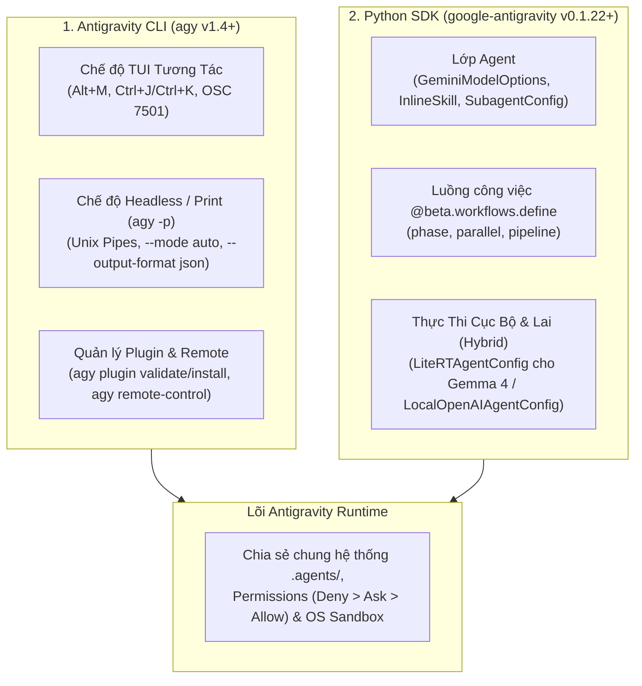

# Module 10: Antigravity CLI (`agy`) & Python SDK (`google-antigravity`)

[English](../../10-cli/README.md) | **Tiếng Việt**

> **Thời lượng**: 60 phút • **Độ khó**: Mọi cấp độ / Kỹ sư nền tảng • **Trắc nghiệm**: Chạy `/lesson-quiz 10` trong Antigravity

Module cuối cùng trong chương trình giúp bạn làm chủ hoàn toàn **Antigravity CLI (`agy` v1.4+)** — từ các phím tắt TUI tốc độ cao đến việc tích hợp chế độ headless (`agy -p`) vào đường ống CI/CD — đồng thời hướng dẫn cách xây dựng các ứng dụng đa tác nhân tùy chỉnh bằng **Google Antigravity Python SDK (`google-antigravity` v0.1.22+)** với `Agent`, `@beta.workflows.define` và chạy mô hình ngoại tuyến trên thiết bị qua `LiteRTAgentConfig`.

---

## 1. Kiến Trúc Thực Thi Của `agy` CLI & Python SDK



---

## 2. Làm Chủ Antigravity CLI (`agy`)

### 2.1. Bảng Cờ Tham Số Dòng Lệnh Quan Trọng Nhất

| Lệnh / Cờ CLI | Công Dụng & Ví Dụ Thực Tế |
| :--- | :--- |
| **`agy`** | Khởi động giao diện TUI tương tác trong thư mục hiện tại |
| **`agy -p "<prompt>"`** | Chạy chế độ **Print / Headless** không tương tác, in kết quả ra `stdout` rồi thoát (tự động đọc thêm dữ liệu từ `stdin` nếu được pipe vào) |
| **`--mode <mode>`** | Đặt chế độ vận hành: `manual` (hỏi quyền), `auto` (tự động với bộ phân loại an toàn), `plan` (chỉ lập kế hoạch) |
| **`--output-format <fmt>`** | Định dạng đầu ra cho chế độ `-p`: `text` (mặc định), `json` (đối tượng JSON có cấu trúc), hoặc `stream-json` |
| **`--model <name>`** | Chọn mô hình cụ thể: `gemini-4-argon`, `gemini-3.8-flash`, `gemini-3.1-pro` |
| **`--effort <level>`** | Đặt mức độ suy luận: `low`, `medium`, `high`, `max` |
| **`--sandbox`** | Bắt buộc kích hoạt OS Kernel Sandbox (Seatbelt / `nsjail` / `AppContainer`) cho mọi lệnh shell |
| **`-c` / `--continue`** | Tiếp tục ngay phiên hội thoại gần nhất trong workspace hiện tại |
| **`-r` / `--resume [id]`** | Mở danh sách chọn phiên cũ hoặc tiếp tục một phiên cụ thể theo ID/tên |

### 2.2. Các Phím Tắt TUI Tăng Tốc Độ Làm Việc Gấp Đôi

Khi đang làm việc trong giao diện TUI của `agy` hoặc Antigravity IDE:

| Phím Tắt | Tác Dụng |
| :--- | :--- |
| **`Alt+M`** (`alt+m`) | Chuyển đổi nhanh chế độ thực thi/hàng đợi tin nhắn (ví dụ: gửi tin nhắn mới vào hàng đợi **`Queue`** để agent làm xong bước hiện tại mới đọc, hoặc **`Immediate Interrupt`** để ngắt và chuyển hướng ngay lập tức) |
| **`Ctrl+J`** / **`Alt+J`** | Nhảy trực tiếp tới một subagent chạy nền đang tạm dừng chờ bạn phê duyệt quyền công cụ |
| **`Ctrl+K`** | Phê duyệt nhanh (Fast-path approve) yêu cầu công cụ của subagent đang chọn hoặc điều hướng nhanh |
| **`Shift+Tab`** | Chuyển đổi vòng tròn giữa các chế độ `Interactive` → `Plan` → `Auto` |
| **`Esc`** / **`Ctrl+C`** | Dừng ngay lập tức lượt sinh văn bản hoặc lệnh đang thực thi |

---

## 3. Tự Động Hóa Đường Ông CI/CD Với `agy -p` (Headless Mode)

Kết hợp `agy -p`, `--mode auto` và `--output-format json` giúp bạn biến Antigravity thành một bước kiểm tra thông minh trong GitHub Actions, GitLab CI hoặc Cloud Build:

```bash
# 1. Phân tích git diff và xuất báo cáo bảo mật dạng JSON trong CI
git diff origin/main...HEAD | agy -p \
  "Rà soát bản diff này để tìm lỗ hổng bảo mật OWASP Top 10. Trả về danh sách phát hiện." \
  --mode auto \
  --sandbox \
  --output-format json > security-audit.json

# 2. Phân tích log lỗi pytest và tự động đề xuất bản vá
pytest --tb=short 2>&1 | agy -p \
  "Phân tích nguyên nhân gốc rễ của các test bị lỗi và đề xuất cách sửa." \
  --model gemini-4-argon \
  --mode auto
```

---

## 4. Lập Trình Tác Nhân Với Python SDK (`google-antigravity`)

Cài đặt gói SDK chính thức:

```bash
pip install google-antigravity
```

### 4.1. Khởi Tạo `Agent` Với Kỹ Năng & Cấu Hình Mô Hình

```python
import asyncio
from google.antigravity import (
    Agent,
    GeminiModelOptions,
    InlineSkill,
    LocalAgentConfig,
    SubagentConfig,
)

async def main() -> None:
    # Định nghĩa một kỹ năng nội tuyến (ngoài các skill đã có trong .agents/skills/)
    sql_skill = InlineSkill(
        name="sql-index-advisor",
        description="Phân tích câu truy vấn SQL và đề xuất chỉ mục tối ưu.",
        instructions="Luôn kiểm tra kế hoạch thực thi EXPLAIN ANALYZE trước khi đề xuất tạo index.",
    )

    agent = Agent(
        model="gemini-4-argon",
        config=LocalAgentConfig(
            workspace_dir=".",
            sandbox=True,
        ),
        model_options=GeminiModelOptions(
            thinking_effort="high",
            max_output_tokens=16384,
        ),
        skills=[sql_skill],
        subagents=[
            SubagentConfig(name="research", model="gemini-3.8-flash"),
        ],
    )

    response = await agent.run("Kiểm tra các câu truy vấn trong src/repositories/ và đề xuất tối ưu chỉ mục.")
    print(response.text)

if __name__ == "__main__":
    asyncio.run(main())
```

---

### 4.2. Khai Báo Luồng Công Việc Đa Bước Với `@beta.workflows.define`

Trình trang trí `@beta.workflows.define` cho phép bạn kết hợp các bước kiểm tra Python tất định với các pha thực thi đa tác nhân (`phase`, `parallel`, `pipeline`):

```python
from google.antigravity import Agent, beta

reviewer = Agent(model="gemini-4-argon")
tester = Agent(model="gemini-3.8-flash")

@beta.workflows.define(name="automated-pr-gate")
async def automated_pr_gate(pr_diff: str) -> dict:
    # Chạy song song bước kiểm toán bảo mật và bước sinh kịch bản test
    security_report, test_plan = await beta.workflows.parallel(
        reviewer.run(f"Kiểm tra lỗ hổng bảo mật trong diff sau:\n{pr_diff}"),
        tester.run(f"Liệt kê các unit test cần bổ sung cho diff sau:\n{pr_diff}"),
    )

    return {
        "security_summary": security_report.text,
        "recommended_tests": test_plan.text,
    }
```

---

### 4.3. Thực Thi Ngoại Tuyến Trên Thiết Bị Với `LiteRTAgentConfig` (Gemma 4)

Khi bạn cần xây dựng công cụ phản hồi tức thì ngay trên máy trạm của lập trình viên mà không cần kết nối mạng (hoặc lọc dữ liệu nhạy cảm cục bộ trước khi gửi lên đám mây), hãy sử dụng `LiteRTAgentConfig`:

```python
from google.antigravity import Agent, LiteRTAgentConfig

local_agent = Agent(
    model="gemma-4-26b-it",
    config=LiteRTAgentConfig(
        model_path="/Users/dev/.gemini/models/gemma-4-26b-q4.litertlm",
        hardware_acceleration="metal",  # "metal" trên macOS Apple Silicon, "cuda"/"vulkan" trên Linux
        workspace_dir=".",
    ),
)

result = local_agent.run_sync("Tóm tắt nhanh cấu trúc các hàm trong file utils.py")
print(result.text)
```

---

## 5. Nguyên Tắc Nên & Không Nên (Do's & Don'ts)

| ✅ Nên Làm (Do's) | ❌ Không Nên Làm (Don'ts) |
| :--- | :--- |
| Luôn truyền `--mode auto` (hoặc cấu hình quyền không tương tác) và `--output-format json` khi gọi `agy -p` trong CI/CD | Gọi `agy` ở chế độ tương tác mặc định trong script GitHub Actions khiến job bị treo chờ nhập phím |
| Sử dụng `@beta.workflows.define` và `beta.workflows.parallel` khi điều phối nhiều `Agent` trong Python | Viết các vòng lặp gọi tuần tự chậm chạp cho các tác vụ phân tích hoàn toàn độc lập nhau |
| Kết hợp `LiteRTAgentConfig` (Gemma 4 cục bộ) cho các bước phân loại nhanh và `gemini-4-argon` cho bước suy luận kiến trúc sâu | Dùng mô hình lớn nhất cho mọi tác vụ phân loại văn bản đơn giản gây lãng phí thời gian và chi phí |

---

## Chúc Mừng Bạn Đã Hoàn Thành Chương Trình 10 Module!

- **Kiểm tra mức độ hiểu bài Module 10**: Chạy `/lesson-quiz 10` trong Antigravity App hoặc `agy` CLI.
- **Đánh giá tổng thể toàn chương trình**: Chạy `/self-assessment` để kiểm tra lại toàn bộ 10 module từ `01` đến `10`!
- **Quay lại**: ← [Module 09: Tính Năng Nâng Cao](../09-advanced-features/README.md) | [Trang Chủ Tiếng Việt](../README.md)
