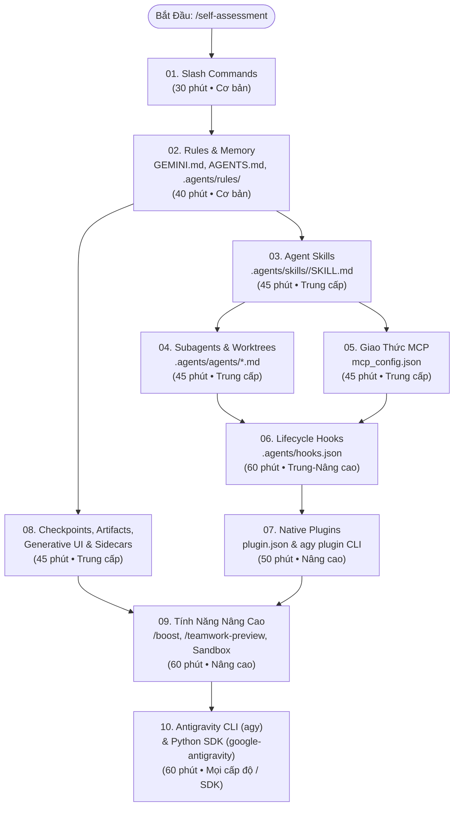

# Lộ Trình Học Tập: Làm Chủ Google Antigravity & Gemini

[English](../LEARNING-ROADMAP.md) | **Tiếng Việt**

Lộ trình này cung cấp hướng dẫn từng bước xuyên suốt 10 module của **gemini-howto**, đưa bạn từ lệnh slash đầu tiên đến việc điều phối các đội ngũ kỹ sư AI tự hành đa tác nhân và xây dựng luồng công việc tùy chỉnh bằng Python SDK.

> [!TIP]
> **Bạn muốn biết chính xác mình nên bắt đầu từ đâu?** Hãy mở repository này trong Antigravity App hoặc CLI (`agy`) và chạy lệnh `/self-assessment` để thực hiện bài kiểm tra chẩn đoán tương tác 10 câu hỏi!

---

## Sơ Đồ Phụ Thuộc Chương Trình Học

---

## Bốn Lộ Trình Học Theo Vai Trò Thực Tế

### Lộ Trình 1: Lập Trình Viên Hiệu Suất Hàng Ngày (~2 Giờ)
*Mục tiêu: Loại bỏ việc phải gõ lại prompt lặp đi lặp lại, lưu giữ quy chuẩn dự án tự động và khám phá code an toàn với checkpoints cùng Implementation Plans.*

1. **[Module 01: Slash Commands](01-slash-commands/README.md)** (30 phút)
   - Làm chủ `/plan`, `/grill-me`, `/btw`, `/diff`, `/compact`, `/context` và `/learn`.
   - Cài đặt các lệnh tùy chỉnh dựa trên skill đầu tiên (`/commit`, `/pr`, `/optimize`).
   - Kiểm tra kiến thức bằng `/lesson-quiz 01`.
2. **[Module 02: Rules & Memory](02-memory/README.md)** (40 phút)
   - Viết file `GEMINI.md` / `AGENTS.md` ở thư mục gốc nằm gọn trong ngân sách 20.000 token.
   - Tách các quy định chuyên biệt vào `.agents/rules/*.md` sử dụng `trigger: model_decision` và `trigger: glob`.
   - Dùng `/learn` để biến một góp ý sửa code thành quy tắc vĩnh viễn cho dự án.
   - Kiểm tra kiến thức bằng `/lesson-quiz 02`.
3. **[Module 08: Checkpoints, Artifacts & Sidecars](08-checkpoints/README.md)** (45 phút)
   - Thực hành `/rewind` (chỉ hoàn tác hội thoại hoặc hoàn tác cả file) và `/fork` để thử nghiệm song song.
   - Duyệt **Implementation Plan** artifact bằng bình luận trực tiếp trên từng dòng.
   - Hiển thị widget **Generative UI** `<agent-embed>` tự động thích ứng giao diện đầu tiên.
   - Kiểm tra kiến thức bằng `/lesson-quiz 08`.

---

### Lộ Trình 2: Kỹ Sư Tự Động Hóa Quy Trình & Chất Lượng (~3,5 Giờ)
*Mục tiêu: Chuẩn hóa quy trình làm việc của nhóm, ủy quyền công việc song song cho các subagent cô lập, kết nối cơ sở dữ liệu/API qua MCP và thiết lập cổng kiểm soát tất định bằng hooks.*

1. **[Module 03: Agent Skills](03-skills/README.md)** (45 phút)
   - Nắm vững cơ chế tiết lộ tăng dần 3 giai đoạn (danh mục `name`/`description` → nội dung `SKILL.md` → `scripts/` & `references/`).
   - Xây dựng các skill đa file (`code-review-specialist`, `doc-generator`) và quản lý trạng thái skill bằng `.agents/skills.json`.
   - Kiểm tra kiến thức bằng `/lesson-quiz 03`.
2. **[Module 04: Subagents](04-subagents/README.md)** (45 phút)
   - Sử dụng các subagent tích hợp sẵn: `research`, `browser` và `self`.
   - Tạo subagent tùy chỉnh trong `.agents/agents/*.md` với danh sách `tools` giới hạn và `commandExecutionPolicy: sandbox`.
   - Chạy nhiều subagent song song với `Workspace: "branch"` và `Workspace: "share"` để tránh xung đột chỉnh sửa file.
   - Kiểm tra kiến thức bằng `/lesson-quiz 04`.
3. **[Module 05: Giao Thức MCP (Model Context Protocol)](05-mcp/README.md)** (45 phút)
   - Cấu hình `~/.gemini/config/mcp_config.json` với các máy chủ Stdio và Streamable HTTP (nội suy biến `${VAR}` trong header).
   - Khóa chặt quyền thực thi công cụ bằng cú pháp `mcp(server/tool)` trong `Allow`, `Ask` và `Deny`.
   - Kiểm tra kiến thức bằng `/lesson-quiz 05`.
4. **[Module 06: Lifecycle Hooks](06-hooks/README.md)** (60 phút)
   - Cấu hình `.agents/hooks.json` cho cả 6 sự kiện: `SessionStart`, `PreToolUse`, `PostToolUse`, `PreInvocation`, `PostInvocation` và `Stop`.
   - Triển khai `security-scan.sh` (chặn lộ khóa bí mật ở `PreToolUse`), `format-code.sh` (tự động format ở `PostToolUse`) và `goal-gate.sh` (ép chạy test ở `Stop`).
   - Kiểm tra kiến thức bằng `/lesson-quiz 06`.

---

### Lộ Trình 3: Kiến Trúc Sư Hệ Thống Tự Hành & Bảo Mật (~3 Giờ)
*Mục tiêu: Đóng gói các bộ công cụ chuẩn của tổ chức thành plugin, khai thác sức mạnh đa tác nhân `/boost` và `/teamwork-preview`, đồng thời siết chặt bảo mật sandbox cấp hệ điều hành.*

1. **[Module 07: Native Plugins](07-plugins/README.md)** (50 phút)
   - Đóng gói skills, subagents, rules, `hooks.json` gốc, `mcp_config.json` gốc và `sidecars/` vào gói `plugin.json`.
   - Kiểm định cấu trúc bằng `agy plugin validate --strict` và quản lý qua `/plugin`.
   - Kiểm tra kiến thức bằng `/lesson-quiz 07`.
2. **[Module 09: Tính Năng Nâng Cao](09-advanced-features/README.md)** (60 phút)
   - Sử dụng `/boost` (khám phá giải pháp 3 giai đoạn với `DeepCoder`/`DeepInvestigator` trên worktree riêng) cho các bài toán thuật toán và lỗi khó.
   - Sử dụng `/teamwork-preview` (đội ngũ kỹ sư tự hành 2 giai đoạn với `Sentinel`, `Critic`, `Challenger` và `Auditor`) cho dự án mới hoặc tái cấu trúc lớn.
   - Cấu hình thứ tự ưu tiên quyền `Deny > Ask > Allow`, sandbox nhân hệ điều hành (Seatbelt / `nsjail` / `AppContainer`) và `agy remote-control`.
   - Kiểm tra kiến thức bằng `/lesson-quiz 09`.
3. **[Module 08 (Phần 4): Sidecars & Tự Động Hóa Theo Lịch](08-checkpoints/README.md)** (30 phút)
   - Cấu hình daemon nền `sidecar.json` và lịch định kỳ `CRON_TZ` với `access_grants` được giới hạn chặt chẽ.

---

### Lộ Trình 4: Chuyên Gia CLI & Kỹ Sư Python SDK (~2 Giờ)
*Mục tiêu: Tự động hóa đường ống CI/CD bằng `agy -p` headless và xây dựng các ứng dụng đa tác nhân tùy chỉnh bằng Python với `google-antigravity`.*

1. **[Module 10 (Phần 1): Antigravity CLI (`agy` v1.4.0)](10-cli/README.md)** (45 phút)
   - Thành thạo thao tác TUI (`alt+m` chuyển chế độ hàng đợi, `Ctrl+J`/`Ctrl+K` duyệt quyền subagent, chế độ Vim, trạng thái tab OSC 7501).
   - Xây dựng đường ống Unix không tương tác (`git diff | agy -p "..." --mode auto --output-format json`).
2. **[Module 10 (Phần 2): Python SDK (`google-antigravity` v0.1.22)](10-cli/README.md)** (45 phút)
   - Khởi tạo tác nhân bằng code Python với `Agent`, `GeminiModelOptions`, `InlineSkill` và `SubagentConfig`.
   - Kết hợp luồng xử lý tất định và tác nhân AI bằng `@beta.workflows.define` (`phase`, `parallel`, `pipeline`).
   - Chạy mô hình cục bộ ngoại tuyến (Gemma 4 26B qua `LiteRTAgentConfig` hoặc Ollama qua `LocalOpenAIAgentConfig`).
   - Kiểm tra kiến thức bằng `/lesson-quiz 10`.

---

## Danh Sách Kiểm Tra Mức Độ Thành Thạo

Đánh dấu tiến độ của bạn khi hoàn thành từng module:

- [ ] **01 — Slash Commands**: Đã tạo một skill tùy chỉnh tại `.agents/skills/<name>/SKILL.md` và gọi thành công bằng `/<name>`.
- [ ] **02 — Rules & Memory**: Đã cấu hình `GEMINI.md` và ít nhất một file `.agents/rules/*.md` với `trigger: model_decision` hoặc `trigger: glob`.
- [ ] **03 — Agent Skills**: Đã xây dựng một skill đa file có script hỗ trợ trong `scripts/` và kiểm tra mức tiêu thụ token qua `/context`.
- [ ] **04 — Subagents**: Đã khởi chạy các subagent song song với `Workspace: "branch"` hoặc `"share"` và theo dõi qua `/agents`.
- [ ] **05 — MCP**: Đã kết nối một MCP server trong `~/.gemini/config/mcp_config.json` và phân quyền `mcp(server/tool)`.
- [ ] **06 — Hooks**: Đã cấu hình `.agents/hooks.json` với một chốt chặn an toàn `PreToolUse` và cổng kiểm định `Stop`.
- [ ] **07 — Plugins**: Đã kiểm định một gói plugin bằng lệnh `agy plugin validate --strict`.
- [ ] **08 — Checkpoints, Artifacts & Sidecars**: Đã để lại bình luận trực tiếp trên Implementation Plan, nhúng widget `<agent-embed>` và đặt lịch bằng `/schedule`.
- [ ] **09 — Tính Năng Nâng Cao**: Đã chạy `/boost` hoặc `/teamwork-preview` trên một tác vụ phức tạp và rà soát bộ quy tắc `Deny > Ask > Allow`.
- [ ] **10 — CLI & Python SDK**: Đã thực thi lệnh `agy -p` ở chế độ headless và chạy thử một kịch bản `@beta.workflows.define` với `google-antigravity`.
