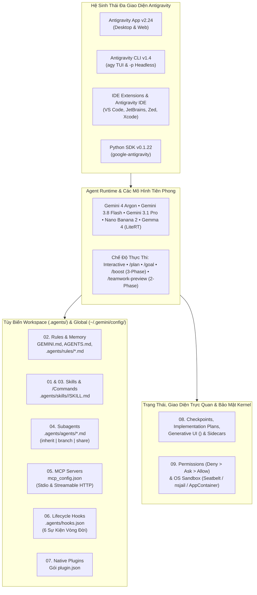

<div align="center">

<picture>
  <source media="(prefers-color-scheme: dark)" srcset="../resources/logos/gemini-howto-logo-dark.svg">
  <source media="(prefers-color-scheme: light)" srcset="../resources/logos/gemini-howto-logo.svg">
  
</picture>

# Hướng Dẫn Thực Chiến Google Antigravity & Gemini

**Chương trình học trực quan, thực tế từ các câu lệnh hàng ngày đến điều phối đa tác nhân `/boost` & `/teamwork-preview`, Generative UI artifacts, hooks bảo mật cấp hệ điều hành, native plugins và Python SDK.**

[](https://antigravity.google/docs/changelog)
[](https://antigravity.google/docs/cli/reference)
[](10-cli/README.md)
[](09-advanced-features/README.md)
[](../LICENSE)

[English](../README.md) | **Tiếng Việt**

[Bắt Đầu Nhanh](#-bắt-đầu-nhanh-trong-5-phút) • [Lộ Trình Học Tập](LEARNING-ROADMAP.md) • [Tham Khảo Nhanh](QUICK_REFERENCE.md) • [Danh Mục Template](CATALOG.md) • [Cẩm Nang Kiến Trúc](gemini_concepts_guide.md) • [Mục Lục Tra Cứu](INDEX.md)

</div>

---

## Tại Sao Repository Này Ra Đời?

Phần lớn lập trình viên chỉ mới khai thác một phần rất nhỏ sức mạnh của **Google Antigravity** và **Gemini** — chủ yếu gõ các câu hỏi tự do trong khung chat mà bỏ lỡ hệ thống tùy biến (customizations) và các bộ máy điều phối tự hành (autonomous orchestration) biến Antigravity thành một nền tảng kỹ thuật có thể lập trình được:

- **Rules & Memory Tiết Lộ Tăng Dần (Progressive Disclosure)** (`GEMINI.md`, `AGENTS.md`, `.agents/rules/*.md` với 4 chế độ kích hoạt `always_on`, `model_decision`, `glob` và `manual` nằm gọn trong ngân sách 20.000 token)
- **Agent Skills Chế Độ Kép** (`.agents/skills/<name>/SKILL.md` hoạt động đồng thời như lệnh tắt `/<name>` và khả năng tự động kích hoạt theo ngữ nghĩa)
- **Subagents Cô Lập Worktree** (`research`, `browser`, `self` và các tác nhân con tùy chỉnh trong `.agents/agents/*.md` chạy song song trên các không gian làm việc `inherit`, `branch` hoặc `share`)
- **Lifecycle Hooks Tất Định** (`.agents/hooks.json` đón chặn 6 sự kiện vòng đời: `SessionStart`, `PreToolUse`, `PostToolUse`, `PreInvocation`, `PostInvocation` và `Stop`)
- **Artifacts Phong Phú, Generative UI & Sidecars** (Implementation Plans hỗ trợ bình luận trực tiếp theo dòng, widget HTML `<agent-embed>` tự động thích ứng giao diện sáng/tối và các tác vụ nền `sidecar.json`)
- **Chế Độ Đa Tác Nhân Tiên Phong** (`/boost` suy luận sâu 3 giai đoạn, `/teamwork-preview` đội ngũ kỹ sư AI tự hành với các cổng phản biện `Critic`/`Challenger`/`Auditor` và `/goal`)

Mỗi module trong kho lưu trữ này đều đi kèm **sơ đồ kiến trúc Mermaid**, **template mẫu sẵn sàng sử dụng ngay trong dự án thực tế**, **nguyên tắc Nên & Không Nên (Do's & Don'ts)** cùng **bài trắc nghiệm tương tác**.

---

## Tự Đánh Giá & Trắc Nghiệm Tương Tác (Tích Hợp Sẵn!)

Khi bạn mở repository này trong **Antigravity App** hoặc **Antigravity CLI (`agy`)**, hai kỹ năng tương tác trong `.agents/skills/` sẽ tự động sẵn sàng:

```text
/self-assessment        # Làm bài chẩn đoán 10 câu hỏi để nhận lộ trình học tập cá nhân hóa
/lesson-quiz 01         # Kiểm tra mức độ thành thạo của bất kỳ module nào (01 đến 10) với 5 câu hỏi tình huống
```

> [!TIP]
> Cả hai kỹ năng đều sử dụng hộp thoại tương tác gốc `ask_question` của Antigravity — hiển thị các lựa chọn trắc nghiệm trực quan và giải thích kiến trúc chi tiết ngay sau khi hoàn thành.

---

## Tổng Quan Kiến Trúc Hệ Sinh Thái



---

## Chương Trình 10 Module Học Tập

| Module | Chủ Đề | Độ Khó | Thời Lượng | Nội Dung Xây Dựng & Làm Chủ |
| :--- | :--- | :---: | :---: | :--- |
| **[01. Slash Commands](01-slash-commands/README.md)** | Lệnh tích hợp sẵn & `/commands` tùy chỉnh | Cơ bản | 30 phút | Làm chủ hơn 35 lệnh tích hợp sẵn (`/boost`, `/teamwork-preview`, `/goal`, `/plan`, `/grill-me`, `/learn`, `/btw`) và tạo 8 lệnh slash tùy chỉnh dựa trên skill (`/optimize`, `/pr`, `/commit`...). |
| **[02. Rules & Memory](02-memory/README.md)** | `GEMINI.md`, `AGENTS.md`, `.agents/rules/` | Cơ bản | 40 phút | Cấu hình `GEMINI.md`/`AGENTS.md` phân cấp, quy tắc mô-đun hóa với 4 cơ chế kích hoạt (`always_on`, `model_decision`, `glob`, `manual`), nhúng file `@[label](path)`, ngân sách 20k token, `.agents/rules.json` và `/learn`. |
| **[03. Agent Skills](03-skills/README.md)** | `.agents/skills/<name>/SKILL.md` | Trung cấp | 45 phút | Xây dựng Open Agent Skills đa file với cơ chế tiết lộ tăng dần 3 giai đoạn (3-stage progressive disclosure), đóng gói kèm `scripts/`, `references/` và 6 bộ skill thực tế. |
| **[04. Subagents](04-subagents/README.md)** | `.agents/agents/*.md` & Worktrees | Trung cấp | 45 phút | Điều phối `research`, `browser`, `self` và 9 subagent chuyên gia tùy chỉnh trên các workspace cô lập (`inherit`, `branch`, `share`) cùng cơ chế đánh thức phản ứng (`send_message`). |
| **[05. Giao Thức MCP](05-mcp/README.md)** | `mcp_config.json` (Stdio & HTTP) | Trung cấp | 45 phút | Kết nối GitHub, PostgreSQL, Sentry và filesystem MCP server qua Stdio và Streamable HTTP (nội suy biến môi trường `${VAR}`), phân quyền `mcp(server/tool)` và sửa lỗi nhanh bằng **Fix with Agent**. |
| **[06. Lifecycle Hooks](06-hooks/README.md)** | `.agents/hooks.json` (6 Sự Kiện) | Trung–Nâng cao | 60 phút | Đón chặn `SessionStart`, `PreToolUse`, `PostToolUse`, `PreInvocation`, `PostInvocation` và `Stop` bằng hợp đồng JSON camelCase để chặn lộ khóa bí mật, tự động format code và kiểm tra test trước khi kết thúc. |
| **[07. Native Plugins](07-plugins/README.md)** | `plugin.json` & `agy plugin` CLI | Nâng cao | 50 phút | Đóng gói skills, subagents, rules, `hooks.json`, `mcp_config.json` và sidecars thành các plugin dễ phân phối (`pr-review`, `devops-automation`, `documentation`) và kiểm định bằng `agy plugin validate`. |
| **[08. Checkpoints, Artifacts & Sidecars](08-checkpoints/README.md)** | `/rewind`, `/fork`, Generative UI, `sidecar.json` | Trung cấp | 45 phút | Quay lui trạng thái code/hội thoại, duyệt Implementation Plan bằng bình luận theo dòng, dựng widget HTML `<agent-embed>` và chạy daemon `sidecar.json` cùng lịch hẹn `CRON_TZ`. |
| **[09. Tính Năng Nâng Cao](09-advanced-features/README.md)** | `/boost`, `/teamwork-preview`, Permissions, Sandbox | Nâng cao | 60 phút | Triển khai `/boost` 3 giai đoạn và đội ngũ `/teamwork-preview` 2 giai đoạn, tối ưu Gemini 4 Argon, thiết lập quyền `Deny > Ask > Allow`, ép buộc sandbox cấp nhân HĐH và điều khiển từ xa qua `agy remote-control`. |
| **[10. CLI & Python SDK](10-cli/README.md)** | `agy` v1.4 & `google-antigravity` v0.1.22 | Mọi cấp độ | 60 phút | Làm chủ phím tắt TUI của `agy` (`alt+m`, `Ctrl+J`/`Ctrl+K`), chạy chế độ headless `-p` trong CI/CD và lập trình tác nhân bằng Python (`Agent`, `@beta.workflows.define`, `LiteRTAgentConfig` cho Gemma 4 cục bộ). |

---

## Bạn Chuyển Từ Claude Code Sang? Bảng Chuyển Đổi Nhanh

Nếu bạn từng sử dụng Claude Code (`claude-howto`), bảng dưới đây giúp bạn ánh xạ mọi khái niệm sang **Google Antigravity & Gemini**:

| Khả Năng | Claude Code | Google Antigravity & Gemini | Nâng Cấp Đáng Giá Trong Antigravity |
| :--- | :--- | :--- | :--- |
| **CLI Binary** | `claude` | `agy` (`~/.local/bin/agy`) | TUI Alt-Screen/Inline mượt mà, chuyển chế độ hàng đợi bằng `alt+m`, nhảy nhanh đến subagent bằng `Ctrl+J` |
| **Bộ Nhớ Workspace** | `CLAUDE.md`, `.claude/rules/` | `GEMINI.md`, `AGENTS.md`, `.agents/rules/*.md` | 4 cơ chế kích hoạt tường minh (`always_on`, `model_decision`, `glob`, `manual`), nhúng `@[label](path)`, quản lý bằng `.agents/rules.json`, lệnh `/learn` |
| **Lệnh Slash Tùy Chỉnh** | `.claude/commands/*.md` | `.agents/skills/<name>/SKILL.md` | Mô hình hợp nhất: mỗi Skill vừa là lệnh `/<name>` vừa tự động được kích hoạt theo ngữ nghĩa |
| **Cô Lập Subagent** | `.claude/agents/*.md` | `.agents/agents/*.md` + `invoke_subagent` | Tùy chọn `Workspace: "inherit" \| "branch" \| "share"` cho từng lần gọi, tạo động bằng `define_subagent`, đánh thức phản ứng không cần polling |
| **Cấu Hình Hooks** | `settings.json` (khóa `hooks`) | `.agents/hooks.json` & `~/.gemini/config/hooks.json` | File `hooks.json` chuyên biệt với 6 sự kiện vòng đời, cho phép ghi đè tham số công cụ (`overwrite`) và tiêm bước tiếp theo (`injectSteps`) |
| **Plugins** | `.claude-plugin/plugin.json` | `<plugin-root>/plugin.json` | Đóng gói trọn bộ `skills/`, `agents/`, `rules/`, `hooks.json` gốc, `mcp_config.json` gốc và `sidecars/` + công cụ `agy plugin validate --strict` |
| **Đầu Ra Trực Quan & Kế Hoạch** | Markdown trên Terminal | **Artifacts & Generative UI** | Implementation Plans hỗ trợ bình luận từng dòng, xuất PDF và nhúng trực tiếp widget tương tác HTML/Tailwind `<agent-embed>` |
| **Tác Vụ Nền & Lịch Định Kỳ** | `/loop` hoặc OS crontab | **Sidecars (`sidecar.json`) & `/schedule`** | Quản lý tiến trình daemon nền, bảng điều khiển `sidecar://` và lịch định kỳ hỗ trợ múi giờ `CRON_TZ` |
| **Chế Độ Đa Tác Nhân Sâu** | Subagent thủ công | `/boost`, `/teamwork-preview`, `/goal` | Khám phá đa giả thuyết trên worktree độc lập 3 giai đoạn (`/boost`) và đội ngũ kỹ sư tự hành 2 giai đoạn với cổng kiểm định đối kháng (`/teamwork-preview`) |
| **SDK Lập Trình** | Agent SDK | `google-antigravity` Python SDK | Hỗ trợ Gemini 4 Argon, khai báo luồng công việc `@beta.workflows.define` và chạy Gemma 4 ngoại tuyến trên thiết bị qua `LiteRTAgentConfig` |

---

## Bắt Đầu Nhanh Trong 5 Phút

### 1. Cài Đặt Antigravity CLI (`agy`) & Python SDK

```bash
# macOS / Linux — Cài đặt Antigravity CLI (v1.4.0+)
curl -fsSL https://antigravity.google/cli/install.sh | bash

# Windows (PowerShell)
irm https://antigravity.google/cli/install.ps1 | iex

# Tùy chọn: Cài đặt Google Antigravity Python SDK (v0.1.22+)
pip install google-antigravity
```

### 2. Clone Repository Này & Chạy Bài Chẩn Đoán Năng Lực

```bash
git clone https://github.com/minhxuvi/gemini-howto.git
cd gemini-howto

# Khởi động Antigravity CLI ngay trong thư mục dự án
agy
```

Tại dấu nhắc của Antigravity (App hoặc CLI), hãy gõ:

```text
/self-assessment
```

### 3. Sao Chép Các Template Thực Chiến Đầu Tiên Vào Dự Án Của Bạn

```bash
# 1. Sao chép GEMINI.md & các quy tắc mô-đun vào dự án của bạn
cp ../02-memory/project-GEMINI.md /path/to/your-project/GEMINI.md
mkdir -p /path/to/your-project/.agents/rules
cp ../02-memory/rules/*.md /path/to/your-project/.agents/rules/

# 2. Thêm lệnh slash /optimize dựa trên skill
mkdir -p /path/to/your-project/.agents/skills/optimize
cp ../01-slash-commands/optimize.md /path/to/your-project/.agents/skills/optimize/SKILL.md

# 3. Thêm subagent kiểm tra bảo mật chỉ đọc (secure-reviewer)
mkdir -p /path/to/your-project/.agents/agents
cp ../04-subagents/secure-reviewer.md /path/to/your-project/.agents/agents/

# 4. Bật lifecycle hooks quét khóa bí mật & tự động format code
cp ../06-hooks/hooks.json /path/to/your-project/.agents/hooks.json
mkdir -p /path/to/your-project/.agents/hooks
cp ../06-hooks/*.sh ../06-hooks/*.py /path/to/your-project/.agents/hooks/
chmod +x /path/to/your-project/.agents/hooks/*.sh /path/to/your-project/.agents/hooks/*.py
```

---

## Chọn Lộ Trình Học Phù Hợp Với Vai Trò Của Bạn

Bạn chưa rõ nên bắt đầu từ đâu? Hãy chọn nhánh học tập phù hợp với vai trò của mình, hoặc xem toàn bộ **[Lộ Trình Học Tập Chi Tiết](LEARNING-ROADMAP.md)**:

1. **Nhánh A — Lập Trình Viên Hiệu Suất Hàng Ngày (~2 giờ)**:
   - [Module 01: Slash Commands](01-slash-commands/README.md) → [Module 02: Rules & Memory](02-memory/README.md) → [Module 08: Checkpoints, Artifacts & Sidecars](08-checkpoints/README.md)
2. **Nhánh B — Kỹ Sư Tự Động Hóa Quy Trình Nhóm (~3,5 giờ)**:
   - [Module 03: Agent Skills](03-skills/README.md) → [Module 04: Subagents](04-subagents/README.md) → [Module 05: MCP](05-mcp/README.md) → [Module 06: Lifecycle Hooks](06-hooks/README.md)
3. **Nhánh C — Kiến Trúc Sư Hệ Thống & Nền Tảng (~4 giờ)**:
   - [Module 07: Native Plugins](07-plugins/README.md) → [Module 09: Tính Năng Nâng Cao (`/boost`, `/teamwork-preview`, Sandbox)](09-advanced-features/README.md) → [Module 10: CLI & Python SDK](10-cli/README.md)

---

## Tài Liệu Tham Chiếu Nhanh Trong Repository

- **[`LEARNING-ROADMAP.md`](LEARNING-ROADMAP.md)** — Sơ đồ phụ thuộc trực quan, ước tính thời gian và danh sách kiểm tra từng cột mốc.
- **[`QUICK_REFERENCE.md`](QUICK_REFERENCE.md)** — Bảng tra cứu 1 trang cho mọi lệnh slash, trường frontmatter, schema JSON của hook, quy tắc phân quyền và cờ CLI.
- **[`CATALOG.md`](CATALOG.md)** — Duyệt và sao chép hơn 50 template mẫu sẵn sàng sử dụng từ Module 01 đến 10.
- **[`gemini_concepts_guide.md`](gemini_concepts_guide.md)** — Cẩm nang kiến trúc chuyên sâu: cách Antigravity quản lý cửa sổ ngữ cảnh, khi nào chọn Rule vs Skill vs Subagent vs Hook vs Plugin, và cách `/boost` cùng `/teamwork-preview` điều phối kiểm thử đa tác nhân.
- **[`INDEX.md`](INDEX.md)** — Mục lục tra cứu theo bảng chữ cái A-Z và theo tình huống thực tế (*"Làm sao chặn `git push --force`?"*, *"Làm sao chạy Gemma 4 ngoại tuyến?"*).

---

## Giấy Phép

Phân phối theo giấy phép [MIT License](../LICENSE).
