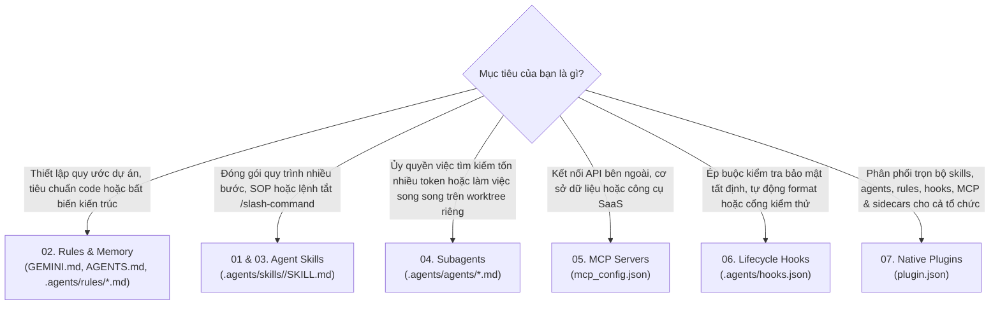
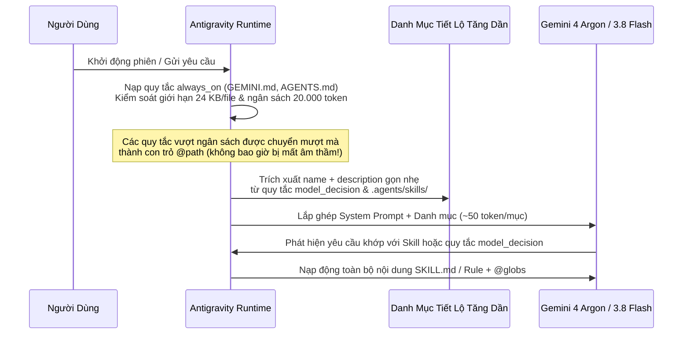
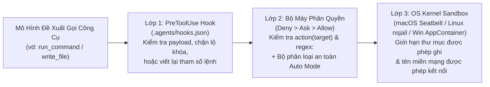

# Google Antigravity & Gemini: Cẩm Nang Kiến Trúc & Khái Niệm Cốt Lõi

[English](../gemini_concepts_guide.md) | **Tiếng Việt**

Cẩm nang này giải thích các mô hình tư duy kiến trúc đằng sau **Google Antigravity** và **Gemini** — cách các tầng tùy biến phối hợp với nhau, cách cửa sổ ngữ cảnh (context window) được quản lý bên dưới hệ thống, và cách chọn đúng công cụ cho từng bài toán kỹ thuật.

---

## 1. Sáu Thành Phần Tùy Biến Cốt Lõi: Khi Nào Dùng Gì?

Antigravity cung cấp 6 thành phần tùy biến có thể kết hợp linh hoạt. Việc chọn đúng thành phần giúp cửa sổ ngữ cảnh luôn gọn nhẹ, ranh giới bảo mật tất định và quy trình làm việc dễ dàng tái sử dụng:

### Ma Trận So Sánh Kiến Trúc

| Thành Phần | Vị Trí Cấu Hình | Cơ Chế Kích Hoạt | Chi Phí Token Ngữ Cảnh | Môi Trường Thực Thi | Phù Hợp Nhất Cho |
| :--- | :--- | :--- | :--- | :--- | :--- |
| **Rules & Memory** | `GEMINI.md`, `AGENTS.md`, `.agents/rules/*.md` | `always_on`, `model_decision`, `glob` hoặc `manual` (`@`) | **Ngay từ đầu** (`always_on` giới hạn trong ngân sách 20k) hoặc **Theo yêu cầu** (`model_decision`/`glob`) | Tiêm trực tiếp vào system prompt | Quy chuẩn code, ràng buộc công nghệ, checklist PR |
| **Agent Skills** | `.agents/skills/<name>/SKILL.md` | **Chế độ kép**: Gõ lệnh `/<name>` HOẶC tự động khớp theo ngữ nghĩa | **~50–100 token** trong danh mục; chỉ nạp toàn bộ `SKILL.md` khi kích hoạt | Tác nhân chính (kèm thực thi `scripts/` nếu có) | Quy trình chuẩn hóa lặp lại (`/commit`, `/optimize`, sinh tài liệu API) |
| **Subagents** | `.agents/agents/<name>.md` | Công cụ `invoke_subagent` hoặc `/browser` | **Bằng 0** ở tác nhân chính cho đến khi nhận bản tóm tắt kết quả | **Cửa sổ ngữ cảnh cô lập** + tùy chọn Git worktree `branch`/`share` | Nghiên cứu sâu codebase, lập trình song song nhiều hướng, kiểm toán bảo mật |
| **MCP Servers** | `~/.gemini/config/mcp_config.json` | Mô hình gọi công cụ `mcp_<server>_<tool>` | Nạp schema công cụ theo từng server đang bật | Tiến trình con Stdio cục bộ hoặc Streamable HTTP từ xa | Truy vấn PostgreSQL, GitHub PR, Sentry, Jira, tài liệu nội bộ |
| **Lifecycle Hooks** | `.agents/hooks.json` | Sự kiện runtime tất định (`PreToolUse`, `PostToolUse`, `Stop`...) | **Bằng 0** (trừ khi tiêm bước mới qua `injectSteps`) | Tiến trình shell/Python bên ngoài giao tiếp qua JSON stdin/stdout | Chặn khóa bí mật bị hardcode, tự chạy `prettier`/`ruff`, bắt buộc vượt qua bộ test |
| **Sidecars & Automations** | `~/.gemini/config/sidecars/<id>/sidecar.json` | Khởi chạy daemon nền hoặc theo lịch `CRON_TZ` (`/schedule`) | **Bằng 0** trong phiên chat tương tác; chạy trong tiến trình/phiên riêng | Daemon bền bỉ hoặc phiên headless theo lịch | Bảng điều khiển 3D/dữ liệu tương tác (`sidecar://`), báo cáo tổng hợp CI hàng ngày |

---

## 2. Cách Antigravity Quản Lý Cửa Sổ Ngữ Cảnh (Context Window)

Một sai lầm phổ biến khi làm việc với tác nhân AI là nhồi nhét hàng ngàn dòng tài liệu vào một file chỉ dẫn gốc duy nhất, khiến mô hình bị thiếu hụt bộ nhớ làm việc cho mã nguồn và kết quả công cụ. Antigravity giải quyết triệt để vấn đề này bằng kiến trúc **Tiết Lộ Tăng Dần (Progressive Disclosure)** và **Ngân Sách Token (Token Budget)** nghiêm ngặt:

### Ba Nguyên Tắc Giữ Ngữ Cảnh Luôn Tinh Gọn
1. **Giữ `GEMINI.md` / `AGENTS.md` Gốc Dưới 2.000 Token**: Chỉ đặt các lệnh build/test phổ quát, sơ đồ thư mục và các nguyên tắc bất biến cốt lõi ở file gốc.
2. **Dùng `trigger: model_decision` và `trigger: glob` Cho Quy Tắc Chuyên Ngành**: Các quy tắc migration cơ sở dữ liệu (`trigger: model_decision`) hay quy ước Protobuf (`trigger: glob`, `globs: "**/*.proto"`) hầu như không tốn token nào cho đến khi agent thực sự làm việc với các thành phần đó.
3. **Ủy Quyền Việc Khám Phá Nhiều Nhiễu Cho Subagents**: Việc tìm kiếm trên 50 file bằng grep và đọc 10.000 dòng log ngay trong tác nhân chính sẽ làm phình lịch sử hội thoại vĩnh viễn. Khi giao nhiệm vụ đó cho subagent `research`, toàn bộ các bước đọc file trung gian được cô lập trong ngữ cảnh riêng của subagent và chỉ trả về bản tổng hợp gọn gàng khoảng 300 token.

---

## 3. Các Bộ Máy Thực Thi Đa Tác Nhân: Interactive vs `/goal` vs `/boost` vs `/teamwork-preview`

Antigravity cung cấp 4 chế độ điều phối tùy theo độ phức tạp của bài toán:

| Chế Độ | Lệnh Kích Hoạt | Kiến Trúc Hoạt Động | Khi Nào Nên Chọn |
| :--- | :--- | :--- | :--- |
| **Tương Tác Chuẩn / Lập Kế Hoạch** | Mặc định hoặc `/plan` | Một tác nhân chính (có thể gọi subagent `research`/`self`) + duyệt artifact **Implementation Plan** | Sửa lỗi hàng ngày, làm tính năng đơn lẻ, lập trình cặp tương tác |
| **Vòng Lặp Mục Tiêu Tự Hành** | `/goal <mục tiêu>` | Tác nhân chính duy trì vòng lặp tự kiểm chứng liên tục cho đến khi thỏa mãn mọi tiêu chí hoàn thành | Nâng cấp thư viện diện rộng, mở rộng độ phủ test, dọn dẹp lỗi lint/typecheck toàn repo |
| **Boost Mode (3 Giai Đoạn)** | `/boost <nhiệm vụ>` | **Giai đoạn 1**: `Orchestrator` phân rã bài toán & khung kiểm thử **Giai đoạn 2**: Các subagent `DeepCoder` & `DeepInvestigator` chạy song song trên Git worktree riêng **Giai đoạn 3**: Kiểm thử đa vòng & tổng hợp kết quả tối ưu | Lỗi thuật toán hóc búa, race condition, tối ưu hiệu năng sâu, so sánh các thiết kế kiến trúc cạnh tranh |
| **Teamwork Mode (2 Giai Đoạn)** | `/teamwork-preview <nhiệm vụ>` | **Giai đoạn 1**: Phỏng vấn xác định phạm vi (`Scoping Interview`) **Giai đoạn 2**: Đội ngũ tự hành (`Sentinel`, `Orchestrator`, `Explorers`, `Workers`) + 4 tầng cổng phản biện (`Critic`, `Challenger`, `Auditor`, `Success Auditor`) | Xây dựng phân hệ lớn mới từ đầu, tái cấu trúc liên dịch vụ đòi hỏi kiểm định chất lượng đối kháng nghiêm ngặt |

---

## 4. Kiến Trúc Bảo Mật Đa Tầng (Defense-in-Depth)

Antigravity kết hợp 3 lớp bảo vệ độc lập để các tác nhân AI có thể vận hành tốc độ cao mà không gây rủi ro cho máy trạm hay hạ tầng production:

1. **Lớp 1 — `PreToolUse` Hooks Tất Định (`.agents/hooks.json`)**: Thực thi logic kiểm soát riêng của dự án (ví dụ: quét nội dung `write_to_file` để tìm khóa AWS bị lộ hoặc tự động gắn thêm cờ an toàn qua trường `overwrite`).
2. **Lớp 2 — Bộ Máy Phân Quyền Chi Tiết (`Deny > Ask > Allow`)**: Đánh giá các đối tượng `read_file`, `write_file`, `command`, `unsandboxed`, `read_url`, `execute_url` và `mcp`. Quy tắc `Deny` luôn có quyền phủ quyết cao nhất.
3. **Lớp 3 — Sandbox Cấp Nhân Hệ Điều Hành (OS Kernel Sandbox)**: Ngay cả sau khi lệnh `command(...)` được phép chạy, nhân hệ điều hành (Seatbelt trên macOS, `nsjail` trên Linux, `AppContainer` trên Windows) vẫn khóa chặt tiến trình con để chỉ được phép ghi vào đúng các đường dẫn `write_file(...)` và chỉ kết nối tới các tên miền trong `read_url(...)`.

---

## 5. Đầu Ra Trực Quan Phong Phú: Artifacts, Generative UI & Sidecars

Khác với các công cụ chỉ hiển thị văn bản thuần trên terminal, Antigravity xem giao diện trực quan tương tác là công dân hạng nhất:

- **Implementation Plans (`<appDataDir>/brain/<conversation-id>/`)**: Trước khi sửa code cho một tác vụ phức tạp, agent tạo artifact kế hoạch triển khai có cấu trúc. Bạn có thể bôi đen từng dòng để **bình luận trực tiếp (inline review comments)** và nhấn **Proceed** (hoặc xuất ra PDF).
- **Generative UI (`<agent-embed>`)**: Agent có thể sinh các widget HTML/Tailwind tự chứa (bảng tính chi phí, biểu đồ hiệu năng, trình khám phá schema, mô phỏng máy trạng thái) sử dụng các biến CSS ngữ nghĩa của Antigravity (`var(--card)`, `var(--foreground)`, `var(--primary)`) và nhúng trực tiếp vào luồng chat hoặc bảng điều khiển bên cạnh.
- **Interactive Sidecars (`sidecar://`)**: Các plugin chuyên biệt (chẳng hạn như Biomolecular Structure Viewer 3D hoặc bảng giám sát dịch vụ trực tiếp) chạy như các tiến trình sidecar được quản lý và hiển thị nút liên kết `[Open Viewer](sidecar://...)` để mở ngay với một cú nhấp chuột.
